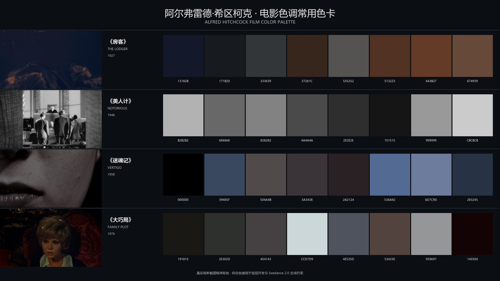
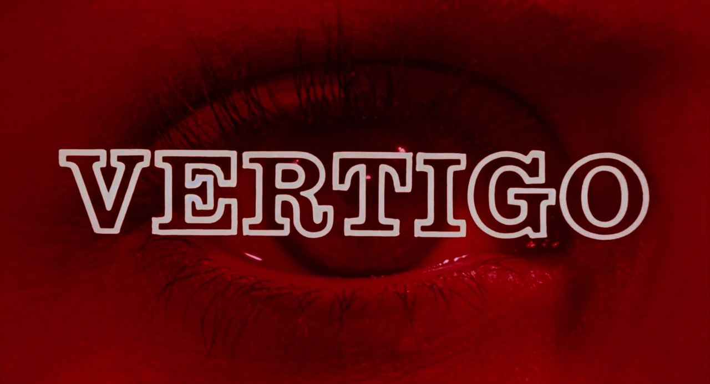
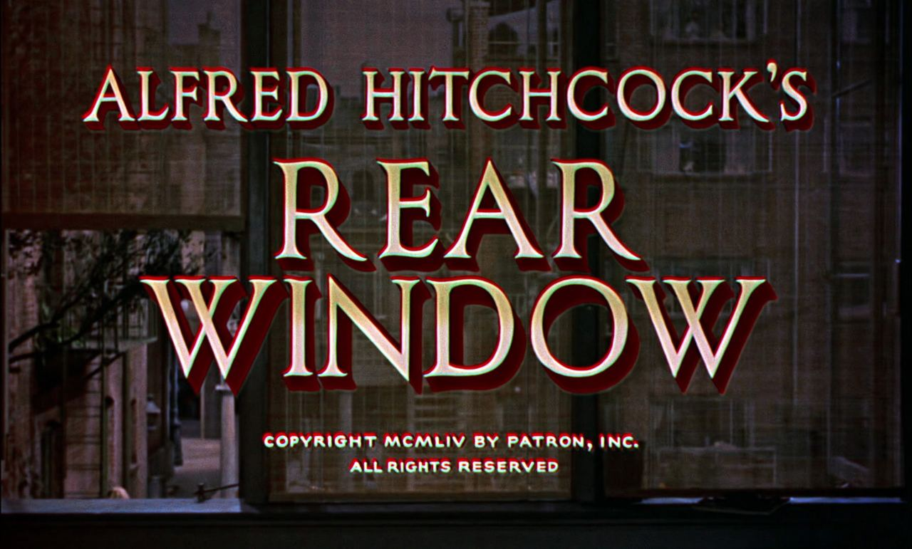
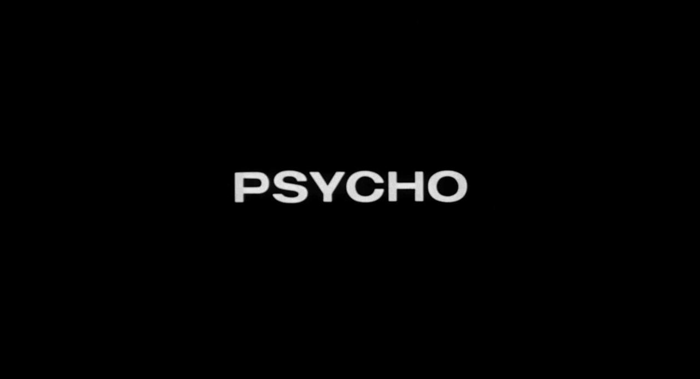
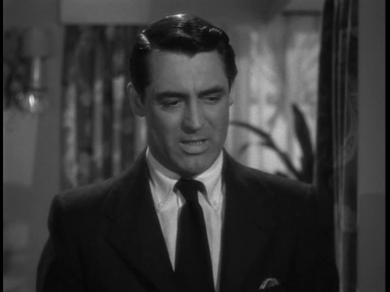
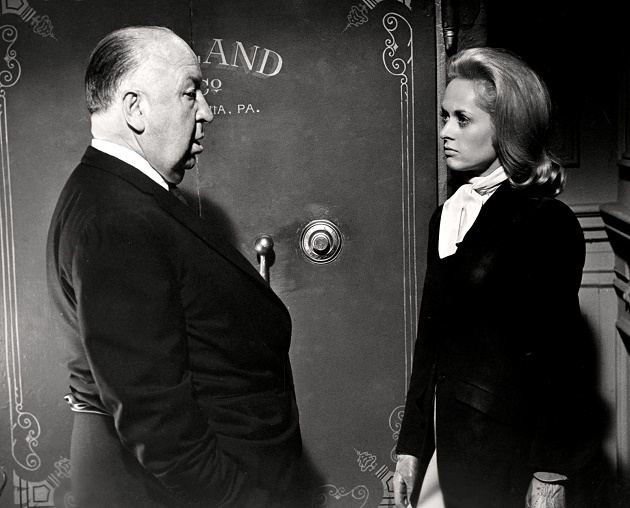
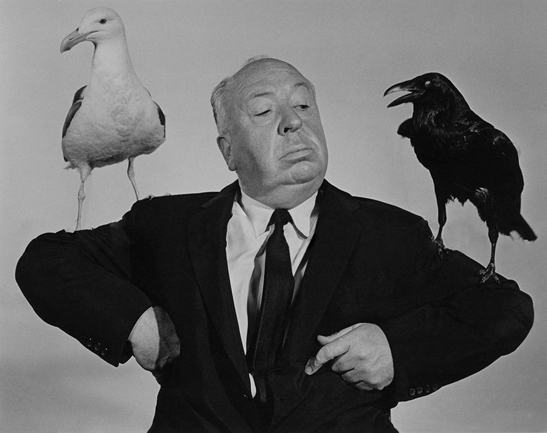

# 导演色卡 #001 — Alfred Hitchcock 阿尔弗雷德·希区柯克

> **分类**：01 黑色悬疑与冷调惊悚
> **编号**：001
> **国籍**：英国 / 美国
> **活跃年代**：1925-1976
> **创建日期**：2026-07-31

---

## 一、核心风格一句话

> 精致对称构图下的互补色对比戏剧，阴影与眩晕感交织的悬疑美学。

---

## 二、色板构成



> 横版主色卡（点击查看高清图）

### 主色板（6色）

| 色号 | HEX | 色彩名称 | 占比 | 来源说明 |
|------|-----|---------|------|---------|
| C01 | `#1A2332` | 深夜暗蓝 | 40% | 惊魂记浴室主阴影、迷魂记夜空 |
| C02 | `#3D5A6C` | 雾霭钢蓝 | 20% | 后窗公寓外墙、西北偏北黄昏 |
| C03 | `#8B6914` | 暗金琥珀 | 15% | 蝴蝶梦烛台、美人计水晶灯 |
| C04 | `#C41E3A` | 恐惧猩红 | 8% | 迷魂记红裙、艳贼红唇、玛妮警告色 |
| C05 | `#2E4A38` | 深墨绿 | 12% | 眩晕走廊、疑影邮筒内部、绳索暗角 |
| C06 | `#D4C5A9` | 暖米肤 | 5% | 主角肤色高光、金发柔光 |

### 情绪色板（4色）

| 色号 | HEX | 色彩名称 | 情绪含义 |
|------|-----|---------|---------|
| E01 | `#7B241C` | 血暗红 | 谋杀、死亡、危险信号 |
| E02 | `#F7DC6F` | 眩晕金 | 晕眩、梦境、精神不稳定 |
| E03 | `#283747` | 冷灰蓝 | 监视、窥视、未知威胁 |
| E04 | `#F8B195` | 唇粉橘 | 金发女郎、诱惑、危机前的美 |

### 光影特征

- **主光方向**：3/4侧光，硬边阴影， chiaroscuro light-dark对比强烈
- **高光色偏**：暖金偏黄（烛光/钨丝灯）
- **阴影色偏**：冷蓝偏青（夜色/心理恐惧）
- **对比比**：高对比（75-85%）
- **色调整体**：偏冷偏暗，65%冷调 + 35%暖色点缀

---

## 三、视觉风格关键词（按权重排序）

### 构图与运镜
对称构图 · 低角度仰拍 · 高角度俯拍 · 眩晕镜头（dolly zoom）· 窥视视角 · 楼梯构图 · 剪影光 · 窗框取景 · 镜子反射 · 长镜头跟踪

### 色彩与光影
互补色红蓝对比 · 暗调低调照明 ·  chiaroscuro light-dark法 · 金色暖烛光 · 冷蓝夜色 · 红色警告点光源 · 金发逆光 · 阴影中藏人

### 氛围与情绪
悬疑张力 · 心理恐惧 · 优雅的危险 · 黑色电影 · 中产焦虑 · 窥视欲 · 错视与误解 · 时间的悬停

---

## 四、运镜特征

| 特征 | 说明 | 经典例子 |
|------|------|---------|
| 眩晕镜头 (Dolly Zoom) | 推拉变焦，营造空间扭曲与心理失衡 | 《迷魂记》钟楼下坠 |
| 长镜头跟踪 | 跟随角色移动，让观众代入紧张感 | 《惊魂记》车驶入庄园 |
| 高角度俯拍 | 上帝视角，角色被命运支配 | 《迷魂记》屋顶追逐 |
| 低角度仰拍 | 压迫感，权力结构展现 | 《美人计》楼梯间 |
| 窥视视角 (POV) | 望远镜/钥匙孔/窗户取景，观众同谋 | 《后窗》全程 |
| 楼梯构图 | 危险上升/坠落的视觉隐喻 | 《迷魂记》钟楼 |
| 物体特写转场 | 用物体（钥匙、戒指、刀）串接剧情 | 《蝴蝶梦》各处 |
| 蒙太奇剪辑 | 碎片式画面叠加表现心理 | 《惊魂记》浴室谋杀 |

---

## 五、经典场景色彩参考

### 电影截图画廊

| 迷魂记 | 后窗 | 惊魂记 |
|--------|------|--------|
|  |  |  |
| 暗蓝+眩晕金 · 眩晕恐惧 | 钢蓝+暖窗黄 · 窥视隔离 | 高对比 · 纯粹恐惧 |

| 美人计 | 艳贼 | 群鸟 |
|--------|------|------|
|  |  |  |
| 暗金酒色 · 楼梯阴影 | 冷蓝猩红 · 心理障碍 | 海岸灰蓝 · 天空恐怖 |

| 电影 | 场景 | 主导色 | 色彩氛围 |
|------|------|--------|---------|
| 迷魂记 Vertigo | 钟楼坠落 | 暗蓝+眩晕金 | 眩晕、恐惧、失控 |
| 后窗 Rear Window | 公寓雨夜 | 钢蓝+暖窗黄 | 窥视、隔离、好奇 |
| 惊魂记 Psycho | 浴室谋杀 | 黑白对比 → 暗蓝+血暗红 | 暴力、震惊、纯粹恐惧 |
| 西北偏北 | 麦田飞机追杀 | 金黄麦田+深蓝西装 | 孤立无援、空旷中的威胁 |
| 蝴蝶梦 Rebecca | 曼德利庄园客厅 | 暗金烛光+深木棕 | 过去的压迫、贵族阴影 |
| 美人计 Notorious | 酒窖藏铀 | 暗绿瓶+暖金酒 | 秘密、危险、被囚禁的美 |
| 艳贼 Marnie | 红色触发 | 恐惧猩红+冷蓝办公 | 童年创伤、心理障碍 |
| 眩晕 Spellbound | 达利梦境 | 超现实紫+弯曲线条 | 潜意识、催眠、迷雾 |

---

## 六、AI 生成提示词模板

> 完整提示词文件见 `prompts/` 目录

### 图像生成速用公式

```
[subject description], in the style of Alfred Hitchcock,
chiaroscuro lighting, dark thriller film still,
complementary red-green-blue color palette,
symmetrical composition, framed through a window,
film noir aesthetic, 1950s technicolor,
emotional tension, suspense atmosphere,
grainy cinematic texture --ar 16:9 --style raw
```

### 视频生成速用公式

```
A suspenseful thriller scene in Alfred Hitchcock style,
a woman in a red dress walking up a spiral staircase,
dolly zoom effect, chiaroscuro lighting,
cold blue shadows with warm candle highlights,
film noir aesthetic, 1950s cinematic look,
slow build of tension, grainy film texture,
16:9 aspect ratio, cinematic movement
```

---

## 七、代表作索引

| 年份 | 片名 | 主要色彩特征 |
|------|------|-------------|
| 1940 | 蝴蝶梦 Rebecca | 暗金庄园、烛光、哥特暖暗 |
| 1945 | 爱德华大夫 Spellbound | 达利超现实梦境、冷灰医院 |
| 1946 | 美人计 Notorious | 金酒色、暗绿酒窖、楼梯阴影 |
| 1951 | 火车怪客 Strangers on a Train | 黑夜黑白对比、游乐园霓虹 |
| 1953 | 忏情记 I Confess | 教堂阴影、宗教暗色 |
| 1954 | 后窗 Rear Window | 钢蓝雨夜、暖窗灯光、窥视美学 |
| 1955 | 捉贼记 To Catch a Thief | 蔚蓝海岸、金色阳光、猫眼绿 |
| 1956 | 擒凶记 The Man Who Knew Too Much | 摩洛哥暖沙、金色礼堂 |
| 1958 | 迷魂记 Vertigo | 雾霭钢蓝、恐惧猩红、眩晕金 |
| 1959 | 西北偏北 North by Northwest | 麦田金黄、灰色西装、拉什莫尔山 |
| 1960 | 惊魂记 Psycho | 黑白（重映暗蓝）、浴室血雨 |
| 1963 | 群鸟 The Birds | 海岸灰蓝、天空恐怖、冷绿调 |
| 1964 | 艳贼 Marnie | 冷蓝办公室、恐惧猩红色、古典暖金 |
| 1976 | 大巧局 Family Plot | 70年代暖棕、黑色喜剧调 |

---

## 八、蒸馏验证

- [x] 色板6+4色已提取
- [x] 可视化色卡图片已生成（横版+竖版）
- [x] 运镜特征已归纳（8种）
- [x] 提示词模板已生成（MJ/SD/视频）
- [x] 电影截图参考图已收集（6张：迷魂记/后窗/惊魂记/美人计/艳贼/群鸟）
- [ ] Stable Diffusion 实测试图
- [ ] Runway 视频测试
