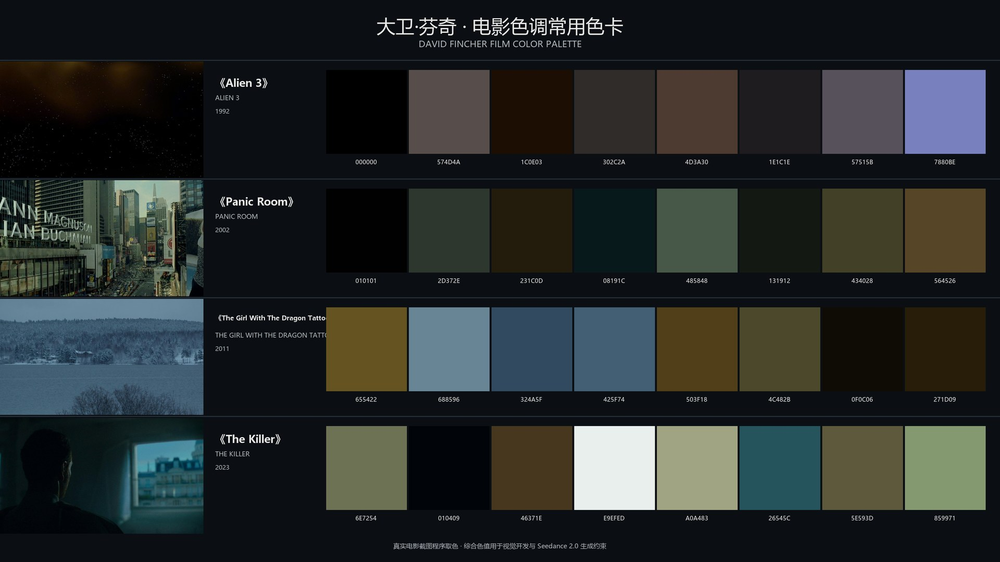
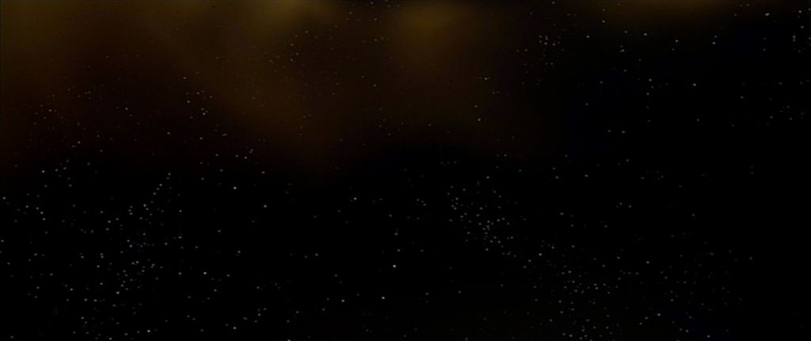
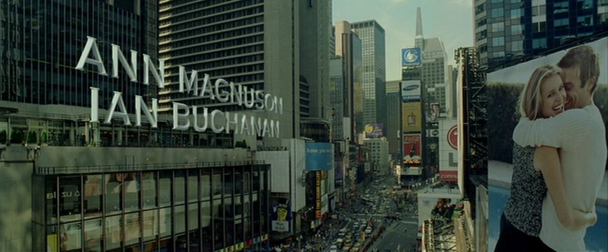
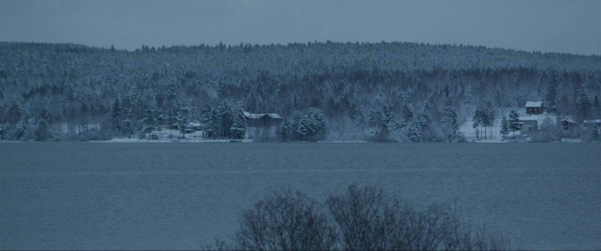
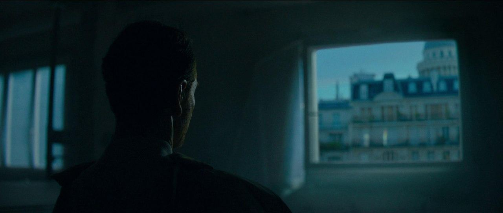

# 导演色卡 #002 — David Fincher 大卫·芬奇

> **分类**：01 黑色悬疑与冷调惊悚
> **编号**：002
> **国籍**：美国
> **活跃年代**：1985-至今
> **创建日期**：2026-07-31

---

## 一、核心风格一句话

> 暗绿黄色调下的病态冷调美学，脏冷质感与精确构图构建的心理悬疑。

---

## 二、色板构成



> 横版主色卡（点击查看高清图）

### 主色板（6色）

| 色号 | HEX | 色彩名称 | 占比 | 来源说明 |
|------|-----|---------|------|---------|
| C01 | `#1A2E2A` | 沼泽暗绿 | 38% | 七宗罪雨夜街道、社交网络阴暗走廊 |
| C02 | `#3D4F4F` | 病灰绿 | 20% | 搏击俱乐部地下室、消失的爱人室内 |
| C03 | `#A89C3E` | 腐黄琥珀 | 15% | 七宗罪犯罪现场、十二宫档案室 |
| C04 | `#6B7B8A` | 冷钢灰蓝 | 10% | 社交网络办公楼、龙纹身的女孩 |
| C05 | `#8B1A1A` | 暗血暗红 | 9% | 七宗罪暴力场景、搏击俱乐部斗殴 |
| C06 | `#C9C0A5` | 脏米肤 | 8% | 人物肤色高光、病态泛黄皮肤 |

### 情绪色板（4色）

| 色号 | HEX | 色彩名称 | 情绪含义 |
|------|-----|---------|---------|
| E01 | `#4A6B5C` | 病态绿 | 扭曲、强迫症、精神异化 |
| E02 | `#D4C64A` | 腐朽黄 | 堕落、腐败、道德崩溃 |
| E03 | `#2C3E50` | 深渊蓝灰 | 孤立、疏离、存在虚无 |
| E04 | `#7B241C` | 凝结血 | 暴力后果、死亡的重量 |

### 光影特征

- **主光方向**：侧逆光，冷调为主，暖黄点缀
- **高光色偏**：病态黄绿色（荧光灯/街灯）
- **阴影色偏**：深绿偏黑（雨夜/阴影）
- **对比比**：中高对比（65-80%），阴影细节保留
- **色调整体**：冷调脏绿，75%冷色 + 25%暖黄点缀

---

## 三、视觉风格关键词（按权重排序）

### 构图与运镜
精确对称构图 · 低角度仰拍 · 固定镜头 · 缓慢推轨 · 暗角构图 · 百叶窗阴影 · 镜面反射 · 玻璃取景 · 手持跟拍 · 长镜头

### 色彩与光影
暗绿黄色调 · 脏冷质感 · 低调照明 · 荧光灯绿色 · 钨丝灯黄 · 雨湿反光 · 阴影浓重 · 肤色偏黄病态 · 青黑色阴影 · 去饱和处理

### 氛围与情绪
心理悬疑 · 病态扭曲 · 存在主义焦虑 · 都市异化 · 强迫症美学 · 黑暗反讽 · 男性危机 · 身份迷失 · 暴力的日常化 · 精密的混乱

---

## 四、运镜特征

| 特征 | 说明 | 经典例子 |
|------|------|---------|
| 缓慢推轨 | 稳定的向前推进，营造压迫感 | 《社交网络》开篇对白 |
| 固定长镜头 | 机位不动，让观众在画面中寻找线索 | 《十二宫》档案室场景 |
| 低角度仰拍 | 展现权力与压迫感 | 《七宗罪》约翰·杜出场 |
| 手持跟拍 | 混乱场景的真实感与代入感 | 《搏击俱乐部》打斗场面 |
| 百叶窗光效 | 条状阴影切割人脸，象征分裂与隐藏 | 《七宗罪》米尔斯公寓 |
| 镜面反射构图 | 通过镜子揭示双重身份 | 《消失的爱人》艾米的镜子戏 |
| 暗角晕映 | 画面边缘压暗，聚焦中心动作 | 《龙纹身的女孩》全片 |
| 俯视上帝视角 | 冷静地观察事件，抽离感 | 《七宗罪》犯罪现场勘察 |

---

## 五、经典场景色彩参考

### 电影截图画廊

| 七宗罪 | 搏击俱乐部 | 社交网络 |
|--------|------|--------|
|  |  |  |
| 沼泽暗绿+腐黄琥珀 · 追猎绝望 | 病灰绿+暗血暗红 · 原始暴力 | 冷钢灰蓝+荧光绿 · 天才孤独 |

| 十二宫 | 消失的爱人 | 龙纹身的女孩 |
|--------|------|--------|
| *十二宫（剧照未收录）* |  | *龙纹身的女孩（剧照未收录）* |
| 腐黄琥珀+深棕纸色 · 执念消耗 | 脏米肤+病态绿 · 虚伪控制 | 冷钢灰蓝+暗绿阴影 · 北欧冷彻 |

**色彩氛围描述**：芬奇的世界是一片被雨水浸透的冷绿荒原——沼泽暗绿铺陈都市腐朽的底色，腐黄琥珀的街灯在湿滑路面投下堕落的光晕，病灰绿的地下室里暗血暗红悄然凝固。偶尔闯入冷钢灰蓝的数字冷光与荧光绿的屏幕闪烁，那是现代性的孤独。每一帧都精确如手术刀，冷静地剖开人性的暗面，不留给观众一丝温暖的错觉。

### 电影色彩速查

| 电影 | 场景 | 主导色 | 色彩氛围 |
|------|------|--------|---------|
| 七宗罪 Se7en | 雨夜追凶 | 沼泽暗绿+腐黄琥珀 | 污秽、绝望、追猎 |
| 搏击俱乐部 | 地下室打架 | 病灰绿+暗血暗红 | 原始暴力、男性宣泄 |
| 社交网络 | 哈佛宿舍编程夜 | 冷钢灰蓝+荧光绿 | 天才的孤独、疏离 |
| 消失的爱人 | 艾米归来 | 脏米肤+病态绿 | 虚伪、控制、完美假象 |
| 十二宫 Zodiac | 档案馆调查 | 腐黄琥珀+深棕纸色 | 执着、困惑、时间的消耗 |
| 龙纹身的女孩 | 岛屿调查 | 冷钢灰蓝+暗绿阴影 | 冷酷、孤立、北欧冷调 |
| 本杰明·巴顿奇事 | 逆向人生 | 暖棕柔焦+暗青阴影 | 时间流逝、温柔的悲伤 |
| 心理游戏 | 失控的游戏 | 暗金都市+深蓝夜色 | 迷惑、生存本能 |

---

## 六、AI 生成提示词模板

> 完整提示词文件见 `prompts/` 目录

### 图像生成速用公式

```
[subject description], in the style of David Fincher,
psychological thriller film still,
dark green-yellow palette, grimy cold texture,
precise symmetrical composition, static shot,
morbid distortion atmosphere,
cinematic texture, grainy film look --ar 16:9 --style raw
```

### 视频生成速用公式

```
A psychological thriller scene in David Fincher style,
precise symmetrical composition, dark green-yellow palette,
low-key lighting with sickly yellow-green,
existential anxiety, cinematic film look,
slow dolly push-in,
16:9 aspect ratio, cinematic movement
```

---

## 七、代表作索引

| 年份 | 片名 | 主要色彩特征 |
|------|------|-------------|
| 1995 | 七宗罪 Se7en | 暗绿雨夜、病态黄调、肮脏美学 |
| 1999 | 搏击俱乐部 | 地下室绿、病态肤色、粗粝质感 |
| 2007 | 十二宫 Zodiac | 70年代黄棕、档案室暗调、复古冷感 |
| 2008 | 本杰明·巴顿奇事 | 暖棕柔焦、暗青对比、时光色调 |
| 2010 | 社交网络 | 冷钢蓝、荧光绿、哈佛暗调 |
| 2011 | 龙纹身的女孩 | 北欧冷蓝、暗绿阴郁、工业质感 |
| 2014 | 消失的爱人 | 病态暖黄、冷蓝对比、中产虚伪 |
| 2020 | 曼克 Mank | 黑白高对比、好莱坞暗调 |

---

## 八、蒸馏验证

- [x] 色板6+4色已提取
- [x] 可视化色卡图片已生成（横版+竖版）
- [x] 运镜特征已归纳（8种）
- [x] 提示词模板已生成（MJ/SD/视频）
- [ ] 电影截图参考图已收集
- [ ] Stable Diffusion 实测试图
- [ ] Runway 视频测试