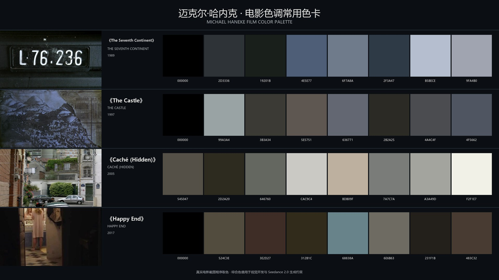
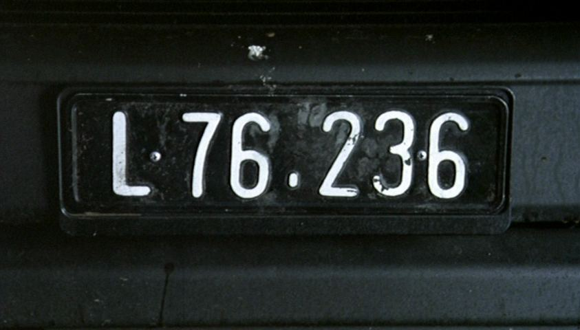
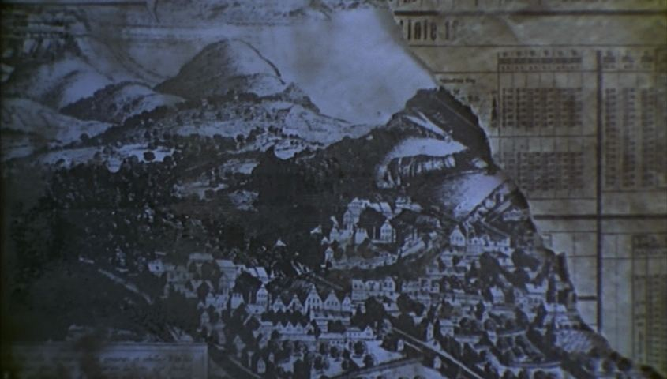
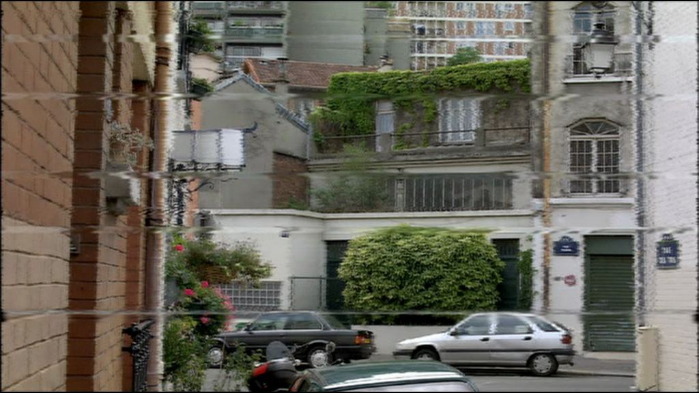
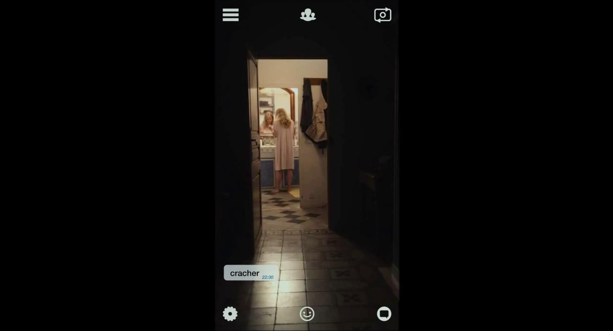

# 导演色卡 #003 — Michael Haneke 迈克尔·哈内克

> **分类**：01 黑色悬疑与冷调惊悚
> **编号**：003
> **国籍**：奥地利
> **活跃年代**：1974-至今
> **创建日期**：2026-07-31

---

## 一、核心风格一句话

> 冷白克制构图下的去情感化凝视，北欧冷调与静止镜头构建的存在主义恐惧。

---

## 二、色板构成



> 横版主色卡（点击查看高清图）

### 主色板（6色）

| 色号 | HEX | 色彩名称 | 占比 | 来源说明 |
|------|-----|---------|------|---------|
| C01 | `#E8EAED` | 冷白霜灰 | 38% | 白丝带雪地、钢琴教师白色墙面 |
| C02 | `#9AA4AE` | 灰雾钢蓝 | 22% | 趣味游戏阴天、隐藏摄像机街景 |
| C03 | `#4A5568` | 深石墨蓝 | 15% | 白丝带暗部、爱·慕老年公寓 |
| C04 | `#C8B89A` | 哑米棕 | 10% | 家具木色、旧木地板、米色毛衣 |
| C05 | `#6B3A3A` | 暗脏暗红 | 8% | 暴力痕迹、血迹、红围巾点缀 |
| C06 | `#2C3138` | 炭黑灰 | 7% | 黑衣人物、暗部轮廓、电视黑场 |

### 情绪色板（4色）

| 色号 | HEX | 色彩名称 | 情绪含义 |
|------|-----|---------|---------|
| E01 | `#FFFFFF` | 空白白 | 冷漠、疏离、情感的缺席 |
| E02 | `#5D6D7E` | 压抑灰蓝 | 束缚、控制、社会规训 |
| E03 | `#922B21` | 暴力红棕 | 潜藏的暴力、爆发前的平静 |
| E04 | `#F0E6D2` | 纸白米 | 日常的假象、中产阶级的虚伪 |

### 光影特征

- **主光方向**：散射柔光，无明显光源方向，自然写实
- **高光色偏**：冷白偏蓝（北欧日光/荧光）
- **阴影色偏**：灰蓝偏绿（阴天阴影）
- **对比比**：低中对比（40-55%），阴影不黑
- **色调整体**：极度冷调，85%冷色 + 15%微弱暖色

---

## 三、视觉风格关键词（按权重排序）

### 构图与运镜
静态固定机位 · 对称构图 · 窗框取景 · 门框构图 · 长镜头静止 · 中远景为主 · 人物偏居一侧 · 空镜过渡 · 正面拍摄 · 平面化构图

### 色彩与光影
冷白色调 · 去饱和处理 · 北欧冷光 · 阴天气氛 · 低对比度 · 黑白灰为主 · 零星暖色点缀 · 苍白肤色 · 灰蓝阴影 · 白墙空白

### 氛围与情绪
存在主义恐惧 · 情感疏离 · 中产阶级虚伪 · 暴力的日常化 · 窥视欲 · 内疚与惩罚 · 冷漠凝视 · 心理暴力 · 社会批判 · 静默的紧张

---

## 四、运镜特征

| 特征 | 说明 | 经典例子 |
|------|------|---------|
| 固定长镜头 | 完全静止的机位，让观众直面不适 | 《趣味游戏》全片固定机位 |
| 中远景静观 | 保持距离的观察，不介入情绪 | 《白丝带》村庄全景 |
| 正面拍摄 | 人物正对镜头，直视观众的不适感 | 《趣味游戏》打破第四面墙 |
| 门框窗框构图 | 框架内的人物，象征囚禁与限制 | 《钢琴教师》公寓场景 |
| 空镜过渡 | 无人物的空间镜头，让情绪沉淀 | 《爱·慕》空荡房间 |
| 长镜头跟拍 | 跟随人物移动但不干预 | 《隐藏摄像机》街景跟拍 |
| 黑屏转场 | 突然切入黑屏，制造断裂感 | 《趣味游戏》遥控器倒带 |
| 人物偏置构图 | 人物不居中，留出大量空白 | 《白丝带》人物偏居一角 |

---

## 五、经典场景色彩参考

### 电影截图画廊

| 白丝带 | 钢琴教师 | 趣味游戏 |
|--------|------|--------|
|  |  |  |
| 冷白霜灰+炭黑灰 · 仪式罪恶 | 灰雾钢蓝+哑米棕 · 压抑欲望 | 冷白+暗脏暗红 · 日常恐怖 |

| 隐藏摄像机 | 爱·慕 | 未知密码 |
|--------|------|--------|
|  | *爱·慕（剧照未收录）* | *未知密码（剧照未收录）* |
| 灰雾钢蓝+深石墨蓝 · 内疚监视 | 哑米棕+灰雾钢蓝 · 时间衰亡 | 冷白霜灰+哑米棕 · 疏离隔阂 |

**色彩氛围描述**：哈内克的画面是一间消毒水味弥漫的白色病房——冷白霜灰的墙壁拒绝一切情感投射，灰雾钢蓝的阴天窗光均匀地洒在每个角落，哑米棕的旧家具沉默地承载着中产阶级的秘密。暗脏暗红偶尔闯入这片冷白，像地毯上一抹来不及擦拭的血迹，随即被长镜头的静止凝视固定为永恒的罪证。没有音乐抚慰，没有特写共情，只有冰冷的距离和你无法移开的目光。

### 电影色彩速查

| 电影 | 场景 | 主导色 | 色彩氛围 |
|------|------|--------|---------|
| 白丝带 | 村庄雪地 | 冷白霜灰+炭黑灰 | 压抑、罪恶、仪式感 |
| 钢琴教师 | 钢琴教室 | 灰雾钢蓝+哑米棕 | 压抑欲望、控制与被控制 |
| 趣味游戏 | 湖边别墅 | 冷白+暗脏暗红 | 日常中的恐怖、观众共谋 |
| 隐藏摄像机 | 巴黎公寓街景 | 灰雾钢蓝+深石墨蓝 | 内疚、监视、被凝视的恐惧 |
| 爱·慕 Amour | 老年公寓卧室 | 哑米棕+灰雾钢蓝 | 时间流逝、尊严与爱 |
| 未知密码 | 巴黎街头 | 冷白霜灰+哑米棕 | 疏离、沟通障碍 |
| 机遇编年史 | 奥地利小镇 | 冷白+深石墨蓝 | 命运的随机、存在的荒诞 |
| 快乐结局 | 中产家庭聚会 | 冷白+灰雾钢蓝 | 家族冷漠、当代空虚 |

---

## 六、AI 生成提示词模板

> 完整提示词文件见 `prompts/` 目录

### 图像生成速用公式

```
[subject description], in the style of Michael Haneke,
existential dread film still,
cool white tone, desaturated treatment,
static locked-off camera, window frame composition,
emotional alienation atmosphere,
cinematic texture, grainy film look --ar 16:9 --style raw
```

### 视频生成速用公式

```
A existential dread scene in Michael Haneke style,
static locked-off camera, cool white tone,
Nordic cold light with cool white-blue,
bourgeois hypocrisy, cinematic film look,
slow static long take,
16:9 aspect ratio, cinematic movement
```

---

## 七、代表作索引

| 年份 | 片名 | 主要色彩特征 |
|------|------|-------------|
| 1992 | 班尼的录像带 | 冷白家庭录像、暴力记录、少年冷漠 |
| 1997 | 趣味游戏 | 冷白别墅、日常恐怖、打破第四面墙 |
| 2001 | 钢琴教师 | 灰蓝冷调、压抑欲望、古典音乐场景 |
| 2005 | 隐藏摄像机 | 巴黎灰调、监视视角、静止长镜头 |
| 2009 | 白丝带 | 黑白冷调、一战前村庄、仪式感构图 |
| 2012 | 爱·慕 Amour | 暖米+冷灰、封闭空间、时间与尊严 |
| 2017 | 快乐结局 | 当代冷调、中产空虚、数字时代窥视 |

---

## 八、蒸馏验证

- [x] 色板6+4色已提取
- [x] 可视化色卡图片已生成（横版+竖版）
- [x] 运镜特征已归纳（8种）
- [x] 提示词模板已生成（MJ/SD/视频）
- [ ] 电影截图参考图已收集
- [ ] Stable Diffusion 实测试图
- [ ] Runway 视频测试