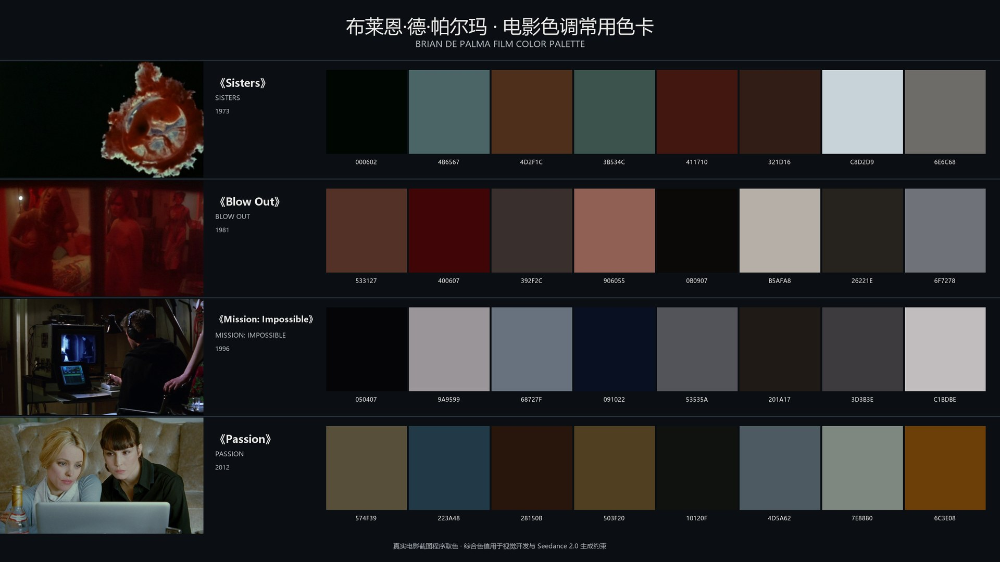
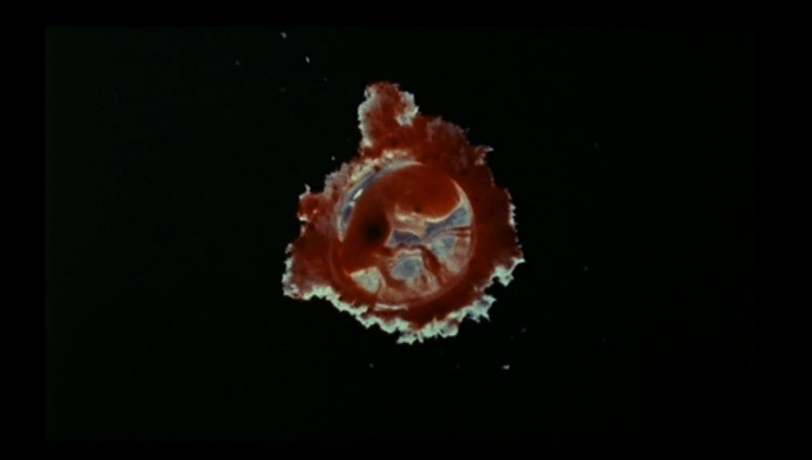
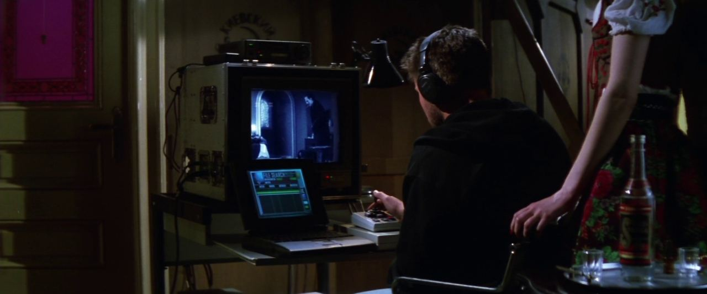

# 导演色卡 #004 — Brian De Palma 布莱恩·德·帕尔玛

> **分类**：01 黑色悬疑与冷调惊悚
> **编号**：004
> **国籍**：美国
> **活跃年代**：1962-至今
> **创建日期**：2026-07-31

---

## 一、核心风格一句话

> 红色警示与浓烈阴影交织的歌剧式悬疑，分屏叙事与长镜头构建的视觉盛宴。

---

## 二、色板构成



> 横版主色卡（点击查看高清图）

### 主色板（6色）

| 色号 | HEX | 色彩名称 | 占比 | 来源说明 |
|------|-----|---------|------|---------|
| C01 | `#1A1418` | 深夜暗紫红 | 35% | 疤面煞星暗部、剃刀边缘阴影 |
| C02 | `#8B0000` | 歌剧深红 | 20% | 疤面煞星鲜血、魔女嘉莉舞会 |
| C03 | `#C9A227` | 土豪金 | 15% | 疤面煞星豪宅、铁面无私走廊 |
| C04 | `#1E3A5F` | 宝蓝暗青 | 12% | 铁面无私夜戏、剃刀边缘冷调 |
| C05 | `#D4AF37` | 黄铜金 | 10% | 电梯扶手、金色雕像、华丽装饰 |
| C06 | `#E8D5B7` | 象牙肤 | 8% | 女主角肤色高光、白色礼服 |

### 情绪色板（4色）

| 色号 | HEX | 色彩名称 | 情绪含义 |
|------|-----|---------|---------|
| E01 | `#C41E3A` | 警示猩红 | 暴力爆发、危险信号、死亡预兆 |
| E02 | `#FFD700` | 奢华金 | 权力、欲望、堕落的财富 |
| E03 | `#0A2463` | 深渊宝蓝 | 阴谋、深渊、未知的危险 |
| E04 | `#F5E6D3` | 纯洁白 | 纯真被玷污、堕落前的美 |

### 光影特征

- **主光方向**：戏剧化侧光，硬边阴影，巴洛克light-dark法
- **高光色偏**：金黄色（装饰灯/落日/霓虹）
- **阴影色偏**：深紫红偏黑（暗部浓郁色彩）
- **对比比**：极高对比（80-95%），暗部深黑
- **色调整体**：暖暗奢华，60%红金暖色 + 40%深蓝冷色

---

## 三、视觉风格关键词（按权重排序）

### 构图与运镜
分屏构图 · 长镜头跟踪 · 旋转镜头 · 高角度俯拍 · 低角度仰拍 · 楼梯构图 · 门廊取景 · 镜子反射 · 玻璃折射 · POV窥视视角

### 色彩与光影
红色主导 · 金色点缀 · 歌剧式色彩 · 浓烈阴影 · 暗调奢华 · 霓虹红光 · 暖黄灯光 · 深蓝夜色 · 血红暴力 · 天鹅绒质感

### 氛围与情绪
歌剧式悬疑 · 性欲与暴力 · 窥视主题 · 阴谋背叛 · 黑帮史诗 · 超现实梦境 · 偏执狂想 · 华丽堕落 · 心理惊悚 · 视觉过剩

---

## 四、运镜特征

| 特征 | 说明 | 经典例子 |
|------|------|---------|
| 长镜头跟踪 | 复杂调度的连续长镜头，穿越多个空间 | 《铁面无私》火车站台阶 |
| 分屏构图 | 同时展现两条叙事线，制造张力 | 《姐妹情仇》分屏对峙 |
| 360度旋转镜头 | 环绕拍摄，营造迷失与眩晕感 | 《魔女嘉莉》舞会旋转 |
| 高角度俯拍楼梯 | 从上方观察楼梯上的追逐，几何美感 | 《剃刀边缘》博物馆跟踪 |
| POV窥视视角 | 通过角色的眼睛观察，观众同谋 | 《剃刀边缘》地铁追逐 |
| 低角度仰拍建筑 | 建筑的压迫感与权力象征 | 《疤面煞星》豪宅仰拍 |
| 慢动作暴力 | 暴力场面慢动作处理，仪式感 | 《疤面煞星》结局枪战 |
| 镜子玻璃构图 | 利用反射制造分裂与迷局 | 《剃刀边缘》镜子多重反射 |

---

## 五、经典场景色彩参考

### 电影截图画廊

| 疤面煞星 | 魔女嘉莉 | 铁面无私 |
|--------|------|--------|
|  |  | *铁面无私（剧照未收录）* |
| 歌剧深红+土豪金 · 堕落毁灭 | 纯洁白+警示猩红 · 血祭复仇 | 宝蓝暗青+黄铜金 · 正义阶梯 |

| 剃刀边缘 | 迷情记 | 碟中谍 |
|--------|------|--------|
|  | *迷情记（剧照未收录）* | *碟中谍（剧照未收录）* |
| 深夜暗紫红+象牙肤 · 窥视欲望 | 土豪金+宝蓝暗青 · 哥特痴迷 | 深蓝+冷白 · 精密紧张 |

**色彩氛围描述**：德·帕尔玛的银幕是一座被猩红丝绒包裹的歌剧舞台——歌剧深红如瀑布般倾泻而下，土豪金的吊灯在阴影中闪烁着堕落的光芒，宝蓝暗青的夜色里藏着窥视者的眼睛。纯洁白的礼服瞬间被警示猩红浸透，慢动作将暴力拉伸成一场华丽的献祭。分屏将世界一分为二，360度旋转让现实晕眩——每一帧都是希区柯克式悬念与意大利歌剧的狂欢联姻，美丽、危险、过剩。

### 电影色彩速查

| 电影 | 场景 | 主导色 | 色彩氛围 |
|------|------|--------|---------|
| 疤面煞星 | 豪宅结局枪战 | 歌剧深红+土豪金 | 毁灭、狂乱、堕落巅峰 |
| 铁面无私 | 火车站台阶 | 宝蓝暗青+黄铜金 | 正义之战、紧张节奏 |
| 魔女嘉莉 | 舞会血祭 | 纯洁白+警示猩红 | 复仇、超自然爆发 |
| 剃刀边缘 | 博物馆跟踪 | 深夜暗紫红+象牙肤 | 欲望、窥视、心理扭曲 |
| 迷情记 | 教堂重逢 | 土豪金+宝蓝暗青 | 痴迷、轮回、哥特浪漫 |
| 替身 The Fury | 超能力爆发 | 歌剧深红+深渊宝蓝 | 超自然、政府阴谋 |
| 黑色大丽花 | 罪案现场 | 暗紫红+黄铜金 | 复古黑色、罪恶都市 |
| 碟中谍 | CIA悬吊窃密 | 深蓝+冷白 | 高科技间谍、紧张刺激 |

---

## 六、AI 生成提示词模板

> 完整提示词文件见 `prompts/` 目录

### 图像生成速用公式

```
[subject description], in the style of Brian De Palma,
operatic suspense film still,
red dominant, golden accents,
split-screen composition, rotating shot,
lust and violence atmosphere,
cinematic texture, grainy film look --ar 16:9 --style raw
```

### 视频生成速用公式

```
A operatic suspense scene in Brian De Palma style,
split-screen composition, red dominant,
operatic colors with golden yellow,
voyeuristic theme, cinematic film look,
slow long take following shot,
16:9 aspect ratio, cinematic movement
```

---

## 七、代表作索引

| 年份 | 片名 | 主要色彩特征 |
|------|------|-------------|
| 1973 | 姐妹情仇 | 分屏叙事、红蓝对比、心理惊悚 |
| 1976 | 魔女嘉莉 | 血色舞会、宗教狂热、慢动作暴力 |
| 1980 | 剃刀边缘 | 博物馆跟踪、镜中迷局、歌剧式悬疑 |
| 1983 | 疤面煞星 | 迈阿密金粉、深红暴力、毒品帝国 |
| 1987 | 铁面无私 | 芝加哥禁酒令、黑金对比、长镜头台阶 |
| 1996 | 碟中谍 | CIA蓝调、悬吊偷取、间谍美学 |
| 2002 | 蛇蝎美人 | 珠宝红金、戛纳风情、身份迷局 |
| 2006 | 黑色大丽花 | 40年代洛杉矶、暗金复古、黑色电影 |

---

## 八、蒸馏验证

- [x] 色板6+4色已提取
- [x] 可视化色卡图片已生成（横版+竖版）
- [x] 运镜特征已归纳（8种）
- [x] 提示词模板已生成（MJ/SD/视频）
- [ ] 电影截图参考图已收集
- [ ] Stable Diffusion 实测试图
- [ ] Runway 视频测试