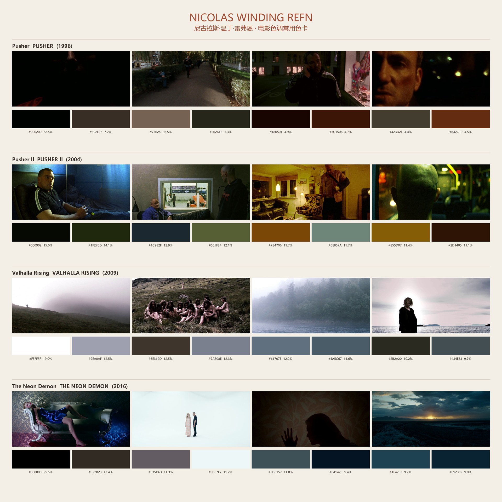
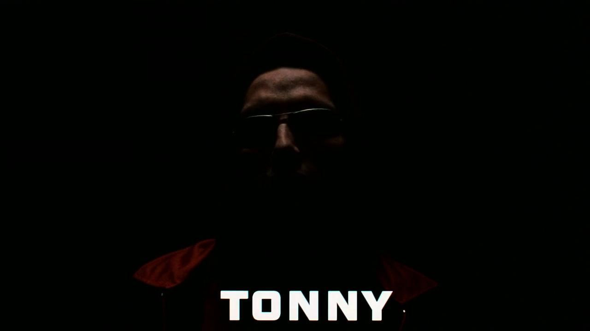
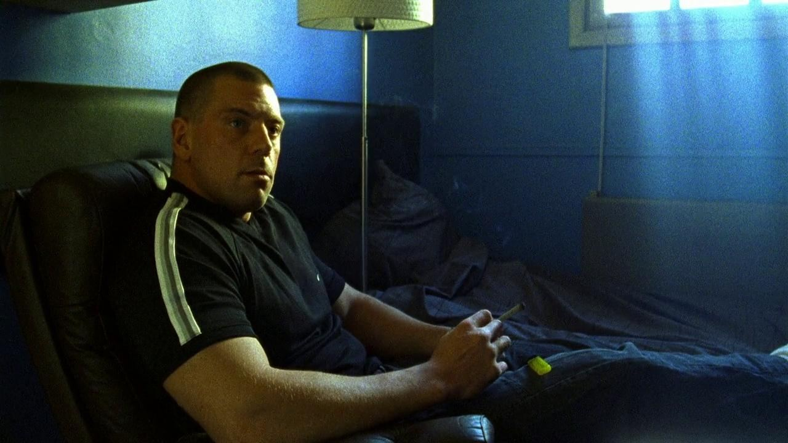
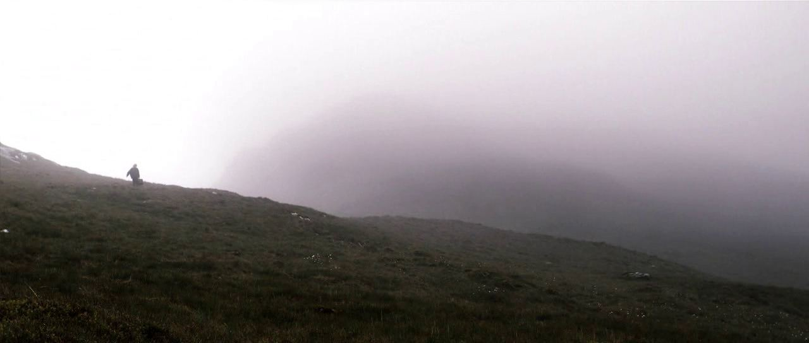
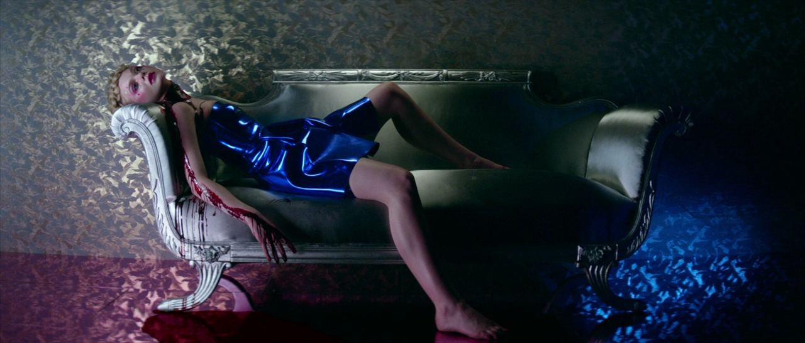

# 导演色卡 #006 — Nicolas Winding Refn 尼古拉斯·雷弗恩

> **分类**：01 黑色悬疑与冷调惊悚
> **编号**：006
> **国籍**：丹麦
> **活跃年代**：1996-至今
> **创建日期**：2026-07-31

---

## 一、核心风格一句话

> 霓虹冷蓝与暗夜城市交织的风格化暴力，极简构图与电子配乐构建的虚无主义美学。

---

## 二、色板构成



> 横版主色卡（点击查看高清图）

### 主色板（6色）

| 色号 | HEX | 色彩名称 | 占比 | 来源说明 |
|------|-----|---------|------|---------|
| C01 | `#0D1B2A` | 深海暗蓝 | 40% | 亡命驾驶夜戏、霓虹恶魔暗部 |
| C02 | `#1B4965` | 霓虹冷蓝 | 20% | 亡命驾驶城市夜景、泳池蓝光 |
| C03 | `#E63946` | 猩红警示 | 13% | 霓虹恶魔血红色、亡命驾驶暴力瞬间 |
| C04 | `#FFB703` | 电幻金 | 10% | 霓虹恶魔金箔、落日金 |
| C05 | `#5F0F40` | 洋红深紫 | 9% | 霓虹恶魔时尚秀、紫色霓虹 |
| C06 | `#F1FAEE` | 冷白肤 | 8% | 主角苍白肤色、白色赛车服 |

### 情绪色板（4色）

| 色号 | HEX | 色彩名称 | 情绪含义 |
|------|-----|---------|---------|
| E01 | `#00B4D8` | 电光蓝 | 速度、孤独、都市疏离 |
| E02 | `#E63946` | 爆裂红 | 暴力爆发、激情、死亡 |
| E03 | `#9D4EDD` | 迷幻紫 | 欲望、堕落、时尚界的虚幻 |
| E04 | `#FFD60A` | 黄金黄 | 神性、荣耀、疯狂的美 |

### 光影特征

- **主光方向**：彩色光源直射，霓虹为主，硬边光效
- **高光色偏**：霓虹蓝粉金（城市霓虹/电子屏）
- **阴影色偏**：深靛蓝偏黑（夜色/阴影）
- **对比比**：极高对比（80-95%），暗部纯黑
- **色调整体**：极冷霓虹调，70%冷蓝紫 + 30%暖红金

---

## 三、视觉风格关键词（按权重排序）

### 构图与运镜
极简构图 · 对称中心构图 · 固定长镜头 · 慢动作 · 霓虹光源 · 镜面反射 · 水池倒影 · 人物正面特写 · 空旷街道 · 几何建筑

### 色彩与光影
霓虹冷蓝 · 电子色 · 高饱和彩色点光源 · 暗夜黑色 · 镜面反射色 · 游泳池蓝光 · 血红色暴力 · 金色神性 · 洋红时尚 · 无色差肤色

### 氛围与情绪
虚无主义 · 都市孤独 · 风格化暴力 · 速度与激情 · 沉默的主角 · 超现实美 · 时尚与死亡 · 男性身份危机 · 存在的空洞 · 电子梦境

---

## 四、运镜特征

| 特征 | 说明 | 经典例子 |
|------|------|---------|
| 固定对称构图 | 人物居中，完美对称，仪式感 | 《亡命驾驶》电梯场景 |
| 慢动作暴力 | 暴力场面极度慢化，美学化 | 《亡命驾驶》电梯爆头 |
| 长镜头跟拍 | 流畅的跟随，像电子游戏 | 《亡命驾驶》驾驶场景 |
| 霓虹剪影 | 人物在霓虹前的剪影，色彩强烈 | 《霓虹恶魔》时尚秀 |
| 镜面水面反射 | 利用反射创造超现实感 | 《亡命驾驶》泳池场景 |
| 正面特写推进 | 正对人物面部，缓慢推进 | 《唯神能恕》人物特写 |
| 静止空镜 | 无人的空间，情绪停留 | 《亡命驾驶》洛杉矶空镜 |
| 升降镜头 | 垂直移动展示空间层次 | 《霓虹恶魔》升降电梯 |

---

## 五、经典场景色彩参考

### 电影截图画廊

| 亡命驾驶 | 霓虹恶魔 | 唯神能恕 |
|---------|---------|---------|
|  |  |  |
| 深海暗蓝+猩红警示 · 浪漫与暴力 | 洋红深紫+电幻金 · 欲望吞噬 | 深海暗蓝+猩红警示 · 东方复仇 |

| Valhalla Rising | 布朗森 | Too Old to Die Young |
|----------------|--------|----------------------|
|  | *布朗森（剧照未收录）* | *Too Old to Die Young（剧照未收录）* |
| 泥灰褐+血红 · 原始暴力 | 猩红警示+舞台暖黄 · 野性表演 | 霓虹冷蓝+洋红深紫 · 黑暗寓言 |

**色彩氛围描述**：雷弗恩的色彩世界是一场霓虹包裹的虚无主义梦境——深海暗蓝吞没一切背景，猩红警示在黑暗中炸裂出暴力瞬间，洋红深紫与电幻金在时装秀与城市夜色中交织出电子迷幻。镜面反射将画面分裂为多重自我，固定长镜头让每一个霓虹剪影都像祭坛上的圣像，美与死在极简构图中共存，冷白肤色的沉默主角在彩色光源中成为都市孤独的图腾。

### 电影色彩速查

| 电影 | 场景 | 主导色 | 色彩氛围 |
|------|------|--------|---------|
| 亡命驾驶 Drive | 电梯暴力 | 霓虹冷蓝+猩红警示 | 沉默的爆发、浪漫与暴力 |
| 霓虹恶魔 | 时装秀走台 | 洋红深紫+电幻金 | 欲望、嫉妒、美的吞噬 |
| 唯神能恕 | 曼谷夜街 | 深海暗蓝+猩红警示 | 复仇、罪恶、东方神秘 |
| 布朗森 Bronson | 监狱暴动 | 猩红警示+冷白肤 | 野性、表演性暴力、身份建构 |
| Pusher三部曲 | 哥本哈根黑道 | 暗蓝+脏绿 | 底层生存、毒品暴力 |
| Too Old to Die Young | 洛杉矶夜色 | 霓虹冷蓝+洋红深紫 | 黑暗寓言、慢节奏暴力 |
| 哥本哈根牛仔 | 地下世界 | 霓虹蓝+血红 | 超现实黑帮、女性力量 |
| Valhalla Rising | 蛮荒之地 | 泥灰+血红 | 原始暴力、神秘旅程 |

---

## 六、AI 生成提示词模板

> 完整提示词文件见 `prompts/` 目录

### 图像生成速用公式

```
[subject description], in the style of Nicolas Winding Refn,
nihilism film still,
neon cool blue, electronic colors,
minimal composition, static long take,
urban loneliness atmosphere,
cinematic texture, grainy film look --ar 16:9 --style raw
```

### 视频生成速用公式

```
A nihilism scene in Nicolas Winding Refn style,
minimal composition, neon cool blue,
highly saturated colored point light sources with neon blue pink gold,
stylized violence, cinematic film look,
slow static symmetrical composition,
16:9 aspect ratio, cinematic movement
```

---

## 七、代表作索引

| 年份 | 片名 | 主要色彩特征 |
|------|------|-------------|
| 1996 | Pusher | 丹麦黑道、手持镜头、粗粝现实 |
| 2008 | 布朗森 Bronson | 监狱橙红、表演性暴力、赤裸狂躁 |
| 2011 | 亡命驾驶 Drive | 霓虹蓝夜、沉默车手、风格化暴力 |
| 2013 | 唯神能恕 | 曼谷红黑、东方神秘、缓慢复仇 |
| 2016 | 霓虹恶魔 | 时尚粉金、血红色、美的吞噬 |
| 2019 | Too Old to Die Young | 洛杉矶暗蓝霓虹、慢节奏、黑暗寓言 |
| 2022 | 哥本哈根牛仔 | 地下霓虹、超现实黑帮、神秘女性 |

---

## 八、蒸馏验证

- [x] 色板6+4色已提取
- [x] 可视化色卡图片已生成（横版+竖版）
- [x] 运镜特征已归纳（8种）
- [x] 提示词模板已生成（MJ/SD/视频）
- [ ] 电影截图参考图已收集
- [ ] Stable Diffusion 实测试图
- [ ] Runway 视频测试