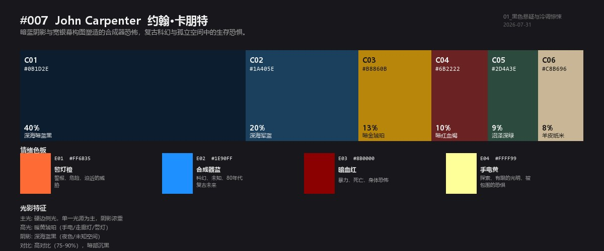
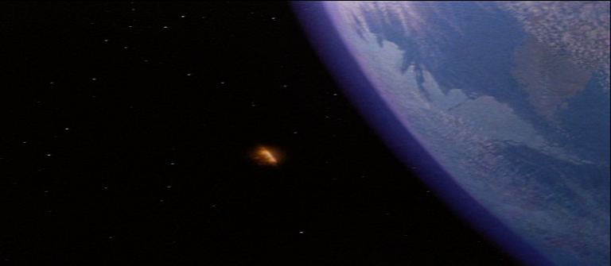
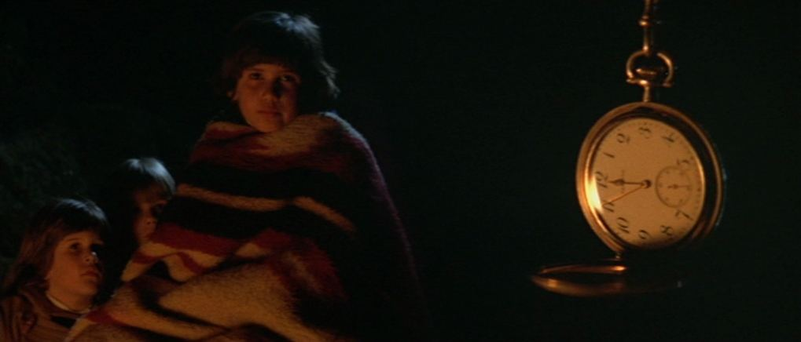
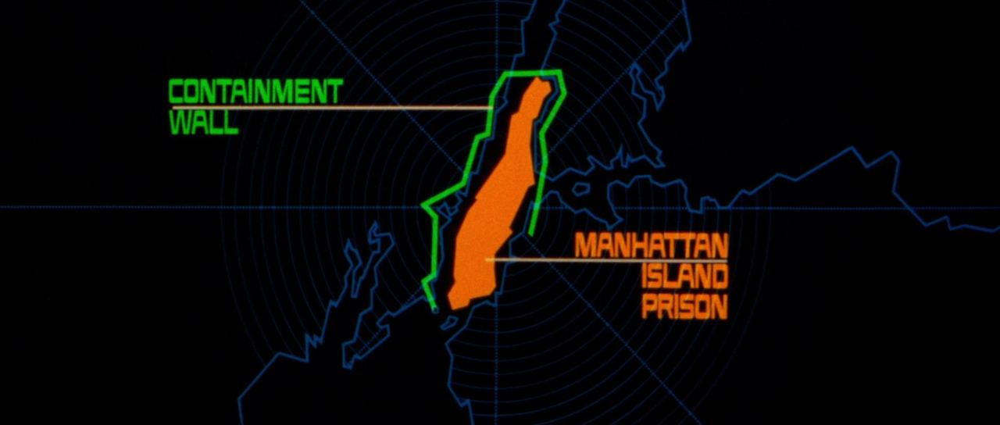

# 导演色卡 #007 — John Carpenter 约翰·卡朋特

> **分类**：01 黑色悬疑与冷调惊悚
> **编号**：007
> **国籍**：美国
> **活跃年代**：1974-至今
> **创建日期**：2026-07-31

---

## 一、核心风格一句话

> 暗蓝阴影与宽银幕构图塑造的合成器恐怖，复古科幻与孤立空间中的生存恐惧。

---

## 二、色板构成



> 横版主色卡（点击查看高清图）

### 主色板（6色）

| 色号 | HEX | 色彩名称 | 占比 | 来源说明 |
|------|-----|---------|------|---------|
| C01 | `#0B1D2E` | 深海暗蓝黑 | 40% | 怪形南极基地、月光光心慌慌夜戏 |
| C02 | `#1A405E` | 深海军蓝 | 20% | 雾山迷嶂夜色、纽约大逃亡暗部 |
| C03 | `#B8860B` | 暗金琥珀 | 13% | 恐怖走廊灯光、老式警灯黄 |
| C04 | `#6B2222` | 暗红血褐 | 10% | 怪形血迹、万圣节恐怖点 |
| C05 | `#2D4A3E` | 沼泽深绿 | 9% | 雾山迷嶂丛林、怪形苔藓 |
| C06 | `#C8B696` | 羊皮纸米 | 8% | 人物肤色、旧文件、米色夹克 |

### 情绪色板（4色）

| 色号 | HEX | 色彩名称 | 情绪含义 |
|------|-----|---------|---------|
| E01 | `#FF6B35` | 警灯橙 | 警报、危险、迫近的威胁 |
| E02 | `#1E90FF` | 合成器蓝 | 科幻、未知、80年代复古未来 |
| E03 | `#8B0000` | 暗血红 | 暴力、死亡、身体恐怖 |
| E04 | `#FFFF99` | 手电黄 | 探索、有限的光明、被包围的恐惧 |

### 光影特征

- **主光方向**：硬边侧光，单一光源为主，阴影浓重
- **高光色偏**：暖黄琥珀（手电/走廊灯/警灯）
- **阴影色偏**：深海蓝黑（夜色/未知空间）
- **对比比**：高对比（75-90%），暗部沉黑
- **色调整体**：冷调暗蓝，70%冷蓝 + 30%暖黄橙

---

## 三、视觉风格关键词（按权重排序）

### 构图与运镜
宽银幕构图 · 低角度仰拍 · 黑暗中手电光 · 门廊取景 · 阴影藏人 · 烟雾大气 · 走廊透视 · 剪影光 · 蓝幕合成 · 广角畸变

### 色彩与光影
暗蓝阴影 · 合成器蓝调 · 暖黄点光源 · 警灯红蓝 · 复古色调 · 低光环境 · 迷雾朦胧 · 血红色点缀 · 绿怪物色 · 80年代胶片质感

### 氛围与情绪
生存恐惧 · 孤立无援 · 未知生物 · 科幻恐怖 · 合成器配乐 · 反权威 · 密闭空间 · 偏执猜疑 · 末日感 · 黑色幽默

---

## 四、运镜特征

| 特征 | 说明 | 经典例子 |
|------|------|---------|
| 宽银幕构图 | 2.35:1超宽幅，空间感强 | 几乎所有卡朋特电影 |
| 稳定器跟拍 | 流畅的第一人称视角跟拍 | 《月光光心慌慌》开场POV |
| 手电光构图 | 黑暗中唯一光源，探索感 | 《怪形》基地探索 |
| 低角度仰拍 | 建筑或怪物的压迫感 | 《纽约大逃亡》自由女神像 |
| 门廊框架构图 | 从室内看向门外的黑暗 | 《怪形》门廊对峙 |
| 长镜头走廊 | 走廊纵深透视，未知尽头 | 《月光光心慌慌》走廊场景 |
| 烟雾朦胧 | 利用烟雾制造恐怖氛围 | 《雾山迷嶂》全片 |
| 固定机位群像 | 固定镜头内多人对峙，张力强 | 《怪形》测谎场景 |

---

## 五、经典场景色彩参考

### 电影截图画廊

| 月光光心慌慌 | 怪形 | 雾山迷嶂 |
|-------------|------|---------|
|  |  |  |
| 深海军蓝+暗血红 · 郊区恐惧 | 深海暗蓝黑+手电黄 · 信任崩塌 | 沼泽深绿+暗金琥珀 · 幽灵复仇 |

| 纽约大逃亡 | 极度空间 | 血溅十三号警署 |
|-----------|---------|---------------|
|  | *极度空间（该片剧照未下载）* | *血溅十三号警署（该片剧照未下载）* |
| 暗金琥珀+深海暗蓝黑 · 朋克末日 | 黑白+警灯橙 · 反体制觉醒 | 深蓝+暗血红 · 围困生存 |

**色彩氛围描述**：卡朋特的画面是合成器配乐的视觉等价物——深海暗蓝黑吞没郊区的夜晚，手电黄在走廊中切出唯一的安全锥，暗金琥珀的街灯与警灯橙在迷雾中闪烁出迫近的威胁。宽银幕构图将孤独的人物嵌入黑暗空间的几何中心，阴影中永远藏着不可名状的恐惧，烟雾从海岸涌来吞没小镇，每一束光都像在为生存而战。

### 电影色彩速查

| 电影 | 场景 | 主导色 | 色彩氛围 |
|------|------|--------|---------|
| 月光光心慌慌 | 哈登菲尔德夜追杀 | 深海军蓝+暗血红 | 跟踪、无动机暴力、郊区恐惧 |
| 怪形 The Thing | 南极基地血检对峙 | 深海暗蓝黑+手电黄 | 孤立无援、信任崩塌、身体恐怖 |
| 雾山迷嶂 The Fog | 海岸雾夜幽灵船 | 沼泽深绿+暗金琥珀 | 幽灵复仇、小镇被围攻 |
| 纽约大逃亡 | 废墟曼哈顿 | 暗金琥珀+深海暗蓝黑 | 朋克末日、反乌托邦、生存 |
| 极度空间 They Live | 墨镜看真相 | 黑白+警灯橙 | 反体制、消费主义批判、觉醒 |
| 血溅十三号警署 | 警署围攻 | 深蓝+暗血红 | 围困、生存、暴力无政府 |
| 天魔回魂 Prince of Darkness | 教堂地下室 | 暗绿教堂+烛火金+镜面暗蓝 | 宇宙邪恶、科学vs宗教、镜面异界 |
| 星际之门 Starman | 公路旅行 | 夕阳金+暗蓝夜 | 温柔科幻、人性温暖 |

---

## 六、AI 生成提示词模板

> 完整提示词文件见 `prompts/` 目录

### 图像生成速用公式

```
[subject description], in the style of John Carpenter,
survival fear film still,
dark blue shadows, synthwave blue tone,
widescreen composition, flashlight in darkness,
isolation and helplessness atmosphere,
cinematic texture, grainy film look --ar 16:9 --style raw
```

### 视频生成速用公式

```
A survival fear scene in John Carpenter style,
widescreen composition, dark blue shadows,
warm yellow point light source with warm amber yellow,
unknown creature, cinematic film look,
slow widescreen composition,
16:9 aspect ratio, cinematic movement
```

---

## 七、代表作索引

| 年份 | 片名 | 主要色彩特征 |
|------|------|-------------|
| 1978 | 月光光心慌慌 | 郊区暗蓝、跟踪视角、合成器恐怖 |
| 1980 | 雾山迷嶂 The Fog | 海岸迷雾、幽灵复仇、小镇围攻 |
| 1981 | 怪形 The Thing | 南极暗蓝、身体恐怖、信任崩塌 |
| 1981 | 纽约大逃亡 | 朋克末日、暗金琥珀、反乌托邦 |
| 1986 | 妖魔大闹唐人街 | 香港风、奇幻动作、黑色幽默 |
| 1988 | 极度空间 They Live | 黑白真相、警灯橙、反体制寓言 |
| 1994 | 战栗黑洞 | 超现实恐怖、虚实边界、克苏鲁 |
| 1998 | V字特工队 | 西部恐怖、沙漠暗调、吸血鬼猎杀 |

---

## 八、蒸馏验证

- [x] 色板6+4色已提取
- [x] 可视化色卡图片已生成（横版+竖版）
- [x] 运镜特征已归纳（8种）
- [x] 提示词模板已生成（MJ/SD/视频）
- [ ] 电影截图参考图已收集
- [ ] Stable Diffusion 实测试图
- [ ] Runway 视频测试