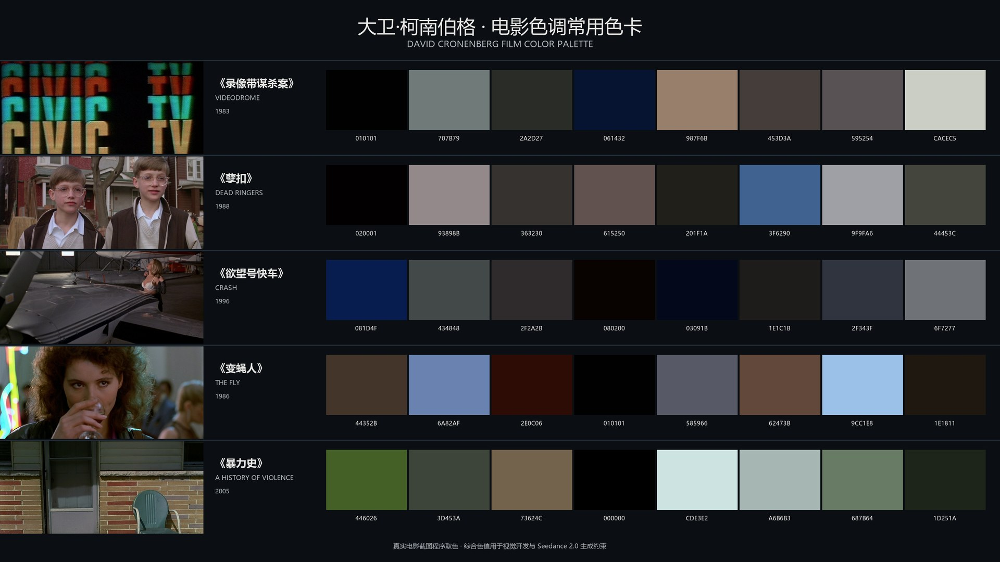
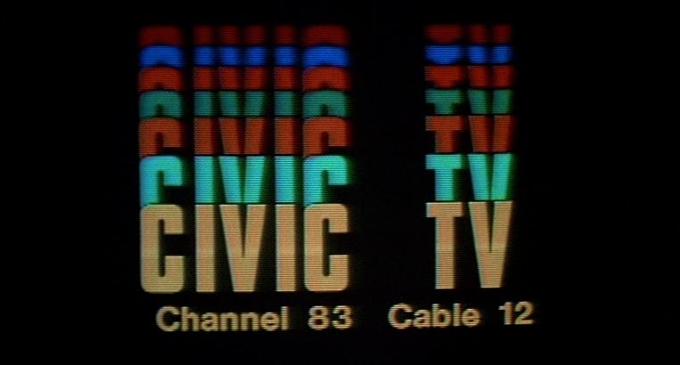
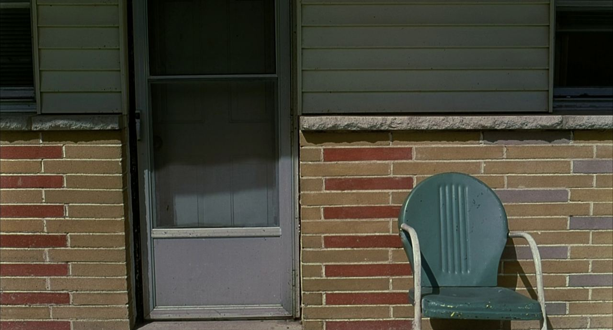

# 导演色卡 #008 — David Cronenberg 大卫·柯南伯格

> **分类**：01 黑色悬疑与冷调惊悚
> **编号**：008
> **国籍**：加拿大
> **活跃年代**：1969-至今
> **创建日期**：2026-07-31

---

## 一、核心风格一句话

> 肉体恐怖与临床冷调交织的身体哲学，生物质感与心理畸变构筑的存在主义惊惧。

---

## 二、色板构成



> 横版主色卡（点击查看高清图）

### 主色板（6色）

| 色号 | HEX | 色彩名称 | 占比 | 来源说明 |
|------|-----|---------|------|---------|
| C01 | `#2C3639` | 临床灰绿 | 38% | 变蝇人实验室、暴力史医院 |
| C02 | `#6B7F73` | 冷灰绿 | 20% | 感官游戏室内、裸体午餐暗部 |
| C03 | `#8B3A3A` | 血肉暗红 | 13% | 变蝇人肉体变形、暴力史血腥 |
| C04 | `#D4A574` | 肉肤色 | 10% | 赤裸身体、肉体特写、皮肤质感 |
| C05 | `#3D5A50` | 深菌绿 | 9% | 生物分泌物、科幻有机体 |
| C06 | `#B8A082` | 羊皮纸棕 | 10% | 旧皮革家具、米色西装、复古背景 |

### 情绪色板（4色）

| 色号 | HEX | 色彩名称 | 情绪含义 |
|------|-----|---------|---------|
| E01 | `#FF6B6B` | 血肉粉红 | 身体变形、痛苦与快感交织 |
| E02 | `#6B8E23` | 病变绿 | 感染、变异、身体的背叛 |
| E03 | `#4682B4` | 科技蓝 | 科技入侵人体、未来医学的恐惧 |
| E04 | `#DEB887` | 裸肤色 | 脆弱、暴露、存在的赤裸 |

### 光影特征

- **主光方向**：散射柔光为主，局部硬光突出肉体质感
- **高光色偏**：冷白偏绿（荧光灯/实验室灯）
- **阴影色偏**：深灰绿偏褐（暗部/阴影/生物组织）
- **对比比**：中对比（55-70%），肉体质感细节丰富
- **色调整体**：冷调绿褐，65%冷绿 + 35%暖肉色

---

## 三、视觉风格关键词（按权重排序）

### 构图与运镜
肉体特写 · 对称构图 · 临床空间 · 有机与机械融合 · 身体变形镜头 · 镜面反射 · 解剖式构图 · 心理空间外化 · 生物质感纹理 · 性与暴力重叠

### 色彩与光影
临床冷调 · 肉肤色 · 病变绿 · 血肉暗红 · 生物质感 · 金属冷灰 · 湿滑质感 · 裸露皮肤 · 有机形态 · 医学冷白

### 氛围与情绪
肉体恐怖 · 身体哲学 · 科技焦虑 · 性与暴力 · 身份消解 · 心理畸变 · 存在恐惧 · 科技与人性 · 欲望变形 · 禁忌边界

---

## 四、运镜特征

| 特征 | 说明 | 经典例子 |
|------|------|---------|
| 肉体特写推移 | 极近距离拍摄皮肤肉体的变化 | 《变蝇人》皮肤变形特写 |
| 临床固定镜头 | 静止不动，像医学观察 | 《暴力史》开篇长镜头 |
| 对称几何构图 | 空间的冷静秩序与肉体的混乱对比 | 《欲望号快车》车祸场景 |
| 慢动作变形 | 身体变化过程的慢镜头，仪式感 | 《变蝇人》最终变形 |
| 镜面玻璃构图 | 分裂的自我、身体的异化 | 《死环》双胞胎镜面 |
| 生物纹理特写 | 皮肤、分泌物、有机组织的微距 | 《感官游戏》生物枪 |
| 手持跟拍（心理） | 有限度的手持，增强不安感 | 《裸体午餐》迷幻场景 |
| 空间压迫构图 | 人物在空间中的限制与扭曲 | 《蜘蛛梦魇》室内场景 |

---

## 五、经典场景色彩参考

### 电影截图画廊

| 录影带谋杀案 | 变蝇人 | 死环 |
|--------|------|--------|
|  |  |  |
| 血肉暗红+科技蓝 · 媒体暴力入侵 | 血肉暗红+病变绿 · 身体背叛悲剧 | 临床灰绿+裸肤色 · 身份共依崩塌 |

| 欲望号快车 | 感官游戏 | 暴力史 |
|--------|------|--------|
|  |  | *暴力史（该片剧照未下载）* |
| 冷灰绿+血肉暗红 · 性与死亡交缠 | 深菌绿+血肉暗红 · 虚拟身体边界 | 临床灰绿+肉肤色 · 日常暴力反转 |

**色彩氛围描述**：柯南伯格的银幕世界是一具被临床冷光照亮的变异身体——血肉暗红是欲望与痛苦的底色，病变绿与科技蓝分别从生物内部和机械外部侵蚀肉体的边界，临床灰绿的实验室空间像巨大的解剖台将一切存在置于观察之下。每一帧都是身体哲学的切片，冷静地展示着肉体如何背叛、变异、融合，以及在变形中绽放的诡异美丽。

### 电影色彩速查

| 电影 | 场景 | 主导色 | 色彩氛围 |
|------|------|--------|---------|
| 变蝇人 The Fly | 变形最终章 | 血肉暗红+病变绿 | 身体背叛、痛苦与爱、悲剧 |
| 暴力史 | 小镇咖啡店 | 临床灰绿+肉肤色 | 身份伪装、暴力的潜伏 |
| 感官游戏 eXistenZ | 生物端口接入 | 深菌绿+血肉暗红 | 虚拟现实、身体入侵、边界模糊 |
| 欲望号快车 Crash | 车祸重演 | 冷灰绿+血肉暗红 | 性爱与死亡、机械与肉体的融合 |
| 裸体午餐 | 打字机变形 | 羊皮纸棕+病变绿 | 迷幻、作家的疯狂、虚实不分 |
| 死环 Dead Ringers | 双胞胎镜像 | 临床灰绿+裸肤色 | 身份融合、分离焦虑、心理共依 |
| 未来罪行 | 身体表演 | 肉肤色+深菌绿 | 进化、艺术、身体的新语言 |
| 录影带谋杀案 | 录影带幻觉 | 血肉暗红+科技蓝 | 媒体暴力、欲望变形、现实消融 |

---

## 六、AI 生成提示词模板

> 完整提示词文件见 `prompts/` 目录

### 图像生成速用公式

```
[subject description], in the style of David Cronenberg,
body horror film still,
clinical cold tone, flesh tone,
flesh close-up, clinical space,
body philosophy atmosphere,
cinematic texture, grainy film look --ar 16:9 --style raw
```

### 视频生成速用公式

```
A body horror scene in David Cronenberg style,
flesh close-up, clinical cold tone,
diseased green with cool white-green,
tech anxiety, cinematic film look,
slow flesh close-uptracking,
16:9 aspect ratio, cinematic movement
```

---

## 七、代表作索引

| 年份 | 片名 | 主要色彩特征 |
|------|------|-------------|
| 1983 | 录影带谋杀案 | 血肉科技、媒体暴力、肉体变形 |
| 1986 | 变蝇人 The Fly | 肉体恐怖、生物学变异、悲剧爱情 |
| 1988 | 死环 Dead Ringers | 临床冷调、双胞胎镜像、心理惊悚 |
| 1991 | 裸体午餐 Naked Lunch | 迷幻棕调、生物机器、作家疯狂 |
| 1996 | 欲望号快车 Crash | 冷灰金属、性与死亡、机械恋物 |
| 1999 | 感官游戏 eXistenZ | 生物科幻、有机科技、虚拟现实 |
| 2005 | 暴力史 | 小镇冷调、身份秘密、日常暴力 |
| 2022 | 未来罪行 | 肉色生物调、进化艺术、身体政治 |

---

## 八、蒸馏验证

- [x] 色板6+4色已提取
- [x] 可视化色卡图片已生成（横版+竖版）
- [x] 运镜特征已归纳（8种）
- [x] 提示词模板已生成（MJ/SD/视频）
- [ ] 电影截图参考图已收集
- [ ] Stable Diffusion 实测试图
- [ ] Runway 视频测试