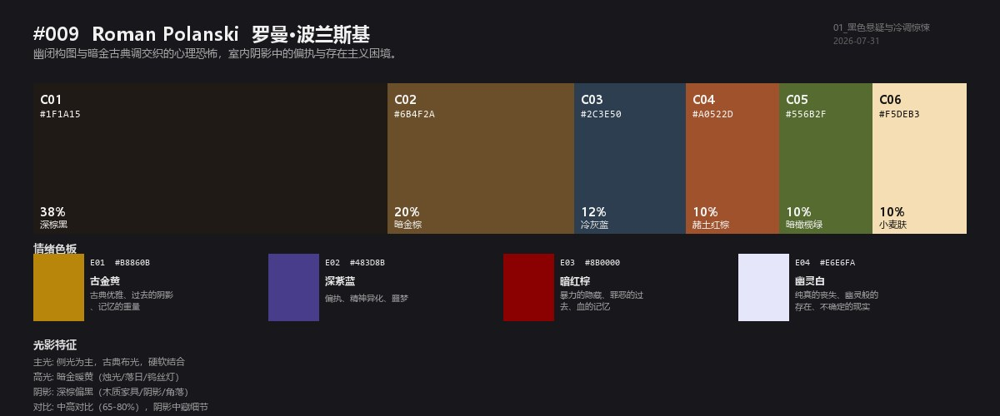
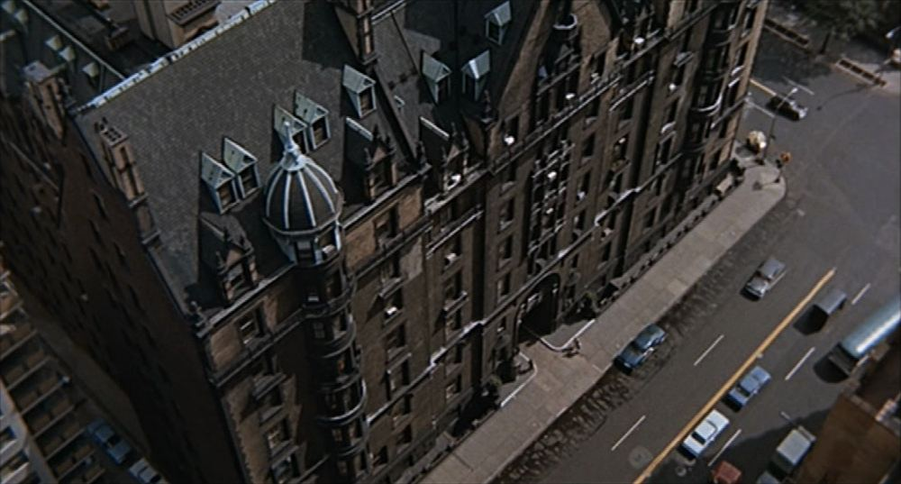
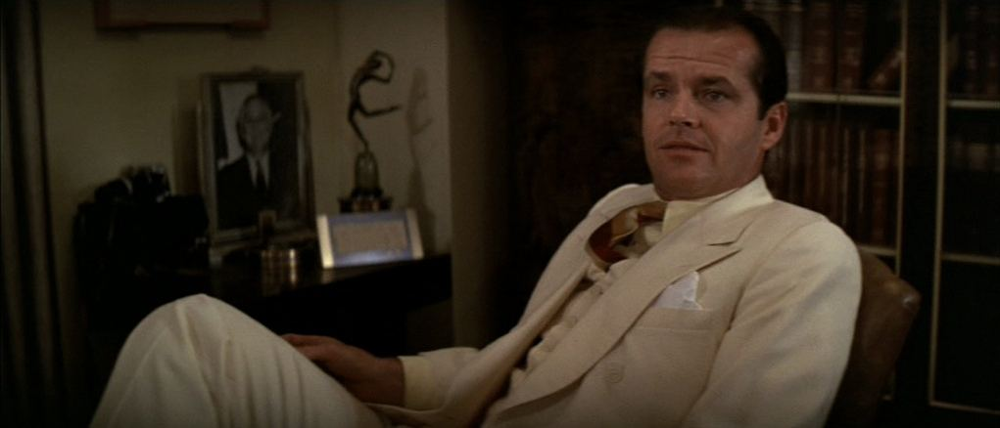
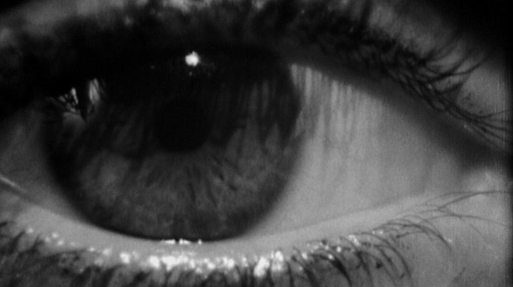

# 导演色卡 #009 — Roman Polanski 罗曼·波兰斯基

> **分类**：01 黑色悬疑与冷调惊悚
> **编号**：009
> **国籍**：波兰/法国
> **活跃年代**：1953-至今
> **创建日期**：2026-07-31

---

## 一、核心风格一句话

> 幽闭构图与暗金古典调交织的心理恐怖，室内阴影中的偏执与存在主义困境。

---

## 二、色板构成



> 横版主色卡（点击查看高清图）

### 主色板（6色）

| 色号 | HEX | 色彩名称 | 占比 | 来源说明 |
|------|-----|---------|------|---------|
| C01 | `#1F1A15` | 深棕黑 | 38% | 唐人街暗部、罗斯玛丽的婴儿阴影 |
| C02 | `#6B4F2A` | 暗金棕 | 20% | 唐人街复古色调、钢琴家暖棕 |
| C03 | `#2C3E50` | 冷灰蓝 | 12% | 苦月亮夜戏、罗斯玛丽窗外 |
| C04 | `#A0522D` | 赭土红棕 | 10% | 唐人街橙红落日、苔丝暖色 |
| C05 | `#556B2F` | 暗橄榄绿 | 10% | 唐人街西装、罗斯玛丽沙发 |
| C06 | `#F5DEB3` | 小麦肤 | 10% | 女主角肤色、金色头发柔光 |

### 情绪色板（4色）

| 色号 | HEX | 色彩名称 | 情绪含义 |
|------|-----|---------|---------|
| E01 | `#B8860B` | 古金黄 | 古典优雅、过去的阴影、记忆的重量 |
| E02 | `#483D8B` | 深紫蓝 | 偏执、精神异化、噩梦 |
| E03 | `#8B0000` | 暗红棕 | 暴力的隐藏、罪恶的过去、血的记忆 |
| E04 | `#E6E6FA` | 幽灵白 | 纯真的丧失、幽灵般的存在、不确定的现实 |

### 光影特征

- **主光方向**：侧光为主，古典布光，硬软结合
- **高光色偏**：暗金暖黄（烛光/落日/钨丝灯）
- **阴影色偏**：深棕偏黑（木质家具/阴影/角落）
- **对比比**：中高对比（65-80%），阴影中藏细节
- **色调整体**：暖暗古典，55%暖棕金 + 45%冷蓝绿

---

## 三、视觉风格关键词（按权重排序）

### 构图与运镜
幽闭空间构图 · 门框取景 · 楼梯几何 · 低角度仰拍 · 镜面反射 · 窗户取景 · 走廊透视 · 人物偏置 · 阴影藏脸 · 圆形构图

### 色彩与光影
暗金古典调 · 暖棕木色 · 深蓝夜色 · 赭土红 · 橄榄绿西装 · 烛光辉映 · 复古米色 · 阴影浓重 · 肤色暖黄 · 冷蓝窗外

### 氛围与情绪
幽闭恐惧 · 偏执妄想 · 心理悬疑 · 存在主义困境 · 罪恶与内疚 · 黑色幽默 · 性与政治 · 身份迷失 · 宿命感 · 卡夫卡式荒诞

---

## 四、运镜特征

| 特征 | 说明 | 经典例子 |
|------|------|---------|
| 幽闭空间构图 | 利用门框窗框框住人物，囚禁感 | 《罗斯玛丽的婴儿》公寓场景 |
| 楼梯几何构图 | 楼梯作为危险与上升下降的隐喻 | 《唐人街》楼梯对峙 |
| 手持跟拍（限制） | 有控制的手持，增强焦虑感 | 《冷血惊魂》公寓漫游 |
| 低角度仰拍天花板 | 压迫感，人物被空间压垮 | 《死胡同》室内场景 |
| 镜面反射叙事 | 通过镜子暗示双重生活 | 《唐人街》眼镜反射 |
| 缓慢推进 | 缓慢向前，张力逐步建立 | 《罗斯玛丽的婴儿》门后场景 |
| 俯视上帝视角 | 命运的俯视，人物无力反抗 | 《唐人街》结局俯视 |
| 走廊透视构图 | 走廊纵深，尽头未知 | 《怪房客》走廊场景 |

---

## 五、经典场景色彩参考

### 电影截图画廊

| 罗斯玛丽的婴儿 | 唐人街 | 钢琴家 |
|--------|------|--------|
|  |  |  |
| 深棕黑+暗金棕 · 幽闭怀疑 | 赭土红棕+暗金棕 · 宿命无力 | 冷灰蓝+暗金棕 · 幸存孤独 |

| 冷血惊魂 | 怪房客 | 水中刀 |
|--------|------|--------|
|  | *怪房客（该片剧照未下载）* | *水中刀（该片剧照未下载）* |
| 幽灵白+深紫蓝 · 精神分裂 | 暗金棕+冷灰蓝 · 身份消融 | 冷灰蓝+赭土红棕 · 三角博弈 |

**色彩氛围描述**：波兰斯基的画面是一座由暗金木质和阴影构筑的公寓迷宫——深棕黑与暗金棕铺陈出古典而压抑的室内底色，赭土红的落日与冷灰蓝的夜色在窗外交替，走廊尽头永远藏着不可知的威胁。他的镜头像一位冷静的房客，透过门框与窗格窥视人物被空间逐渐吞噬的过程，在优雅的布光中，宿命感像阴影一样缓缓爬过每一寸墙面。

### 电影色彩速查

| 电影 | 场景 | 主导色 | 色彩氛围 |
|------|------|--------|---------|
| 罗斯玛丽的婴儿 | 公寓走廊 | 深棕黑+暗金棕 | 幽闭、怀疑、被周围人算计 |
| 唐人街 | 橙红落日终局 | 赭土红棕+暗金棕 | 宿命、无力、正义的失败 |
| 钢琴家 The Pianist | 华沙废墟 | 冷灰蓝+暗金棕 | 幸存、孤独、战争的创伤 |
| 苦月亮 | 船舱夜戏 | 冷灰蓝+赭土红棕 | 欲望的毁灭、性与权力 |
| 苔丝 Tess | 英国乡村 | 小麦肤+暗橄榄绿 | 纯真的毁灭、命运的不公 |
| 冷血惊魂 | 公寓崩溃 | 幽灵白+深紫蓝 | 精神分裂、女性恐惧 |
| 怪房客 | 巴黎公寓 | 暗金棕+冷灰蓝 | 身份消融、卡夫卡式荒诞 |
| 水中刀 | 湖面游艇 | 冷灰蓝+赭土红棕 | 三角关系、男性较量、密闭空间 |

---

## 六、AI 生成提示词模板

> 完整提示词文件见 `prompts/` 目录

### 图像生成速用公式

```
[subject description], in the style of Roman Polanski,
claustrophobia film still,
dark golden classical tone, warm brown wood,
claustrophobic space composition, staircase geometry,
paranoid delusion atmosphere,
cinematic texture, grainy film look --ar 16:9 --style raw
```

### 视频生成速用公式

```
A claustrophobia scene in Roman Polanski style,
claustrophobic space composition, dark golden classical tone,
deep blue night with dark golden warm yellow,
psychological thriller, cinematic film look,
slow claustrophobic space composition,
16:9 aspect ratio, cinematic movement
```

---

## 七、代表作索引

| 年份 | 片名 | 主要色彩特征 |
|------|------|-------------|
| 1962 | 水中刀 | 湖泊冷调、三角张力、密闭空间 |
| 1965 | 冷血惊魂 | 黑白冷调、公寓幽闭、女性恐惧 |
| 1966 | 死胡同 | 荒诞喜剧、黑白构图、存在困境 |
| 1968 | 罗斯玛丽的婴儿 | 暗金公寓、幽闭恐怖、邪教疑云 |
| 1974 | 唐人街 Chinatown | 70年代复古、橙金落日、黑色电影 |
| 1979 | 苔丝 Tess | 乡村暖金、田园诗意、悲剧命运 |
| 2002 | 钢琴家 The Pianist | 冷灰废墟、幸存孤独、音乐救赎 |
| 2019 | 我控诉 | 暗金古典、司法阴谋、历史真相 |

---

## 八、蒸馏验证

- [x] 色板6+4色已提取
- [x] 可视化色卡图片已生成（横版+竖版）
- [x] 运镜特征已归纳（8种）
- [x] 提示词模板已生成（MJ/SD/视频）
- [ ] 电影截图参考图已收集
- [ ] Stable Diffusion 实测试图
- [ ] Runway 视频测试