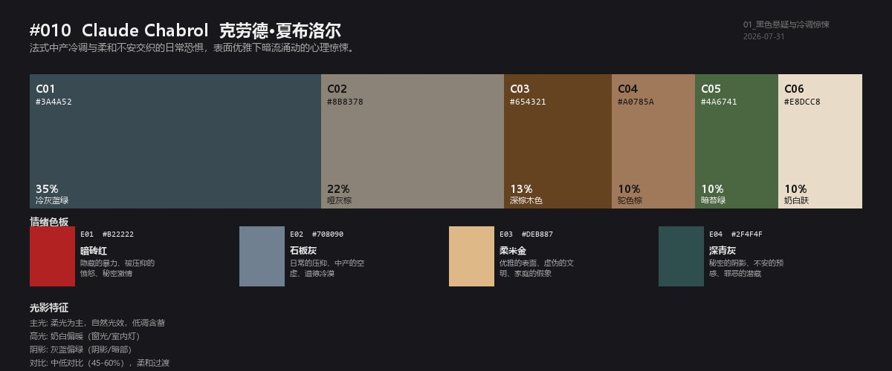
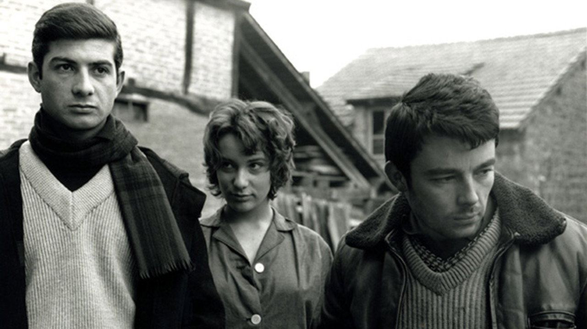
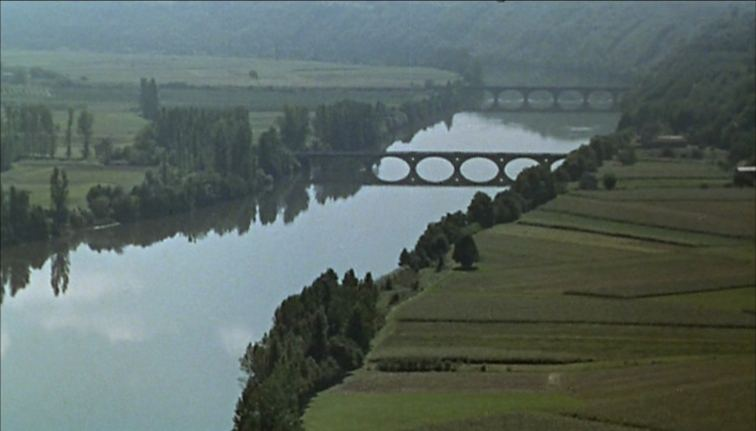
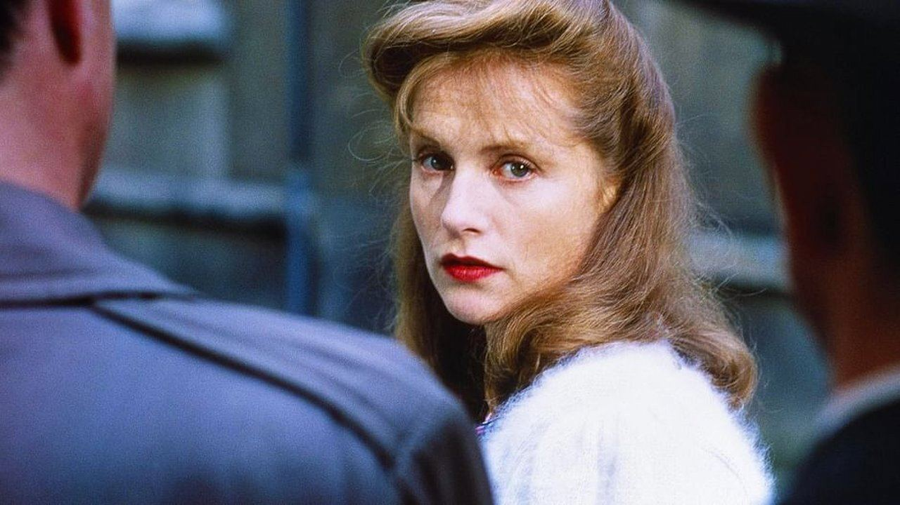

# 导演色卡 #010 — Claude Chabrol 克劳德·夏布洛尔

> **分类**：01 黑色悬疑与冷调惊悚
> **编号**：010
> **国籍**：法国
> **活跃年代**：1957-2010
> **创建日期**：2026-07-31

---

## 一、核心风格一句话

> 法式中产冷调与柔和不安交织的日常恐惧，表面优雅下暗流涌动的心理惊悚。

---

## 二、色板构成



> 横版主色卡（点击查看高清图）

### 主色板（6色）

| 色号 | HEX | 色彩名称 | 占比 | 来源说明 |
|------|-----|---------|------|---------|
| C01 | `#3A4A52` | 冷灰蓝绿 | 35% | 漂亮的塞尔吉小镇、屠夫村庄冷调 |
| C02 | `#8B8378` | 哑灰棕 | 22% | 中产家居、米色石墙、小镇建筑 |
| C03 | `#654321` | 深棕木色 | 13% | 木质家具、暗部、老建筑 |
| C04 | `#A0785A` | 驼色棕 | 10% | 风衣、小镇秋色、暖调家具 |
| C05 | `#4A6741` | 暗苔绿 | 10% | 花园绿植、乡间树丛、橄榄色 |
| C06 | `#E8DCC8` | 奶白肤 | 10% | 法国女人肤色、白色衬衫、瓷器 |

### 情绪色板（4色）

| 色号 | HEX | 色彩名称 | 情绪含义 |
|------|-----|---------|---------|
| E01 | `#B22222` | 暗砖红 | 隐藏的暴力、被压抑的愤怒、秘密激情 |
| E02 | `#708090` | 石板灰 | 日常的压抑、中产的空虚、道德冷漠 |
| E03 | `#DEB887` | 柔米金 | 优雅的表面、虚伪的文明、家庭的假象 |
| E04 | `#2F4F4F` | 深青灰 | 秘密的阴影、不安的预感、罪恶的潜藏 |

### 光影特征

- **主光方向**：柔光为主，自然光效，低调含蓄
- **高光色偏**：奶白偏暖（窗光/室内灯）
- **阴影色偏**：灰蓝偏绿（阴影/暗部）
- **对比比**：中低对比（45-60%），柔和过渡
- **色调整体**：冷调柔和，60%冷色 + 40%暖木色

---

## 三、视觉风格关键词（按权重排序）

### 构图与运镜
中产阶级空间构图 · 窗框门框取景 · 餐桌构图 · 楼梯转折 · 花园取景 · 镜面反射 · 长镜头静观 · 人物背景化 · 日常构图中的不安 · 对称失衡

### 色彩与光影
法式冷调 · 低饱和处理 · 灰棕色系 · 苔绿点缀 · 砖红暗点 · 奶白肤色 · 木质暖调 · 石墙灰调 · 花园绿 · 秋天金

### 氛围与情绪
日常恐惧 · 中产阶级虚伪 · 秘密与谎言 · 心理暗流 · 道德模糊 · 女性主义视角 · 讽刺社会 · 家庭秘密 · 优雅的恶意 · 平静下的风暴

---

## 四、运镜特征

| 特征 | 说明 | 经典例子 |
|------|------|---------|
| 中景静观长镜头 | 观察式中景，让观众自己发现不安 | 《屠夫》村庄场景 |
| 餐桌构图 | 餐桌场景中揭示关系张力 | 《仪式》晚餐场景 |
| 门框窗框取景 | 透过框架观察人物的囚禁状态 | 《漂亮的塞尔吉》窗景 |
| 缓慢横移 | 画面缓慢移动，不安感逐渐累积 | 《冷酷祭典》场景 |
| 花园空间构图 | 田园表面下的阴暗秘密 | 《故事的女人》花园场景 |
| 楼梯转折构图 | 楼梯转角处的秘密会面 | 《不忠的女人》楼梯戏 |
| 镜面反射构图 | 揭示人物的双重身份 | 《维奥莱特·诺齐埃尔》 |
| 手持跟拍（极少） | 关键时刻少量使用，情绪爆发点 | 《屠夫》结局 |

---

## 五、经典场景色彩参考

### 电影截图画廊

| 漂亮的塞尔吉 | 屠夫 | 冷酷祭典 |
|--------|------|--------|
|  |  |  |
| 冷灰蓝绿+哑灰棕 · 乡村压抑 | 暗砖红+奶白肤 · 日常恐惧 | 深棕木色+奶白肤 · 阶级对立 |

| 雌鹿 | 不忠的女人 | 女人韵事 |
|--------|------|--------|
|  | *不忠的女人（该片剧照未下载）* | *女人韵事（该片剧照未下载）* |
| 冷灰蓝绿+砖红 · 嫉妒占有 | 驼色棕+暗苔绿 · 欲望谎言 | 驼色棕+奶白肤 · 女性共谋 |

**色彩氛围描述**：夏布洛尔的法国是一个被冷灰蓝绿和哑灰棕浸透的中产阶级世界——石墙村庄的阴郁、木质餐厅的暖棕、花园里暗苔绿的枝叶，一切都在柔和的自然光中显得如此得体而平静。然而暗砖红的血色斑点和奶白肤色下的冷峻眼神不断提醒我们：在法式优雅的餐桌旁，在静谧的乡村街道上，恶意像苔藓一样在表面之下悄然滋生。他的镜头是最冷静的同谋，用最不打扰的构图，让观众自己听见那平静水面下的暗流声。

### 电影色彩速查

| 电影 | 场景 | 主导色 | 色彩氛围 |
|------|------|--------|---------|
| 漂亮的塞尔吉 | 村庄冬日 | 冷灰蓝绿+哑灰棕 | 乡村压抑、朋友的堕落 |
| 屠夫 Le Boucher | 小镇谋杀 | 暗砖红+奶白肤 | 日常中的恐怖、优雅的暴力 |
| 冷酷祭典 | 女佣与雇主 | 深棕木色+奶白肤 | 阶级冲突、累积的愤怒 |
| 不忠的女人 | 小镇婚外情 | 驼色棕+暗苔绿 | 欲望的代价、中产虚伪 |
| 双面女人 | 身份交换 | 冷灰蓝绿+砖红 | 嫉妒、双生、毁灭 |
| 维奥莱特·诺齐埃尔 | 30年代巴黎 | 深棕木色+柔米金 | 少女犯罪、家庭秘密 |
| 女人韵事 | 堕胎故事 | 驼色棕+奶白肤 | 女性友谊、社会伪善 |
| 一切搞定 | 骗子母女 | 暗苔绿+柔米金 | 黑色幽默、女性共谋 |

---

## 六、AI 生成提示词模板

> 完整提示词文件见 `prompts/` 目录

### 图像生成速用公式

```
[subject description], in the style of Claude Chabrol,
everyday fear film still,
French cool tone, desaturated treatment,
bourgeois space composition, dining table composition,
bourgeois hypocrisy atmosphere,
cinematic texture, grainy film look --ar 16:9 --style raw
```

### 视频生成速用公式

```
A everyday fear scene in Claude Chabrol style,
bourgeois space composition, French cool tone,
grey-brown palette with milky warm white,
secrets and lies, cinematic film look,
slow medium shot static long take,
16:9 aspect ratio, cinematic movement
```

---

## 七、代表作索引

| 年份 | 片名 | 主要色彩特征 |
|------|------|-------------|
| 1958 | 漂亮的塞尔吉 | 乡村冷调、新浪潮开端、好友重聚 |
| 1959 | 表兄弟 | 巴黎冷调、双重生活、新浪潮杰作 |
| 1969 | 不忠的女人 | 小镇秋色、婚外情、道德困境 |
| 1970 | 屠夫 Le Boucher | 乡村冷调、连环杀手、日常恐怖 |
| 1978 | 维奥莱特·诺齐埃尔 | 30年代复古、少女犯罪、家庭秘密 |
| 1988 | 女人韵事 | 二战暖调、女性堕胎、社会批判 |
| 1995 | 冷酷祭典 | 中产冷调、阶级对立、暴力爆发 |
| 2000 | 一切搞定 | 黑色幽默、女骗子、公路片 |

---

## 八、蒸馏验证

- [x] 色板6+4色已提取
- [x] 可视化色卡图片已生成（横版+竖版）
- [x] 运镜特征已归纳（8种）
- [x] 提示词模板已生成（MJ/SD/视频）
- [ ] 电影截图参考图已收集
- [ ] Stable Diffusion 实测试图
- [ ] Runway 视频测试