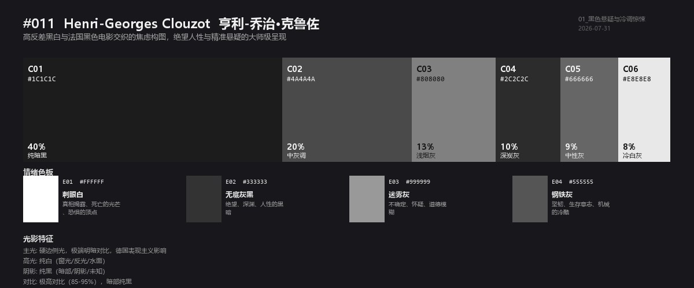
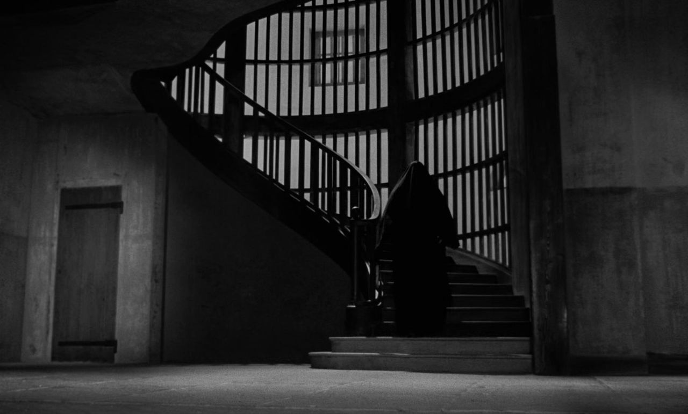
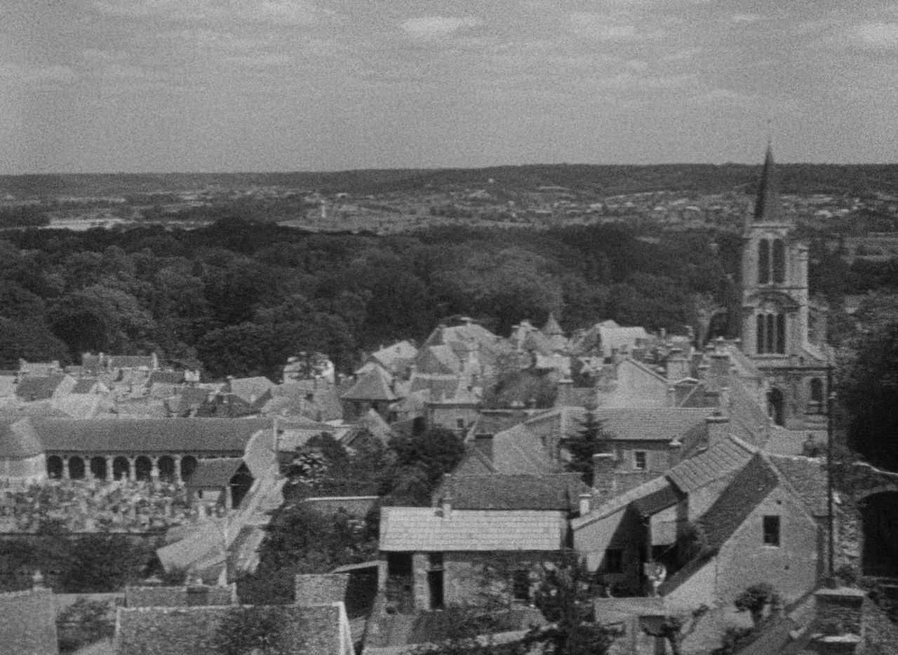
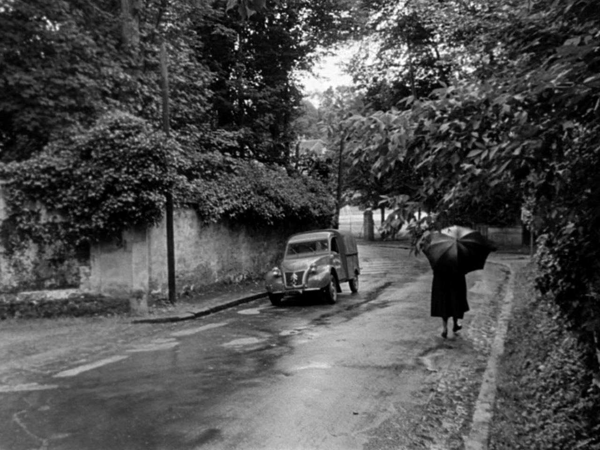
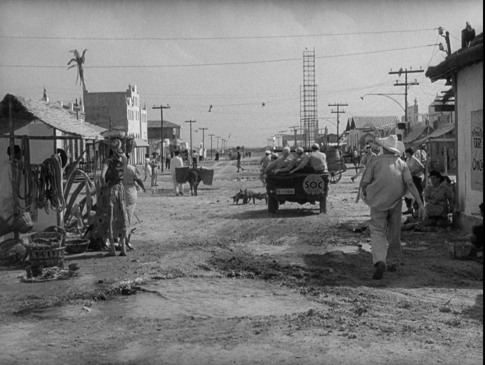

# 导演色卡 #011 — Henri-Georges Clouzot 亨利-乔治·克鲁佐

> **分类**：01 黑色悬疑与冷调惊悚
> **编号**：011
> **国籍**：法国
> **活跃年代**：1931-1968
> **创建日期**：2026-07-31

---

## 一、核心风格一句话

> 高反差黑白与法国黑色电影交织的焦虑构图，绝望人性与精准悬疑的大师级呈现。

---

## 二、色板构成



> 横版主色卡（点击查看高清图）

### 主色板（6色）

| 色号 | HEX | 色彩名称 | 占比 | 来源说明 |
|------|-----|---------|------|---------|
| C01 | `#1C1C1C` | 纯暗黑 | 40% | 恐惧的代价暗部、恶魔浴室阴影 |
| C02 | `#4A4A4A` | 中灰调 | 20% | 恐惧的代价灰尘、中间调 |
| C03 | `#808080` | 浅烟灰 | 13% | 白墙、烟雾、高光区域 |
| C04 | `#2C2C2C` | 深炭灰 | 10% | 暗部过渡、阴影边缘 |
| C05 | `#666666` | 中性灰 | 9% | 人物面部中间调、服装灰 |
| C06 | `#E8E8E8` | 冷白灰 | 8% | 高光、白色衬衫、水面反光 |

### 情绪色板（4色）

| 色号 | HEX | 色彩名称 | 情绪含义 |
|------|-----|---------|---------|
| E01 | `#FFFFFF` | 刺眼白 | 真相揭露、死亡的光芒、恐惧的顶点 |
| E02 | `#333333` | 无底灰黑 | 绝望、深渊、人性的黑暗 |
| E03 | `#999999` | 迷雾灰 | 不确定、怀疑、道德模糊 |
| E04 | `#555555` | 钢铁灰 | 坚韧、生存意志、机械的冷酷 |

### 光影特征

- **主光方向**：硬边侧光，极端light-dark对比，德国表现主义影响
- **高光色偏**：纯白（窗光/反光/水面）
- **阴影色偏**：纯黑（暗部/阴影/未知）
- **对比比**：极高对比（85-95%），暗部纯黑
- **色调整体**：黑白灰，极端light-dark二元对立

---

## 三、视觉风格关键词（按权重排序）

### 构图与运镜
高反差黑白 · 对角构图 · 楼梯几何 · 门框取景 · 阴影藏人 · 烟雾尘粒 · 水面反光 · 低角度仰拍 · 特写放大 · 平面化构图

### 色彩与光影
纯黑白灰 · 高对比度 · 硬边阴影 · 德国表现主义 · 烟雾朦胧 · 水面倒影 · 纹理丰富 · 白色衬衫 · 黑色大衣 · 灰色墙面

### 氛围与情绪
绝望 · 焦虑 · 人性黑暗 · 存在困境 · 社会批判 · 宿命感 · 猜疑背叛 · 生存恐惧 · 黑色幽默 · 道德沦丧

---

## 四、运镜特征

| 特征 | 说明 | 经典例子 |
|------|------|---------|
| 对角构图 | 斜线构图制造不安与张力 | 《恐惧的代价》山路运输 |
| 烟雾尘粒构图 | 利用烟雾和灰尘营造氛围 | 《恐惧的代价》油田火灾 |
| 水面反光镜头 | 水面倒影暗示真相与谎言 | 《恶魔》泳池场景 |
| 特写放大 | 极端特写放大面部表情和物体 | 《恐惧的代价》汗水特写 |
| 低角度仰拍 | 压迫感和权力关系 | 《乌鸦》村民围攻 |
| 长镜头跟拍 | 连续跟随增强紧张感 | 《恐惧的代价》卡车驾驶 |
| 门框取景 | 人物被框架囚禁的视觉隐喻 | 《恶魔》学校走廊 |
| 楼梯构图 | 上升下降的心理象征 | 《恐惧的代价》楼梯场景 |

---

## 五、经典场景色彩参考

### 电影截图画廊

| 恐惧的代价 | 恶魔 | 乌鸦 |
|--------|------|--------|
|  |  |  |
| 纯暗黑+中灰调 · 生存绝望 | 深炭灰+冷白灰 · 女性阴谋 | 中灰调+纯暗黑 · 集体猜疑 |

| 犯罪河岸 | 真相 | 监狱囚犯 |
|--------|------|--------|
|  | *真相（剧照未收录）* | *监狱囚犯（剧照未收录）* |
| 浅烟灰+深炭灰 · 潮湿阴郁 | 中性灰+刺眼白 · 正义谎言 | 纯暗黑+钢铁灰 · 体制暴力 |

### 电影色彩速查

| 电影 | 场景 | 主导色 | 色彩氛围 |
|------|------|--------|---------|
| 恐惧的代价 | 硝化甘油山路运输 | 纯暗黑+中灰调 | 绝望、生存、一触即发 |
| 恶魔 Les Diaboliques | 泳池浮尸 | 深炭灰+冷白灰 | 阴谋、恐惧、女人的复仇 |
| 乌鸦 Le Corbeau | 匿名信小镇 | 中灰调+纯暗黑 | 猜疑、集体疯狂、道德审判 |
| 犯罪河岸 | 码头犯罪 | 浅烟灰+深炭灰 | 底层犯罪、宿命、潮湿阴郁 |
| 曼侬 | 沙漠逃亡 | 冷白灰+中灰调 | 欲望、毁灭、炽热的爱 |
| 真相 | 法庭对峙 | 中性灰+刺眼白 | 正义、谎言、明星陨落 |
| 骗子 | 赌局骗局 | 深炭灰+浅烟灰 | 赌徒心理、欺骗、沉沦 |
| 监狱囚犯 | 监狱暴动 | 纯暗黑+钢铁灰 | 反叛、暴力、体制压迫 |

---

## 六、AI 生成提示词模板

> 完整提示词文件见 `prompts/` 目录

### 图像生成速用公式

```
[subject description], in the style of Henri-Georges Clouzot,
despair film still,
pure black white grey, high contrast,
high contrast black and white, staircase geometry,
anxiety atmosphere,
cinematic texture, grainy film look --ar 16:9 --style raw
```

### 视频生成速用公式

```
A despair scene in Henri-Georges Clouzot style,
high contrast black and white, pure black white grey,
hard-edged shadows with pure white,
human darkness, cinematic film look,
slow diagonal composition,
16:9 aspect ratio, cinematic movement
```

---

## 七、代表作索引

| 年份 | 片名 | 主要色彩特征 |
|------|------|-------------|
| 1943 | 乌鸦 Le Corbeau | 小镇匿名信、集体猜疑、法国黑色 |
| 1947 | 犯罪河岸 | 码头阴影、底层犯罪、潮湿阴郁 |
| 1950 | 真相 | 明星陨落、法庭对峙、黑白光影 |
| 1953 | 恐惧的代价 | 沙漠卡车、硝化甘油、紧张到窒息 |
| 1955 | 恶魔 | 泳池谋杀、女校阴谋、经典反转 |
| 1956 | 毕加索的秘密 | 纪录式创作、艺术与光影 |
| 1960 | 真相（重拍） | 法庭戏剧、黑白高对比 |
| 1968 | 女囚犯 | 监狱题材、女性困境 |

---

## 八、蒸馏验证

- [x] 色板6+4色已提取
- [x] 可视化色卡图片已生成（横版+竖版）
- [x] 运镜特征已归纳（8种）
- [x] 提示词模板已生成（MJ/SD/视频）
- [ ] 电影截图参考图已收集
- [ ] Stable Diffusion 实测试图
- [ ] Runway 视频测试