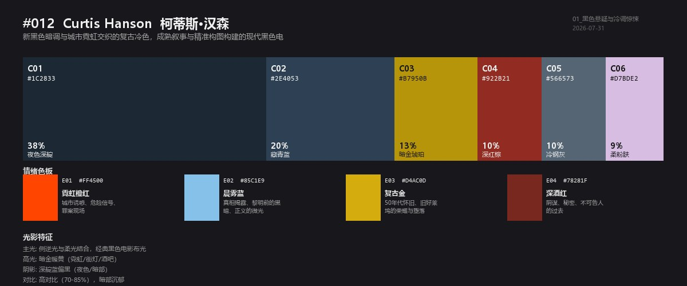
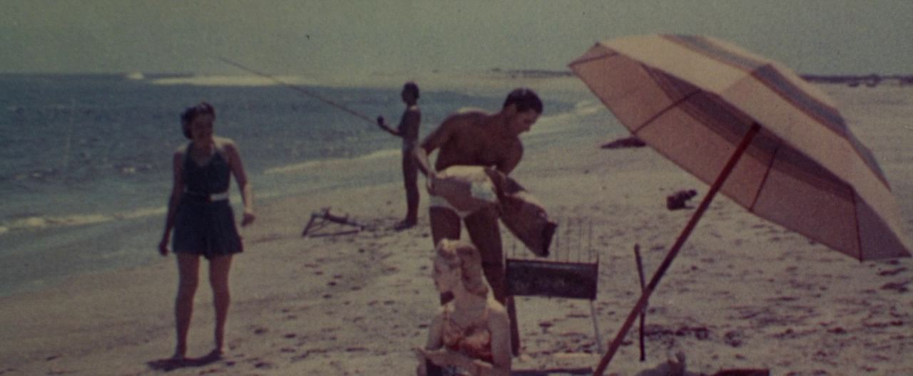

# 导演色卡 #012 — Curtis Hanson 柯蒂斯·汉森

> **分类**：01 黑色悬疑与冷调惊悚
> **编号**：012
> **国籍**：美国
> **活跃年代**：1973-2011
> **创建日期**：2026-07-31

---

## 一、核心风格一句话

> 新黑色暗调与城市霓虹交织的复古冷色，成熟叙事与精准构图构建的现代黑色电影。

---

## 二、色板构成



> 横版主色卡（点击查看高清图）

### 主色板（6色）

| 色号 | HEX | 色彩名称 | 占比 | 来源说明 |
|------|-----|---------|------|---------|
| C01 | `#1C2833` | 夜色深靛 | 38% | 洛城机密夜戏、8英里暗部 |
| C02 | `#2E4053` | 藏青蓝 | 20% | 洛城机密西装、暗街夜色 |
| C03 | `#B7950B` | 暗金琥珀 | 13% | 50年代酒吧、复古霓虹灯金 |
| C04 | `#922B21` | 深红棕 | 10% | 红色霓虹、血迹、红唇 |
| C05 | `#566573` | 冷钢灰 | 10% | 警察局内景、街道灰调 |
| C06 | `#D7BDE2` | 柔粉肤 | 9% | 女主角肤色、复古妆容 |

### 情绪色板（4色）

| 色号 | HEX | 色彩名称 | 情绪含义 |
|------|-----|---------|---------|
| E01 | `#FF4500` | 霓虹橙红 | 城市诱惑、危险信号、罪案现场 |
| E02 | `#85C1E9` | 晨雾蓝 | 真相揭露、黎明前的黑暗、正义的微光 |
| E03 | `#D4AC0D` | 复古金 | 50年代怀旧、旧好莱坞的荣耀与堕落 |
| E04 | `#78281F` | 深酒红 | 阴谋、秘密、不可告人的过去 |

### 光影特征

- **主光方向**：侧逆光与柔光结合，经典黑色电影布光
- **高光色偏**：暗金暖黄（霓虹/街灯/酒吧）
- **阴影色偏**：深靛蓝偏黑（夜色/暗部）
- **对比比**：高对比（70-85%），暗部沉郁
- **色调整体**：暖暗新黑色，55%暖金棕 + 45%冷靛蓝

---

## 三、视觉风格关键词（按权重排序）

### 构图与运镜
新黑色构图 · 低角度仰拍 · 窗框取景 · 走廊透视 · 镜子反射 · 长镜头跟踪 · 百叶窗光影 · 人物剪影 · 烟雾氛围 · 汽车前灯

### 色彩与光影
新黑色暗调 · 城市霓虹 · 复古冷色 · 暗金琥珀 · 深红棕 · 藏青蓝西装 · 烟雾朦胧 · 雨湿反光 · 50年代色调 · 电影胶片质感

### 氛围与情绪
新黑色电影 · 城市黑暗面 · 警匪对决 · 政治阴谋 · 道德模糊 · 怀旧浪漫 · 男性情谊 · 司法腐败 · 悬疑推理 · 宿命感

---

## 四、运镜特征

| 特征 | 说明 | 经典例子 |
|------|------|---------|
| 长镜头跟踪 | 流畅的跟随长镜头，信息丰富 | 《洛城机密》酒吧跟踪 |
| 百叶窗光影 | 条状阴影在人物脸上，暗示秘密 | 《洛城机密》办公室场景 |
| 低角度仰拍建筑 | 建筑的压迫感和权力感 | 《洛城机密》警察局 |
| 走廊透视 | 走廊纵深构图，尽头未知 | 《洛城机密》酒店走廊 |
| 车内构图 | 车内空间的封闭感与观察视角 | 《洛城机密》车中对峙 |
| 镜面反射 | 通过镜子揭示隐藏信息 | 《奇迹小子》镜子戏 |
| 烟雾氛围 | 烟雾营造怀旧和神秘感 | 《洛城机密》酒吧场景 |
| 手持跟拍 | 关键时刻增加真实感 | 《8英里》说唱对决 |

---

## 五、经典场景色彩参考

### 电影截图画廊

| 洛城机密 | 洛城机密夜街 | 8英里 |
|--------|------|--------|
|  | *洛城机密夜街（剧照未收录）* | *8英里（剧照未收录）* |
| 暗金琥珀+夜色深靛 · 警匪博弈 | 藏青蓝+霓虹橙红 · 黑暗城市 | 深红棕+冷钢灰 · 底层奋斗 |

| 奇迹小子 | 狂野之河 | 血溅13号警署 |
|--------|------|--------|
| *奇迹小子（剧照未收录）* | *狂野之河（剧照未收录）* | *血溅13号警署（剧照未收录）* |
| 冷钢灰+柔粉肤 · 中年危机 | 晨雾蓝+藏青蓝 · 自然力量 | 夜色深靛+深红棕 · 围困生存 |

### 电影色彩速查

| 电影 | 场景 | 主导色 | 色彩氛围 |
|------|------|--------|---------|
| 洛城机密 | 酒吧对峙 | 暗金琥珀+夜色深靛 | 张力、试探、警匪博弈 |
| 洛城机密 | 夜街追凶 | 藏青蓝+霓虹橙红 | 紧张、黑暗城市、危险迫近 |
| 8英里 | 地下说唱对决 | 深红棕+冷钢灰 | 底层奋斗、原始能量、尊严 |
| 奇迹小子 | 冬日校园 | 冷钢灰+柔粉肤 | 中年危机、写作困境、温暖幽默 |
| 狂野之河 | 急流冒险 | 晨雾蓝+藏青蓝 | 生存、家庭危机、自然力量 |
| 手到擒来 | 赌场骗局 | 复古金+深酒红 | 骗术、浪漫、轻松悬疑 |
| 窗外有蓝天 | 河畔浪漫 | 暗金琥珀+柔粉肤 | 青春爱情、成长、田园诗意 |
| 血溅13号警署 | 警署围攻 | 夜色深靛+深红棕 | 围困、生存、暴力升级 |

---

## 六、AI 生成提示词模板

> 完整提示词文件见 `prompts/` 目录

### 图像生成速用公式

```
[subject description], in the style of Curtis Hanson,
neo-noir film film still,
neo-noir dark tone, urban neon,
neo-noir composition, window frame composition,
urban dark side atmosphere,
cinematic texture, grainy film look --ar 16:9 --style raw
```

### 视频生成速用公式

```
A neo-noir film scene in Curtis Hanson style,
neo-noir composition, neo-noir dark tone,
retro cool colors with dark golden warm yellow,
cop vs criminal showdown, cinematic film look,
slow long take following shot,
16:9 aspect ratio, cinematic movement
```

---

## 七、代表作索引

| 年份 | 片名 | 主要色彩特征 |
|------|------|-------------|
| 1990 | 窗外有蓝天 | 田园暖调、青春爱情、成长故事 |
| 1992 | 手到擒来 | 赌场暖金、骗术悬疑、黑色幽默 |
| 1997 | 洛城机密 | 50年代暗金、新黑色、警匪悬疑 |
| 2000 | 奇迹小子 | 冬日校园、冷调温情、中年危机 |
| 2002 | 8英里 | 底特律灰调、地下说唱、底层奋斗 |
| 2007 | 幸运牌手 | 赌城暖金、扑克心理、父子关系 |
| 2011 | 大而不倒 | 金融冷调、政治惊悚、危机时刻 |

---

## 八、蒸馏验证

- [x] 色板6+4色已提取
- [x] 可视化色卡图片已生成（横版+竖版）
- [x] 运镜特征已归纳（8种）
- [x] 提示词模板已生成（MJ/SD/视频）
- [ ] 电影截图参考图已收集
- [ ] Stable Diffusion 实测试图
- [ ] Runway 视频测试