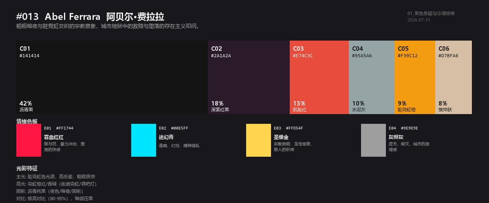
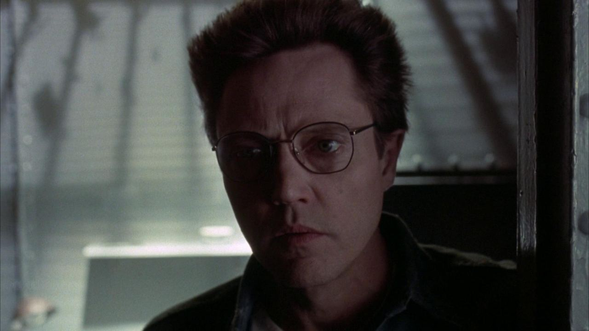
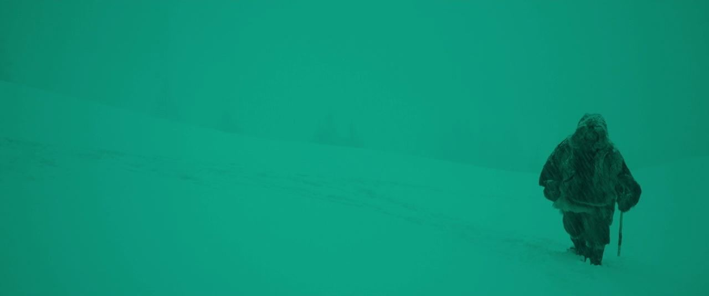
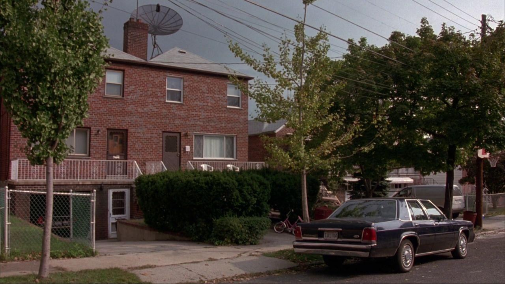
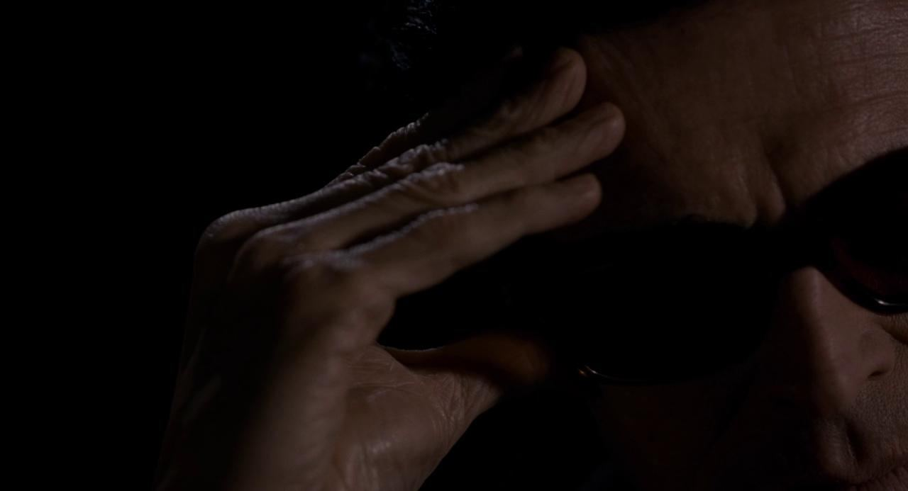

# 导演色卡 #013 — Abel Ferrara 阿贝尔·费拉拉

> **分类**：01 黑色悬疑与冷调惊悚
> **编号**：013
> **国籍**：美国
> **活跃年代**：1976-至今
> **创建日期**：2026-07-31

---

## 一、核心风格一句话

> 粗粝暗夜与脏霓虹交织的宗教意象，城市地狱中的救赎与堕落的存在主义叩问。

---

## 二、色板构成



> 横版主色卡（点击查看高清图）

### 主色板（6色）

| 色号 | HEX | 色彩名称 | 占比 | 来源说明 |
|------|-----|---------|------|---------|
| C01 | `#141414` | 沥青黑 | 42% | 坏中尉暗部、纽约夜晚街道 |
| C02 | `#2A1A2A` | 深紫红黑 | 18% | 夜店霓虹暗部、脱衣舞俱乐部 |
| C03 | `#E74C3C` | 肮脏红 | 13% | 坏中尉夹克、暴力血迹 |
| C04 | `#95A5A6` | 水泥灰 | 10% | 纽约街道、建筑水泥墙 |
| C05 | `#F39C12` | 脏霓虹橙 | 9% | 街灯、霓虹招牌、酒吧灯光 |
| C06 | `#D7BFA6` | 憔悴肤 | 8% | 人物憔悴肤色、风尘感 |

### 情绪色板（4色）

| 色号 | HEX | 色彩名称 | 情绪含义 |
|------|-----|---------|---------|
| E01 | `#FF1744` | 罪血红红 | 罪与罚、暴力冲动、堕落的快感 |
| E02 | `#00E5FF` | 迷幻青 | 毒瘾、幻觉、精神错乱 |
| E03 | `#FFD54F` | 圣像金 | 宗教救赎、圣母意象、罪人的祈祷 |
| E04 | `#9E9E9E` | 灰烬灰 | 虚无、毁灭、城市的废墟感 |

### 光影特征

- **主光方向**：脏霓虹色光源，高反差，粗粝质感
- **高光色偏**：霓虹橙红/青绿（街道霓虹/酒吧灯）
- **阴影色偏**：沥青纯黑（夜色/暗巷/阴影）
- **对比比**：极高对比（80-95%），暗部压黑
- **色调整体**：暗夜脏霓虹，65%冷暗 + 35%脏彩色

---

## 三、视觉风格关键词（按权重排序）

### 构图与运镜
粗粝手持 · 脏霓虹构图 · 宗教意象 · 低角度仰拍 · 街景构图 · 镜子破碎 · 烟雾弥漫 · 城市夜景 · 特写暴力 · 手持晃动

### 色彩与光影
粗粝暗夜 · 脏霓虹 · 宗教暗金 · 血红暴力 · 水泥灰调 · 街头肮脏感 · 胶片颗粒 · 红绿对比 · 蓝紫夜店色 · 焦黄肤色

### 氛围与情绪
城市地狱 · 宗教救赎 · 罪恶与忏悔 · 毒瘾与堕落 · 存在主义 · 底层生活 · 暴力美学 · 黑色都市 · 精神崩溃 · 救赎的不可能

---

## 四、运镜特征

| 特征 | 说明 | 经典例子 |
|------|------|---------|
| 手持跟拍 | 晃动的手持镜头，真实粗粝 | 《坏中尉》街道行走 |
| 低角度仰拍 | 宗教意象，人物被审判感 | 《坏中尉》教堂场景 |
| 霓虹剪影 | 人物在霓虹前的剪影 | 《纽约王》夜店场景 |
| 破碎镜面 | 破碎的镜子象征分裂的自我 | 《死亡游戏》镜子戏 |
| 烟雾迷漫 | 烟雾营造地狱般的氛围 | 《坏中尉》毒品场景 |
| 特写暴力 | 近距离拍摄暴力场面 | 《坏中尉》暴力场景 |
| 长镜头观察 | 远距离观察，像纪录片 | 《玛丽》宗教场景 |
| 夜间车拍 | 车内视角观察城市夜晚 | 《坏中尉》驾驶场景 |

---

## 五、经典场景色彩参考

### 电影截图画廊

| 坏中尉·教堂 | 坏中尉·街头 | 纽约王 |
|--------|------|--------|
|  |  |  |
| 圣像金+沥青黑 · 罪与救赎 | 肮脏红+迷幻青 · 毒瘾堕落 | 深紫红黑+脏霓虹橙 · 暗夜权力 |

| 电钻杀手 | 死亡游戏 | 玛丽 |
|--------|------|--------|
|  | *死亡游戏（剧照未收录）* | *玛丽（剧照未收录）* |
| 沥青黑+血红 · 原始暴力 | 迷幻青+沥青黑 · 精神分裂 | 圣像金+水泥灰 · 信仰危机 |

### 电影色彩速查

| 电影 | 场景 | 主导色 | 色彩氛围 |
|------|------|--------|---------|
| 坏中尉 | 教堂救赎 | 圣像金+沥青黑 | 罪与罚、宗教狂热、绝望 |
| 坏中尉 | 街头毒瘾 | 肮脏红+迷幻青 | 堕落、毒瘾、自我毁灭 |
| 纽约王 | 夜店王者 | 深紫红黑+脏霓虹橙 | 黑帮荣耀、夜晚城市、权力 |
| 电钻杀手 | 公寓谋杀 | 沥青黑+血红 | 原始暴力、精神错乱、城市恐惧 |
| 威龙杀阵 | 功夫复仇 | 水泥灰+肮脏红 | 复仇、地下世界、正义暴力 |
| 死亡游戏 | 演员入戏 | 迷幻青+沥青黑 | 虚实不分、精神异化、艺术与死亡 |
| 玛丽 | 宗教演绎 | 圣像金+水泥灰 | 信仰危机、艺术与宗教、现代救赎 |
| 零点定理 | 黑客追凶 | 脏霓虹+深紫红黑 | 数字时代、信息恐惧、黑客文化 |

---

## 六、AI 生成提示词模板

> 完整提示词文件见 `prompts/` 目录

### 图像生成速用公式

```
[subject description], in the style of Abel Ferrara,
urban hell film still,
gritty dark night, grimy neon,
gritty handheld, religious imagery,
religious redemption atmosphere,
cinematic texture, grainy film look --ar 16:9 --style raw
```

### 视频生成速用公式

```
A urban hell scene in Abel Ferrara style,
gritty handheld, gritty dark night,
religiondark gold with neon orange-red/teal,
sin and repentance, cinematic film look,
slow handheld tracking shot,
16:9 aspect ratio, cinematic movement
```

---

## 七、代表作索引

| 年份 | 片名 | 主要色彩特征 |
|------|------|-------------|
| 1979 | 电钻杀手 | 粗粝恐怖、公寓谋杀、低预算质感 |
| 1981 | 恐惧X | 连环杀手、地铁恐怖、城市暴力 |
| 1990 | 纽约王 | 黑帮暗色、夜店霓虹、哈林区 |
| 1992 | 坏中尉 | 脏霓虹、宗教意象、堕落救赎 |
| 1995 | 死亡游戏 | 演员迷局、虚实不分、好莱坞黑暗 |
| 2005 | 玛丽 | 宗教金调、信仰危机、艺术救赎 |
| 2014 | 欢迎来到纽约 | 酒店囚笼、性丑闻、权力堕落 |
| 2019 | 托马索 | 罗马生活、瘾君子挣扎、半自传 |

---

## 八、蒸馏验证

- [x] 色板6+4色已提取
- [x] 可视化色卡图片已生成（横版+竖版）
- [x] 运镜特征已归纳（8种）
- [x] 提示词模板已生成（MJ/SD/视频）
- [ ] 电影截图参考图已收集
- [ ] Stable Diffusion 实测试图
- [ ] Runway 视频测试