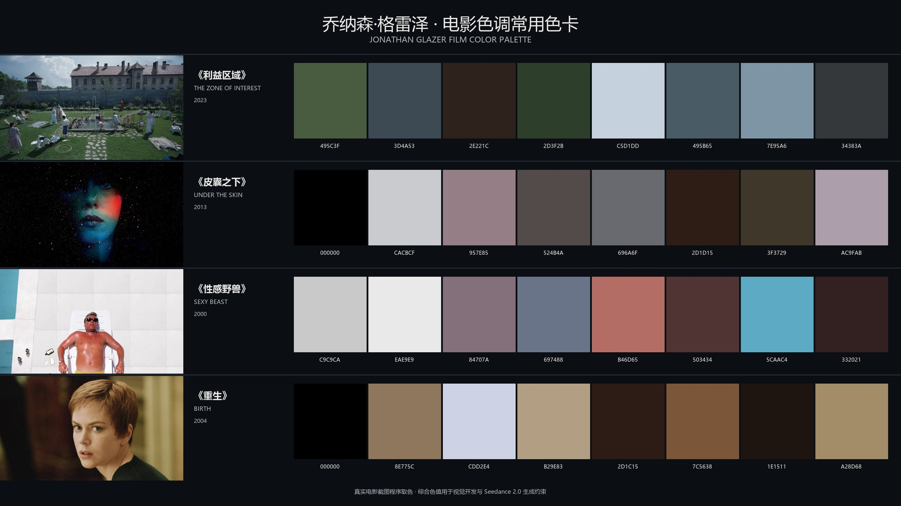
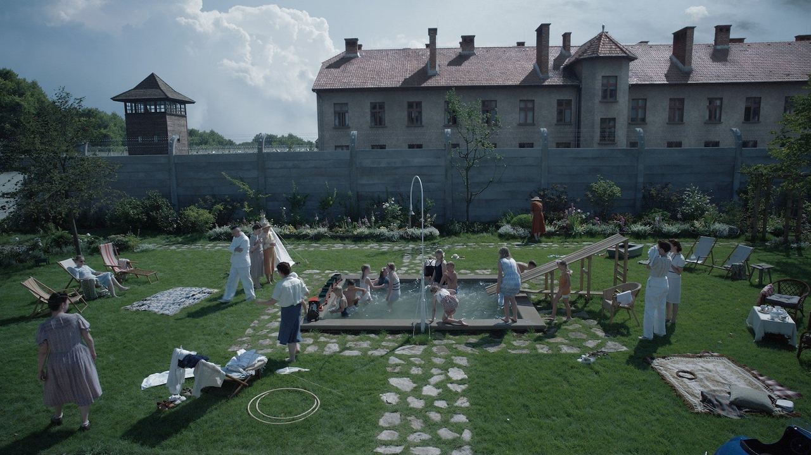
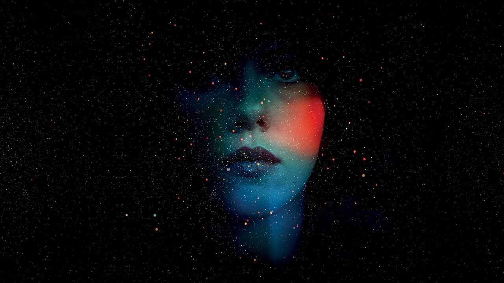
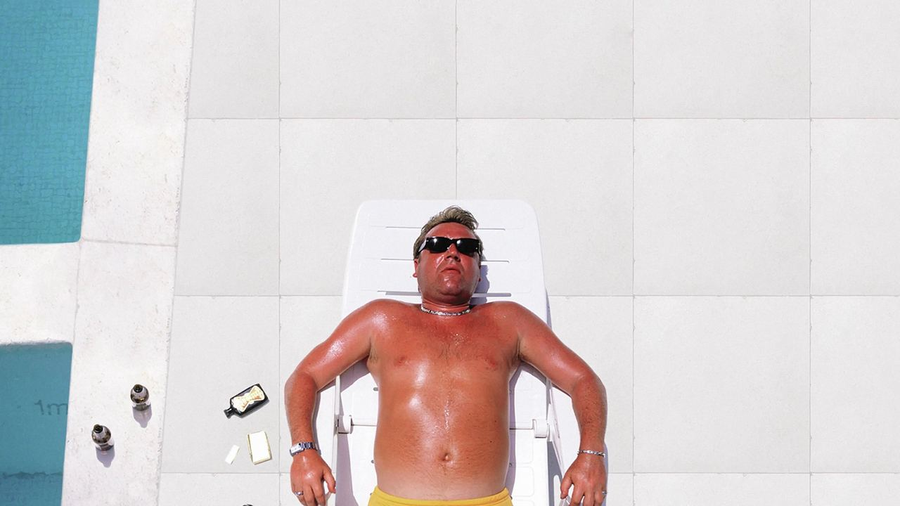
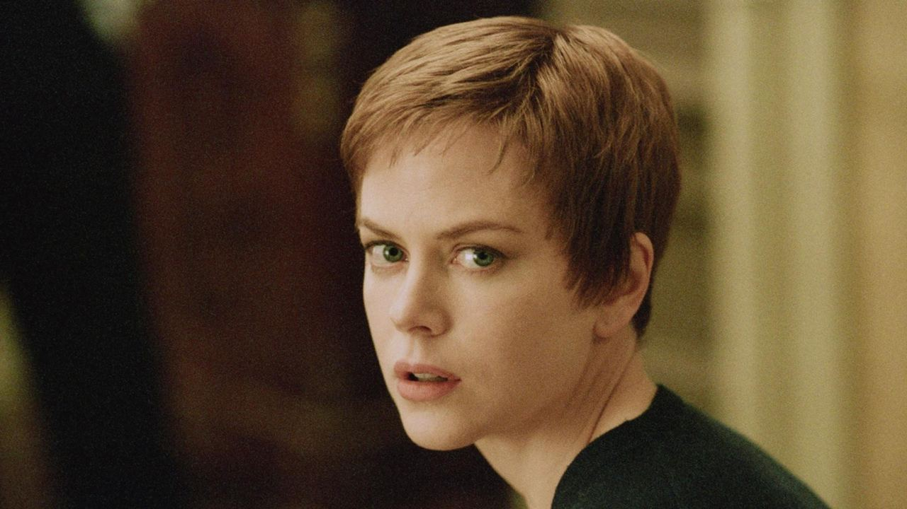

# 导演色卡 #014 — Jonathan Glazer 乔纳森·格雷泽

> **分类**：01 黑色悬疑与冷调惊悚
> **编号**：014
> **国籍**：英国
> **活跃年代**：1997-至今
> **创建日期**：2026-07-31

---

## 一、核心风格一句话

> 极端构图与冷黑实验交织的抽象恐怖，疏离视角与精准声音设计构建的存在主义惊惧。

---

## 二、色板构成



> 横版主色卡（点击查看高清图）

### 主色板（6色）

| 色号 | HEX | 色彩名称 | 占比 | 来源说明 |
|------|-----|---------|------|---------|
| C01 | `#0A0A0A` | 虚空黑 | 45% | 皮囊之下暗部、利益区域黑色 |
| C02 | `#1C2833` | 深渊蓝灰 | 18% | 皮囊之下隧道、苏格兰冷天 |
| C03 | `#78281F` | 凝固血 | 12% | 皮囊之下红色场景、暴力痕迹 |
| C04 | `#5D6D7E` | 铁灰蓝 | 10% | 利益区域集中营、灰色制服 |
| C05 | `#AAB7B8` | 冷灰雾 | 8% | 苏格兰雾天、苍白天空 |
| C06 | `#F5B7B1` | 苍白肤 | 7% | 女主角苍白肤色、冷光下人皮肤 |

### 情绪色板（4色）

| 色号 | HEX | 色彩名称 | 情绪含义 |
|------|-----|---------|---------|
| E01 | `#000000` | 绝对黑 | 虚无、未知、存在的深渊 |
| E02 | `#E74C3C` | 原初红 | 原始欲望、生命与死亡、肉体的真相 |
| E03 | `#85929E` | 冷钢蓝 | 疏离、观察、非人的视角 |
| E04 | `#F4F6F7` | 幽灵白 | 纯真的丧失、人类的脆弱、超自然 |

### 光影特征

- **主光方向**：极简光源，大面积暗部，精准的单光源设计
- **高光色偏**：冷白偏灰（自然光/日光灯/未知光源）
- **阴影色偏**：纯黑（虚空/暗部/未知空间）
- **对比比**：极高对比（85-95%），大面积纯黑
- **色调整体**：冷黑实验，90%冷暗 + 10%微弱暖调

---

## 三、视觉风格关键词（按权重排序）

### 构图与运镜
极简极端构图 · 固定长镜头 · 对称几何 · 大面积暗部 · 人物渺小化 · 抽象空间 · 手持观察 · 水面倒影 · 低角度仰拍 · 负空间构图

### 色彩与光影
冷黑实验 · 抽象恐怖 · 极简色彩 · 大面积暗部 · 冷白高光 · 血红点缀 · 铁灰冷调 · 雾蒙蒙白 · 肤色苍白 · 虚空纯黑

### 氛围与情绪
存在主义恐惧 · 超自然疏离 · 抽象恐怖 · 非人视角 · 人类的渺小 · 身份消融 · 生命与死亡 · 时间的静止 · 道德深渊 · 不可名状

---

## 四、运镜特征

| 特征 | 说明 | 经典例子 |
|------|------|---------|
| 固定长镜头 | 长时间静止，观察与等待 | 《利益区域》集中营围墙外 |
| 极简对称构图 | 完美对称，秩序感与不安 | 《皮囊之下》商场场景 |
| 负空间构图 | 大量空白/黑色空间，人物渺小 | 《皮囊之下》海滩场景 |
| 手持观察镜头 | 像纪录片一样的观察视角 | 《出生》公园场景 |
| 抽象空间镜头 | 空间的抽象化，脱离现实 | 《皮囊之下》黑色虚空 |
| 低角度仰拍天空 | 天空占据画面，渺小感 | 《利益区域》烟囱仰拍 |
| 水面倒影构图 | 水的反射暗示另一个世界 | 《皮囊之下》水中场景 |
| 缓慢推进 | 极其缓慢的推进，积累张力 | 《出生》走廊场景 |

---

## 五、经典场景色彩参考

### 电影截图画廊

| 皮囊之下·虚空 | 皮囊之下·公路 | 利益区域·墙外 |
|--------|------|--------|
|  |  |  |
| 虚空黑+原初红 · 存在恐惧 | 铁灰蓝+冷灰雾 · 疏离观察 | 深渊蓝灰+冷灰雾 · 平庸之恶 |

| 利益区域·家庭 | 出生·公园 | 性感野兽·别墅 |
|--------|------|--------|
|  | *出生公园（剧照未收录）* | *性感野兽别墅（剧照未收录）* |
| 苍白肤+铁灰蓝 · 日常之恶 | 冷灰雾+深渊蓝灰 · 转世迷思 | 铁灰蓝+凝固血 · 暴力暗流 |

### 电影色彩速查

| 电影 | 场景 | 主导色 | 色彩氛围 |
|------|------|--------|---------|
| 皮囊之下 | 黑色虚空 | 虚空黑+原初红 | 存在恐惧、非人视角、生命本质 |
| 皮囊之下 | 苏格兰公路 | 铁灰蓝+冷灰雾 | 疏离、观察、陌生感 |
| 利益区域 | 集中营墙外 | 深渊蓝灰+冷灰雾 | 平庸之恶、日常中的恐怖、距离感 |
| 利益区域 | 军官家庭 | 苍白肤+铁灰蓝 | 正常的假象、恶的日常化 |
| 出生 Birth | 中央公园 | 冷灰雾+深渊蓝灰 | 转世迷思、爱与记忆、身份疑问 |
| 性感野兽 | 西班牙别墅 | 铁灰蓝+凝固血 | 黑帮返乡、暴力的回归、男性危机 |
| 区域 | 未知空间 | 虚空黑+幽灵白 | 超现实、抽象恐怖、不可名状 |
| 最后一班地铁 | 夜间街道 | 深渊蓝灰+苍白肤 | 孤独、追思、时间的重量 |

---

## 六、AI 生成提示词模板

> 完整提示词文件见 `prompts/` 目录

### 图像生成速用公式

```
[subject description], in the style of Jonathan Glazer,
existential dread film still,
cold black experiment, abstract horror,
minimal extreme composition, symmetrical geometry,
supernaturalalienation atmosphere,
cinematic texture, grainy film look --ar 16:9 --style raw
```

### 视频生成速用公式

```
A existential dread scene in Jonathan Glazer style,
minimal extreme composition, cold black experiment,
minimal color palette with cool white-grey,
abstract horror, cinematic film look,
slow static long take,
16:9 aspect ratio, cinematic movement
```

---

## 七、代表作索引

| 年份 | 片名 | 主要色彩特征 |
|------|------|-------------|
| 2000 | 性感野兽 | 西班牙暖调、黑帮返乡、暴力暗流 |
| 2004 | 出生 Birth | 纽约冷调、转世迷思、心理悬疑 |
| 2013 | 皮囊之下 | 苏格兰冷调、极简科幻、存在恐惧 |
| 2023 | 利益区域 | 集中营灰调、平庸之恶、声音设计 |
| 详见乔纳森·格雷泽代表作品分析 | 区域 | 抽象恐怖、超现实空间、实验叙事 |

---

## 八、蒸馏验证

- [x] 色板6+4色已提取
- [x] 可视化色卡图片已生成（横版+竖版）
- [x] 运镜特征已归纳（8种）
- [x] 提示词模板已生成（MJ/SD/视频）
- [ ] 电影截图参考图已收集
- [ ] Stable Diffusion 实测试图
- [ ] Runway 视频测试