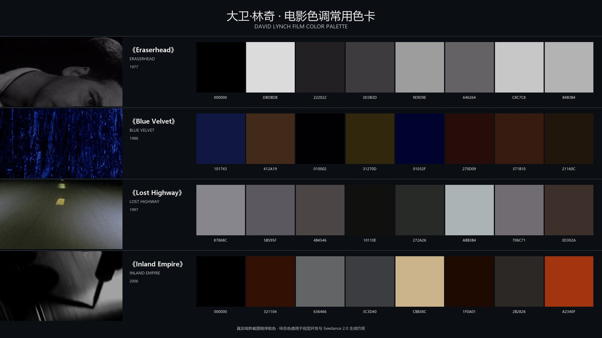
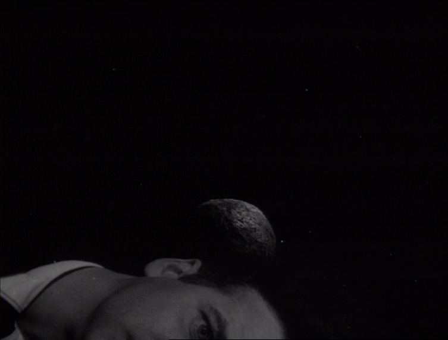
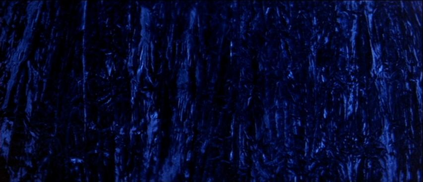
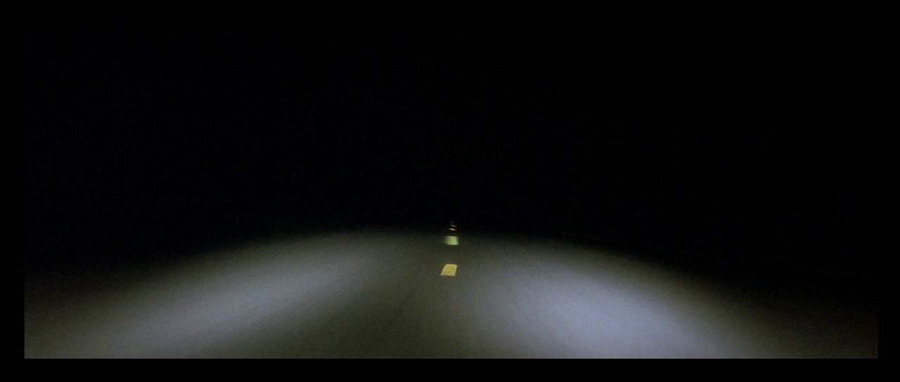

# 导演色卡 #015 — David Lynch 大卫·林奇

> **分类**：01 黑色悬疑与冷调惊悚
> **编号**：015
> **国籍**：美国
> **活跃年代**：1977-至今
> **创建日期**：2026-07-31

---

## 一、核心风格一句话

> 超现实暗红与天鹅绒质感交织的梦境逻辑，工业杂音与潜意识恐惧构筑的美国黑暗寓言。

---

## 二、色板构成



> 横版主色卡（点击查看高清图）

### 主色板（6色）

| 色号 | HEX | 色彩名称 | 占比 | 来源说明 |
|------|-----|---------|------|---------|
| C01 | `#1A0A14` | 天鹅绒紫黑 | 38% | 穆赫兰道暗部、蓝丝绒夜幕 |
| C02 | `#641E16` | 深酒红 | 20% | 蓝丝绒红帘、穆赫兰道剧院 |
| C03 | `#1E3D59` | 深海蓝 | 13% | 蓝丝绒夜晚、双峰镇暗调 |
| C04 | `#B7950B` | 复古金 | 10% | 50年代怀旧、舞厅灯、咖啡馆 |
| C05 | `#234F1E` | 墨绿森林 | 10% | 双峰镇森林、太平洋西北绿 |
| C06 | `#F5CBA7` | 暖杏肤 | 9% | 女人肤色、红唇、暖光下人皮肤 |

### 情绪色板（4色）

| 色号 | HEX | 色彩名称 | 情绪含义 |
|------|-----|---------|---------|
| E01 | `#943126` | 鲜血红 | 暴力、潜意识、梦境的入侵 |
| E02 | `#5DADE2` | 霓虹蓝 | 神秘、未知、另一个世界 |
| E03 | `#F7DC6F` | 梦境金 | 超现实、记忆的扭曲、白日梦 |
| E04 | `#7D3C98` | 迷幻紫 | 潜意识、疯狂、超越现实 |

### 光影特征

- **主光方向**：硬软交替，梦境柔光vs现实硬光，工业色光
- **高光色偏**：暖金/霓虹蓝（梦境灯/霓虹/工业灯）
- **阴影色偏**：深紫红偏黑（暗部/梦境/未知空间）
- **对比比**：高对比（75-90%），暗部浓郁
- **色调整体**：暗调梦境，60%暖红金 + 40%冷蓝紫

---

## 三、视觉风格关键词（按权重排序）

### 构图与运镜
梦境构图 · 对称与失衡交替 · 工业质感 · 红帘构图 · 低角度仰拍 · 镜面反射 · 烟雾缭绕 · 长镜头滑行 · 人物特写 · 神秘光源

### 色彩与光影
超现实暗红 · 天鹅绒质感 · 梦境蓝金 · 工业冷光 · 复古暖金 · 霓虹蓝色 · 森林墨绿 · 红唇对比 · 紫色迷幻 · 黑白反转

### 氛围与情绪
超现实 · 梦境逻辑 · 潜意识恐惧 · 美国黑暗面 · 工业噪声 · 恋物癖 · 黑色幽默 · 神秘主义 · 身份迷失 · 双峰式怪诞

---

## 四、运镜特征

| 特征 | 说明 | 经典例子 |
|------|------|---------|
| 长镜头滑行 | 像做梦一样的平滑移动 | 《穆赫兰道》Silencio剧院 |
| 红帘构图 | 红色窗帘作为神秘的边界 | 《蓝丝绒》红帘场景 |
| 低角度仰拍工业 | 工业建筑的压迫感和神秘感 | 《橡皮头》工厂 |
| 梦境柔光 | 柔焦处理，梦幻质感 | 《穆赫兰道》贝蒂初到洛杉矶 |
| 镜面反射多重 | 多重镜子反射，身份迷失 | 《内陆帝国》镜子场景 |
| 烟雾弥漫 | 烟雾营造梦境和神秘感 | 《双峰镇》森林场景 |
| 特写放大 | 极端特写，物件的神秘化 | 《蓝丝绒》耳朵特写 |
| 手持混乱 | 梦境崩塌时的手持晃动 | 《穆赫兰道》结局崩溃 |

---

## 五、经典场景色彩参考

### 电影截图画廊

| 穆赫兰道 | 蓝丝绒 | 双峰镇 |
|--------|------|--------|
|  |  |  |
| 深酒红+梦境金 · 梦境崩塌 | 天鹅绒紫黑+鲜血红 · 禁忌窥视 | 墨绿森林+霓虹蓝 · 怪诞神秘 |

| 橡皮头 | 内陆帝国 | 妖夜慌踪 |
|--------|------|--------|
|  | *内陆帝国（剧照未收录）* | *妖夜慌踪（剧照未收录）* |
| 深酒红+工业冷灰 · 存在焦虑 | 迷幻紫+天鹅绒紫黑 · 身份消融 | 复古金+深海蓝 · 黑色梦境 |

**色彩氛围描述**：林奇的画面世界是一场被红帘和工业烟雾笼罩的梦境——深酒红与天鹅绒紫黑铺陈潜意识的底色，梦境金的暖光与霓虹蓝的冷光在银幕两端交替闪烁，墨绿森林中藏着太平洋西北的怪诞秘密。每一帧都像从噩梦中截取的快照，美丽而令人不安。

### 电影色彩速查

| 电影 | 场景 | 主导色 | 色彩氛围 |
|------|------|--------|---------|
| 穆赫兰道 | Silencio剧院 | 深酒红+梦境金 | 梦境崩塌、真相浮现、心碎 |
| 蓝丝绒 | 红帘后窥视 | 天鹅绒紫黑+鲜血红 | 禁忌、窥视、小镇的黑暗秘密 |
| 双峰镇 | 森林小屋 | 墨绿森林+霓虹蓝 | 怪诞、神秘、太平洋西北 |
| 橡皮头 | 工业公寓 | 深酒红+工业冷灰 | 存在焦虑、父性恐惧、超现实 |
| 内陆帝国 | 镜子迷宫 | 迷幻紫+天鹅绒紫黑 | 身份消融、多重现实、疯狂 |
| 妖夜慌踪 | 沙漠旅馆 | 复古金+深海蓝 | 身份交换、死亡与重生、黑色梦境 |
| 象人 | 维多利亚伦敦 | 暖杏肤+深酒红 | 人性尊严、社会的残酷、温柔 |
| 沙丘 | 外星沙漠 | 梦境金+深酒红 | 史诗科幻、神秘主义、宇宙意识 |

---

## 六、AI 生成提示词模板

> 完整提示词文件见 `prompts/` 目录

### 图像生成速用公式

```
[subject description], in the style of David Lynch,
surreal film still,
surreal dark red, velvet texture,
dream composition, industrial texture,
dream logic atmosphere,
cinematic texture, grainy film look --ar 16:9 --style raw
```

### 视频生成速用公式

```
A surreal scene in David Lynch style,
dream composition, surreal dark red,
dream blue and gold with warm gold/neon blue,
subconscious fear, cinematic film look,
slow long gliding tracking shot,
16:9 aspect ratio, cinematic movement
```

---

## 七、代表作索引

| 年份 | 片名 | 主要色彩特征 |
|------|------|-------------|
| 1977 | 橡皮头 | 工业黑白、超现实、存在焦虑 |
| 1980 | 象人 | 维多利亚暗金、人性尊严、黑白影像 |
| 1986 | 蓝丝绒 | 小镇暗调、红帘窥视、黑色梦境 |
| 1990 | 我心狂野 | 公路暖色、疯狂爱情、蛇皮夹克 |
| 1992 | 双峰镇：与火同行 | 太平洋西北、红屋梦境、神秘恐怖 |
| 2001 | 穆赫兰道 | 好莱坞暗金、梦境逻辑、身份迷局 |
| 2006 | 内陆帝国 | 数字影像、迷幻紫、多重现实 |
| 2017 | 双峰镇 回归 | 超现实恐怖、黑白红、时间的扭曲 |

---

## 八、蒸馏验证

- [x] 色板6+4色已提取
- [x] 可视化色卡图片已生成（横版+竖版）
- [x] 运镜特征已归纳（8种）
- [x] 提示词模板已生成（MJ/SD/视频）
- [ ] 电影截图参考图已收集
- [ ] Stable Diffusion 实测试图
- [ ] Runway 视频测试