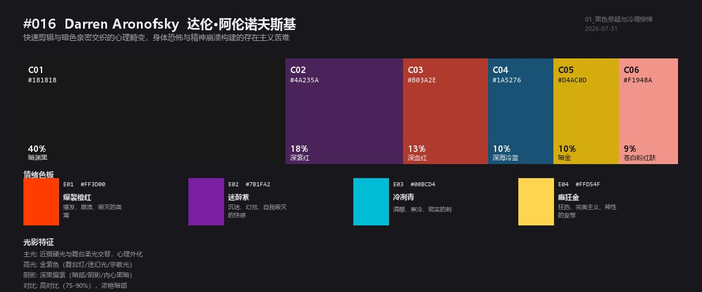
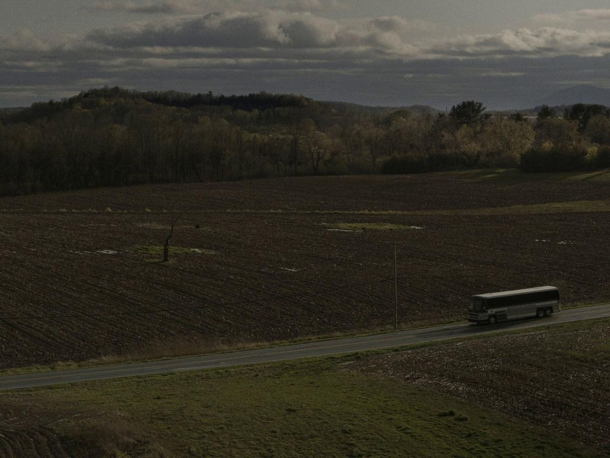
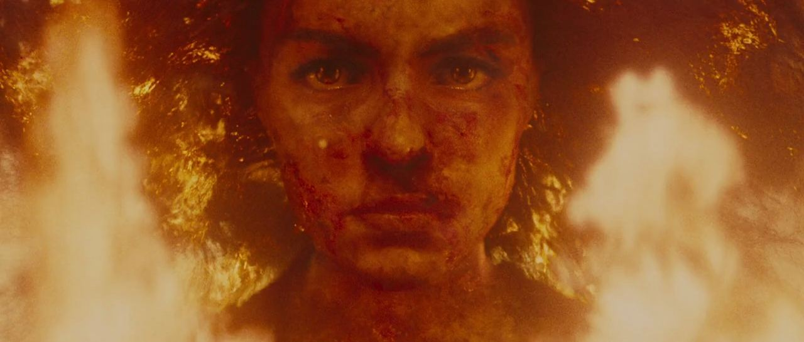
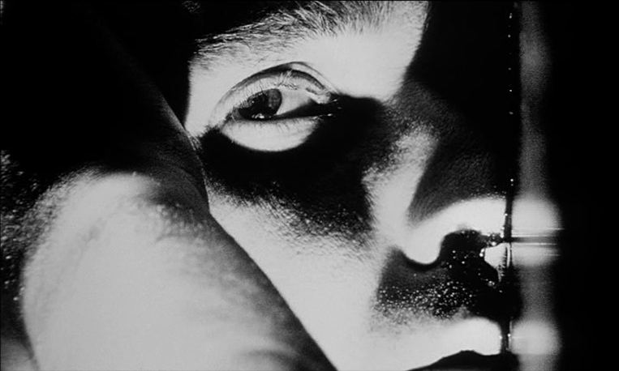

# 导演色卡 #016 — Darren Aronofsky 达伦·阿伦诺夫斯基

> **分类**：01 黑色悬疑与冷调惊悚
> **编号**：016
> **国籍**：美国
> **活跃年代**：1998-至今
> **创建日期**：2026-07-31

---

## 一、核心风格一句话

> 快速剪辑与暗色亲密交织的心理畸变，身体恐怖与精神崩溃构建的存在主义苦难。

---

## 二、色板构成



> 横版主色卡（点击查看高清图）

### 主色板（6色）

| 色号 | HEX | 色彩名称 | 占比 | 来源说明 |
|------|-----|---------|------|---------|
| C01 | `#181818` | 暗渊黑 | 40% | 黑天鹅暗部、梦之安魂曲暗调 |
| C02 | `#4A235A` | 深紫红 | 18% | 黑天鹅舞台、迷上瘾暗紫 |
| C03 | `#B03A2E` | 深血红 | 13% | 黑天鹅血迹、摔角王伤痛 |
| C04 | `#1A5276` | 深海冷蓝 | 10% | 诺亚方舟洪水、鲸骑士海洋 |
| C05 | `#D4AC0D` | 暗金 | 10% | 摔角王金腰带、舞台金灯 |
| C06 | `#F1948A` | 苍白粉红肤 | 9% | 女主角肤色、苍白病态皮肤 |

### 情绪色板（4色）

| 色号 | HEX | 色彩名称 | 情绪含义 |
|------|-----|---------|---------|
| E01 | `#FF3D00` | 爆裂橙红 | 爆发、崩溃、毁灭的高潮 |
| E02 | `#7B1FA2` | 迷醉紫 | 沉迷、幻觉、自我毁灭的快感 |
| E03 | `#00BCD4` | 冷冽青 | 清醒、寒冷、现实的刺 |
| E04 | `#FFD54F` | 癫狂金 | 狂热、完美主义、神性的妄想 |

### 光影特征

- **主光方向**：近摄硬光与舞台柔光交替，心理外化
- **高光色偏**：金紫色（舞台灯/迷幻光/宗教光）
- **阴影色偏**：深黑偏紫（暗部/阴影/内心黑暗）
- **对比比**：高对比（75-90%），浓艳暗部
- **色调整体**：暗调浓烈，55%暖红金 + 45%冷蓝紫

---

## 三、视觉风格关键词（按权重排序）

### 构图与运镜
快速剪辑 · 近摄特写 · 广角畸变 · 对称构图 · 旋转镜头 · 镜像分裂 · 低角度仰拍 · 烟雾迷幻 · 舞台灯光 · 手持晃动

### 色彩与光影
暗色亲密 · 心理畸变 · 身体恐怖 · 深紫红 · 深血红 · 舞台金紫 · 迷幻色 · 冷冽青 · 苍白肤色 · 浓艳暗部

### 氛围与情绪
精神崩溃 · 身体恐怖 · 成瘾执念 · 完美主义 · 死亡驱动 · 存在痛苦 · 宗教狂热 · 母子关系 · 自我毁灭 · 迷醉与清醒

---

## 四、运镜特征

| 特征 | 说明 | 经典例子 |
|------|------|---------|
| 快速剪辑蒙太奇 | 极速剪辑，制造感官过载 | 《梦之安魂曲》结局蒙太奇 |
| 近摄特写 | 极端贴近人物面部，私密窒息 | 《黑天鹅》尼娜的脸 |
| 广角畸变 | 广角镜头扭曲空间，心理外化 | 《梦之安魂曲》公寓场景 |
| 旋转镜头 | 环绕旋转，眩晕与失控 | 《黑天鹅》舞蹈场面 |
| 镜像分裂构图 | 镜子中的双重自我 | 《黑天鹅》镜子场景 |
| 低角度仰拍人物 | 神性与疯狂的仰视 | 《诺亚方舟》上帝视角 |
| 手持跟拍 | 真实感与焦虑感 | 《摔角王》后台跟拍 |
| 烟雾迷幻 | 烟雾营造迷幻和精神错乱 | 《迷上瘾》吸毒场景 |

---

## 五、经典场景色彩参考

### 电影截图画廊

| 黑天鹅 | 梦之安魂曲 | 摔角王 |
|--------|------|--------|
|  |  |  |
| 深紫红+深血红 · 完美毁灭 | 暗渊黑+迷醉紫 · 成瘾深渊 | 暗金+深血红 · 死亡荣耀 |

| 诺亚方舟 | 圆周率 Pi | 母亲！ |
|--------|------|--------|
|  | *圆周率（剧照未收录）* | *母亲！（剧照未收录）* |
| 深海冷蓝+暗金 · 审判洪水 | 暗渊黑+冷冽青 · 数字偏执 | 爆裂橙红+深紫红 · 创造毁灭 |

**色彩氛围描述**：阿伦诺夫斯基的色彩是一剂注入静脉的毒药——深紫红与暗渊黑构建精神崩溃的温床，深血红是身体撕裂的痛感，迷醉紫与癫狂金在成瘾与完美主义的幻觉中燃烧，冷冽青则是现实刺入骨髓的寒战。每一帧都在凝视深渊，而深渊也在凝视你。

### 电影色彩速查

| 电影 | 场景 | 主导色 | 色彩氛围 |
|------|------|--------|---------|
| 黑天鹅 | 最终变身 | 深紫红+深血红 | 完美与毁灭、精神崩溃、艺术的献祭 |
| 梦之安魂曲 | 结局蒙太奇 | 暗渊黑+迷醉紫 | 绝望、成瘾的尽头、人性深渊 |
| 摔角王 | 最后一场比赛 | 暗金+深血红 | 死亡的荣耀、男性身份、自我毁灭 |
| 诺亚方舟 | 大洪水 | 深海冷蓝+暗金 | 审判、毁灭与新生、宗教狂热 |
| 圆周率 Pi | 数字偏执 | 暗渊黑+冷冽青 | 数学狂热、精神崩溃、模式追寻 |
| 母亲！ | 房子暴乱 | 爆裂橙红+深紫红 | 宗教隐喻、创造与毁灭、女性痛苦 |
| 鲸 | 公寓对峙 | 暗渊黑+苍白粉红肤 | 家庭创伤、肉身沉重、救赎 |
| 真爱源泉 | 时空穿越 | 迷醉紫+癫狂金 | 生死爱恋、永恒追寻、超越 |

---

## 六、AI 生成提示词模板

> 完整提示词文件见 `prompts/` 目录

### 图像生成速用公式

```
[subject description], in the style of Darren Aronofsky,
mental breakdown film still,
dark intimacy, psychological distortion,
rapid editing, wide-angle distortion,
body horror atmosphere,
cinematic texture, grainy film look --ar 16:9 --style raw
```

### 视频生成速用公式

```
A mental breakdown scene in Darren Aronofsky style,
rapid editing, dark intimacy,
body horror with golden purple,
addictive obsession, cinematic film look,
slow rapid editingmontage,
16:9 aspect ratio, cinematic movement
```

---

## 七、代表作索引

| 年份 | 片名 | 主要色彩特征 |
|------|------|-------------|
| 1998 | 圆周率 Pi | 黑白高对比、数学狂热、低成本实验 |
| 2000 | 梦之安魂曲 | 暗金迷醉、快速剪辑、成瘾悲剧 |
| 2006 | 真爱源泉 | 跨越时空、金蓝色调、生死爱恋 |
| 2008 | 摔角王 | 暗金摔角、真实粗粝、男性落幕 |
| 2010 | 黑天鹅 | 舞台金紫、心理畸变、身体恐怖 |
| 2014 | 诺亚方舟 | 洪水蓝灰、宗教史诗、黑暗奇幻 |
| 2017 | 母亲！ | 暗金暴乱、宗教隐喻、密室恐怖 |
| 2022 | 鲸 | 室内暗调、肥胖身体、家庭创伤 |

---

## 八、蒸馏验证

- [x] 色板6+4色已提取
- [x] 可视化色卡图片已生成（横版+竖版）
- [x] 运镜特征已归纳（8种）
- [x] 提示词模板已生成（MJ/SD/视频）
- [ ] 电影截图参考图已收集
- [ ] Stable Diffusion 实测试图
- [ ] Runway 视频测试