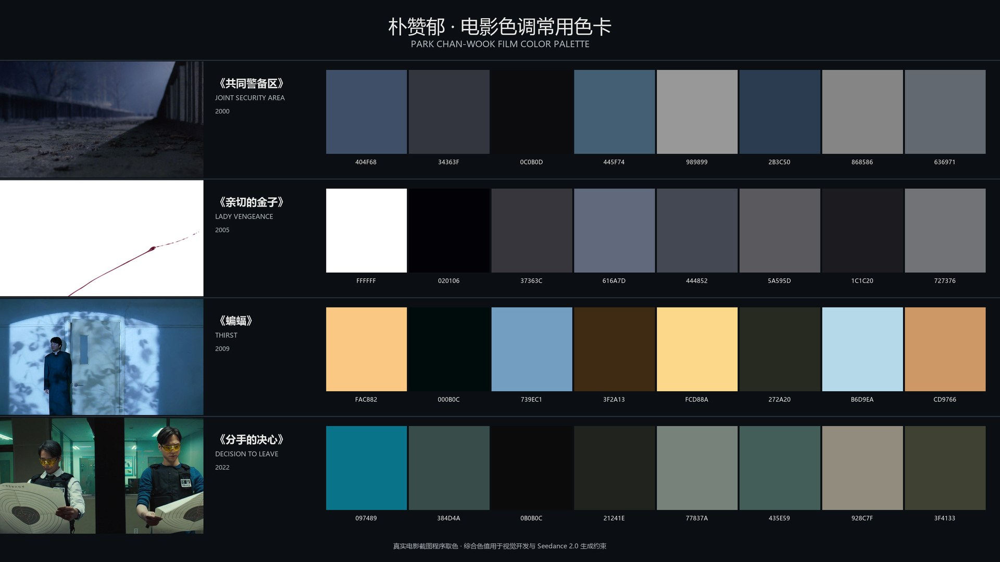
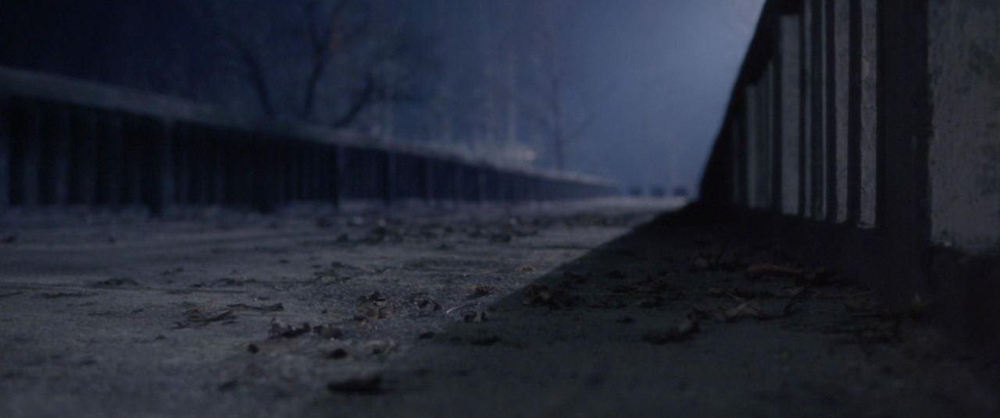
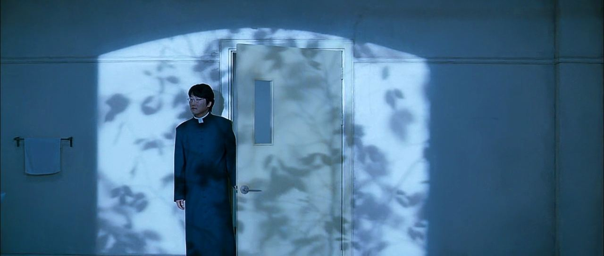
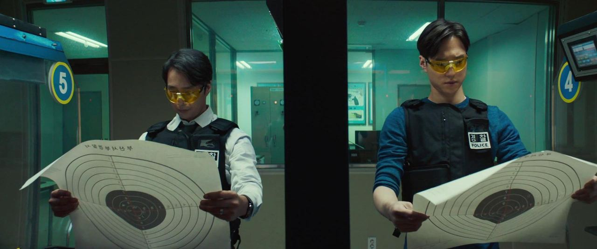

# 导演色卡 #017 — Park Chan-wook 朴赞郁

> **分类**：01 黑色悬疑与冷调惊悚
> **编号**：017
> **国籍**：韩国
> **活跃年代**：1992-至今
> **创建日期**：2026-07-31

---

## 一、核心风格一句话

> 华丽绿紫与对称构图交织的丝绒质感，优雅暴力与复仇美学构建的黑色诗意。

---

## 二、色板构成



> 横版主色卡（点击查看高清图）

### 主色板（6色）

| 色号 | HEX | 色彩名称 | 占比 | 来源说明 |
|------|-----|---------|------|---------|
| C01 | `#0E2A24` | 深翡绿黑 | 38% | 小姐暗部、老男孩阴影 |
| C02 | `#3E1F5B` | 深紫丝绒 | 20% | 小姐闺房、手部受伤暗紫 |
| C03 | `#C9A227` | 华丽金 | 13% | 小姐装饰、老男孩监狱金色 |
| C04 | `#7B241C` | 深红丝绒 | 10% | 暴力场景、红唇、血色 |
| C05 | `#1F4E5F` | 孔雀蓝绿 | 10% | 小姐瓷砖、场景装饰色 |
| C06 | `#F7DC6F` | 金瓷肤 | 9% | 女主角暖金肤色、古典妆容高光 |

### 情绪色板（4色）

| 色号 | HEX | 色彩名称 | 情绪含义 |
|------|-----|---------|---------|
| E01 | `#9B59B6` | 高贵紫 | 优雅的堕落、禁忌之爱、贵族的秘密 |
| E02 | `#E74C3C` | 复仇红 | 暴力、复仇的激情、血的美学 |
| E03 | `#1ABC9C` | 翡翠绿 | 嫉妒、秘密、生机与危险 |
| E04 | `#F1C40F` | 皇家金 | 权力、财富、华丽的囚笼 |

### 光影特征

- **主光方向**：装饰性柔光，对称布光，色彩浓艳
- **高光色偏**：金紫暖光（灯笼/装饰灯/落地窗）
- **阴影色偏**：深翡绿偏紫（暗部/阴影/帷幔）
- **对比比**：中高对比（65-80%），色彩饱和
- **色调整体**：暖暗华丽，60%暖金红 + 40%冷绿紫

---

## 三、视觉风格关键词（按权重排序）

### 构图与运镜
严格对称构图 · 俯视几何 · 低角度仰拍 · 门框窗框取景 · 镜面反射 · 长镜头平移 · 色彩对比构图 · 丝绒质感 · 旋转镜头 · 装饰性构图

### 色彩与光影
华丽绿紫 · 丝绒质感 · 对称美学 · 优雅暴力 · 深翡绿 · 深紫丝绒 · 华丽金 · 瓷白肤 · 孔雀蓝 · 深红丝绒

### 氛围与情绪
复仇三部曲 · 禁忌之爱 · 优雅暴力 · 黑色美学 · 心理扭曲 · 身份谜题 · 女性力量 · 阶级批判 · 黑色幽默 · 华丽堕落

---

## 四、运镜特征

| 特征 | 说明 | 经典例子 |
|------|------|---------|
| 严格对称构图 | 完美对称构图，仪式感极强 | 《小姐》闺房场景 |
| 俯视几何镜头 | 从上方观察地面和人物 | 《老男孩》长棍打斗俯视 |
| 长镜头平移 | 横向长镜头展示空间层次 | 《小姐》庄园平移 |
| 镜面/水面反射 | 多重反射，身份的多重性 | 《小姐》水面倒影 |
| 低角度仰拍 | 人物的权威与压迫感 | 《老男孩》李佑真出场 |
| 门框窗框取景 | 人物在框架中的囚禁感 | 《我要复仇》窗框场景 |
| 旋转镜头 | 环绕旋转，眩晕与命运感 | 《小姐》旋转镜头 |
| 色彩对比构图 | 互补色强烈对比，视觉冲击 | 《老男孩》绿红对比 |

---

## 五、经典场景色彩参考

### 电影截图画廊

| 老男孩 | 小姐 | 亲切的金子 |
|--------|------|--------|
|  |  |  |
| 深翡绿黑+复仇红 · 走廊困兽 | 深紫丝绒+华丽金 · 禁忌之爱 | 深红丝绒+瓷白肤 · 女性复仇 |

| 分手的决心 | 斯托克 | 蝙蝠 |
|--------|------|--------|
|  | *斯托克（剧照未收录）* | *蝙蝠（剧照未收录）* |
| 翡翠绿+皇家金 · 海的秘密 | 孔雀蓝绿+高贵紫 · 哥特悬疑 | 深红丝绒+深紫丝绒 · 血色爱情 |

朴赞郁的色彩世界是华丽绿紫与复仇红交织的丝绒迷宫。深翡绿黑构成暗部底色，象征人性深处的欲望与秘密；深紫丝绒与华丽金营造殖民时期的贵族颓废感，是《小姐》闺房中禁忌之爱的视觉外壳；复仇红在《老男孩》长廊和《亲切的金子》审判中爆发，以极端暴力的美学化呈现黑色诗意。翡翠绿与皇家金的搭配在《分手的决心》中化作山海之间的执念，而孔雀蓝绿与高贵紫则在《斯托克》中编织哥特式的家族暗流。整体色彩浓艳却不失克制，对称构图与丝绒质感共同构建出一种优雅而残酷的视觉仪式。

### 电影色彩速查

| 电影 | 场景 | 主导色 | 色彩氛围 |
|------|------|--------|---------|
| 老男孩 | 长廊打斗 | 深翡绿黑+复仇红 | 原始暴力、复仇的重量、走廊困兽 |
| 小姐 | 闺房秘密 | 深紫丝绒+华丽金 | 禁忌之爱、女性共谋、华丽骗局 |
| 我要复仇 | 工厂废墟 | 深翡绿黑+孔雀蓝绿 | 阶级对立、命运悲剧、灰色道德 |
| 亲切的金子 | 复仇策划 | 深红丝绒+瓷白肤 | 女性复仇、华丽审判、集体正义 |
| 斯托克 | 大宅暗流 | 孔雀蓝绿+高贵紫 | 家族秘密、少女觉醒、哥特悬疑 |
| 分手的决心 | 山海之间 | 翡翠绿+皇家金 | 禁忌之恋、海的秘密、侦探的执念 |
| 共同警备区 | 板门店 | 深翡绿黑+冷蓝 | 分裂的悲剧、兄弟情谊、政治讽刺 |
| 蝙蝠 | 血色爱情 | 深红丝绒+深紫丝绒 | 宗教与欲望、吸血鬼爱情、道德困境 |

---

## 六、AI 生成提示词模板

> 完整提示词文件见 `prompts/` 目录

### 图像生成速用公式

```
[subject description], in the style of Park Chan-wook,
the Vengeance Trilogy film still,
opulent green-purple, velvet texture,
strict symmetrical composition, low angle shot,
forbidden love atmosphere,
cinematic texture, grainy film look --ar 16:9 --style raw
```

### 视频生成速用公式

```
A the Vengeance Trilogy scene in Park Chan-wook style,
strict symmetrical composition, opulent green-purple,
symmetrical aesthetics with golden-purple warm light,
elegant violence, cinematic film look,
slow strict symmetrical composition,
16:9 aspect ratio, cinematic movement
```

---

## 七、代表作索引

| 年份 | 片名 | 主要色彩特征 |
|------|------|-------------|
| 2000 | 共同警备区 | 板门店冷调、南北分裂、人性悲剧 |
| 2002 | 我要复仇 | 工业绿调、阶级悲剧、原始暴力 |
| 2003 | 老男孩 | 监狱暗调、走廊长镜头、复仇美学 |
| 2005 | 亲切的金子 | 红白色调、女性复仇、华丽审判 |
| 2009 | 蝙蝠 | 血色暗调、宗教欲望、吸血鬼爱情 |
| 2013 | 斯托克 | 哥特庄园、少女觉醒、家族秘密 |
| 2016 | 小姐 | 殖民朝鲜、华丽金紫、女同爱情 |
| 2022 | 分手的决心 | 山海色调、侦探爱情、海的秘密 |

---

## 八、蒸馏验证

- [x] 色板6+4色已提取
- [x] 可视化色卡图片已生成（横版+竖版）
- [x] 运镜特征已归纳（8种）
- [x] 提示词模板已生成（MJ/SD/视频）
- [ ] 电影截图参考图已收集
- [ ] Stable Diffusion 实测试图
- [ ] Runway 视频测试