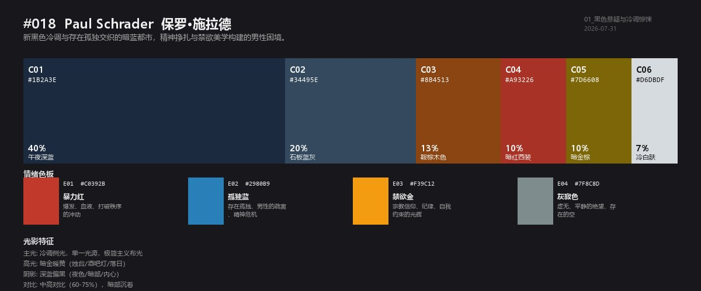
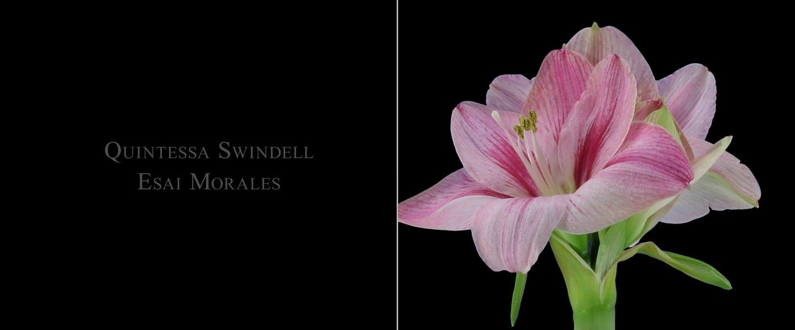
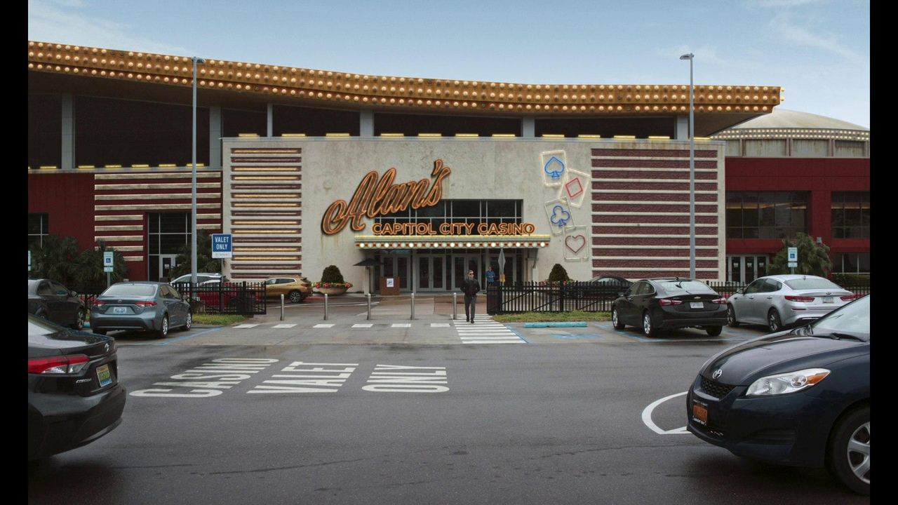
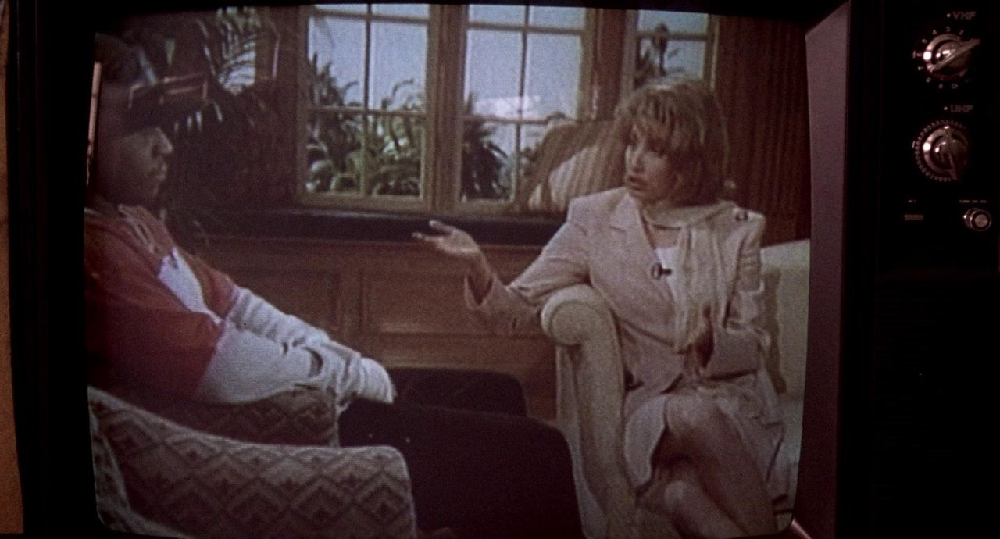
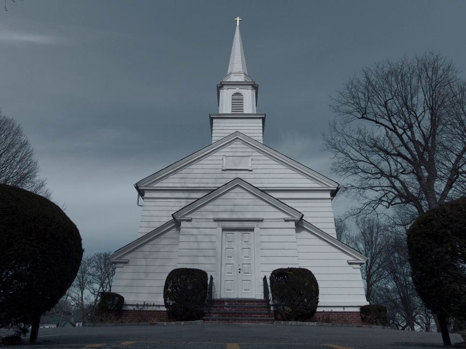

# 导演色卡 #018 — Paul Schrader 保罗·施拉德

> **分类**：01 黑色悬疑与冷调惊悚
> **编号**：018
> **国籍**：美国
> **活跃年代**：1974-至今
> **创建日期**：2026-07-31

---

## 一、核心风格一句话

> 新黑色冷调与存在孤独交织的暗蓝都市，精神挣扎与禁欲美学构建的男性困境。

---

## 二、色板构成



> 横版主色卡（点击查看高清图）

### 主色板（6色）

| 色号 | HEX | 色彩名称 | 占比 | 来源说明 |
|------|-----|---------|------|---------|
| C01 | `#1B2A3E` | 午夜深蓝 | 40% | 第一归正会暗部、美国舞男夜戏 |
| C02 | `#34495E` | 石板蓝灰 | 20% | 出租车司机街道、牧者的制服 |
| C03 | `#8B4513` | 鞍棕木色 | 13% | 酒吧木色、皮革家具、复古内饰 |
| C04 | `#A93226` | 暗红西装 | 10% | 美国舞男红色外套、暴力点缀 |
| C05 | `#7D6608` | 暗金棕 | 10% | 酒吧灯光、教堂烛台、暖黄 |
| C06 | `#D6DBDF` | 冷白肤 | 7% | 人物苍白肤色、冷光下人皮肤 |

### 情绪色板（4色）

| 色号 | HEX | 色彩名称 | 情绪含义 |
|------|-----|---------|---------|
| E01 | `#C0392B` | 暴力红 | 爆发、血液、打破秩序的冲动 |
| E02 | `#2980B9` | 孤独蓝 | 存在孤独、男性的疏离、精神危机 |
| E03 | `#F39C12` | 禁欲金 | 宗教信仰、纪律、自我约束的光辉 |
| E04 | `#7F8C8D` | 灰寂色 | 虚无、平静的绝望、存在的空 |

### 光影特征

- **主光方向**：冷调侧光，单一光源，极简主义布光
- **高光色偏**：暗金暖黄（烛台/酒吧灯/落日）
- **阴影色偏**：深蓝偏黑（夜色/暗部/内心）
- **对比比**：中高对比（60-75%），暗部沉着
- **色调整体**：冷调沉着，70%冷蓝 + 30%暖棕金

---

## 三、视觉风格关键词（按权重排序）

### 构图与运镜
极简构图 · 静态长镜头 · 对称几何 · 正面拍摄 · 单人构图 · 窗户取景 · 镜中自我 · 走廊透视 · 低饱和色调 · 负空间

### 色彩与光影
新黑色冷调 · 暗蓝都市 · 存在孤独 · 暗金烛光 · 鞍棕皮革 · 暗红点缀 · 石板灰蓝 · 禁欲色调 · 低饱和处理 · 冷静克制

### 氛围与情绪
存在主义 · 男性孤独 · 精神危机 · 宗教信仰 · 禁欲美学 · 暴力冲动 · 都市异化 · 黑色电影 · 道德困境 · 自我毁灭

---

## 四、运镜特征

| 特征 | 说明 | 经典例子 |
|------|------|---------|
| 静态长镜头 | 完全静止的长镜头，冥想式 | 《第一归正会》牧师独白 |
| 单人构图 | 单人居中或偏置，孤独感 | 《出租车司机》特拉维斯公寓 |
| 正面拍摄 | 人物正面朝向镜头，直面观众 | 《第一归正会》牧师对镜 |
| 窗户取景 | 透过窗户观察，隔离感 | 《美国舞男》窗户场景 |
| 镜中自我 | 镜子中的人物，自我审视 | 《愤怒的公牛》镜子戏 |
| 走廊透视 | 走廊纵深，人物走向未知 | 《硬核》走廊场景 |
| 缓慢推进 | 极慢的推进，张力积累 | 《第一归正会》发现日记 |
| 俯视观察 | 上帝视角，命运的注视 | 《沉睡者》俯视镜头 |

---

## 五、经典场景色彩参考

### 电影截图画廊

| 第一归正会 | 出租车司机 | 美国舞男 |
|--------|------|--------|
|  |  |  |
| 午夜深蓝+禁欲金 · 信仰危机 | 午夜深蓝+暴力红 · 都市异化 | 石板蓝灰+鞍棕木色 · 孤独奢华 |

| 愤怒的公牛 | 算牌人 | 三岛由纪夫传 |
|--------|------|--------|
|  | *算牌人（剧照未收录）* | *三岛由纪夫传（剧照未收录）* |
| 暗金棕+暴力红 · 自我毁灭 | 石板蓝灰+暗金棕 · 赎罪之旅 | 暗金棕+暴力红 · 艺术与死亡 |

保罗·施拉德的色彩是存在主义孤独的视觉化。午夜深蓝构成画面的绝对主导，是都市夜色、牧师书房、出租车窗外的无尽暗蓝，承载着男性精神世界的疏离与危机。禁欲金作为唯一的暖光来源，来自烛台、酒吧灯和落日，象征宗教信仰与纪律的微光，在深蓝冷调中显得珍贵而脆弱。鞍棕木色与石板蓝灰构成室内空间的底色，皮革、木墙、冷调西装共同营造出一种禁欲主义的美学质感。暴力红只在愤怒爆发时出现——拳击场的鲜血、出租车司机的幻想、三岛的切腹——是男性困境中压抑的暴力冲动。整体色调极度克制，低饱和处理和静态构图共同构建出一种超验风格的精神景观：人在黑暗中独坐，唯有一盏烛火与信仰为伴。

### 电影色彩速查

| 电影 | 场景 | 主导色 | 色彩氛围 |
|------|------|--------|---------|
| 第一归正会 | 牧师书房 | 午夜深蓝+禁欲金 | 信仰危机、环境焦虑、精神崩溃 |
| 美国舞男 | 高级公寓 | 石板蓝灰+鞍棕木色 | 孤独的奢华、存在的空虚、男性身份 |
| 出租车司机 | 纽约夜街 | 午夜深蓝+暴力红 | 都市异化、精神错乱、暴力幻想 |
| 愤怒的公牛 | 拳击场 | 暗金棕+暴力红 | 男性暴力、自我毁灭、兽性 |
| 苦难 | 小镇夜晚 | 石板蓝灰+暗红西装 | 存在痛苦、小镇压抑、救赎的可能 |
| 聚焦人生 | 作家隐居 | 午夜深蓝+冷白肤 | 创作焦虑、中年危机、女性关系 |
| 沉睡者 | 午夜酒吧 | 鞍棕木色+暗金棕 | 过去的阴影、罪恶感、男性情谊 |
| 极限追捕 | 都市追凶 | 午夜深蓝+暴力红 | 警匪对峙、都市黑暗、系统腐败 |

---

## 六、AI 生成提示词模板

> 完整提示词文件见 `prompts/` 目录

### 图像生成速用公式

```
[subject description], in the style of Paul Schrader,
existentialism film still,
neo-noir cold tone, dark blue urban,
minimal composition, symmetrical geometry,
male loneliness atmosphere,
cinematic texture, grainy film look --ar 16:9 --style raw
```

### 视频生成速用公式

```
A existentialism scene in Paul Schrader style,
minimal composition, neo-noir cold tone,
existential loneliness with dark golden warm yellow,
mental crisis, cinematic film look,
slow static long take,
16:9 aspect ratio, cinematic movement
```

---

## 七、代表作索引

| 年份 | 片名 | 主要色彩特征 |
|------|------|-------------|
| 1978 | 蓝领阶级 | 底特律灰调、工人阶级、黑色喜剧 |
| 1980 | 美国舞男 | 洛杉矶冷调、高级奢华、存在空虚 |
| 1985 | 三岛由纪夫传 | 日式美学、金红对比、艺术与死亡 |
| 1988 | 巴顿·芬克 | 好莱坞暗金、编剧困境、超现实 |
| 1992 | 极端恐惧 | 纽约暗蓝、偏执狂、都市恐怖 |
| 2017 | 第一归正会 | 教堂冷调、信仰危机、极简主义 |
| 2021 | 算牌人 | 赌城冷调、创伤后应激、赎罪之旅 |
| 2023 | 大师 gardener | 花园暖调、园艺隐喻、过去的阴影 |

---

## 八、蒸馏验证

- [x] 色板6+4色已提取
- [x] 可视化色卡图片已生成（横版+竖版）
- [x] 运镜特征已归纳（8种）
- [x] 提示词模板已生成（MJ/SD/视频）
- [ ] 电影截图参考图已收集
- [ ] Stable Diffusion 实测试图
- [ ] Runway 视频测试