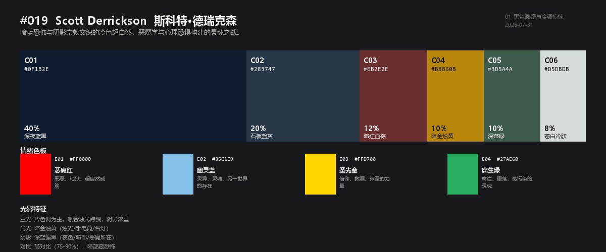
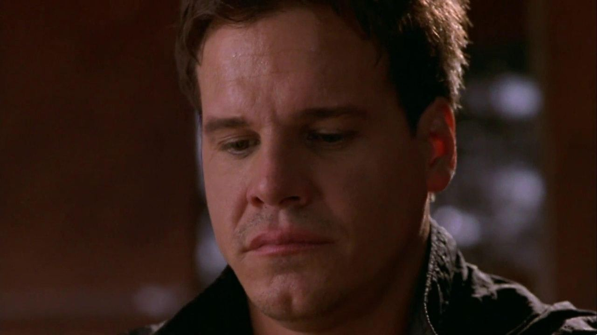
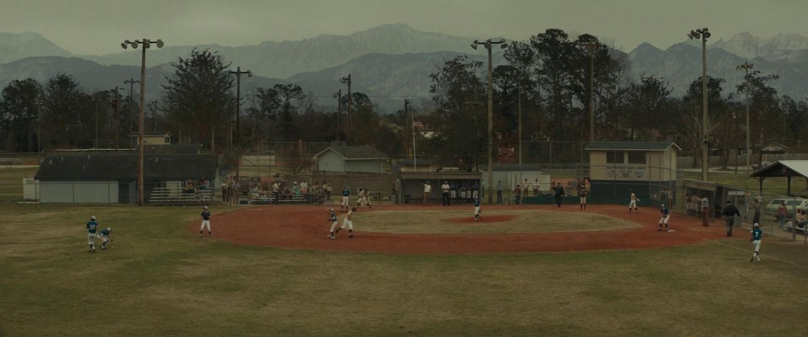
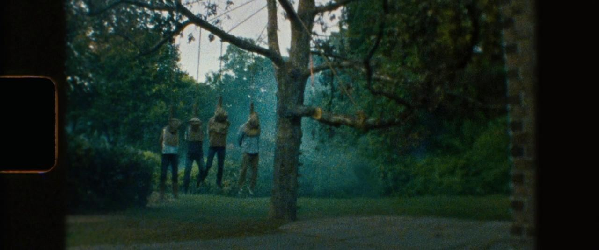
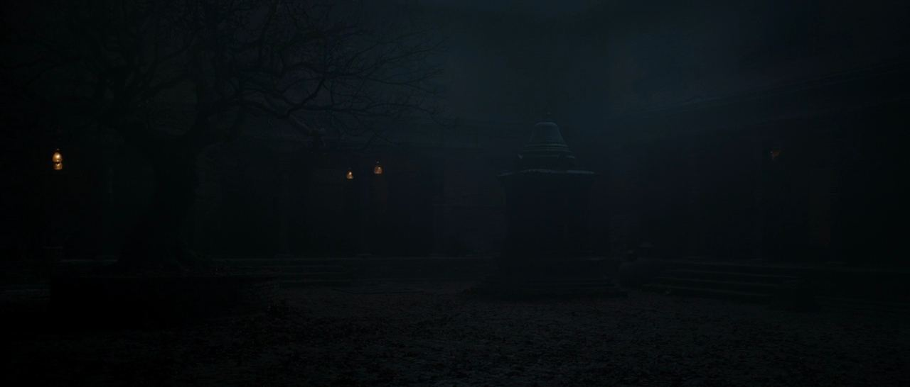

# 导演色卡 #019 — Scott Derrickson 斯科特·德瑞克森

> **分类**：01 黑色悬疑与冷调惊悚
> **编号**：019
> **国籍**：美国
> **活跃年代**：1995-至今
> **创建日期**：2026-07-31

---

## 一、核心风格一句话

> 暗蓝恐怖与阴影宗教交织的冷色超自然，恶魔学与心理恐惧构建的灵魂之战。

---

## 二、色板构成



> 横版主色卡（点击查看高清图）

### 主色板（6色）

| 色号 | HEX | 色彩名称 | 占比 | 来源说明 |
|------|-----|---------|------|---------|
| C01 | `#0F1B2E` | 深夜蓝黑 | 40% | 驱魔暗部、险恶夜色 |
| C02 | `#283747` | 石板蓝灰 | 20% | 驱魔室内、险恶房子暗调 |
| C03 | `#6B2E2E` | 暗红血棕 | 12% | 恶魔象征、血迹、十字架暗 |
| C04 | `#B8860B` | 暗金烛黄 | 10% | 烛光、教堂金饰、旧书金 |
| C05 | `#3D5A4A` | 深苔绿 | 10% | 旧墙纸、腐烂植物、地下室 |
| C06 | `#D5DBDB` | 苍白冷肤 | 8% | 人物苍白肤色、冷光人皮肤 |

### 情绪色板（4色）

| 色号 | HEX | 色彩名称 | 情绪含义 |
|------|-----|---------|---------|
| E01 | `#FF0000` | 恶魔红 | 邪恶、地狱、超自然威胁 |
| E02 | `#85C1E9` | 幽灵蓝 | 灵异、灵魂、另一世界的存在 |
| E03 | `#FFD700` | 圣光金 | 信仰、救赎、神圣的力量 |
| E04 | `#27AE60` | 腐生绿 | 腐烂、堕落、被污染的灵魂 |

### 光影特征

- **主光方向**：冷色调为主，暖金烛光点缀，阴影浓重
- **高光色偏**：暗金烛黄（烛光/手电筒/台灯）
- **阴影色偏**：深蓝偏黑（夜色/暗部/恶魔所在）
- **对比比**：高对比（75-90%），暗部藏恐怖
- **色调整体**：冷调暗蓝，70%冷蓝 + 30%暖金红

---

## 三、视觉风格关键词（按权重排序）

### 构图与运镜
暗蓝阴影 · 低角度仰拍 · 门框取恐 · 黑暗中微光驱 · 宗教符号构图 · 镜面鬼影 · 楼梯阴影 · 走廊纵深 · 手持跟拍 · 特写惊吓

### 色彩与光影
暗蓝恐怖 · 阴影宗教 · 冷色超自然 · 深蓝夜色 · 暗金烛光 · 暗红血棕 · 苍白肤色 · 深苔绿霉 · 恶魔红眼 · 幽灵蓝光

### 氛围与情绪
宗教恐怖 · 恶魔附身 · 灵魂之战 · 心理恐惧 · 超自然 · 家庭受扰 · 信仰考验 · 邪恶的本质 · 童年创伤 · 驱魔仪式

---

## 四、运镜特征

| 特征 | 说明 | 经典例子 |
|------|------|---------|
| 缓慢推进 | 缓慢推向恐怖源，张力积累 | 《驱魔》驱魔场景 |
| 门框取恐 | 从门框看房间里的恐怖 | 《险恶》门后场景 |
| 低角度仰拍 | 人物被恐怖事物俯视压迫 | 《驱魔》恶魔现身 |
| 黑暗中微光 | 只有一点光源，周围是黑暗 | 《险恶》地下室手电筒 |
| 镜面鬼影 | 镜子中出现超自然存在 | 《驱魔》镜子场景 |
| 楼梯阴影构图 | 楼梯上的阴影藏着恐怖 | 《险恶》楼梯场景 |
| 手持晃动 | 模拟真实的恐惧反应 | 《驱魔日记》手持镜头 |
| 长镜头走廊 | 走廊纵深，尽头未知 | 《险恶》走廊鬼影 |

---

## 五、经典场景色彩参考

### 电影截图画廊

| 驱魔 | 险恶 | 黑色电话 |
|--------|------|--------|
|  |  |  |
| 深夜蓝黑+恶魔红 · 灵魂之战 | 石板蓝灰+暗金烛黄 · 超自然恐怖 | 深苔绿+暗红血棕 · 童年恐惧 |

| 奇异博士 | 驱魔：卢西尔之始 | 停尸房收藏 |
|--------|------|--------|
|  | *修女起源（剧照未收录）* | *停尸房收藏（剧照未收录）* |
| 幽灵蓝+圣光金 · 多元宇宙 | 深夜蓝黑+暗金烛黄 · 邪恶起源 | 深苔绿+暗金烛黄 · 怪诞哥特 |

德瑞克森的色彩是宗教恐怖与超自然恐惧的视觉化。深夜蓝黑构成恐怖场景的绝对底色，是卧室、地下室、修道院的无边黑暗，恶魔就隐藏在这片蓝黑之中。暗金烛黄是唯一的暖光源，来自摇曳的烛光、手电筒光束和教堂金饰，这微弱的暖光不仅未能驱散黑暗，反而在明暗交界处制造出更恐怖的阴影——鬼影就藏在光线的边缘。暗红血棕作为暴力与邪恶的标志色，在驱魔的痛苦、地窖的血迹和恶魔的红眼中浮现；深苔绿则渲染着腐烂与堕落，是旧墙纸、地下室霉斑和被污染灵魂的颜色。幽灵蓝与圣光金在《奇异博士》中打开了神秘主义的视觉维度，而苍白冷肤则将恐怖具象化为人物脸上的惊惧。整体高对比布光让暗部沉到纯黑，每一束光都像在黑暗中撕开一道口子，而恐怖往往就从那道口子中涌现。

### 电影色彩速查

| 电影 | 场景 | 主导色 | 色彩氛围 |
|------|------|--------|---------|
| 驱魔 | 卧室驱魔 | 深夜蓝黑+恶魔红 | 信仰与恶魔、灵魂之战、痛苦 |
| 险恶 Sinister | 地下室影像 | 石板蓝灰+暗金烛黄 | 发现恐怖、家庭危机、超自然 |
| 奇异博士 | 多元宇宙 | 幽灵蓝+圣光金 | 意识扩张、神秘主义、超维度 |
| 黑色电话 | 绑架地窖 | 深苔绿+暗红血棕 | 童年恐惧、生存智慧、幽灵帮助 |
| 驱魔：卢西尔之始 | 修道院起源 | 深夜蓝黑+暗金烛黄 | 邪恶的起源、宗教腐败、女性力量 |
| 天魔异种 | 外星恐怖 | 幽灵蓝+恶魔红 | 未知生物、身体恐怖、科学与宗教 |
| 都市传奇 | 午夜故事 | 石板蓝灰+苍白冷肤 | 都市恐惧、传说成真、青春惊悚 |
| 停尸房收藏 | 恐怖故事集 | 深苔绿+暗金烛黄 | 死亡的故事、怪诞、殡仪馆 |

---

## 六、AI 生成提示词模板

> 完整提示词文件见 `prompts/` 目录

### 图像生成速用公式

```
[subject description], in the style of Scott Derrickson,
religious horror film still,
dark blue horror, shadow religion,
dark blue shadows, door frame horror framing,
demonic possession atmosphere,
cinematic texture, grainy film look --ar 16:9 --style raw
```

### 视频生成速用公式

```
A religious horror scene in Scott Derrickson style,
dark blue shadows, dark blue horror,
cool supernatural with dark candle gold,
battle for the soul, cinematic film look,
slow push-in,
16:9 aspect ratio, cinematic movement
```

---

## 七、代表作索引

| 年份 | 片名 | 主要色彩特征 |
|------|------|-------------|
| 2000 | 天魔异种 | 外星恐怖、身体恐怖、科幻惊悚 |
| 2005 | 驱魔 | 宗教恐怖、真实事件、驱魔仪式 |
| 2012 | 险恶 Sinister | 家庭恐怖、超自然影像、恶魔学 |
| 2016 | 奇异博士 | 魔法金红、多元宇宙、起源故事 |
| 2021 | 黑色电话 | 绑架惊悚、幽灵帮助、童年恐怖 |
| 2023 | 驱魔：卢西尔之始 | 修女起源、修道院恐怖、女性恶魔 |
| 详见斯科特·德瑞克森代表作品分析 | 险恶3 | 恶魔回归、家庭诅咒、超自然恐怖 |

---

## 八、蒸馏验证

- [x] 色板6+4色已提取
- [x] 可视化色卡图片已生成（横版+竖版）
- [x] 运镜特征已归纳（8种）
- [x] 提示词模板已生成（MJ/SD/视频）
- [ ] 电影截图参考图已收集
- [ ] Stable Diffusion 实测试图
- [ ] Runway 视频测试