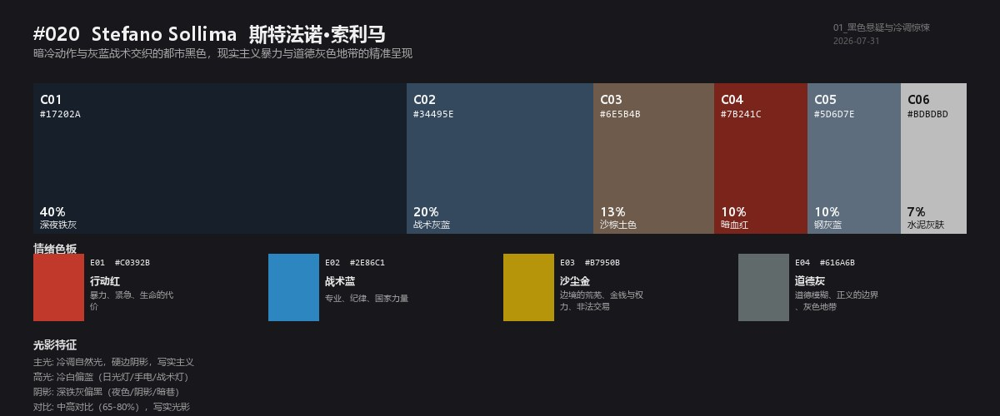
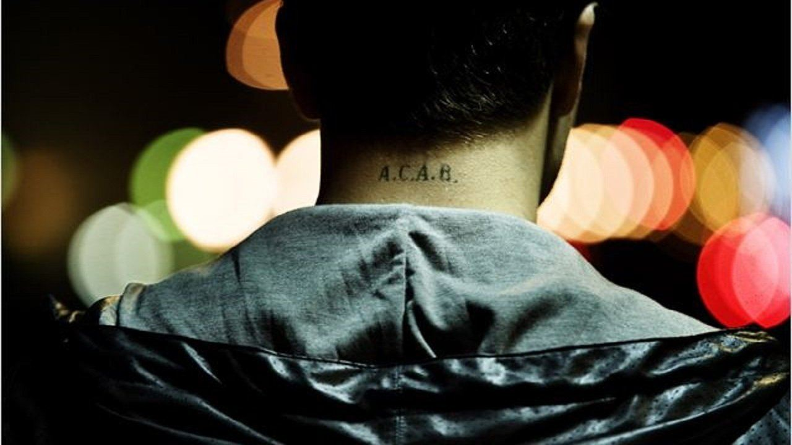
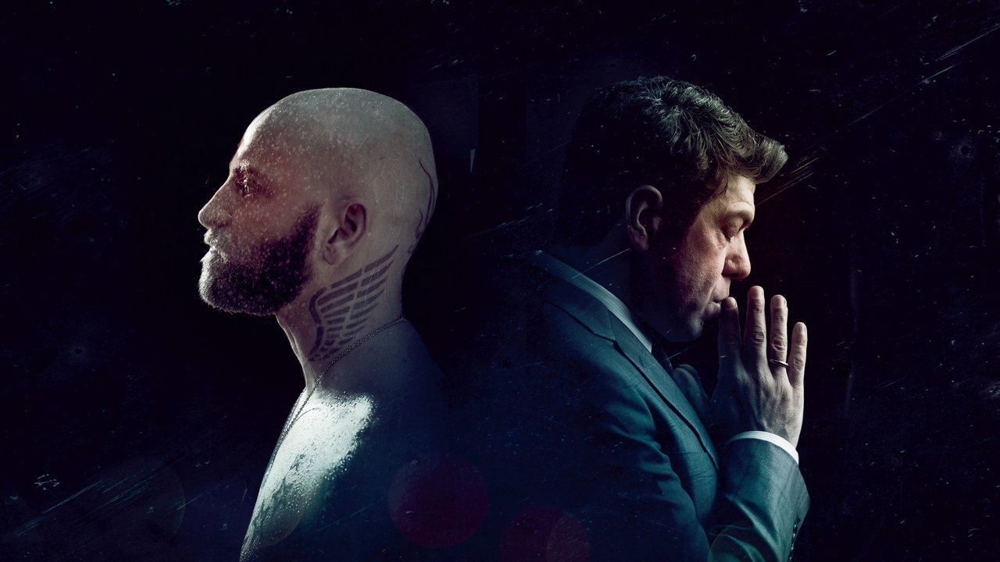
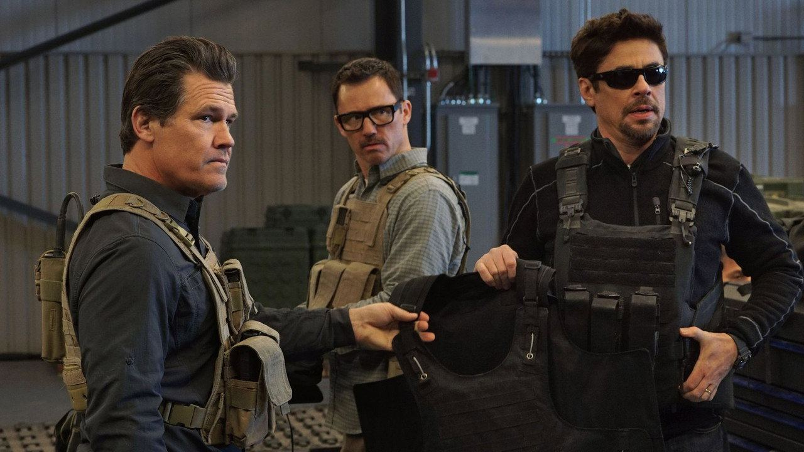
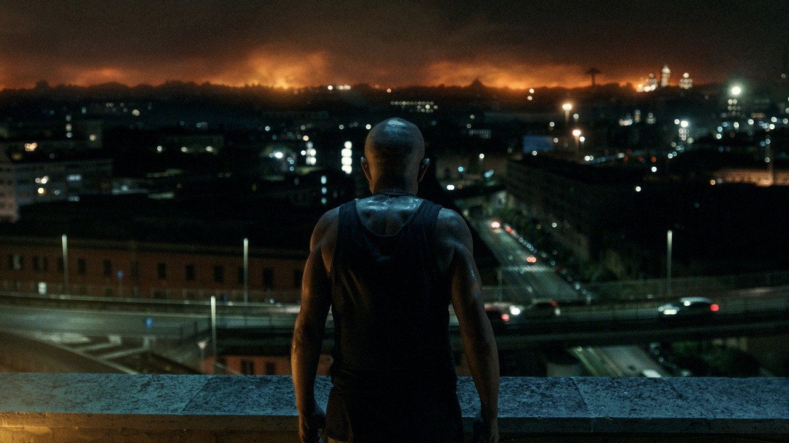

# 导演色卡 #020 — Stefano Sollima 斯特法诺·索利马

> **分类**：01 黑色悬疑与冷调惊悚
> **编号**：020
> **国籍**：意大利
> **活跃年代**：1996-至今
> **创建日期**：2026-07-31

---

## 一、核心风格一句话

> 暗冷动作与灰蓝战术交织的都市黑色，现实主义暴力与道德灰色地带的精准呈现。

---

## 二、色板构成



> 横版主色卡（点击查看高清图）

### 主色板（6色）

| 色号 | HEX | 色彩名称 | 占比 | 来源说明 |
|------|-----|---------|------|---------|
| C01 | `#17202A` | 深夜铁灰 | 40% | 边境杀手2暗部、格莫拉夜色 |
| C02 | `#34495E` | 战术灰蓝 | 20% | 战术装备、警察制服、城市灰调 |
| C03 | `#6E5B4B` | 沙棕土色 | 13% | 边境沙漠、尘土、旧建筑 |
| C04 | `#7B241C` | 暗血红 | 10% | 暴力血迹、红色警示灯 |
| C05 | `#5D6D7E` | 钢灰蓝 | 10% | 金属表面、武器、汽车 |
| C06 | `#BDBDBD` | 水泥灰肤 | 7% | 人物憔悴肤色、风尘感 |

### 情绪色板（4色）

| 色号 | HEX | 色彩名称 | 情绪含义 |
|------|-----|---------|---------|
| E01 | `#C0392B` | 行动红 | 暴力、紧急、生命的代价 |
| E02 | `#2E86C1` | 战术蓝 | 专业、纪律、国家力量 |
| E03 | `#B7950B` | 沙尘金 | 边境的荒芜、金钱与权力、非法交易 |
| E04 | `#616A6B` | 道德灰 | 道德模糊、正义的边界、灰色地带 |

### 光影特征

- **主光方向**：冷调自然光，硬边阴影，写实主义
- **高光色偏**：冷白偏蓝（日光灯/手电/战术灯）
- **阴影色偏**：深铁灰偏黑（夜色/阴影/暗巷）
- **对比比**：中高对比（65-80%），写实光影
- **色调整体**：冷调灰蓝，75%冷色 + 25%暖土色

---

## 三、视觉风格关键词（按权重排序）

### 构图与运镜
战术摄影 · 手持跟拍 · 低角度仰拍 · 广角动作 · 城市夜景 · 车内构图 · 走廊纵深 · 阴影藏人 · 金属反光 · 尘雾效果

### 色彩与光影
暗冷动作 · 灰蓝战术 · 都市黑色 · 沙漠土色 · 钢蓝金属 · 暗血红点 · 水泥灰调 · 冷白光源 · 尘土质感 · 低饱和处理

### 氛围与情绪
道德灰色 · 现实主义 · 暴力的日常化 · 国家机器 · 犯罪网络 · 边境政治 · 男性情谊 · 体制腐败 · 生存法则 · 宿命感

---

## 四、运镜特征

| 特征 | 说明 | 经典例子 |
|------|------|---------|
| 手持跟拍 | 晃动的手持，真实纪录片感 | 《边境杀手2》突袭场景 |
| 战术摄影 | 模拟军事行动的摄影方式 | 《零ZeroZero》战术行动 |
| 车内构图 | 车内空间的封闭与观察 | 《格莫拉》车内对话 |
| 低角度仰拍 | 建筑和权力的压迫感 | 《格莫拉》黑帮建筑 |
| 广角动作 | 广角镜头中的动作场面 | 《边境杀手2》爆炸场景 |
| 走廊纵深 | 走廊中的追逐和对峙 | 《零ZeroZero》走廊枪战 |
| 阴影藏人 | 阴影中隐藏的威胁 | 《边境杀手2》夜袭场景 |
| 尘雾效果 | 尘土和烟雾中的动作 | 《边境杀手2》沙漠场景 |

---

## 五、经典场景色彩参考

### 电影截图画廊

| 边境杀手2 | 格莫拉 | 零ZeroZero |
|--------|------|--------|
|  |  |  |
| 深夜铁灰+战术蓝 · 黑色行动 | 钢灰蓝+暗血红 · 黑帮日常 | 沙棕土色+战术灰蓝 · 跨国犯罪 |

| 警察皆混蛋 | Suburra | Elio |
|--------|------|--------|
|  |  | *Elio（该片剧照未下载）* |
| 战术灰蓝+暗血红 · 体制暴力 | 深夜铁灰+沙尘金 · 教廷阴影 | 沙棕土色+钢灰蓝 · 青春成长 |

索利马的色彩是现实主义暴力的冷色纪实。深夜铁灰与战术灰蓝构成画面的绝对主导，是美墨边境的夜色、那不勒斯的混凝土建筑、防暴警察的装备，也是整个犯罪世界的冷酷底色。冷白偏蓝的光源来自战术手电、日光灯和城市夜景，将人物照得憔悴苍白——水泥灰肤不是化妆效果，而是被体制和暴力磨蚀的真实面貌。沙棕土色来自边境沙漠和意大利南部的尘土，为冷调画面注入唯一的暖色，但这暖色并非温暖，而是荒芜与非法交易的象征——沙尘金是金钱、毒品和权力在阳光下的颜色。暗血红是唯一的高饱和色，在暴力爆发时短暂闪现：血迹、警示灯、伤口，是日常化暴力的视觉标点。整体低饱和处理和手持跟拍的战术摄影共同构建出一种纪录片式的粗粝质感，没有英雄主义的渲染，只有道德灰色地带中生存法则的冷峻呈现。

### 电影色彩速查

| 电影 | 场景 | 主导色 | 色彩氛围 |
|------|------|--------|---------|
| 边境杀手2 | 边境夜袭 | 深夜铁灰+战术蓝 | 黑色行动、道德模糊、国家暴力 |
| 格莫拉 | 那不勒斯街头 | 钢灰蓝+暗血红 | 黑帮日常、生存法则、少年犯罪 |
| 零ZeroZero | 全球毒品网络 | 沙棕土色+战术灰蓝 | 全球犯罪、供应链、权力的游戏 |
| 警察皆混蛋 | 罗马警界 | 战术灰蓝+暗血红 | 警界腐败、体制暴力、灰色正义 |
| 致命信条 | 政治暗杀 | 深夜铁灰+沙尘金 | 政治阴谋、恐怖主义、国际博弈 |
| Elio | 青春成长 | 沙棕土色+钢灰蓝 | 少年时代、家庭关系、意大利小镇 |
| 罗马犯罪 | 首都黑暗 | 钢灰蓝+暗血红 | 首都犯罪网、权力与腐败、政治惊悚 |
| Suburra | 罗马地下 | 深夜铁灰+沙尘金 | 地产阴谋、黑帮政治、教廷阴影 |

---

## 六、AI 生成提示词模板

> 完整提示词文件见 `prompts/` 目录

### 图像生成速用公式

```
[subject description], in the style of Stefano Sollima,
moral grey area film still,
dark cold action, grey-blue tactical,
tactical cinematography, low angle shot,
realism atmosphere,
cinematic texture, grainy film look --ar 16:9 --style raw
```

### 视频生成速用公式

```
A moral grey area scene in Stefano Sollima style,
tactical cinematography, dark cold action,
urban noir with cool white-blue,
mundane violence, cinematic film look,
slow handheld tracking shot,
16:9 aspect ratio, cinematic movement
```

---

## 七、代表作索引

| 年份 | 片名 | 主要色彩特征 |
|------|------|-------------|
| 2008 | 警察皆混蛋 | 罗马警界、腐败暴力、写实动作 |
| 2012 | ACAB - 所有警察都是混蛋 | 防暴警察、体制暴力、道德灰色 |
| 2015 | 致命信条 | 政治惊悚、反恐、国际博弈 |
| 2014-2017 | 格莫拉 剧版 | 那不勒斯黑帮、写实粗粝、家族犯罪 |
| 2018 | 边境杀手2 | 美墨边境、战术动作、黑色行动 |
| 2019-2020 | 零ZeroZero | 全球毒品贸易、跨国犯罪、家族企业 |
| 2023 | Elio | 青春成长、意大利小镇、父子关系 |
| 详见斯特法诺·索利马代表作品分析 | 未定名动作片 | 战术动作、道德灰色、现实主义 |

---

## 八、蒸馏验证

- [x] 色板6+4色已提取
- [x] 可视化色卡图片已生成（横版+竖版）
- [x] 运镜特征已归纳（8种）
- [x] 提示词模板已生成（MJ/SD/视频）
- [ ] 电影截图参考图已收集
- [ ] Stable Diffusion 实测试图
- [ ] Runway 视频测试