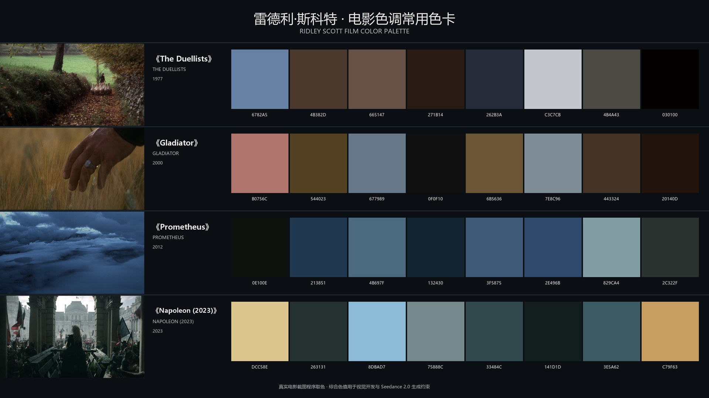
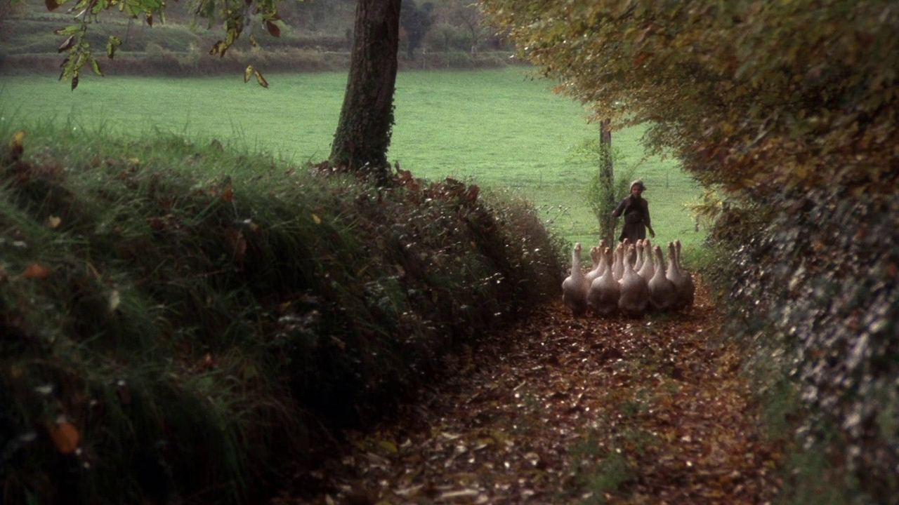
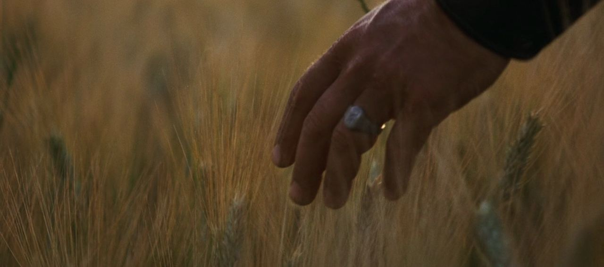
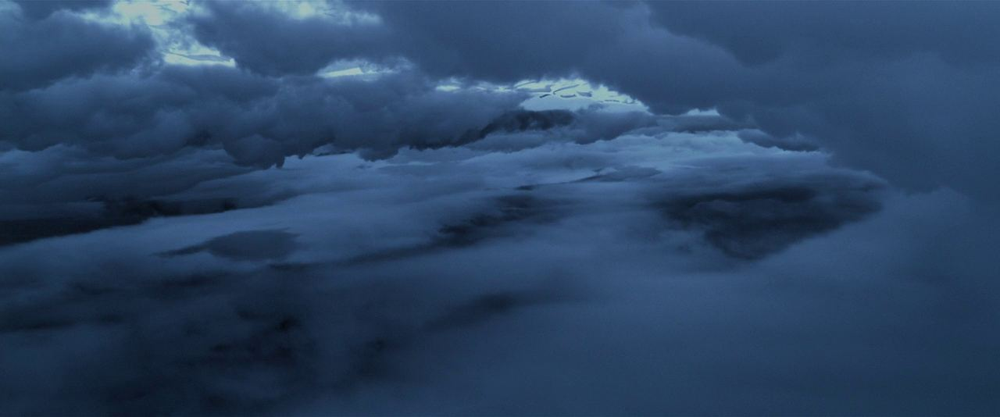
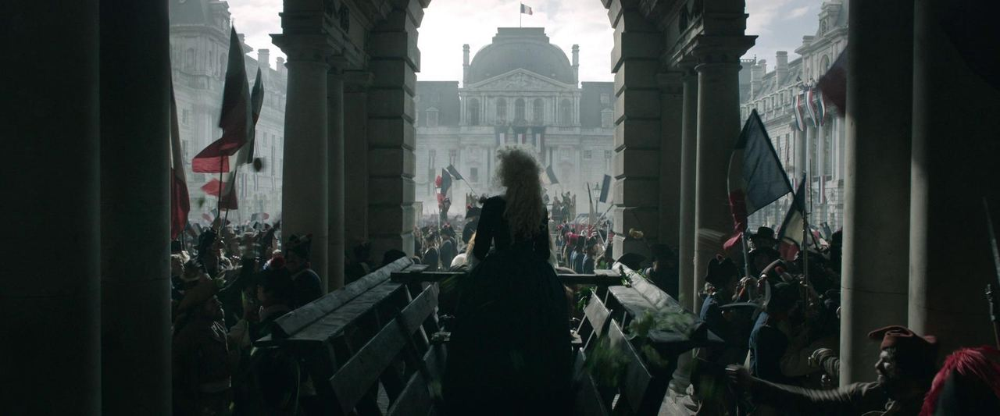

# 导演色卡 #021 — Ridley Scott 雷德利·斯科特

> **分类**：02 霓虹黑色与赛博未来
> **编号**：021
> **国籍**：英国
> **活跃年代**：1977-至今
> **创建日期**：2026-07-31

---

## 一、核心风格一句话

> 烟雾光束穿透暗金未来与雨夜霓虹，巨大尺度剪影构筑的科幻黑色美学。

---

## 二、色板构成



> 横版主色卡（点击查看高清图）

### 主色板（6色）

| 色号 | HEX | 色彩名称 | 占比 | 来源说明 |
|------|-----|---------|------|---------|
| C01 | `#0A0F1A` | 深空夜黑 | 35% | 银翼杀手夜空、异形飞船暗部 |
| C02 | `#1A3A5C` | 雨夜钢蓝 | 20% | 洛杉矶雨夜、工业冷光 |
| C03 | `#C9A84C` | 霓虹暗金 | 15% | 霓虹灯管金光、广告灯牌 |
| C04 | `#8B0000` | 暗红血锈 | 10% | 复制人血迹、异形酸血 |
| C05 | `#2F4F4F` | 暗青绿 | 12% | 霓虹灯青、飞船仪表盘 |
| C06 | `#D4A574` | 肤色暖金 | 8% | 赛博朋克霓虹人肤色 |

### 情绪色板（4色）

| 色号 | HEX | 色彩名称 | 情绪含义 |
|------|-----|---------|---------|
| E01 | `#FF6B35` | 霓虹橙 | 未来都市诱惑、危险信号 |
| E02 | `#00CED1` | 电子青 | 科技冰冷、人工智能 |
| E03 | `#FFD700` | 广告金 | 消费主义幻象、好莱坞浮华 |
| E04 | `#4A0E0E` | 深渊红 | 恐惧、外星恐怖、生命的脆弱 |

### 光影特征

- **主光方向**：穿透性光束（烟雾/雨中），硬边轮廓光
- **高光色偏**：霓虹金橙/电子青（霓虹灯/屏幕/广告灯）
- **阴影色偏**：深蓝黑（夜色/宇宙/暗巷）
- **对比比**：高对比（75-90%），光束切割画面
- **色调整体**：冷暗未来，55%冷蓝青 + 45%暖金红

---

## 三、视觉风格关键词（按权重排序）

### 构图与运镜
巨大尺度构图 · 烟雾光束 · 剪影轮廓 · 低角度仰拍建筑 · 雨湿反光 · 慢推进镜头 · 霓虹反射 · 走廊纵深 · 镜面反射 · 大气透视

### 色彩与光影
烟雾光束 · 暗金未来 · 雨夜霓虹 · 高反差明暗 · 电子青蓝 · 霓虹橙金 · 雨街倒影 · 工业冷光 · 巨型广告投影 · 大气雾霾

### 氛围与情绪
赛博朋克 · 存在主义孤独 · 人造人追问 · 宇宙恐怖 · 企业垄断 · 未来黑色 · 复制人悲歌 · 史诗阴郁 · 视觉宏大 · 雨之哀伤

---

## 四、运镜特征

| 特征 | 说明 | 经典例子 |
|------|------|---------|
| 烟雾光束构图 | 光线穿透烟雾/雨/灰尘，营造层次 | 《银翼杀手》开篇城市 |
| 巨大尺度剪影 | 人物在巨型建筑/飞船前渺小 | 《银翼杀手》泰瑞公司大楼 |
| 慢推进镜头 | 缓慢推向人物面孔，累积张力 | 《银翼杀手》复制人眼特写 |
| 低角度仰拍建筑 | 建筑压迫感，权力的视觉化 | 《银翼杀手》金字塔建筑 |
| 雨湿反光 | 雨水路面反射霓虹，画面翻倍 | 《银翼杀手》结尾雨景 |
| 走廊纵深 | 走廊/通道透视，未知在尽头 | 《异形》飞船走廊 |
| 霓虹反射 | 霓虹在窗户/眼睛/雨面的反射 | 《银翼杀手》街头霓虹 |
| 大气透视 | 烟雾/雾霾营造纵深和神秘感 | 《银翼杀手》城市远景 |

---

## 五、经典场景色彩参考

### 电影截图画廊

| 银翼杀手 | 银翼杀手雨景 | 异形 |
|--------|------|--------|
|  |  |  |
| 深空夜黑+霓虹暗金 · 未来都市 | 雨夜钢蓝+霓虹橙 · 存在悲歌 | 深空夜黑+深渊红 · 宇宙恐怖 |

| 角斗士 | 黑鹰坠落 | 火星救援 |
|--------|------|--------|
|  | *黑鹰坠落（剧照未收录）* | *火星救援（剧照未收录）* |
| 暗金尘沙+暗红血锈 · 史诗悲壮 | 沙棕土色+硝烟灰 · 战争残酷 | 火星橙红+科技蓝 · 孤独求生 |

**色彩氛围描述**：斯科特的未来世界是永远下雨的洛杉矶——深空夜黑铺展无尽的都市暗面，霓虹暗金与电子青在湿滑路面交织成一张光网，烟雾中光束如利剑穿透黑暗。暗红血锈是复制人短暂生命的注脚，深渊红则是异形宇宙中未知的恐怖。每一帧都像一幅荷兰黄金时代的油画，只不过画布换成了赛博朋克的雨幕。

### 电影色彩速查

| 电影 | 场景 | 主导色 | 色彩氛围 |
|------|------|--------|---------|
| 银翼杀手 Blade Runner | 开篇洛杉矶城市 | 深空夜黑+霓虹暗金 | 未来都市、存在孤独 |
| 银翼杀手 | 结尾雨中独白 | 雨夜钢蓝+肤色暖金 | 生命如泪、复制人悲歌 |
| 异形 Alien | 诺斯特罗莫号走廊 | 深空夜黑+深渊红 | 宇宙恐怖、未知恐惧 |
| 异形 | 太空骑师飞船 | 暗青绿+深空夜黑 | 远古神秘、生物恐怖 |
| 角斗士 Gladiator | 斗兽场 | 暗金尘沙+暗红血锈 | 史诗、复仇、荣耀 |
| 黑鹰坠落 | 摩加迪沙巷战 | 沙棕土色+硝烟灰 | 战争残酷、兄弟情谊 |
| 火星救援 | 火星表面 | 火星橙红+科技蓝 | 孤独求生、科学乐观 |
| 普罗米修斯 | 外星遗迹 | 暗青绿+深渊红 | 起源追问、造物恐惧 |

---

## 六、AI 生成提示词模板

> 完整提示词文件见 `prompts/` 目录

### 图像生成速用公式

```
[subject description], in the style of Ridley Scott,
cyberpunk neo-noir film still,
smoke and light beams, dark golden future, rainy night neon,
giant scale silhouettes, atmospheric haze,
neon reflections on wet pavement,
existential loneliness atmosphere,
cinematic texture, grainy film look --ar 16:9 --style raw
```

### 视频生成速用公式

```
A cyberpunk scene in Ridley Scott style,
smoke piercing light beams, giant scale silhouettes,
rainy night with neon gold and electronic cyan reflections,
slow dolly push-in, atmospheric perspective,
neo-noir sci-fi atmosphere, cinematic film look,
16:9 aspect ratio, cinematic movement
```

---

## 七、代表作索引

| 年份 | 片名 | 主要色彩特征 |
|------|------|-------------|
| 1979 | 异形 Alien | 工业冷灰、生物恐怖、深空黑 |
| 1982 | 银翼杀手 Blade Runner | 霓虹暗金、雨夜钢蓝、赛博朋克圣经 |
| 1991 | 末路狂花 | 沙漠金橙、公路暖调、自由 |
| 2000 | 角斗士 Gladiator | 尘沙暗金、血锈红、史诗悲壮 |
| 2001 | 黑鹰坠落 | 沙棕土色、硝烟灰、战争纪实 |
| 2012 | 普罗米修斯 | 外星青绿、深空黑、起源追问 |
| 2015 | 火星救援 | 火星橙红、科技蓝、乐观求生 |
| 2017 | 异形：契约 | 暗青绿、血锈红、造物恐惧 |

---

## 八、蒸馏验证

- [x] 色板6+4色已提取
- [x] 可视化色卡图片已生成（横版+竖版）
- [x] 运镜特征已归纳（8种）
- [x] 提示词模板已生成（MJ/SD/视频）
- [ ] 电影截图参考图已收集
- [ ] Stable Diffusion 实测试图
- [ ] Runway 视频测试
