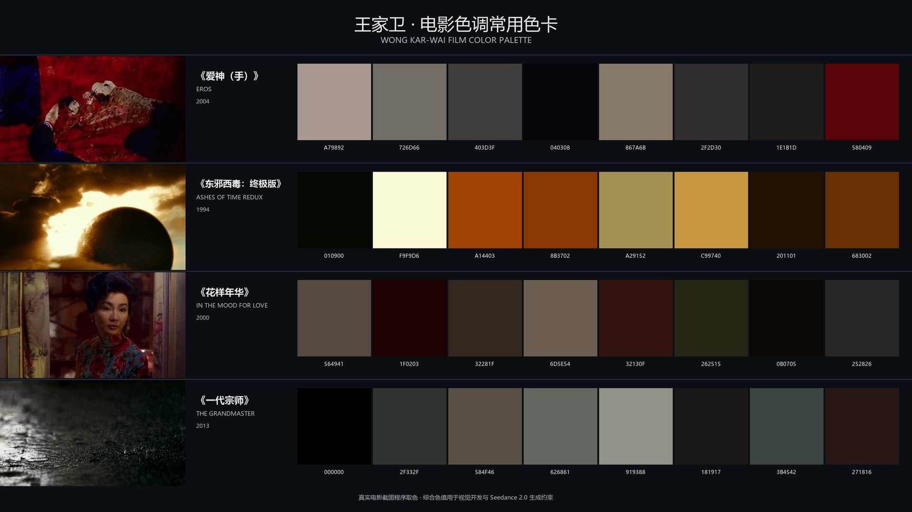
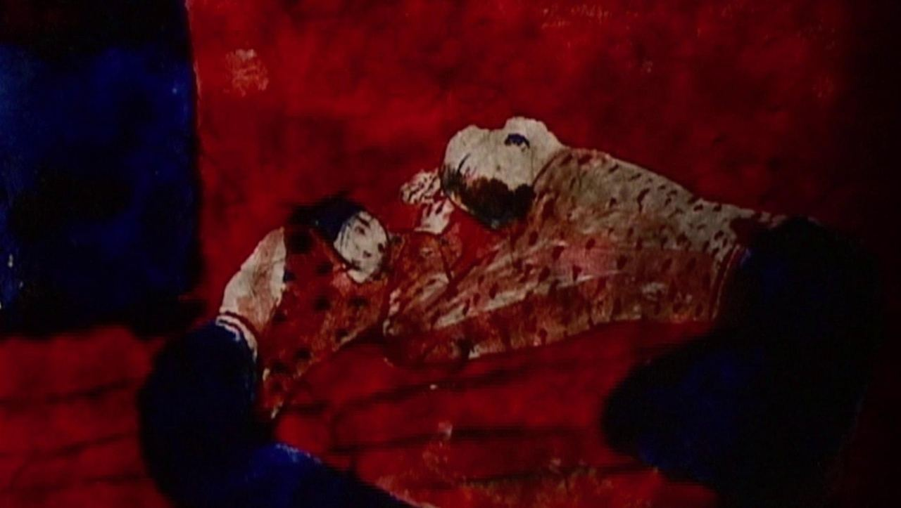
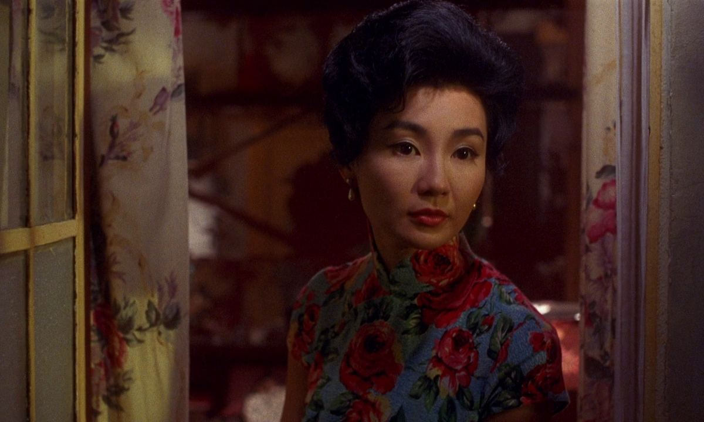
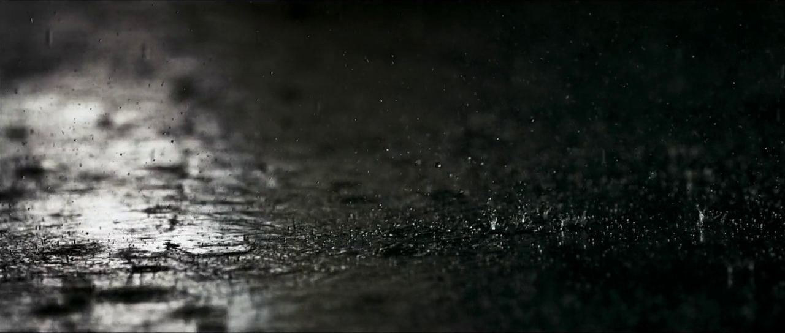

# 导演色卡 #022 — Wong Kar-wai 王家卫

> **分类**：02 霓虹黑色与赛博未来 | **编号**：022 | **国籍**：中国香港 | **活跃年代**：1988-至今 | **创建日期**：2026-07-31

---

## 一、核心风格一句话
> 步印慢门与霓虹暧昧交织的浓饱和红绿，时间灰烬中氤氲的都市爱情诗篇。

---

## 二、色板构成

> 横版主色卡

### 主色板（6色）
| 色号 | HEX | 色彩名称 | 占比 | 来源说明 |
|------|-----|---------|------|---------|
| C01 | `#1A0A1F` | 午夜深紫 | 30% | 重庆森林夜色 |
| C02 | `#C41E3A` | 霓虹正红 | 15% | 花样年华旗袍 |
| C03 | `#006B54` | 墨绿翡翠 | 15% | 重庆森林绿 |
| C04 | `#F4A460` | 暖沙黄 | 12% | 花样年华街灯 |
| C05 | `#4169E1` | 霓虹蓝 | 13% | 堕落天使夜蓝 |
| C06 | `#FFDAB9` | 蜜桃肤 | 15% | 女主角肤色 |

### 情绪色板（4色）
| 色号 | HEX | 色彩名称 | 情绪含义 |
|------|-----|---------|---------|
| E01 | `#FF1493` | 霓虹粉 | 暧昧欲望 |
| E02 | `#00FFFF` | 电子青 | 疏离时间 |
| E03 | `#FFD700` | 回忆金 | 怀旧记忆 |
| E04 | `#8B0000` | 暗血红 | 心碎遗憾 |

### 光影特征
- **主光方向**：step-printed slow shutter, neon color bleeding, soft colored fill
- **高光色偏**：neon pink/red/green
- **阴影色偏**：deep purple-black
- **对比比**：medium-high 65-80%
- **色调整体**：warm saturated neon, 55% warm + 45% cool

---

## 三、视觉风格关键词
### 构图与运镜
step printing slow shutter · neon color framing · wide-angle distortion · through glass/window · mirror reflection · slow motion · smoke and haze · close-up intimacy
### 色彩与光影
neon saturated red-green · step-printed color bleed · 1960s hong kong neon · warm tungsten gold · neon blue night · cheongsam red patterns · cigarette smoke haze · rain-streaked neon
### 氛围与情绪
urban loneliness · romantic melancholy · missed connections · hong kong nocturne · time and memory · unrequited love · neon poetry · emotional saturation

---

## 四、运镜特征
| 特征 | 说明 | 经典例子 |
|------|------|---------|
| 慢门拖影 | 步进印刷拖影时间流动 | 《重庆森林》奔跑 |
| 宽镜头畸变 | 广角变形都市异化 | 《堕落天使》夜行 |
| 隔玻璃拍摄 | 窗户雨幕隔离人物 | 《花样年华》走廊 |
| 镜子反射 | 镜中双重情感 | 《2046》镜面 |
| 特写亲密 | 极端特写面孔情感 | 《花样年华》对视 |
| 霓虹框景 | 霓虹灯框住人物 | 《重庆森林》便利店 |
| 烟雾氤氲 | 烟雾营造怀旧 | 《花样年华》餐厅 |
| 步印运动 | 步进印刷模糊 | 《重庆森林》都市 |

---

## 五、经典场景色彩参考
### 电影截图画廊
| 重庆森林 | 堕落天使 | 花样年华 |
|--------|------|--------|
|  |  |  |
| 午夜深紫+霓虹蓝 · 都市孤独 | 午夜深紫+霓虹粉 · 暗夜暧昧 | 霓虹正红+暖沙黄 · 禁忌爱情 |

| 2046 | 春光乍泄 | 东邪西毒 |
|--------|------|--------|
|  | *春光乍泄（剧照未收录）* | *东邪西毒（剧照未收录）* |
| 墨绿翡翠+回忆金 · 时间列车 | 暖沙黄+暗血红 · 异乡爱恋 | 墨绿翡翠+暖沙黄 · 武侠诗意 |

王家卫的霓虹都市是被慢门拖影拉长的一夜——午夜深紫是香港无尽夜色的底色，霓虹正红与墨绿翡翠在旗袍与夜空中对唱，暖沙黄的钨丝灯把每一个擦肩而过的瞬间都染成回忆。步印慢门让时间变得粘稠，霓虹灯在雨幕中洇开成泪水的形状。

### 电影色彩速查
| 电影 | 场景 | 主导色 | 色彩氛围 |
|------|------|--------|---------|
| 重庆森林 | 便利店夜戏 | 午夜深紫+霓虹蓝 | 都市孤独 |
| 堕落天使 | 摩托夜行 | 午夜深紫+霓虹粉 | 暗夜暧昧 |
| 花样年华 | 走廊相遇 | 霓虹正红+暖沙黄 | 禁忌爱情 |
| 2046 | 列车旅途 | 墨绿翡翠+回忆金 | 时间记忆 |
| 春光乍泄 | 布宜诺斯艾利斯 | 暖沙黄+暗血红 | 异乡爱恋 |
| 东邪西毒 | 沙漠客栈 | 墨绿翡翠+暖沙黄 | 武侠诗意 |
| 一代宗师 | 民国武林 | 墨绿翡翠+暖沙黄 | 功夫美学 |
| 蓝莓之夜 | 公路旅程 | 霓虹蓝+蜜桃肤 | 治愈旅程 |

---

## 六、AI 生成提示词模板
### 图像生成速用公式
```
[subject description], in the style of Wong Kar-wai, hong kong neon noir, step-printed slow shutter, saturated red-green color palette, neon light bleed, romantic melancholy, 1960s hong kong, cinematic film grain --ar 16:9 --style raw
```
### 视频生成速用公式
```
A romantic neon-lit scene in Wong Kar-wai style, step-printed slow shutter, saturated red and green neon, neon light trails through rain, wide-angle distortion, romantic melancholy, slow intimate camera, 16:9, cinematic movement
```

---

## 七、代表作索引
| 年份 | 片名 | 主要色彩特征 |
|------|------|-------------|
| 1988 | 旺角卡门 | 霓虹港风兄弟 |
| 1990 | 阿飞正传 | 60年代暖调 |
| 1994 | 重庆森林 | 霓虹蓝绿步进印刷 |
| 1995 | 堕落天使 | 广角畸变夜雨 |
| 1997 | 春光乍泄 | 南美暖黄同性 |
| 2000 | 花样年华 | 旗袍红60年代怀旧 |
| 2004 | 2046 | 墨绿列车时间 |
| 2013 | 一代宗师 | 民国墨绿功夫 |

---

## 八、蒸馏验证
- [x] 色板6+4色已提取
- [x] 运镜特征已归纳（8种）
- [x] 提示词模板已生成（MJ/SD/视频）
- [ ] 电影截图参考图已收集
- [ ] Stable Diffusion 实测试图
- [ ] Runway 视频测试
