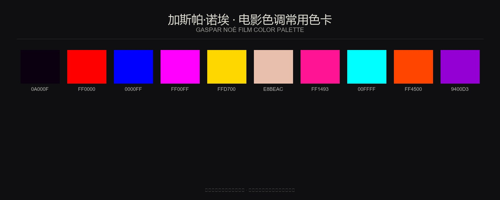
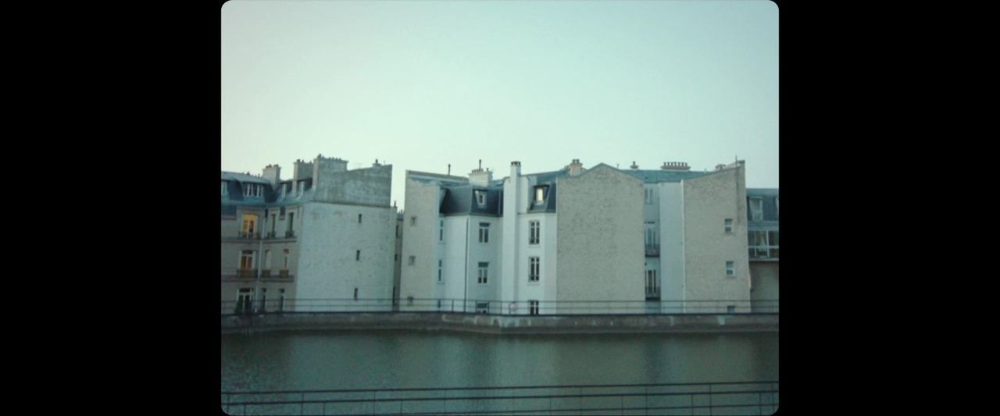
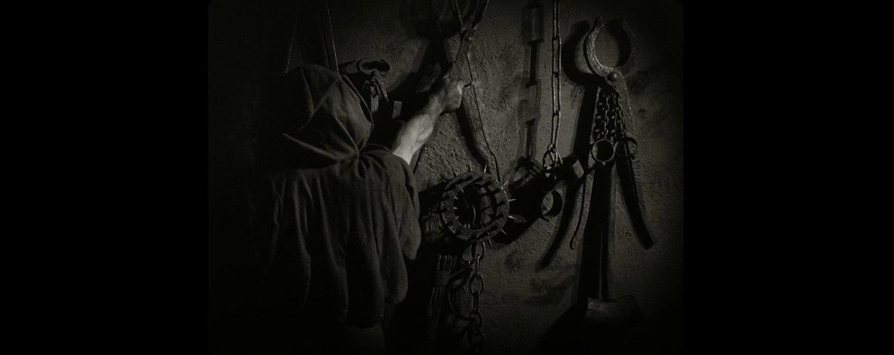
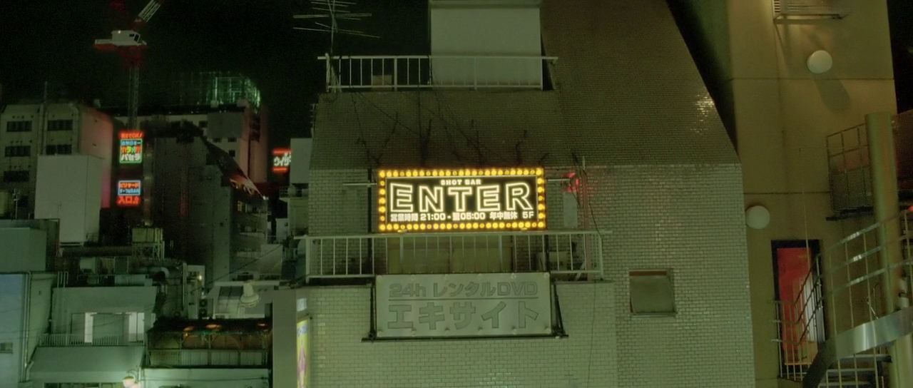

# 导演色卡 #023 — Gaspar Noé 加斯帕·诺埃

> **分类**：02 霓虹黑色与赛博未来 | **编号**：023 | **国籍**：法国/阿根廷 | **活跃年代**：1998-至今 | **创建日期**：2026-07-31

---

## 一、核心风格一句话
> 迷幻频闪与霓虹红蓝交织的夜店色温，感官过载中直面欲望与死亡的极端影像。

---

## 二、色板构成

> 横版主色卡

### 主色板（6色）
| 色号 | HEX | 色彩名称 | 占比 | 来源说明 |
|------|-----|---------|------|---------|
| C01 | `#0A000F` | 迷幻深黑 | 30% | 不可撤销暗部 |
| C02 | `#FF0000` | 频闪纯红 | 18% | 暴力场景 |
| C03 | `#0000FF` | 电音深蓝 | 15% | 夜店蓝光 |
| C04 | `#FF00FF` | 夜店洋红 | 12% | 脱衣舞俱乐部 |
| C05 | `#FFD700` | 迷幻金 | 10% | 灯光频闪 |
| C06 | `#E8BEAC` | 裸肤 | 15% | 人体肤色 |

### 情绪色板（4色）
| 色号 | HEX | 色彩名称 | 情绪含义 |
|------|-----|---------|---------|
| E01 | `#FF1493` | 欲望粉 | 性欲肉体 |
| E02 | `#00FFFF` | 毒幻青 | 毒瘾幻觉 |
| E03 | `#FF4500` | 暴力橙红 | 暴力愤怒 |
| E04 | `#9400D3` | 迷幻紫 | 超越濒死 |

### 光影特征
- **主光方向**：strobing neon, disorienting colored sources, extreme low-angle
- **高光色偏**：strobing red/blue/magenta club lights
- **阴影色偏**：pure black void
- **对比比**：extreme 85-95%
- **色调整体**：psychedelic neon dark 50/50

---

## 三、视觉风格关键词
### 构图与运镜
360 degree rotating camera · extreme low angle · long unbroken takes · first person POV · stroboscopic editing · overhead bird's eye · extreme close-up body · inverted camera
### 色彩与光影
strobing red-blue neon · psychedelic magenta · nightclub color temperature · saturated violence red · drug hallucination colors · strobe light flicker · blacklight UV glow · disorienting color shifts
### 氛围与情绪
extreme cinema · sensory overload · primal desire · violence and sexuality · drug experience · existential void · death transcendence · audience confrontation

---

## 四、运镜特征
| 特征 | 说明 | 经典例子 |
|------|------|---------|
| 360度旋转 | 空间旋转眩晕 | 《爱恋》床戏 |
| 极端低角度 | 天花板视角压迫 | 《不可撤销》火焰 |
| 长镜头一镜 | 不切真实 | 《不可撤销》隧道 |
| 第一人称POV | 主观代入 | 《遁入虚无》灵魂 |
| 频闪剪辑 | 感官冲击 | 《不可撤销》俱乐部 |
| 俯视鸟瞰 | 上帝视角 | 《遁入虚无》东京 |
| 身体特写 | 肉体亲密恐怖 | 《爱恋》身体 |
| 倒转镜头 | 世界倒置 | 《遁入虚无》死亡 |

---

## 五、经典场景色彩参考
### 电影截图画廊
| 不可撤销 | 不可撤销 | 遁入虚无 |
|--------|------|--------|
|  |  | *遁入虚无（剧照未收录）* |
| 迷幻深黑+频闪纯红 · 极端暴力 | 电音深蓝+夜店洋红 · 地狱俱乐部 | 迷幻金+夜店洋红 · 东京漂浮 |

| 爱恋 | 高潮 | 独自站立 |
|--------|------|--------|
|  | *高潮（剧照未收录）* | *独自站立（剧照未收录）* |
| 裸肤+欲望粉 · 3D情欲 | 频闪纯红+电音深蓝 · 集体迷狂 | 暴力橙红+迷幻深黑 · 屠夫独白 |

诺埃的影像世界是一场被频闪霓虹点燃的感官暴乱——迷幻深黑是意识消解的深渊，频闪纯红与电音深蓝在夜店中以不可承受的频率交替闪烁，夜店洋红的紫外线把肉体照成幽灵的颜色。360度旋转镜头让整个世界天旋地转。

### 电影色彩速查
| 电影 | 场景 | 主导色 | 色彩氛围 |
|------|------|--------|---------|
| 不可撤销 | 隧道暴力 | 迷幻深黑+频闪纯红 | 极端暴力 |
| 不可撤销 | 红灯俱乐部 | 电音深蓝+夜店洋红 | 地狱空间 |
| 遁入虚无 | 东京俯瞰 | 迷幻金+夜店洋红 | 灵魂出窍 |
| 爱恋 | 3D性爱 | 裸肤+欲望粉 | 情欲记忆 |
| 高潮 | 集体舞蹈 | 频闪纯红+电音深蓝 | 迷狂 |
| 独自站立 | 屠夫独白 | 迷幻深黑+暴力橙红 | 愤怒暴力 |
| 永恒之光 | 老年迷幻 | 迷幻紫+毒幻青 | 死亡超越 |

---

## 六、AI 生成提示词模板
### 图像生成速用公式
```
[subject description], in the style of Gaspar Noe, extreme cinema, strobing red and blue neon, psychedelic nightclub, magenta blacklight, 360 degree rotating, sensory overload, raw visceral --ar 16:9 --style raw
```
### 视频生成速用公式
```
An extreme psychedelic scene in Gaspar Noe style, 360 degree rotating camera, strobing red blue neon, magenta nightclub, disorienting spinning, first person POV, sensory overload, long take, 16:9, cinematic movement
```

---

## 七、代表作索引
| 年份 | 片名 | 主要色彩特征 |
|------|------|-------------|
| 1998 | 独自站立 | 屠夫暴力暗红 |
| 2002 | 不可撤销 | 频闪红蓝隧道 |
| 2009 | 遁入虚无 | 东京霓虹灵魂 |
| 2015 | 爱恋 | 3D情欲粉红 |
| 2018 | 高潮 | 集体舞迷狂 |
| 2019 | 永恒之光 | 老年迷幻紫 |

---

## 八、蒸馏验证
- [x] 色板6+4色已提取
- [x] 运镜特征已归纳（8种）
- [x] 提示词模板已生成（MJ/SD/视频）
- [ ] 电影截图参考图已收集
- [ ] Stable Diffusion 实测试图
- [ ] Runway 视频测试
