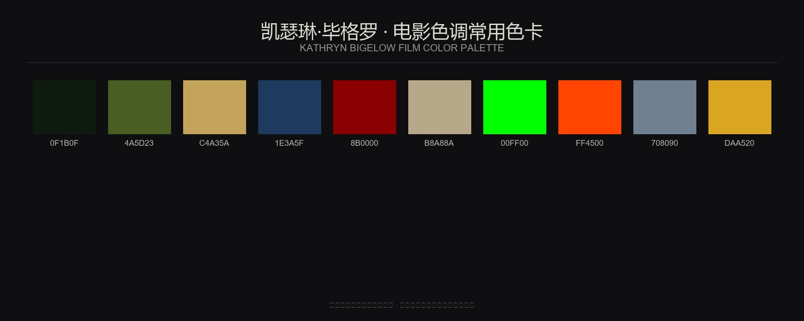
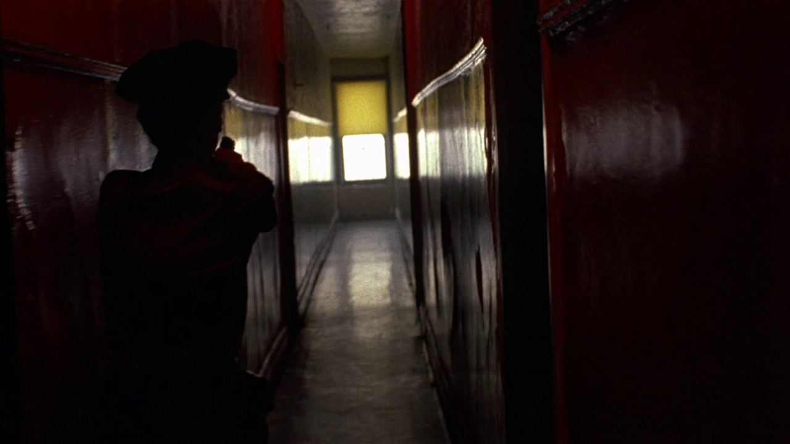
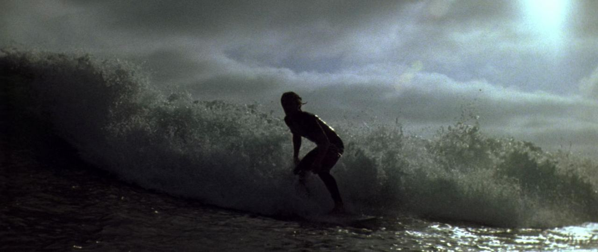
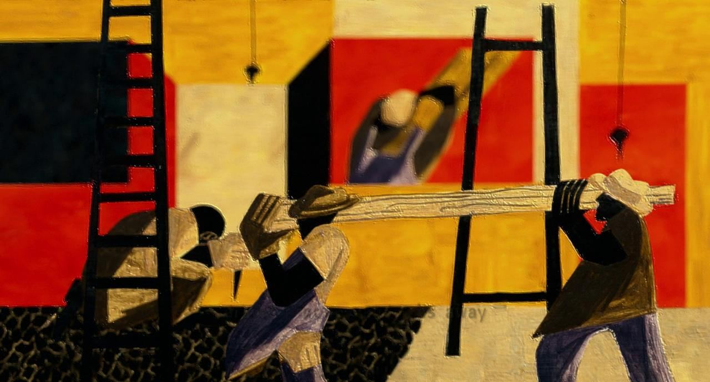
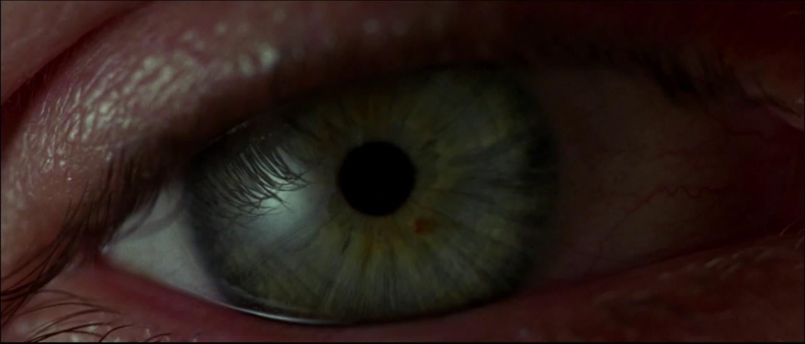

# 导演色卡 #024 — Kathryn Bigelow 凯瑟琳·毕格罗

> **分类**：02 霓虹黑色与赛博未来 | **编号**：024 | **国籍**：美国 | **活跃年代**：1981-至今 | **创建日期**：2026-07-31

---

## 一、核心风格一句话
> 军绿夜视与手持纪实交织的冷蓝沙漠，战争机器的肌理与男性暴力的真实凝视。

---

## 二、色板构成

> 横版主色卡

### 主色板（6色）
| 色号 | HEX | 色彩名称 | 占比 | 来源说明 |
|------|-----|---------|------|---------|
| C01 | `#0F1B0F` | 夜视深绿 | 30% | 拆弹部队夜视 |
| C02 | `#4A5D23` | 军绿橄榄 | 20% | 军装战术装备 |
| C03 | `#C4A35A` | 沙漠土黄 | 15% | 伊拉克沙漠 |
| C04 | `#1E3A5F` | 战术冷蓝 | 12% | 月光夜间行动 |
| C05 | `#8B0000` | 暗红血锈 | 10% | 爆炸血迹 |
| C06 | `#B8A88A` | 沙尘肤 | 13% | 士兵肤色 |

### 情绪色板（4色）
| 色号 | HEX | 色彩名称 | 情绪含义 |
|------|-----|---------|---------|
| E01 | `#00FF00` | 夜视绿 | 战术军事 |
| E02 | `#FF4500` | 爆炸橙 | 战争暴力 |
| E03 | `#708090` | 战术灰 | 纪律压力 |
| E04 | `#DAA520` | 沙漠金 | 酷热生存 |

### 光影特征
- **主光方向**：handheld documentary natural light, harsh desert sun, night vision green
- **高光色偏**：desert gold/orange explosion
- **阴影色偏**：deep olive green-black
- **对比比**：high 70-85%
- **色调整体**：cool military desaturated 60/40

---

## 三、视觉风格关键词
### 构图与运镜
handheld documentary camera · shaky cam immediacy · night vision POV · wide desert vistas · tactical POV · slow motion tension · explosion aftermath · close-up on faces
### 色彩与光影
military night vision green · desert sand ochre · olive drab military · tactical cold blue · explosion orange fire · dust and haze · desaturated war tone · documentary grain
### 氛围与情绪
war realism · documentary intensity · masculine violence · tactical tension · moral ambiguity · desert isolation · combat stress · anti-war

---

## 四、运镜特征
| 特征 | 说明 | 经典例子 |
|------|------|---------|
| 手持纪实 | 晃动增加真实 | 《拆弹部队》巡逻 |
| 夜视POV | 绿光夜视 | 《猎杀本拉登》夜袭 |
| 沙漠大远景 | 广阔人物渺小 | 《拆弹部队》沙漠 |
| 慢镜紧张 | 慢动作放大 | 《拆弹部队》拆弹 |
| 爆炸余波 | 烟尘和光 | 《拆弹部队》爆炸 |
| 面部特写 | 士兵压力 | 《拆弹部队》士兵 |
| 战术俯瞰 | 上帝视角 | 《猎杀本拉登》 |
| 动作沉浸 | 沉浸式跟拍 | 《惊爆点》冲浪 |

---

## 五、经典场景色彩参考
### 电影截图画廊
| 拆弹部队 | 拆弹部队 | 猎杀本拉登 |
|--------|------|--------|
|  |  |  |
| 军绿橄榄+沙漠土黄 · 拆弹紧张 | 夜视深绿+战术冷蓝 · 夜间 | 夜视深绿+战术灰 · 战术夜袭 |

| 惊爆点 | 拆弹部队 | 底特律 |
|--------|------|--------|
|  | *拆弹部队（剧照未收录）* | *底特律（剧照未收录）* |
| 战术冷蓝+沙漠金 · 极限冲浪 | 爆炸橙+沙漠土黄 · 战争暴力 | 暗红血锈+战术灰 · 城市暴力 |

毕格罗的战争世界是被军绿夜视滤镜覆盖的真实沙漠——夜视深绿把夜间行动变成电子幽灵的狩猎，军绿橄榄是战术装备和军装的冷酷底色，沙漠土黄的尘土在每一次爆炸中扬起笼罩整个画面。

### 电影色彩速查
| 电影 | 场景 | 主导色 | 色彩氛围 |
|------|------|--------|---------|
| 拆弹部队 | 沙漠拆弹 | 军绿橄榄+沙漠土黄 | 紧张生存 |
| 猎杀本拉登 | 夜间突袭 | 夜视深绿+战术灰 | 战术CIA |
| 惊爆点 | 冲浪抢劫 | 战术冷蓝+沙漠金 | 极限运动 |
| 拆弹部队 | 爆炸 | 爆炸橙+沙漠土黄 | 暴力死亡 |
| K-19 | 潜艇 | 战术冷蓝+暗红血锈 | 冷战核恐惧 |
| 底特律 | 城市骚乱 | 暗红血锈+战术灰 | 种族暴力 |

---

## 六、AI 生成提示词模板
### 图像生成速用公式
```
[subject description], in the style of Kathryn Bigelow, war documentary realism, military night vision green, desert sand ochre, handheld shaky cam, tactical cold blue, raw gritty, combat tension --ar 16:9 --style raw
```
### 视频生成速用公式
```
A tense war scene in Kathryn Bigelow style, handheld documentary camera, military night vision green, desert sand dust, tactical POV, raw gritty realism, shaky camera movement, 16:9, cinematic movement
```

---

## 七、代表作索引
| 年份 | 片名 | 主要色彩特征 |
|------|------|-------------|
| 1987 | 血尸夜 | 西部吸血鬼 |
| 1991 | 惊爆点 | 冲浪蓝天动作 |
| 1995 | 末世纪暴潮 | 赛博朋克VR |
| 2002 | K-19 | 潜艇冷蓝 |
| 2008 | 拆弹部队 | 沙漠军绿奥斯卡 |
| 2012 | 猎杀本拉登 | 夜视绿CIA |
| 2017 | 底特律 | 城市暗调暴力 |

---

## 八、蒸馏验证
- [x] 色板6+4色已提取
- [x] 运镜特征已归纳（8种）
- [x] 提示词模板已生成（MJ/SD/视频）
- [ ] 电影截图参考图已收集
- [ ] Stable Diffusion 实测试图
- [ ] Runway 视频测试
