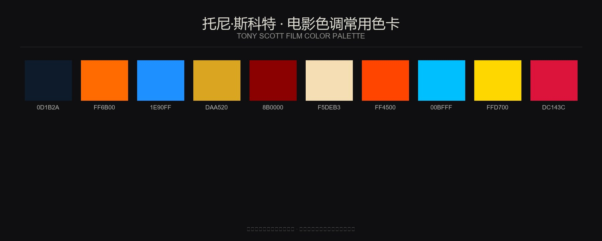
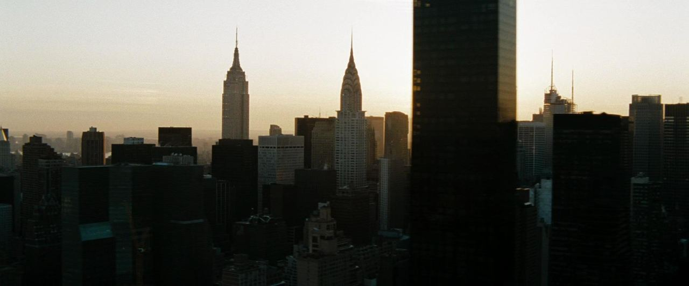
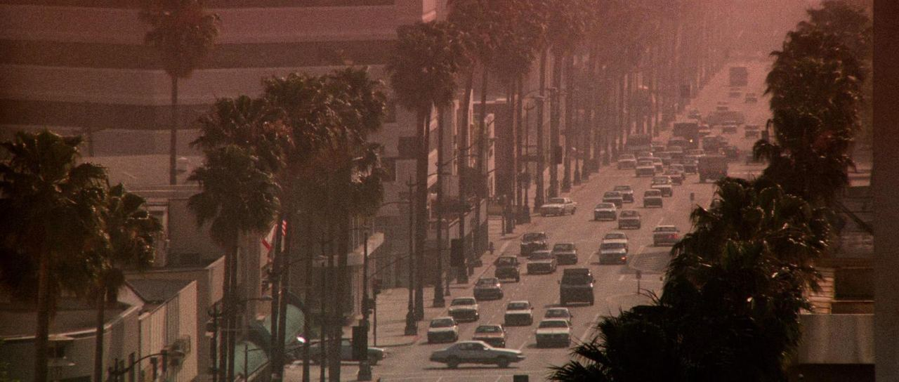
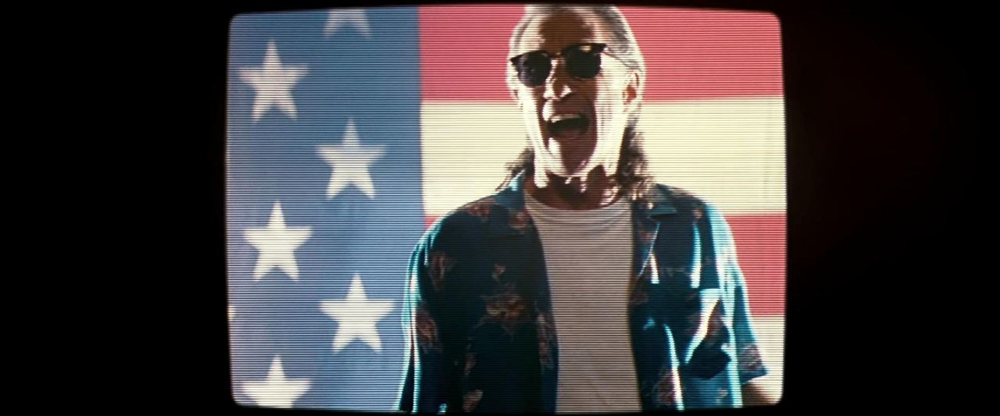

# 导演色卡 #025 — Tony Scott 托尼·斯科特

> **分类**：02 霓虹黑色与赛博未来 | **编号**：025 | **国籍**：英国 | **活跃年代**：1983-2012 | **创建日期**：2026-07-31

---

## 一、核心风格一句话
> 高速剪辑与橙蓝对比交织的过曝逆光，商业动作片最鲜艳的视觉烟花。

---

## 二、色板构成

> 横版主色卡

### 主色板（6色）
| 色号 | HEX | 色彩名称 | 占比 | 来源说明 |
|------|-----|---------|------|---------|
| C01 | `#0D1B2A` | 深蓝夜幕 | 25% | 壮志凌云夜空 |
| C02 | `#FF6B00` | 烈焰橙 | 18% | 爆炸日落 |
| C03 | `#1E90FF` | 电光蓝 | 15% | 天空海洋 |
| C04 | `#DAA520` | 暖金阳光 | 15% | 过曝逆光 |
| C05 | `#8B0000` | 深红行动 | 12% | 动作暴力 |
| C06 | `#F5DEB3` | 小麦肤 | 15% | 主角肤色 |

### 情绪色板（4色）
| 色号 | HEX | 色彩名称 | 情绪含义 |
|------|-----|---------|---------|
| E01 | `#FF4500` | 速度橙 | 速度动作 |
| E02 | `#00BFFF` | 高空蓝 | 飞翔自由 |
| E03 | `#FFD700` | 英雄金 | 荣耀英雄 |
| E04 | `#DC143C` | 激情红 | 爱情危险 |

### 光影特征
- **主光方向**：backlit golden hour, overexposed highlights, strong orange-blue
- **高光色偏**：orange-gold sunset backlight explosion
- **阴影色偏**：deep navy blue
- **对比比**：high 75-85%
- **色调整体**：high-saturation orange-blue 50/50

---

## 三、视觉风格关键词
### 构图与运镜
rapid montage editing · helicopter aerial shots · backlit silhouettes · slow motion action · 360 degree orbits · low angle hero · lens flares · smoke steam
### 色彩与光影
orange-blue complementary · backlit golden hour · overexposed highlights · teal and orange grade · lens flare streaks · sunset orange glow · navy blue night · saturated commercial
### 氛围与情绪
high-octane action · commercial slickness · heroic masculinity · romantic tension · adrenaline rush · patriotic americana · glamorous danger · pop entertainment

---

## 四、运镜特征
| 特征 | 说明 | 经典例子 |
|------|------|---------|
| 直升机航拍 | 壮丽空拍 | 《壮志凌云》飞行 |
| 逆光剪影 | 人物背光剪影 | 《壮志凌云》日落 |
| 慢镜动作 | 慢动作放大 | 《怒火救援》暴力 |
| 360环绕 | 环绕人物旋转 | 《壮志凌云》飞行员 |
| 低角度英雄 | 仰视英雄 | 《壮志凌云》航母 |
| 镜头光晕 | 光斑闪耀 | 《壮志凌云》天空 |
| 快速蒙太奇 | 极速多画面 | 《间谍游戏》 |
| 烟雾蒸汽 | 烟雾氛围 | 《地铁惊魂》 |

---

## 五、经典场景色彩参考
### 电影截图画廊
| 壮志凌云 | 壮志凌云 | 怒火救援 |
|--------|------|--------|
|  |  |  |
| 电光蓝+深蓝夜幕 · 飞行自由 | 烈焰橙+暖金阳光 · 逆光剪影 | 深红行动+烈焰橙 · 复仇暴力 |

| 间谍游戏 | 红潮风暴 | 雷霆壮志 |
|--------|------|--------|
| *间谍游戏（剧照未收录）* | *红潮风暴（剧照未收录）* | *雷霆壮志（剧照未收录）* |
| 深蓝夜幕+暖金阳光 · 谍战 | 深蓝夜幕+深红行动 · 潜艇对峙 | 烈焰橙+电光蓝 · 赛车速度 |

托尼·斯科特的银幕是一场被橙蓝对比点燃的商业烟花——深蓝夜幕是动作片冷硬的底色，烈焰橙的爆炸和逆光像烟花一样在画面中炸开，电光蓝的天空与暖金阳光形成最经典的互补色碰撞。

### 电影色彩速查
| 电影 | 场景 | 主导色 | 色彩氛围 |
|------|------|--------|---------|
| 壮志凌云 | 飞行甲板 | 电光蓝+深蓝夜幕 | 英雄主义 |
| 壮志凌云 | 日落剪影 | 烈焰橙+暖金阳光 | 浪漫自由 |
| 怒火救援 | 墨西哥城 | 深红行动+烈焰橙 | 复仇救赎 |
| 间谍游戏 | 全球谍战 | 深蓝夜幕+暖金阳光 | CIA冷战 |
| 红潮风暴 | 潜艇对峙 | 深蓝夜幕+深红行动 | 核威胁 |
| 雷霆壮志 | 赛车 | 烈焰橙+电光蓝 | 速度 |
| 全民公敌 | 监控都市 | 深蓝夜幕+电光蓝 | 监视政治 |

---

## 六、AI 生成提示词模板
### 图像生成速用公式
```
[subject description], in the style of Tony Scott, high-octane action, orange and blue complementary, backlit golden hour silhouettes, lens flares, commercial slick, heroic atmosphere --ar 16:9 --style raw
```
### 视频生成速用公式
```
A high-octane action scene in Tony Scott style, orange blue contrast, backlit golden hour lens flares, 360 camera orbit, slow motion action, helicopter aerials, heroic adrenaline, dynamic movement, 16:9, cinematic movement
```

---

## 七、代表作索引
| 年份 | 片名 | 主要色彩特征 |
|------|------|-------------|
| 1986 | 壮志凌云 | 橙蓝对比飞行航母 |
| 1990 | 雷霆壮志 | 赛车橙蓝 |
| 1993 | 真实的罗曼史 | 犯罪暖调爱情 |
| 1995 | 红潮风暴 | 潜艇深蓝核威胁 |
| 1998 | 全民公敌 | 监控冷蓝政治 |
| 2001 | 间谍游戏 | 全球谍战师徒 |
| 2004 | 怒火救援 | 墨西哥橙红复仇 |
| 2009 | 地铁惊魂 | 纽约深蓝人质 |

---

## 八、蒸馏验证
- [x] 色板6+4色已提取
- [x] 运镜特征已归纳（8种）
- [x] 提示词模板已生成（MJ/SD/视频）
- [ ] 电影截图参考图已收集
- [ ] Stable Diffusion 实测试图
- [ ] Runway 视频测试
