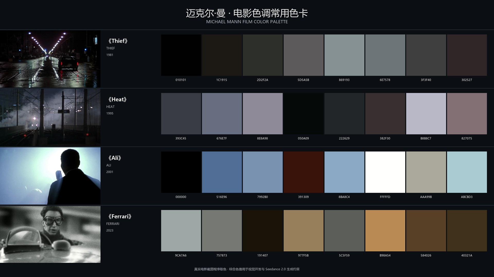
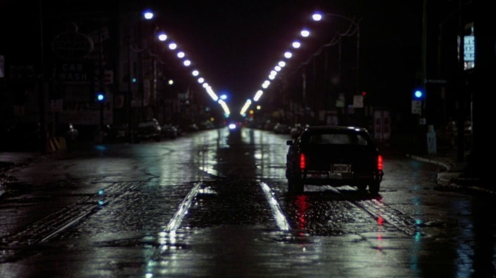
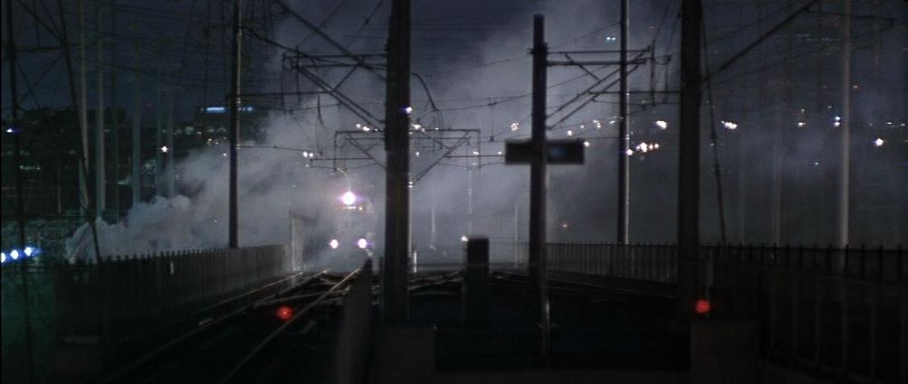
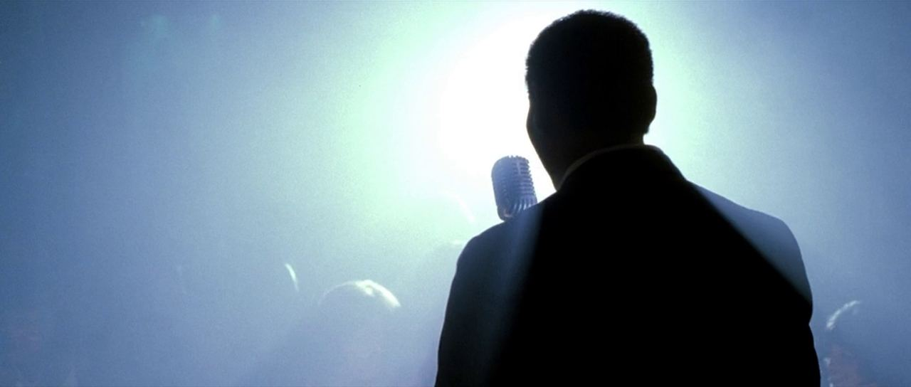
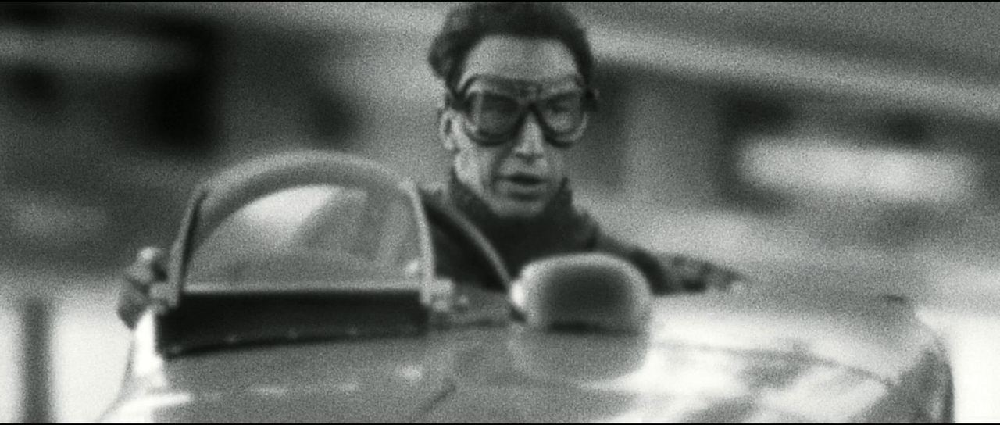

# 导演色卡 #026 — Michael Mann 迈克尔·曼

> **分类**：02 霓虹黑色与赛博未来 | **编号**：026 | **国籍**：美国 | **活跃年代**：1981-至今 | **创建日期**：2026-07-31

---

## 一、核心风格一句话
> 数码深蓝与城市钢灰交织的夜景冷调，专业主义男性在夜色中的孤独与宿命。

---

## 二、色板构成

> 横版主色卡

### 主色板（6色）
| 色号 | HEX | 色彩名称 | 占比 | 来源说明 |
|------|-----|---------|------|---------|
| C01 | `#0A1628` | 数码深蓝 | 35% | 盗火线夜戏 |
| C02 | `#2C3E50` | 城市钢灰 | 20% | 建筑街道西装 |
| C03 | `#4A90D9` | 电子冷蓝 | 12% | 数码摄影冷光 |
| C04 | `#C4A35A` | 都市暖钨 | 12% | 街灯钨丝灯 |
| C05 | `#8B4513` | 皮革棕 | 11% | 皮夹克枪械 |
| C06 | `#B0C4DE` | 冷钢肤 | 10% | 冷光下男性肤色 |

### 情绪色板（4色）
| 色号 | HEX | 色彩名称 | 情绪含义 |
|------|-----|---------|---------|
| E01 | `#1E90FF` | 枪口蓝 | 专业精准 |
| E02 | `#FF6B35` | 枪火橙 | 暴力瞬间 |
| E03 | `#708090` | 钢灰寂 | 孤独疏离 |
| E04 | `#DAA520` | 暖钨灯 | 短暂温暖 |

### 光影特征
- **主光方向**：digital cold blue night, practical sources, tungsten warm accents
- **高光色偏**：electronic cold blue screens neon
- **阴影色偏**：deep digital blue-black
- **对比比**：medium-high 65-80%
- **色调整体**：cool steel blue noir 75/25

---

## 三、视觉风格关键词
### 构图与运镜
digital cinematography · practical light sources · city night aerial · wide anamorphic framing · gunfight choreography · reflections glass water · driving plates · architectural framing
### 色彩与光影
digital cold blue · steel grey urban · tungsten warm accent · practical neon · LA night chrome · anamorphic lens flares · ocean blue night · wet street reflections
### 氛围与情绪
professional criminals · existential male loneliness · urban alienation · precision craft · fate destiny · noir fatalism · cool professionalism · LA nocturne

---

## 四、运镜特征
| 特征 | 说明 | 经典例子 |
|------|------|---------|
| 数字夜景 | 数码冷调 | 《借刀杀人》洛杉矶 |
| 实景光源 | 真实光源布光 | 《盗火线》街道 |
| 城市空拍 | 夜间航拍 | 《盗火线》LA |
| 宽银幕变形 | 宽画幅 | 《盗火线》枪战 |
| 枪战编排 | 精确枪战 | 《盗火线》银行枪战 |
| 玻璃反射 | 反射城市 | 《借刀杀人》出租车 |
| 车内对话 | 驾驶舱对峙 | 《借刀杀人》出租车 |
| 建筑框架 | 建筑几何 | 《盗火线》建筑 |

---

## 五、经典场景色彩参考
### 电影截图画廊
| 盗火线 | 盗火线 | 借刀杀人 |
|--------|------|--------|
|  |  |  |
| 数码深蓝+枪火橙 · 银行枪战 | 城市钢灰+暖钨灯 · 咖啡对峙 | 数码深蓝+电子冷蓝 · 出租车夜行 |

| 盗火线 | 迈阿密风云 | 公众之敌 |
|--------|------|--------|
|  | *迈阿密风云（剧照未收录）* | *公众之敌（剧照未收录）* |
| 城市钢灰+数码深蓝 · LA夜景 | 电子冷蓝+暖钨灯 · 迈阿密夜色 | 皮革棕+暖钨灯 · 大萧条黑帮 |

曼的洛杉矶是被数码摄影机冰冷凝视的钢蓝色迷宫——数码深蓝是永不入眠的城市夜色，城市钢灰的摩天大楼和西装构成现代性的冷硬几何，电子冷蓝的屏幕和霓虹灯是这个数字时代唯一的光源。偶尔一盏钨丝灯的暖金色在黑暗中亮起。

### 电影色彩速查
| 电影 | 场景 | 主导色 | 色彩氛围 |
|------|------|--------|---------|
| 盗火线 | 银行枪战 | 数码深蓝+枪火橙 | 精确暴力 |
| 盗火线 | 餐厅咖啡 | 城市钢灰+暖钨灯 | 宿命对话 |
| 借刀杀人 | 出租车夜行 | 数码深蓝+电子冷蓝 | 杀手哲学 |
| 迈阿密风云 | 游艇夜色 | 电子冷蓝+暖钨灯 | 毒枭卧底 |
| 公众之敌 | 大萧条 | 皮革棕+暖钨灯 | 历史黑帮 |
| 大盗独行 | 钻石盗窃 | 数码深蓝+皮革棕 | 职业犯罪 |

---

## 六、AI 生成提示词模板
### 图像生成速用公式
```
[subject description], in the style of Michael Mann, digital neo-noir, cold steel blue urban night, practical light sources, tungsten warm accents, LA night, anamorphic widescreen, professional criminal --ar 16:9 --style raw
```
### 视频生成速用公式
```
A neo-noir urban night scene in Michael Mann style, digital cold blue cinematography, practical neon tungsten lights, wide anamorphic framing, wet street reflections, professional fatalism, slow deliberate camera, 16:9, cinematic movement
```

---

## 七、代表作索引
| 年份 | 片名 | 主要色彩特征 |
|------|------|-------------|
| 1981 | 大盗独行 | 监狱蓝灰 |
| 1995 | 盗火线 | LA深蓝银行枪战 |
| 2004 | 借刀杀人 | 数码深蓝出租车 |
| 2006 | 迈阿密风云 | 电子蓝紫卧底 |
| 2009 | 公众之敌 | 大萧条棕黑帮 |
| 2015 | 黑客 | 数码深蓝网络 |

---

## 八、蒸馏验证
- [x] 色板6+4色已提取
- [x] 运镜特征已归纳（8种）
- [x] 提示词模板已生成（MJ/SD/视频）
- [ ] 电影截图参考图已收集
- [ ] Stable Diffusion 实测试图
- [ ] Runway 视频测试
