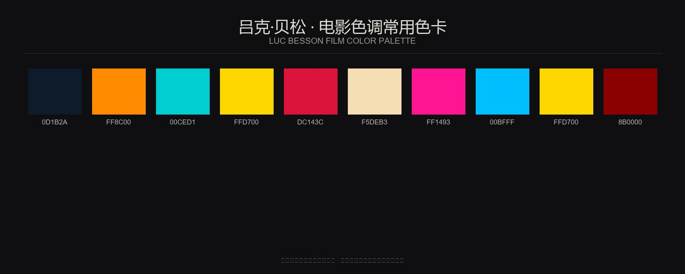
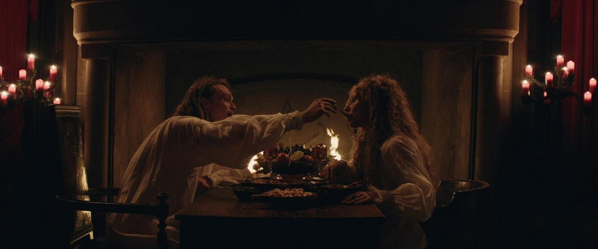
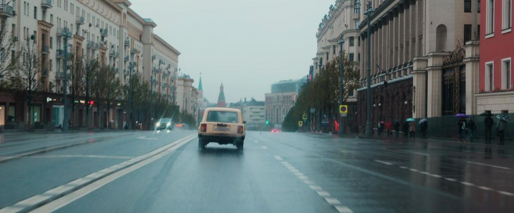
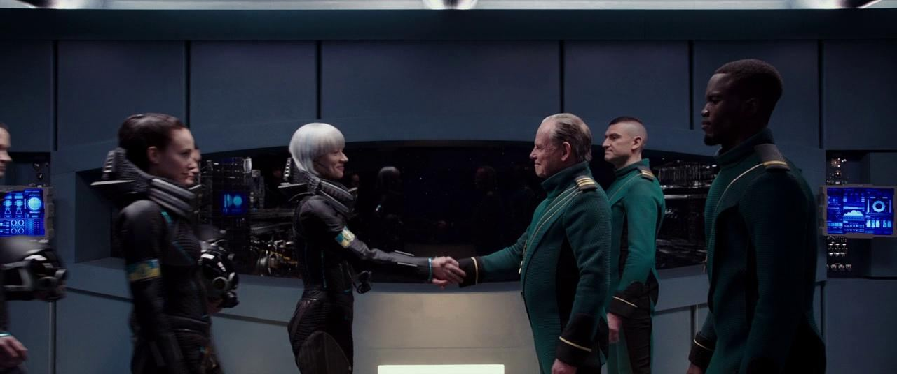
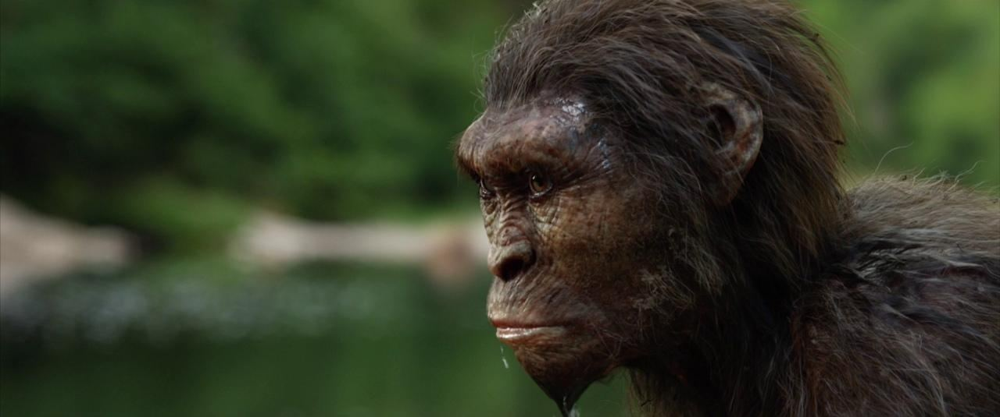

# 导演色卡 #027 — Luc Besson 吕克·贝松

> **分类**：02 霓虹黑色与赛博未来 | **编号**：027 | **国籍**：法国 | **活跃年代**：1983-至今 | **创建日期**：2026-07-31

---

## 一、核心风格一句话
> 法式蓝橙与商业未来感交织的流行科幻，欧罗巴影业的视觉糖果与浪漫暴力。

---

## 二、色板构成

> 横版主色卡

### 主色板（6色）
| 色号 | HEX | 色彩名称 | 占比 | 来源说明 |
|------|-----|---------|------|---------|
| C01 | `#0D1B2A` | 巴黎深蓝 | 25% | 这个杀手不太冷夜戏 |
| C02 | `#FF8C00` | 法式橙 | 18% | 日落暖光 |
| C03 | `#00CED1` | 未来青 | 15% | 第五元素科幻 |
| C04 | `#FFD700` | 黄金光 | 12% | 阳光神性 |
| C05 | `#DC143C` | 法式红 | 12% | 血玫瑰 |
| C06 | `#F5DEB3` | 少女肤 | 18% | 少女主角 |

### 情绪色板（4色）
| 色号 | HEX | 色彩名称 | 情绪含义 |
|------|-----|---------|---------|
| E01 | `#FF1493` | 爱之粉 | 爱情少女 |
| E02 | `#00BFFF` | 未来蓝 | 科幻太空 |
| E03 | `#FFD700` | 神圣金 | 神性救赎 |
| E04 | `#8B0000` | 暗血红 | 暴力死亡 |

### 光影特征
- **主光方向**：polished commercial lighting, golden hour, futuristic colored sources
- **高光色偏**：orange-gold / future cyan
- **阴影色偏**：deep Parisian blue
- **对比比**：medium-high 65-80%
- **色调整体**：polished French commercial 50/50

---

## 三、视觉风格关键词
### 构图与运镜
smooth dolly crane shots · wide angle futuristic cityscapes · slow motion heroic · symmetrical framing · color-coded design · floating camera · iconic costume · vertical city compositions
### 色彩与光影
French blue-orange · pop futurism cyan · golden divine light · Leon plant green · Mathilda red jacket · fifth element orange hair · cinema du look · polished commercial sheen
### 氛围与情绪
French cinematic cool · pop sci-fi spectacle · hitman with heart · young female protagonist · operatic violence · romantic criminal world · euro-pulp aesthetic · divine feminine

---

## 四、运镜特征
| 特征 | 说明 | 经典例子 |
|------|------|---------|
| 平滑推拉摇臂 | 流畅运动 | 《这个杀手不太冷》开场 |
| 广角未来都市 | 未来城市 | 《第五元素》未来城 |
| 慢镜英雄 | 慢动作英雄 | 《这个杀手不太冷》走廊 |
| 对称构图 | 完美对称 | 《第五元素》神殿 |
| 色彩美术 | 色彩编码 | 《第五元素》服装 |
| 漂浮摄影 | 漂浮感 | 《超体》城市 |
| 眼睛特写 | 眼睛表情 | 《这个杀手不太冷》对视 |
| 垂直城市 | 垂直构图 | 《第五元素》飞行车 |

---

## 五、经典场景色彩参考
### 电影截图画廊
| 这个杀手不太冷 | 这个杀手不太冷 | 第五元素 |
|--------|------|--------|
|  |  |  |
| 巴黎深蓝+法式橙 · 走廊对峙 | 法式红+少女肤 · 杀手与女孩 | 未来青+黄金光 · 未来都市 |

| 第五元素 | 超体 | 尼基塔 |
|--------|------|--------|
|  | *超体（剧照未收录）* | *尼基塔（剧照未收录）* |
| 未来青+法式橙 · 神性女主 | 未来青+神圣金 · 意识进化 | 巴黎深蓝+法式红 · 女杀手 |

贝松的欧罗巴世界是一颗被法式蓝橙包裹的糖果——巴黎深蓝是浪漫犯罪世界的夜幕，法式橙的日落和暖光把每一个孤独杀手的瞬间染成温柔，未来青的科技光在第五元素的未来都市中流淌，黄金光的神性照耀着那些超越凡人的女性主角。

### 电影色彩速查
| 电影 | 场景 | 主导色 | 色彩氛围 |
|------|------|--------|---------|
| 这个杀手不太冷 | 走廊对峙 | 巴黎深蓝+法式橙 | 杀手女孩宿命 |
| 这个杀手不太冷 | 玛蒂尔达 | 法式红+少女肤 | 少女复仇成长 |
| 第五元素 | 未来都市 | 未来青+黄金光 | 科幻太空歌剧 |
| 第五元素 | 莉露 | 未来青+法式橙 | 神性第五元素 |
| 超体 | 台北进化 | 未来青+神圣金 | 意识进化 |
| 尼基塔 | 女杀手 | 巴黎深蓝+法式红 | 特工训练 |
| 碧海蓝天 | 海洋 | 未来青+黄金光 | 潜水自由 |

---

## 六、AI 生成提示词模板
### 图像生成速用公式
```
[subject description], in the style of Luc Besson, French cinema du look, polished blue-orange commercial, futuristic cyan and gold, Parisian night, pop sci-fi spectacle, romantic criminal world, operatic color --ar 16:9 --style raw
```
### 视频生成速用公式
```
A stylish French genre scene in Luc Besson style, smooth dolly crane camera, blue-orange French palette, futuristic cyan light, golden hour warmth, wide angle futuristic city, operatic spectacle, floating camera, 16:9, cinematic movement
```

---

## 七、代表作索引
| 年份 | 片名 | 主要色彩特征 |
|------|------|-------------|
| 1988 | 碧海蓝天 | 海洋蓝希腊 |
| 1990 | 尼基塔 | 女杀手法式蓝橙 |
| 1994 | 这个杀手不太冷 | 巴黎深蓝经典 |
| 1997 | 第五元素 | 未来青科幻歌剧 |
| 2014 | 超体 | 台北进化青 |
| 2017 | 星际特工 | 科幻万花筒 |

---

## 八、蒸馏验证
- [x] 色板6+4色已提取
- [x] 运镜特征已归纳（8种）
- [x] 提示词模板已生成（MJ/SD/视频）
- [ ] 电影截图参考图已收集
- [ ] Stable Diffusion 实测试图
- [ ] Runway 视频测试
