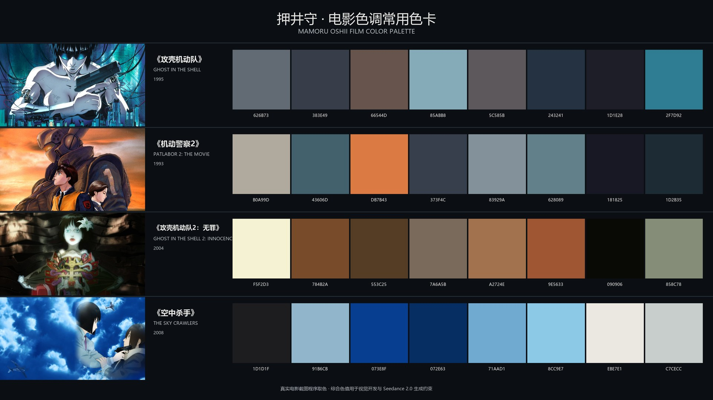
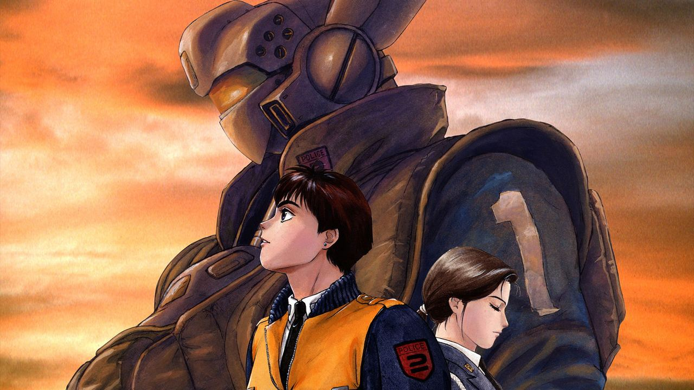
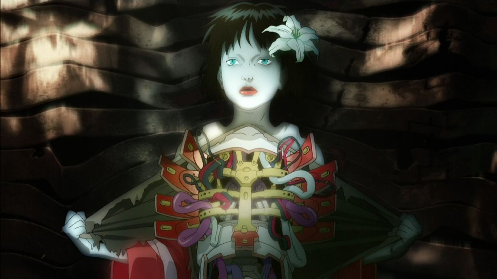
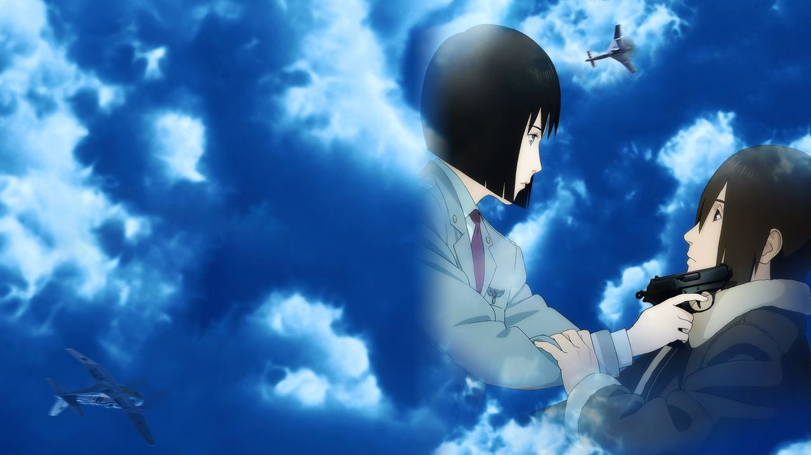

# 导演色卡 #028 — Mamoru Oshii 押井守

> **分类**：02 霓虹黑色与赛博未来
> **编号**：028
> **国籍**：日本
> **活跃年代**：1983-至今
> **创建日期**：2026-07-31

---

## 一、核心风格一句话

> 雨幕笼罩的赛博都市中数据绿流淌，存在主义哲思与冷硬机械美学交织成冷蓝灰调的未来寓言。

---

## 二、色板构成



> 横版主色卡（点击查看高清图）

### 主色板（6色）

| 色号 | HEX | 色彩名称 | 占比 | 来源说明 |
|------|-----|---------|------|---------|
| C01 | `#0D1117` | 赛博深黑 | 32% | 攻壳机动队暗部、新港市夜景、雨幕底色 |
| C02 | `#37474F` | 雨城灰蓝 | 22% | 冷雨街道、建筑表面、阴天天光 |
| C03 | `#00C853` | 数据绿 | 14% | 黑客入侵数据流、终端界面、义眼绿光 |
| C04 | `#00E5FF` | 霓虹青 | 12% | 全息投影、霓虹招牌反射、水面倒影 |
| C05 | `#F0D9B5` | 暖肤黄 | 10% | 草薙素子肤色、暖光室内、记忆中的暖色 |
| C06 | `#607D8B` | 机械灰 | 10% | 义体金属、机甲表面、塔奇克马装甲 |

### 情绪色板（4色）

| 色号 | HEX | 色彩名称 | 情绪含义 |
|------|-----|---------|---------|
| E01 | `#FF1744` | 警报红 | 危险、战斗、系统入侵警告 |
| E02 | `#76FF03` | 数据荧光绿 | 数字意识觉醒、灵魂的电子化 |
| E03 | `#5C6BC0` | 哲学紫灰 | 存在焦虑、记忆与现实的模糊、人偶的凝视 |
| E04 | `#FFD54F` | 夕照金 | 人性的余温、记忆中的阳光、短暂的宁静 |

### 光影特征

- **主光方向**：顶光+侧光为主，雨幕散射光营造湿冷氛围，霓虹招牌作为色彩光源
- **高光色偏**：数据绿/霓虹青（终端界面/全息投影/霓虹反射）
- **阴影色偏**：冷蓝灰偏黑（雨城暗部/机械缝隙/建筑阴影）
- **对比比**：中高对比（65-80%），暗部偏冷蓝，高光处有霓虹色溢出
- **色调整体**：冷调赛博，75%冷蓝绿灰 + 25%暖黄肤色/夕照

---

## 三、视觉风格关键词（按权重排序）

### 构图与运镜
雨幕远景 · 水面倒影 · 义体镜面反射 · 城市俯瞰长镜 · 人偶静止构图 · 走廊纵深透视 · 数据雨叠层 · 鸟类/狗意象空镜 · 玻璃反射叠影 · 城市天际线

### 色彩与光影
数据绿流 · 雨城冷蓝 · 霓虹青溢光 · 湿面反射 · 机械灰冷调 · 暖肤对比 · 夕照金边 · 全息投影半透 · 暗色深黑 · 水面碎光

### 氛围与情绪
赛博哲学 · 存在主义 · 记忆与身份 · 灵肉二元 · 冷疏离感 · 都市孤独 · 政治隐喻 · 神学暗喻 · 静止与等待 · 人偶凝视

---

## 四、运镜特征

| 特征 | 说明 | 经典例子 |
|------|------|---------|
| 雨幕长镜 | 固定或缓慢移动的长镜，雨丝成为视觉肌理 | 《攻壳机动队》开篇城市雨景 |
| 水面倒影构图 | 城市与人物在积水中的倒影，虚实交错 | 《攻壳机动队》运河追逐戏 |
| 俯瞰城市远景 | 极高角度俯瞰赛博都市，人物渺小 | 《攻壳机动队》新港市全景 |
| 人偶静止特写 | 极度静止的人物特写，义体的非人凝视 | 《攻壳机动队》素子凝视橱窗人偶 |
| 走廊纵深推镜 | 沿走廊/通道缓慢推进，压迫感与仪式感 | 《人狼》反乌托邦巷道 |
| 数据叠层画面 | 数据流/代码/界面叠加在实景上 | 《攻壳机动队》黑客入侵场景 |
| 空镜凝视 | 静止的建筑、街道、动物空镜，哲思留白 | 《空中杀手》天空与基地空镜 |
| 玻璃反射叠影 | 通过玻璃/水面/义眼反射呈现多重影像 | 《攻壳机动队》光学迷彩战斗 |

---

## 五、经典场景色彩参考

### 电影截图画廊

| 攻壳机动队 | 空中杀手 | 人狼 |
|--------|------|--------|
| *攻壳机动队（剧照未收录）* |  |  |
| 赛博深黑+数据绿 · 雨城赛博 | 雨城灰蓝+夕照金 · 永恒忧郁 | 机械灰+警报红 · 反乌托邦暗黑 |

| 攻壳机动队2 | 机动警察剧场版 | 天使之卵 |
|--------|------|--------|
|  | *机动警察（剧照未收录）* | *天使之卵（剧照未收录）* |
| 霓虹青+哲学紫灰 · 人偶与仪式 | 赛博深黑+机械灰 · 都市冷调 | 雨城灰蓝+暖肤黄 · 末世诗意 |

**色彩氛围描述**：押井守的画面世界是一个永远被冷雨浸润的赛博都市——赛博深黑铺陈出信息时代的底色，数据绿如幽灵般在暗部流淌，霓虹青在湿漉漉的街道和建筑表面折射出冷光，而人偶般静止的人物面庞上，暖肤黄是唯一对抗机械冷调的人性余温。每一帧都像是对"何为人类"这个问题的沉默凝视。

### 电影色彩速查

| 电影 | 场景 | 主导色 | 色彩氛围 |
|------|------|--------|---------|
| 攻壳机动队 | 开篇城市雨景 | 赛博深黑+数据绿+霓虹青 | 赛博都市、信息洪流、灵肉边界 |
| 攻壳机动队 | 素子凝视橱窗人偶 | 雨城灰蓝+暖肤黄+赛博深黑 | 身份困惑、自我怀疑、人偶镜像 |
| 空中杀手 | 基地永恒天空 | 雨城灰蓝+夕照金 | 永恒轮回、少年忧郁、战争虚无 |
| 空中杀手 | 空中狗斗 | 机械灰+夕照金+赛博深黑 | 空战冷铁、死亡美学、宿命感 |
| 人狼 | 下水道反乌托邦 | 机械灰+警报红+赛博深黑 | 极权压迫、兽性与人性、暗黑童话 |
| 攻壳机动队2：无罪 | 祭典人偶游行 | 霓虹青+哲学紫灰+夕照金 | 仪式感、人偶美学、东方赛博 |
| 天使之卵 | 末世少女与卵 | 雨城灰蓝+暖肤黄+赛博深黑 | 末世诗意、宗教隐喻、沉默等待 |
| 机动警察剧场版 | 东京城市全景 | 赛博深黑+机械灰+霓虹青 | 都市异化、政治阴谋、巨型机械 |

---

## 六、AI 生成提示词模板

> 完整提示词文件见 `prompts/` 目录

### 图像生成速用公式

```
[subject description], in the style of Mamoru Oshii,
cyberpunk anime film still,
rain-soaked cyberpunk city, data green glow,
neon cyan reflections on wet surfaces,
cold blue-grey atmosphere,
philosophical cyberpunk mood,
cinematic anime texture, film grain --ar 16:9 --style raw
```

### 视频生成速用公式

```
A cyberpunk scene in Mamoru Oshii style,
rain-soaked cityscape, data green streams,
neon cyan reflections with cold blue-grey tones,
slow contemplative long take,
philosophical atmosphere,
water reflections, glass surfaces,
anime cinematic look, film grain,
16:9 aspect ratio, slow deliberate camera movement
```

---

## 七、代表作索引

| 年份 | 片名 | 主要色彩特征 |
|------|------|-------------|
| 1985 | 天使之卵 | 末世灰蓝、宗教暗喻、沉默诗意 |
| 1989 | 机动警察剧场版 | 东京冷灰、机械色调、都市阴谋 |
| 1995 | 攻壳机动队 | 数据绿雨城、赛博霓虹、灵肉哲学 |
| 1999 | 人狼 | 暗黑反乌托邦、灰红对比、极权童话 |
| 2004 | 攻壳机动队2：无罪 | 人偶祭典金青、东方赛博、仪式感 |
| 2008 | 空中杀手 | 永恒天空灰蓝、夕照暖金、战争虚无 |

---

## 八、蒸馏验证

- [x] 色板6+4色已提取
- [x] 可视化色卡图片已生成（横版+竖版）
- [x] 运镜特征已归纳（8种）
- [x] 提示词模板已生成（MJ/SD/视频）
- [ ] 电影截图参考图已收集
- [ ] Stable Diffusion 实测试图
- [ ] Runway 视频测试
