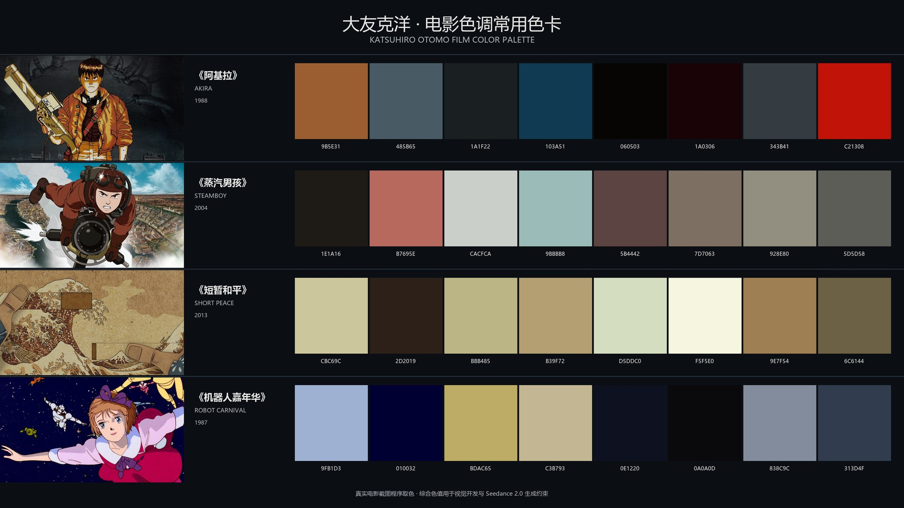
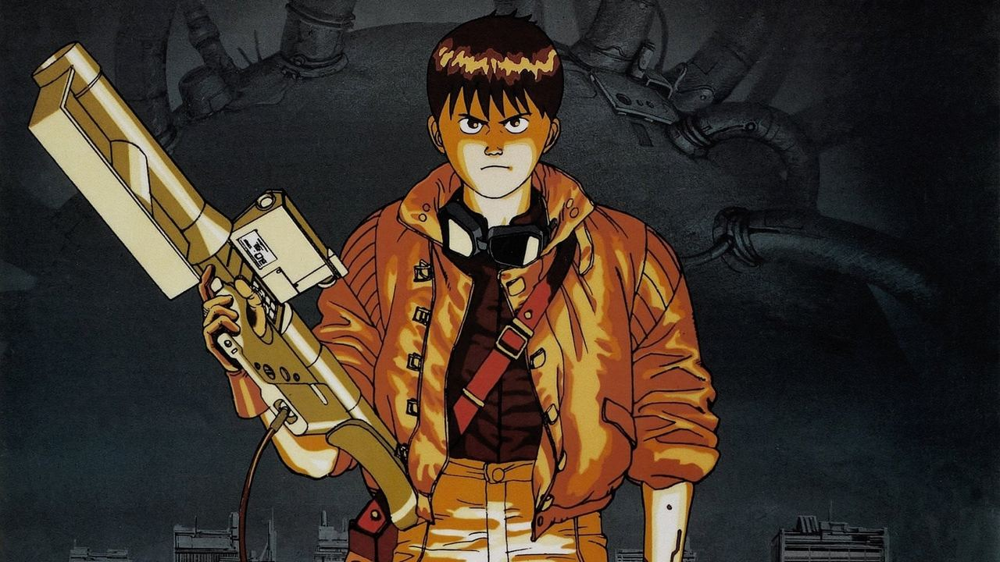
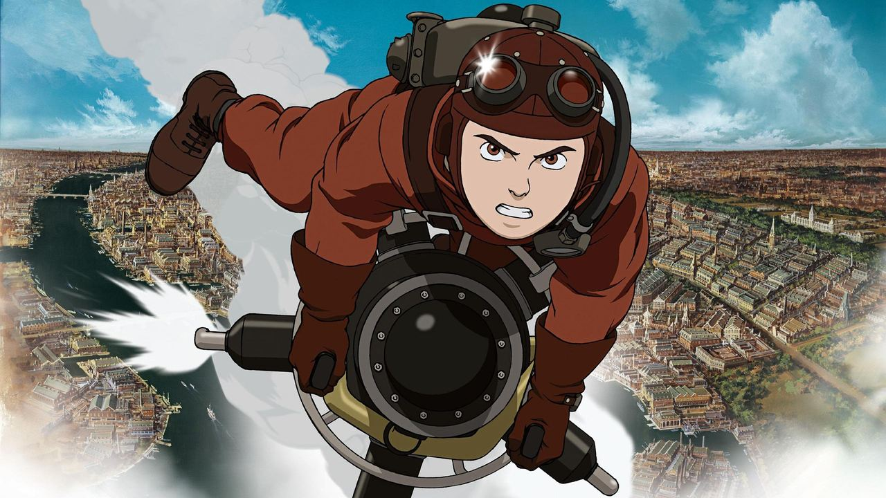
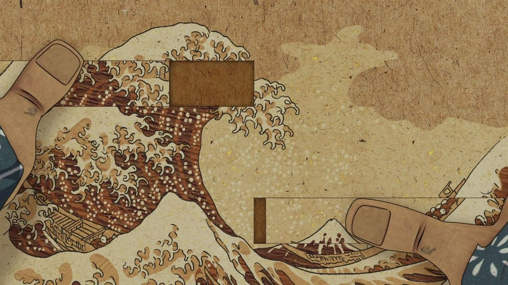
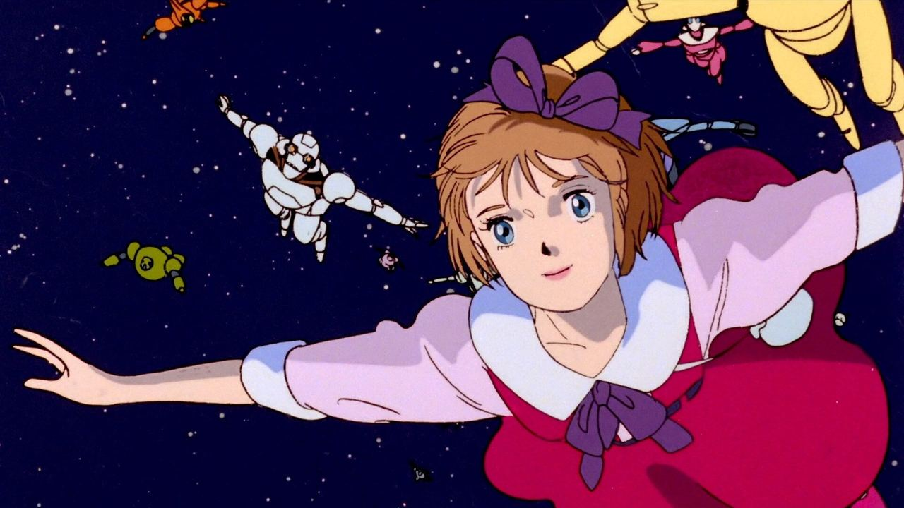

# 导演色卡 #029 — Katsuhiro Otomo 大友克洋

> **分类**：02 霓虹黑色与赛博未来
> **编号**：029
> **国籍**：日本
> **活跃年代**：1979-至今
> **创建日期**：2026-07-31

---

## 一、核心风格一句话

> 爆炸橙红撕裂末日都市的废墟灰棕，赛博朋克的能量洪流与毁灭美学在高饱和色块碰撞中迸发新东京的末世预言。

---

## 二、色板构成



> 横版主色卡（点击查看高清图）

### 主色板（6色）

| 色号 | HEX | 色彩名称 | 占比 | 来源说明 |
|------|-----|---------|------|---------|
| C01 | `#0D0D0D` | 末日深黑 | 28% | 阿基拉暗部、新东京夜晚、爆炸前的压抑 |
| C02 | `#FF3D00` | 爆炸橙红 | 20% | 铁雄能量爆发、爆炸火光、赛博朋克霓虹橙 |
| C03 | `#5D4037` | 废墟灰棕 | 15% | 崩坏的都市建筑、废墟瓦砾、战后破败 |
| C04 | `#D32F2F` | 新东京红 | 12% | 阿基拉标志性红色夹克、血腥暴力、革命旗帜 |
| C05 | `#BF8F3C` | 烟尘金 | 13% | 爆炸烟尘、黄铜蒸汽、废墟尘暴 |
| C06 | `#1565C0` | 能量蓝 | 12% | 超能力蓝光、军事科技、赛博冷光 |

### 情绪色板（4色）

| 色号 | HEX | 色彩名称 | 情绪含义 |
|------|-----|---------|---------|
| E01 | `#FFEB3B` | 核爆白黄 | 毁灭性能量、觉醒瞬间、超能力爆发 |
| E02 | `#B71C1C` | 鲜血深红 | 暴力、毁灭、少年暴走、社会崩溃 |
| E03 | `#6A1B9A` | 超能紫 | 超自然力量、意识膨胀、超越肉身 |
| E04 | `#B87333` | 蒸汽铜 | 蒸汽朋克复古、工业革命质感、机械怀旧 |

### 光影特征

- **主光方向**：强烈的顶光/爆炸光源，硬光为主，能量自发光体（爆炸/超能力）作为核心光源
- **高光色偏**：爆炸橙红/核爆白黄（爆炸核心/能量释放/火光）
- **阴影色偏**：冷蓝偏黑（建筑阴影/军事科技暗部/夜晚）
- **对比比**：极高对比（80-95%），饱和色块碰撞，黑与亮橙红极端对比
- **色调整体**：高饱和末日，60%暖橙红棕 + 40%冷蓝黑

---

## 三、视觉风格关键词（按权重排序）

### 构图与运镜
爆炸中心扩散 · 废墟纵深透视 · 大规模破坏全景 · 速度线爆发 · 建筑崩塌碎片 · 少年暴走正面 · 军事机械对峙 · 烟尘弥漫远景 · 赛博街道纵深 · 能量光流扭曲

### 色彩与光影
爆炸橙红 · 末日深黑 · 废墟棕灰 · 新东京血红 · 能量蓝光 · 烟尘金 · 核爆白黄 · 高饱和碰撞 · 硬光切割 · 自发光体

### 氛围与情绪
末日预言 · 少年暴走 · 毁灭美学 · 赛博废墟 · 社会崩溃 · 能量觉醒 · 暴力史诗 · 反乌托邦 · 科技恐惧 · 新东京狂热

---

## 四、运镜特征

| 特征 | 说明 | 经典例子 |
|------|------|---------|
| 爆炸中心扩散 | 从爆炸核心向外辐射的冲击波镜头 | 《阿基拉》铁雄能量爆炸 |
| 废墟纵深透视 | 沿崩坏街道的极强透视，建筑碎片飞溅 | 《阿基拉》新东京废墟追逐 |
| 大规模破坏全景 | 极远景展现城市级别的毁灭 | 《阿基拉》东京毁灭/新东京崩坏 |
| 速度线爆发 | 漫画式速度线与光流表现极速运动 | 《阿基拉》金田摩托车飙车 |
| 建筑崩塌碎片 | 慢镜展现建筑碎裂崩塌的壮观 | 《阿基拉》奥林匹克体育场崩塌 |
| 少年正面暴走 | 正面/低角度拍摄少年暴走的压迫感 | 《阿基拉》铁雄超能力失控 |
| 军事机械对峙 | 坦克/直升机/军队与超能力者对峙 | 《阿基拉》军队vs铁雄 |
| 烟尘弥漫远景 | 烟尘笼罩的末日城市远景 | 《蒸汽男孩》工业伦敦远景 |

---

## 五、经典场景色彩参考

### 电影截图画廊

| 阿基拉 | 回忆三部曲 | 蒸汽男孩 |
|--------|------|--------|
|  |  |  |
| 爆炸橙红+末日深黑 · 能量毁灭 | 鲜血深红+废墟灰棕 · 记忆迷局 | 蒸汽铜+烟尘金 · 工业史诗 |

| 阿基拉飙车 | 阿基拉觉醒 | 大炮之街 |
|--------|------|--------|
|  | *阿基拉觉醒（剧照未收录）* | *大炮之街（剧照未收录）* |
| 新东京红+能量蓝 · 速度霓虹 | 核爆白黄+超能紫 · 超神失控 | 烟尘金+废墟灰棕 · 极权工业 |

**色彩氛围描述**：大友克洋的画面世界是一场永不停歇的末日爆炸——爆炸橙红是视觉的核心能量，撕裂末日深黑的夜空，废墟灰棕铺陈出文明崩坏后的底色，新东京红如少年鲜血般刺眼，能量蓝在毁灭中闪烁科技的冷光，烟尘金弥漫在每一个爆炸后的远景中。每一帧都像是核爆瞬间的凝固，毁灭中蕴含着新生的能量。

### 电影色彩速查

| 电影 | 场景 | 主导色 | 色彩氛围 |
|------|------|--------|---------|
| 阿基拉 | 东京毁灭爆炸 | 爆炸橙红+核爆白黄+末日深黑 | 创世纪毁灭、能量奇点、世界重启 |
| 阿基拉 | 金田摩托车飙车 | 新东京红+能量蓝+末日深黑 | 速度狂热、霓虹赛博、少年叛逆 |
| 阿基拉 | 铁雄超能力觉醒 | 核爆白黄+超能紫+爆炸橙红 | 力量膨胀、意识失控、超越肉身 |
| 阿基拉 | 新东京废墟 | 废墟灰棕+烟尘金+末日深黑 | 文明废墟、反乌托邦、末世氛围 |
| 回忆三部曲·她的回忆 | 宇宙废弃空间站 | 鲜血深红+废墟灰棕+能量蓝 | 记忆迷局、歌剧魅影、太空哥特 |
| 回忆三部曲·最臭兵器 | 日本乡村灾难 | 烟尘金+末日深黑+爆炸橙红 | 黑色幽默、生化灾难、荒诞末日 |
| 蒸汽男孩 | 工业伦敦博览会 | 蒸汽铜+烟尘金+能量蓝 | 蒸汽朋克、工业革命、机械史诗 |
| 大炮之街 | 极权工业城市 | 烟尘金+废墟灰棕+末日深黑 | 战争机器、工业异化、一天即一生 |

---

## 六、AI 生成提示词模板

> 完整提示词文件见 `prompts/` 目录

### 图像生成速用公式

```
[subject description], in the style of Katsuhiro Otomo,
Akira anime film still,
explosive orange-red energy, post-apocalyptic neo-Tokyo,
ruined cityscape with high saturation color blocks,
hard edge lighting, self-illuminated energy,
destructive epic atmosphere, cinematic anime,
detailed mechanical design, film grain --ar 16:9 --style raw
```

### 视频生成速用公式

```
A destructive epic scene in Katsuhiro Otomo Akira style,
explosion orange-red energy expanding outward,
neo-Tokyo ruins with crumbling buildings and debris,
high saturation color blocks colliding,
hard light cutting through smoke and dust,
speed lines and energy streams,
anime cinematic look, film grain,
16:9 aspect ratio, dynamic explosive camera movement
```

---

## 七、代表作索引

| 年份 | 片名 | 主要色彩特征 |
|------|------|-------------|
| 1988 | 阿基拉 | 爆炸橙红、新东京红、赛博废墟、能量蓝光 |
| 1991 | 回忆三部曲 | 太空哥特深红、荒诞灾难金、极权工业灰 |
| 2004 | 蒸汽男孩 | 蒸汽铜、工业金、机械蓝、维多利亚暗调 |

---

## 八、蒸馏验证

- [x] 色板6+4色已提取
- [x] 可视化色卡图片已生成（横版+竖版）
- [x] 运镜特征已归纳（8种）
- [x] 提示词模板已生成（MJ/SD/视频）
- [ ] 电影截图参考图已收集
- [ ] Stable Diffusion 实测试图
- [ ] Runway 视频测试
