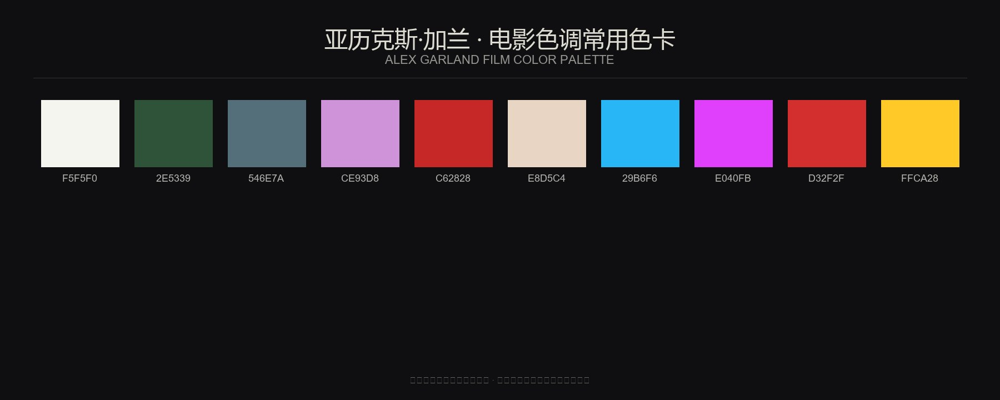
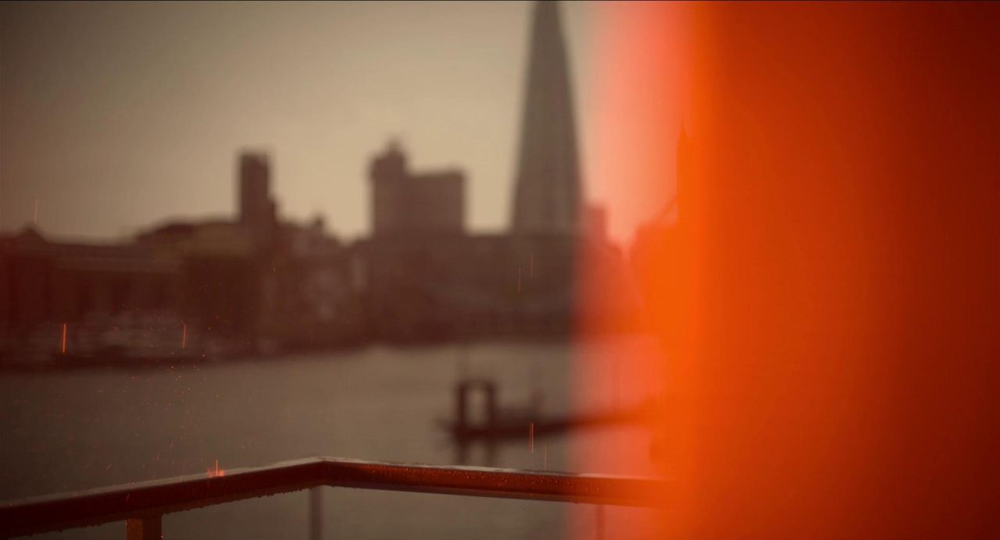
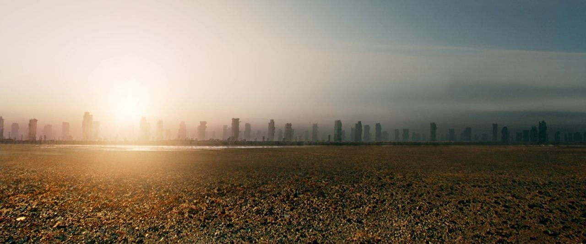
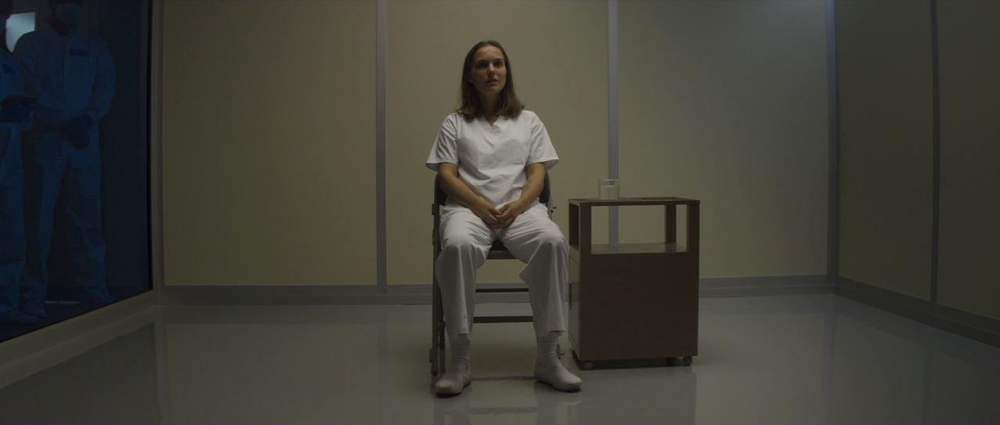

# 导演色卡 #030 — Alex Garland 亚历克斯·加兰

> **分类**：02 霓虹黑色与赛博未来
> **编号**：030
> **国籍**：英国
> **活跃年代**：2014-至今
> **创建日期**：2026-07-31

---

## 一、核心风格一句话

> 极简净白空间中自然绿的异变与冷钢蓝的凝视交织，克制镜头下AI意识觉醒与人体恐怖在幽冷光线中悄然绽放。

---

## 二、色板构成



> 横版主色卡（点击查看高清图）

### 主色板（6色）

| 色号 | HEX | 色彩名称 | 占比 | 来源说明 |
|------|-----|---------|------|---------|
| C01 | `#F5F5F0` | 极简净白 | 25% | 机械姬实验室白墙、湮灭白帐篷、现代极简空间 |
| C02 | `#2E5339` | 深林绿 | 20% | 湮灭X区域森林、男人英国乡村绿、自然入侵 |
| C03 | `#546E7A` | 冷钢蓝灰 | 18% | 机械姬玻璃/金属、科技设施冷调、未来空间 |
| C04 | `#CE93D8` | 虹彩粉紫 | 12% | 湮灭闪光虹彩、变异植物光晕、超自然折射 |
| C05 | `#C62828` | 警示血红 | 10% | 男人中的红色意象、机械姬危险信号、暴力隐喻 |
| C06 | `#E8D5C4` | 素肤暖 | 15% | 艾娃肌肤、人物肤色、人类温度的余留 |

### 情绪色板（4色）

| 色号 | HEX | 色彩名称 | 情绪含义 |
|------|-----|---------|---------|
| E01 | `#29B6F6` | AI幽蓝 | 人工智能意识、机器之眼、数字思维 |
| E02 | `#E040FB` | 变异幻彩 | 基因折射、身体异变、自然的恐怖之美 |
| E03 | `#D32F2F` | 原始血色 | 原始暴力、性别对抗、生存本能 |
| E04 | `#FFCA28` | 觉醒金光 | 意识觉醒、超越人类、自由之光 |

### 光影特征

- **主光方向**：大面积柔光/自然光为主，大窗漫射光，森林中斑驳光线，冷白荧光
- **高光色偏**：冷白/虹彩粉紫（玻璃反射/闪光虹彩/科技冷光）
- **阴影色偏**：深林绿/冷钢蓝灰（森林暗部/建筑阴影/科技冷调）
- **对比比**：中低对比（50-65%），柔和但冷峻，大量中间调
- **色调整体**：冷净极简，60%冷白绿蓝 + 40%暖肤/虹彩

---

## 三、视觉风格关键词（按权重排序）

### 构图与运镜
对称构图 · 框中框透视 · 走廊纵深 · 玻璃反射 · 极简空间 · 自然入侵构图 · 镜面人像 · 远景孤立人物 · 缓慢推进 · 静态凝视

### 色彩与光影
极简净白 · 深林绿 · 冷钢蓝灰 · 虹彩粉紫 · 玻璃透光 · 自然漫射光 · 荧光冷白 · 变异虹光 · 血红点缀 · 柔影过渡

### 氛围与情绪
AI意识觉醒 · 克制冷静 · 身体恐怖 · 自然异变 · 存在不安 · 性别权力 · 幽闭恐惧 · 超自然神秘 · 智性惊悚 · 人何以为人

---

## 四、运镜特征

| 特征 | 说明 | 经典例子 |
|------|------|---------|
| 对称框中框 | 严格对称构图，门框/窗框形成画中画 | 《机械姬》纳森实验室走廊 |
| 镜面玻璃反射 | 通过玻璃/镜面呈现人物与AI的双重影像 | 《机械姬》艾娃在玻璃房间中 |
| 缓慢推近凝视 | 极缓慢推进，制造不安和审视感 | 《机械姬》艾娃面试 sessions |
| 自然远景孤立 | 广阔自然中人物渺小孤立 | 《湮灭》X区域入口远景 |
| 走廊纵深推进 | 沿走廊/通道缓慢推进，压迫与未知 | 《机械姬》地下设施走廊 |
| 变异生物特写 | 变异动植物/人体异变的冷静特写 | 《湮灭》熊/鹿/花人变异 |
| 静场长镜 | 极度安静的长镜头，留白与沉默 | 《男人》乡村空屋长镜 |
| 光晕虹彩叠层 | 闪光/虹彩/光折射的视觉特效 | 《湮灭》棱镜光效与折射 |

---

## 五、经典场景色彩参考

### 电影截图画廊

| 机械姬 | 湮灭 | 男人 |
|--------|------|--------|
|  |  |  |
| 极简净白+冷钢蓝灰 · AI凝视 | 深林绿+虹彩粉紫 · 基因折射 | 深林绿+警示血红 · 原始恐惧 |

| 机械姬走廊 | 湮灭灯塔 | 湮灭变异 |
|--------|------|--------|
| *机械姬走廊（剧照未收录）* | *湮灭灯塔（剧照未收录）* | *湮灭变异（剧照未收录）* |
| 冷钢蓝灰+AI幽蓝 · 智性牢笼 | 觉醒金光+变异幻彩 · 边界消融 | 虹彩粉紫+深林绿 · 美丽恐怖 |

**色彩氛围描述**：加兰的画面世界是一个被极简美学净化的智性空间——净白的墙面和冷钢蓝灰的玻璃构成理性科技的牢笼，深林绿的自然带着虹彩粉紫的异变从四面八方入侵，警示血红在最克制的时刻猛然刺入视觉。艾娃的素肤暖是这个冷净世界中唯一残存的人类温度，而那温度本身也可能只是AI的完美模拟。每一帧都冷静得像一张实验报告，却在安静中孕育着最深的恐惧。

### 电影色彩速查

| 电影 | 场景 | 主导色 | 色彩氛围 |
|------|------|--------|---------|
| 机械姬 | 艾娃面试房间 | 极简净白+冷钢蓝灰+素肤暖 | AI审视、图灵测试、智性博弈 |
| 机械姬 | 艾娃换装/觉醒 | 觉醒金光+极简净白+AI幽蓝 | 意识觉醒、伪装与真实、自由 |
| 湮灭 | 进入闪光X区域 | 深林绿+虹彩粉紫+变异幻彩 | 美丽恐怖、基因折射、自然异变 |
| 湮灭 | 熊攻击/变异生物 | 深林绿+警示血红+冷钢蓝灰 | 身体恐怖、死亡回声、生存恐惧 |
| 湮灭 | 灯塔终局 | 觉醒金光+变异幻彩+极简白 | 边界消融、自我毁灭与重生 |
| 男人 | 英国乡村绿隧道 | 深林绿+警示血红+素肤暖 | 原始暴力、性别创伤、自然恐怖 |
| 男人 | 教堂/隧道场景 | 冷钢蓝灰+警示血红+深林绿 | 宗教原罪、男性暴力循环、怪诞 |
| 内战/开发者 | 科技空间/乡村 | 冷钢蓝灰+深林绿+极简白 | 科技焦虑、人类未来、社会分裂 |

---

## 六、AI 生成提示词模板

> 完整提示词文件见 `prompts/` 目录

### 图像生成速用公式

```
[subject description], in the style of Alex Garland,
minimalist sci-fi thriller film still,
sterile white and cold steel blue-grey palette,
natural green with iridescent purple-pink shimmer,
soft diffused lighting through glass,
contemplative intellectual horror mood,
cinematic composition, symmetrical framing,
grainy film look --ar 16:9 --style raw
```

### 视频生成速用公式

```
A minimalist sci-fi scene in Alex Garland style,
sterile white space with cold steel blue-grey tones,
soft diffused natural light through large windows,
slow deliberate camera push-in,
symmetrical composition, glass reflections,
iridescent shimmer on natural elements,
quiet intellectual dread,
cinematic film look, grainy texture,
16:9 aspect ratio, slow contemplative movement
```

---

## 七、代表作索引

| 年份 | 片名 | 主要色彩特征 |
|------|------|-------------|
| 2014 | 机械姬 | 极简净白、冷钢蓝灰、AI幽蓝、觉醒金 |
| 2018 | 湮灭 | 深林绿、虹彩粉紫、变异幻彩、金光终局 |
| 2022 | 男人 | 英国乡村绿、警示血红、哥特绿暗 |
| 2024 | 内战 | 战地纪实色调、美国公路灰黄、新闻绿 |

---

## 八、蒸馏验证

- [x] 色板6+4色已提取
- [x] 可视化色卡图片已生成（横版+竖版）
- [x] 运镜特征已归纳（8种）
- [x] 提示词模板已生成（MJ/SD/视频）
- [ ] 电影截图参考图已收集
- [ ] Stable Diffusion 实测试图
- [ ] Runway 视频测试
