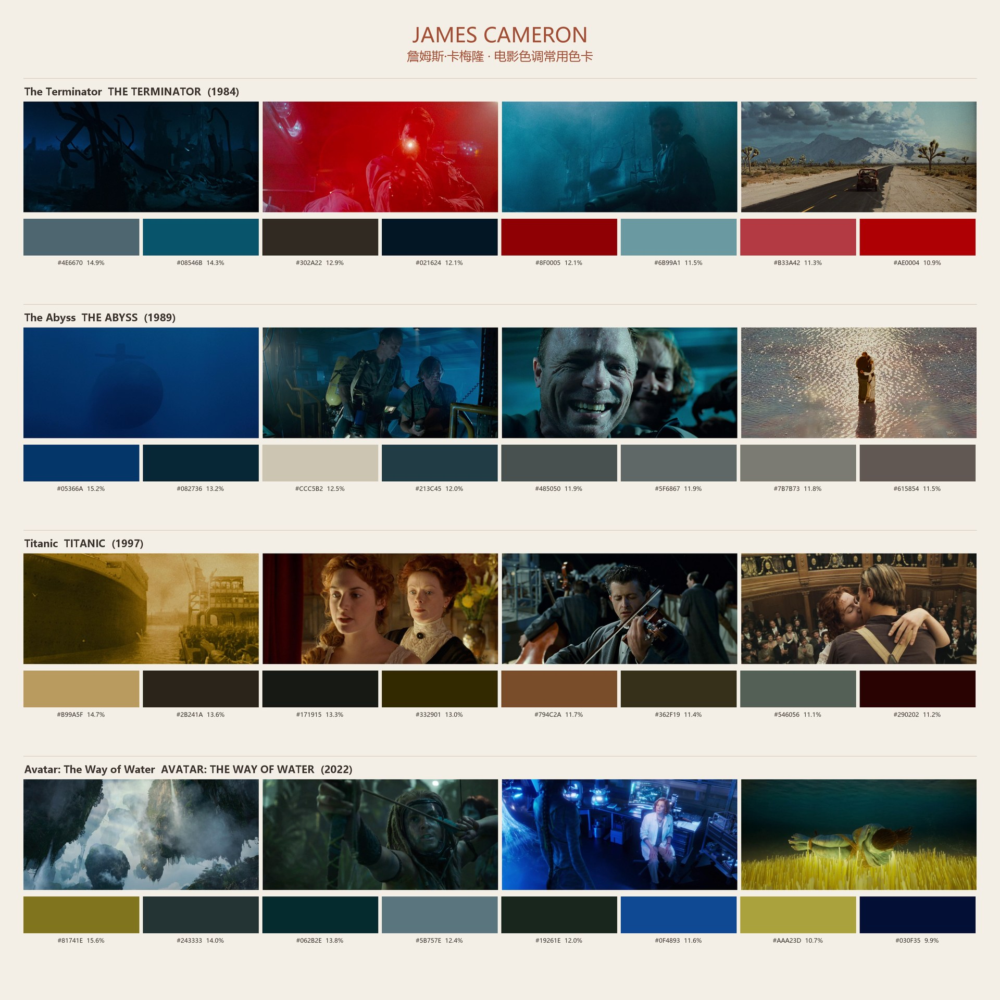
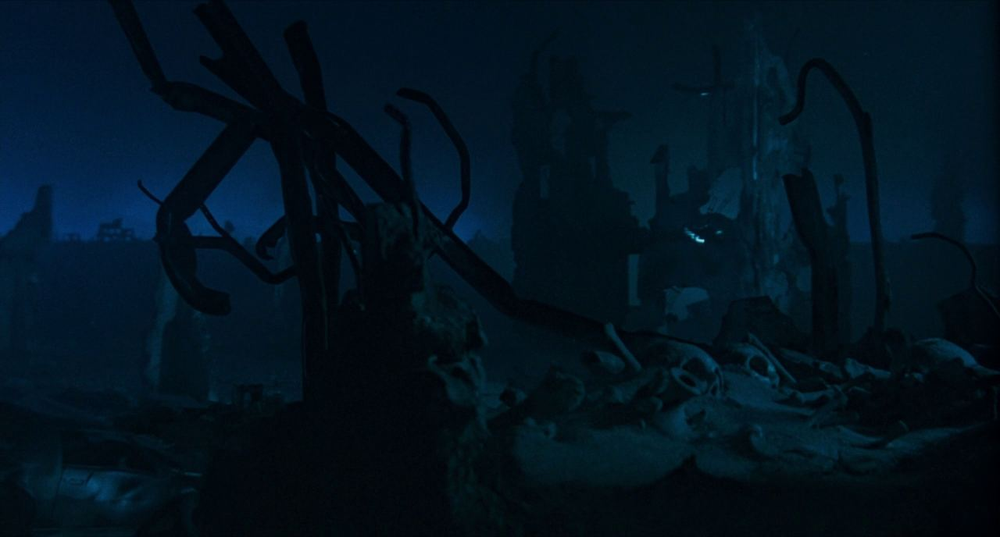
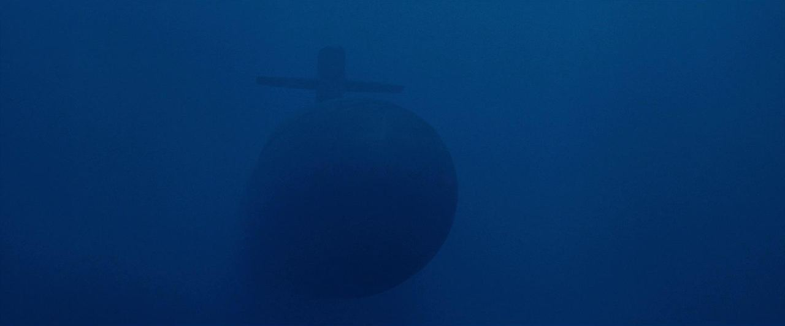
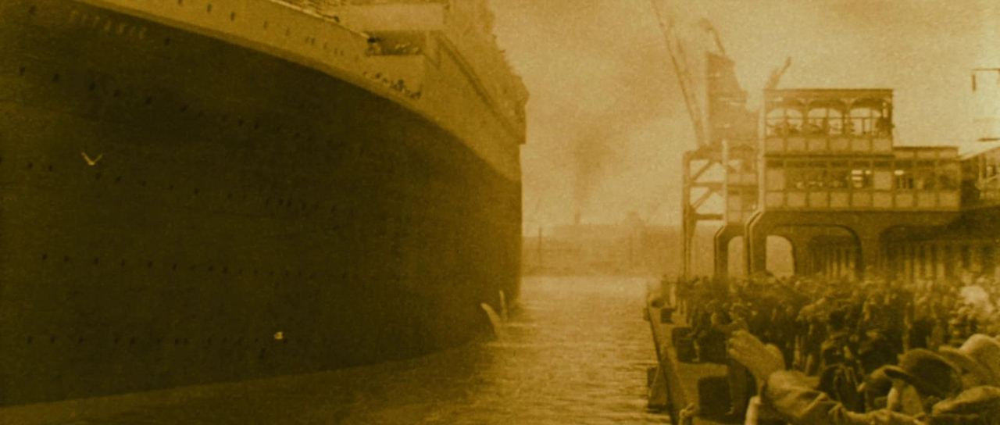
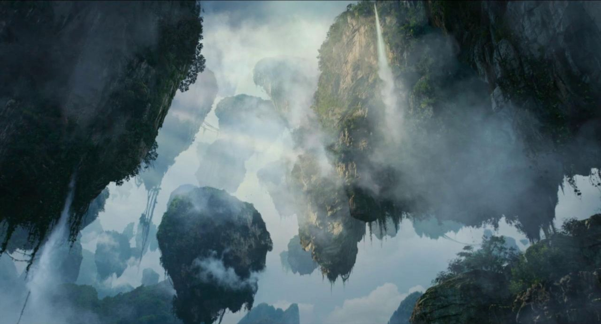

# 导演色卡 #031 — James Cameron 詹姆斯·卡梅隆

> **分类**：02 霓虹黑色与赛博未来
> **编号**：031
> **国籍**：加拿大
> **活跃年代**：1978-至今
> **创建日期**：2026-07-31

---

## 一、核心风格一句话

> 蓝钢机械与水下幽光交织的高科技冷色世界中，镀铬银反射火焰橙的爆裂冲击，生物荧光青在深海与外星丛林中点亮史诗奇观。

---

## 二、色板构成



> 横版主色卡（点击查看高清图）

### 主色板（6色）

| 色号 | HEX | 色彩名称 | 占比 | 来源说明 |
|------|-----|---------|------|---------|
| C01 | `#0A1929` | 深海蓝黑 | 28% | 深渊海底、太空黑暗、终结者夜景、泰坦尼克深海 |
| C02 | `#37474F` | 机械钢蓝 | 18% | T-800金属、机甲外壳、核潜艇、未来战士装甲 |
| C03 | `#B0BEC5` | 镀铬银 | 10% | 终结者金属骨架、T-1000液态金属、飞船外壳 |
| C04 | `#FF6D00` | 火焰橙 | 12% | 爆炸火光、卡车追逐、枪火、引擎喷射 |
| C05 | `#00E676` | 生物荧光青 | 15% | 潘多拉生物发光、水下幽光、全息投影 |
| C06 | `#FFB74D` | 暖金内光 | 17% | 泰坦尼克号暖灯、船舱金色、人间温暖 |

### 情绪色板（4色）

| 色号 | HEX | 色彩名称 | 情绪含义 |
|------|-----|---------|---------|
| E01 | `#F44336` | 激光红眼 | 终结者红眼、危险追杀、机械无情 |
| E02 | `#18FFFF` | 水下幽蓝 | 深海恐惧、未知深渊、幽闭压迫 |
| E03 | `#D500F9` | 外星紫辉 | 潘多拉夜晚、外星奇观、异星生态 |
| E04 | `#2979FF` | 电蓝全息 | 科技界面、全息投影、未来HUD |

### 光影特征

- **主光方向**：强侧光/底光为主，机械硬光与生物柔光交替，爆炸光源和生物自发光
- **高光色偏**：镀铬银/火焰橙（金属反射/爆炸火光/枪火闪光）
- **阴影色偏**：深海蓝黑（暗部偏蓝、水底/太空/夜景阴影）
- **对比比**：高对比（70-90%），冷暖极端对比，蓝冷vs橙暖经典互补
- **色调整体**：冷调科技，65%蓝冷钢色 + 35%橙暖火焰/金内光

---

## 三、视觉风格关键词（按权重排序）

### 构图与运镜
史诗远景 · 机械细节特写 · 追逐运动长镜 · 水下光影 · 机甲对峙正面 · 外星奇观全景 · 沉船纵深 · 爆炸冲击帧 · 终结者行走 · 飞船/潜艇航行

### 色彩与光影
蓝钢机械 · 镀铬银反射 · 火焰橙爆裂 · 生物荧光青 · 深海幽蓝 · 暖金内光 · 激光红眼 · 水下光柱 · 全息电蓝 · 冷暖强对比

### 氛围与情绪
高科技史诗 · 机械无情 · 生存搏斗 · 深海幽闭 · 外星奇观 · 人机对抗 · 末日审判 · 浪漫悲剧 · 技术敬畏 · 英雄主义

---

## 四、运镜特征

| 特征 | 说明 | 经典例子 |
|------|------|---------|
| 史诗远景建立 | 极广阔的全景建立世界观 | 《阿凡达》潘多拉星球全景 |
| 机械细节特写 | 金属/武器/机甲的极致细节特写 | 《终结者2》T-800/T-1000金属特写 |
| 追逐运动长镜 | 高速运动的长镜头追逐 | 《终结者2》卡车/摩托车追逐 |
| 水下光影漫游 | 水下光束与粒子的缓慢运动 | 《深渊》《泰坦尼克号》深海场景 |
| 机甲正面行走 | 低角度正面拍摄机械/战士逼近 | 《终结者2》T-800走来 |
| 外星奇观全景 | 360度展现外星生态奇观 | 《阿凡达》潘多拉夜光森林 |
| 沉船纵深深潜 | 沿沉船/建筑纵深推进到黑暗 | 《泰坦尼克号》深海探潜 |
| 爆炸冲击慢镜 | 爆炸瞬间的慢镜头冲击波 | 《终结者2》公路爆炸 |

---

## 五、经典场景色彩参考

### 电影截图画廊

| 终结者2 | 阿凡达 | 泰坦尼克号 |
|--------|------|--------|
|  |  |  |
| 机械钢蓝+镀铬银+火焰橙 · 机械追杀 | 生物荧光青+外星紫辉+深海蓝黑 · 外星奇观 | 深海蓝黑+暖金内光 · 深海悲剧 |

| 深渊 | 异形2 | 终结者1 |
|--------|------|--------|
|  | *异形2（剧照未收录）* | *终结者1（剧照未收录）* |
| 水下幽蓝+生物荧光青 · 深海幽光 | 机械钢蓝+激光红眼+火焰橙 · 太空恐惧 | 镀铬银+深海蓝黑+激光红眼 · 末日审判 |

**色彩氛围描述**：卡梅隆的画面世界是高科技冷色与火焰暖色的史诗碰撞——深海蓝黑铺陈出太空与深海的无尽幽暗，机械钢蓝和镀铬银构筑出冷硬的未来金属世界，火焰橙在爆炸与追逐中炸裂出原始的能量冲击，而生物荧光青是卡梅隆独有的浪漫——无论是潘多拉的夜光森林还是深渊中的外星生命体，那幽冷的青绿光都是冰冷科技中最神秘的生命之光。暖金内光是他人性的锚点，在冰冷的机器和深海之间留住人间的温度。

### 电影色彩速查

| 电影 | 场景 | 主导色 | 色彩氛围 |
|------|------|--------|---------|
| 终结者2 | T-800酒吧出场 | 机械钢蓝+镀铬银+激光红眼 | 机械冷酷、无敌战士、经典登场 |
| 终结者2 | 卡车追逐爆炸 | 火焰橙+镀铬银+深海蓝黑 | 高速追杀、爆炸冲击、生死时速 |
| 阿凡达 | 潘多拉夜光森林 | 生物荧光青+外星紫辉+深海蓝黑 | 外星奇观、生命神圣、自然壮美 |
| 阿凡达 | 最终大战 | 火焰橙+机械钢蓝+生物荧光青 | 史诗战争、自然vs机械、悲壮 |
| 泰坦尼克号 | 沉船/深海 | 深海蓝黑+暖金内光 | 悲剧浪漫、深海幽闭、历史沉船 |
| 深渊 | 深海外星生命体 | 水下幽蓝+生物荧光青 | 深海奇观、未知生命、幽闭敬畏 |
| 异形2 | 瑞普利vs异形女王 | 机械钢蓝+激光红眼+火焰橙 | 太空恐怖、母性战斗、科幻恐怖 |
| 终结者1 | 终结者降临 | 镀铬银+深海蓝黑+激光红眼 | 末日审判、时间穿越、无情追杀 |

---

## 六、AI 生成提示词模板

> 完整提示词文件见 `prompts/` 目录

### 图像生成速用公式

```
[subject description], in the style of James Cameron,
blue-steel mechanical sci-fi film still,
cold blue-grey metallic tones, chrome reflections,
orange fire explosion accents,
bioluminescent cyan glow, underwater light beams,
high contrast warm-cool color palette,
epic cinematic composition, cinematic lighting --ar 16:9 --style raw
```

### 视频生成速用公式

```
An epic sci-fi scene in James Cameron style,
blue-steel cold metallic palette with chrome reflections,
orange fire and explosion accents,
bioluminescent cyan underwater glow,
high contrast warm-cool complementary colors,
dynamic camera movement with epic wide shots,
cinematic film look, 80s/90s blockbuster texture,
16:9 aspect ratio, sweeping cinematic movement
```

---

## 七、代表作索引

| 年份 | 片名 | 主要色彩特征 |
|------|------|-------------|
| 1984 | 终结者 | 镀铬银、深海蓝黑、激光红眼、末日金属 |
| 1986 | 异形2 | 太空钢蓝、荧光灯绿、火焰橙、酸血红 |
| 1989 | 深渊 | 深海幽蓝、生物荧光青、水下光柱 |
| 1991 | 终结者2 | 蓝钢机械、镀铬银、火焰橙、液态金属 |
| 1997 | 泰坦尼克号 | 深海蓝黑、暖金船灯、冰蓝海水 |
| 2009 | 阿凡达 | 生物荧光青、外星紫辉、潘多拉绿、机甲钢蓝 |
| 2022 | 阿凡达：水之道 | 水下幽蓝、珊瑚青绿、海洋生物荧光 |

---

## 八、蒸馏验证

- [x] 色板6+4色已提取
- [x] 可视化色卡图片已生成（横版+竖版）
- [x] 运镜特征已归纳（8种）
- [x] 提示词模板已生成（MJ/SD/视频）
- [ ] 电影截图参考图已收集
- [ ] Stable Diffusion 实测试图
- [ ] Runway 视频测试
