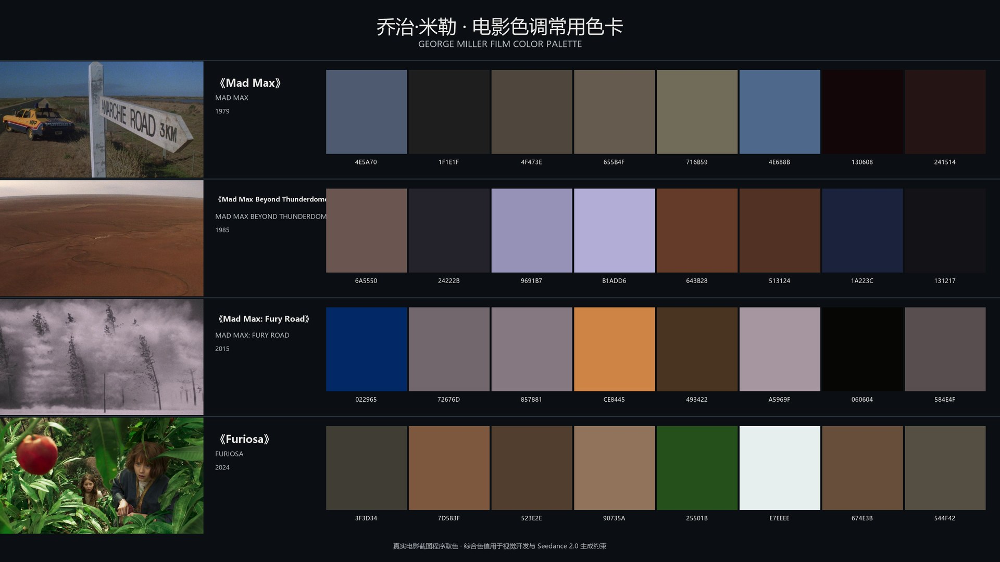
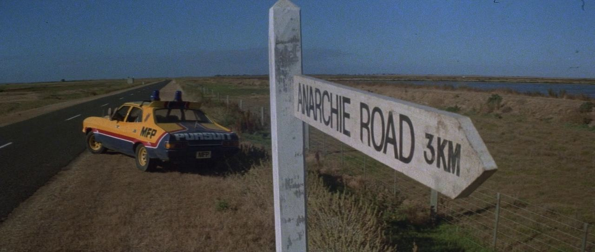
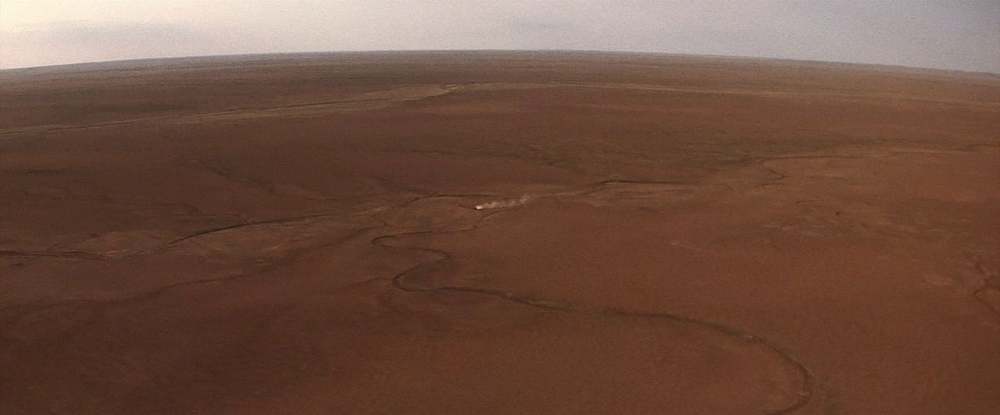
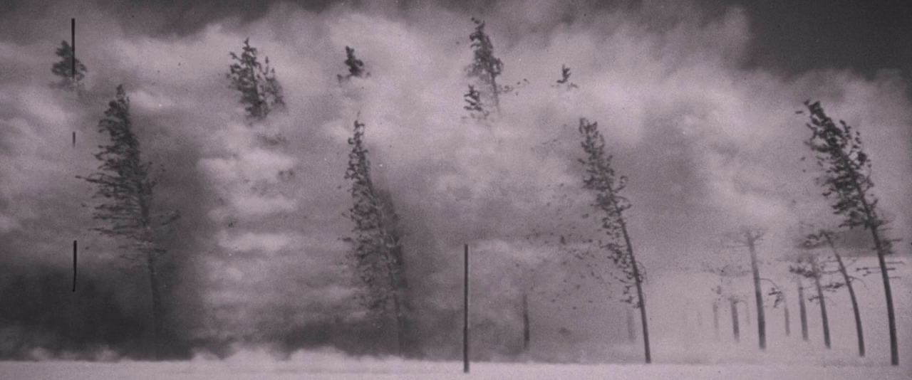
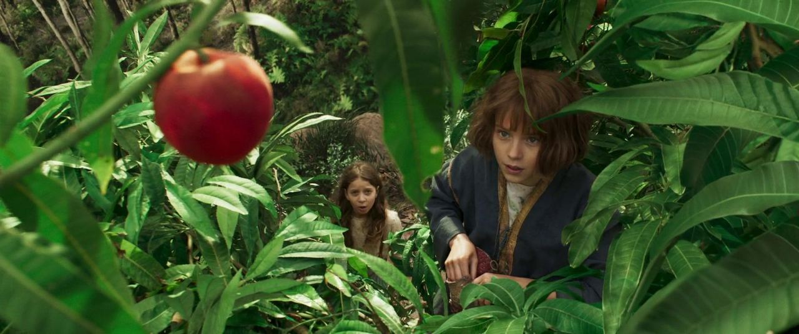

# 导演色卡 #032 — George Miller 乔治·米勒

> **分类**：02 霓虹黑色与赛博未来
> **编号**：032
> **国籍**：澳大利亚
> **活跃年代**：1971-至今
> **创建日期**：2026-07-31

---

## 一、核心风格一句话

> 高饱和橙黄沙漠中烈焰红与天空深蓝极端碰撞，废土美学在铬银战车与战妆白的狂乱追逐中燃烧成末日公路的视觉烈火。

---

## 二、色板构成



> 横版主色卡（点击查看高清图）

### 主色板（6色）

| 色号 | HEX | 色彩名称 | 占比 | 来源说明 |
|------|-----|---------|------|---------|
| C01 | `#E65100` | 沙漠橙 | 26% | 疯狂的麦克斯沙漠、荒原烈日、末日橙黄 |
| C02 | `#C62828` | 烈焰红 | 15% | 爆炸火焰、战车尾焰、血色暴力、战争男孩 |
| C03 | `#0D47A1` | 天空深蓝 | 14% | 沙漠蓝天极端对比、夜空、远方暴风云 |
| C04 | `#8D6E2F` | 尘暴赭 | 15% | 沙尘暴、赭石废土、铁锈荒原、尘雾 |
| C05 | `#CFD8DC` | 铬银战妆 | 12% | 战车铬银、不死老乔白妆、金属反光、白骨 |
| C06 | `#3E2723` | 废土深棕 | 18% | 暗部阴影、皮革、油污、废铁、黑夜 |

### 情绪色板（4色）

| 色号 | HEX | 色彩名称 | 情绪含义 |
|------|-----|---------|---------|
| E01 | `#FFAB00` | 火焰橙黄 | 爆炸烈焰、战车引擎喷火、速度狂热 |
| E02 | `#1A237E` | 夜幕靛蓝 | 夜幕追逐、沙漠寒夜、短暂宁静 |
| E03 | `#76FF03` | 毒雾绿 | 汽油弹绿焰、毒雾、疫病废土异光 |
| E04 | `#795548` | 锈褐 decay | 锈迹斑斑、文明残骸、衰败金属 |

### 光影特征

- **主光方向**：烈日顶光为主，硬光切割，火焰/爆炸作为动态光源，沙漠烈日形成极端明暗
- **高光色偏**：火焰橙黄/铬银白（爆炸火光/金属反光/烈日高光）
- **阴影色偏**：废土深棕/天空深蓝（暗部偏冷蓝/深棕，沙漠阴影极深）
- **对比比**：极高对比（85-95%），橙黄与深蓝极端互补碰撞，饱和度极高
- **色调整体**：高饱和暖废土，70%暖橙红赭 + 30%冷蓝铬白

---

## 三、视觉风格关键词（按权重排序）

### 构图与运镜
极速追车 · 低角度战车正面 · 爆炸中心帧 · 尘暴远景 · 人物群像正面 · 战车对冲 · 慢镜飞溅 · 广角畸变 · 手持颠簸 · 中心对称冲击

### 色彩与光影
沙漠橙黄 · 烈焰红 · 天空深蓝 · 铬银反光 · 尘暴赭 · 战妆白 · 火焰橙黄 · 硬光切割 · 极端互补 · 高饱和碰撞

### 氛围与情绪
废土狂热 · 速度暴力 · 末日公路 · 生存本能 · 战车崇拜 · 汽油文化 · 沙漠神话 · 狂暴美学 · 女性反抗 · 希望绿洲

---

## 四、运镜特征

| 特征 | 说明 | 经典例子 |
|------|------|---------|
| 极速追车剪辑 | 极快节奏的追车剪辑，速度线与尘土 | 《疯狂的麦克斯4》全程公路追逐 |
| 低角度战车正面 | 极低角度正面拍摄战车冲来 | 《疯狂的麦克斯4》战车对冲 |
| 爆炸慢镜飞溅 | 爆炸瞬间火焰/碎片/人体慢镜飞溅 | 《疯狂的麦克斯4》油罐车爆炸 |
| 尘暴远景 | 巨大沙尘暴墙的末日远景 | 《疯狂的麦克斯4》沙尘暴场景 |
| 战妆正面群像 | 战争男孩白妆正面冲锋 | 《疯狂的麦克斯4》战争男孩冲锋 |
| 车顶上动作 | 战车上的人物动作与战斗 | 《疯狂的麦克斯4》车顶上的弗瑞奥萨 |
| 广角畸变速度 | 广角镜头强化速度感和冲击感 | 《疯狂的麦克斯2》追车冲撞 |
| 手持颠簸运镜 | 手持摄影增加颠簸感和紧迫感 | 《疯狂的麦克斯4》车内战斗镜头 |

---

## 五、经典场景色彩参考

### 电影截图画廊

| 疯狂的麦克斯4 | 疯狂的麦克斯2 | 快乐的大脚 |
|--------|------|--------|
|  |  |  |
| 沙漠橙+烈焰红+天空深蓝 · 废土烈火 | 尘暴赭+铬银战妆+废土深棕 · 公路战士 | 冰蓝白+深海蓝 · 南极纯净 |

| 疯狂的麦克斯4沙尘暴 | 疯狂的麦克斯4战车 | 疯狂的麦克斯1 |
|--------|------|--------|
|  | *疯狂的麦克斯4战车（剧照未收录）* | *疯狂的麦克斯1（剧照未收录）* |
| 尘暴赭+夜幕靛蓝+火焰橙黄 · 末日尘暴 | 铬银战妆+烈焰红+沙漠橙 · 战车圣殿 | 废土深棕+烈焰红+铬银 · 复仇骑士 |

**色彩氛围描述**：米勒的画面世界是一场在沙漠烈日下永不停歇的公路烈火——沙漠橙是视觉的基调，像熔化的金属铺满整个荒原，烈焰红在爆炸和追车中喷涌而出，天空深蓝是唯一与橙黄极端对抗的冷色，铬银战妆白在烈日下刺眼地反光，尘暴赭在风暴中吞噬一切，废土深棕是暗部和油污中文明最后的残骸。每一帧都像被太阳烤到极限，饱和度被推到了几乎失真的边缘。

### 电影色彩速查

| 电影 | 场景 | 主导色 | 色彩氛围 |
|------|------|--------|---------|
| 疯狂的麦克斯4 | 公路追逐开篇 | 沙漠橙+烈焰红+天空深蓝 | 速度狂热、废土生存、战车文化 |
| 疯狂的麦克斯4 | 沙尘暴 | 尘暴赭+夜幕靛蓝+火焰橙黄 | 末日风暴、自然之怒、混沌吞噬 |
| 疯狂的麦克斯4 | 战车冲锋群像 | 铬银战妆+烈焰红+沙漠橙 | 战争狂热、殉道崇拜、视觉冲击 |
| 疯狂的麦克斯4 | 峡谷伏击 | 废土深棕+烈焰红+天空深蓝 | 暴力爆发、伏击战、火光冲天 |
| 疯狂的麦克斯2 | 公路战士追车 | 尘暴赭+铬银+沙漠橙 | 公路神话、汽油崇拜、孤独战士 |
| 疯狂的麦克斯1 | 公路复仇 | 废土深棕+烈焰红+铬银 | 原始复仇、骑士陨落、暴力开端 |
| 快乐的大脚 | 南极冰原 | 冰蓝白+深海蓝 | 纯净自然、歌舞生命、环保寓言 |
| 快乐的大脚 | 海洋水下 | 深海蓝+生物荧光+冰白 | 水下奇观、自然壮美、生态警告 |

---

## 六、AI 生成提示词模板

> 完整提示词文件见 `prompts/` 目录

### 图像生成速用公式

```
[subject description], in the style of George Miller,
Mad Max Fury Road style,
highly saturated orange desert, blazing red fire,
deep blue sky contrast, chrome silver vehicles,
dust storm ochre, white war paint,
extreme high contrast complementary colors,
post-apocalyptic wasteland, action cinematic,
wide angle lens distortion, film grain --ar 2.35:1 --style raw
```

### 视频生成速用公式

```
A high-octane wasteland chase in George Miller Mad Max style,
saturated orange desert with blazing red fire,
deep blue sky extreme contrast, chrome vehicles speeding,
dust and sand flying everywhere,
slow-motion explosions with orange fireballs,
white war-painted warriors on vehicles,
extreme high contrast warm-cool palette,
wide angle action, handheld kinetic energy,
2.35:1 cinemascope, explosive camera movement
```

---

## 七、代表作索引

| 年份 | 片名 | 主要色彩特征 |
|------|------|-------------|
| 1979 | 疯狂的麦克斯 | 公路棕黑、复仇赤红、铬银摩托 |
| 1981 | 疯狂的麦克斯2 | 沙漠橙黄、尘暴赭、汽油文化 |
| 1985 | 疯狂的麦克斯3 | 沙漠金、巴特镇铁锈、儿童部落 |
| 2006 | 快乐的大脚 | 南极冰蓝白、深海蓝、歌舞色彩 |
| 2011 | 快乐的大脚2 | 冰蓝、磷虾橙、南极暖光 |
| 2015 | 疯狂的麦克斯4：狂暴之路 | 沙漠橙、烈焰红、天空深蓝、铬银白妆 |

---

## 八、蒸馏验证

- [x] 色板6+4色已提取
- [x] 可视化色卡图片已生成（横版+竖版）
- [x] 运镜特征已归纳（8种）
- [x] 提示词模板已生成（MJ/SD/视频）
- [ ] 电影截图参考图已收集
- [ ] Stable Diffusion 实测试图
- [ ] Runway 视频测试
