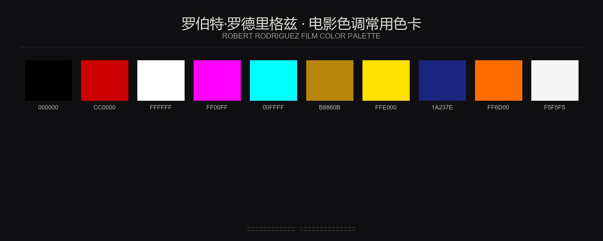
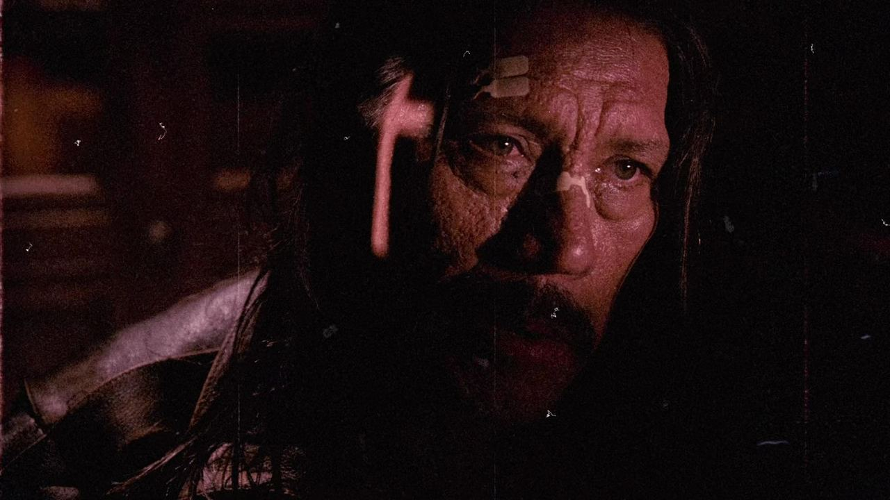
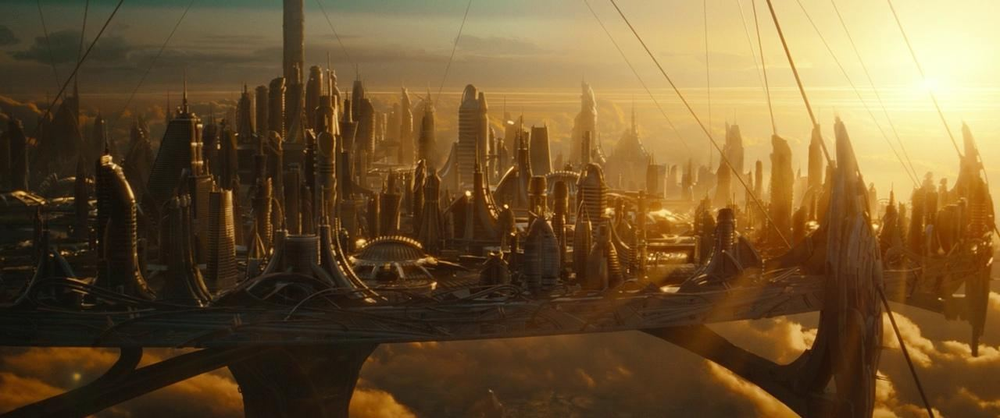
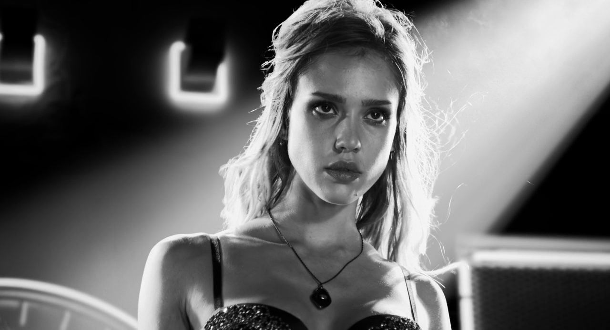
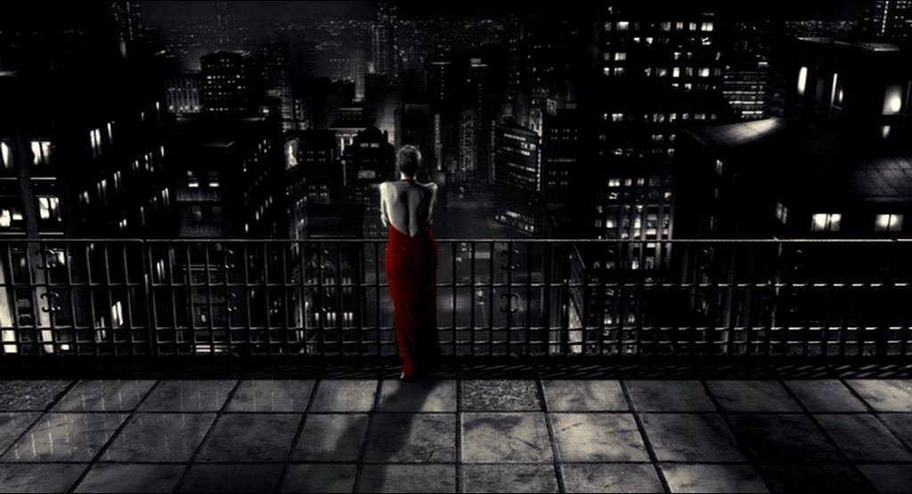

# 导演色卡 #033 — Robert Rodriguez 罗伯特·罗德里格兹

> **分类**：02 霓虹黑色与赛博未来
> **编号**：033
> **国籍**：美国
> **活跃年代**：1992-至今
> **创建日期**：2026-07-31

---

## 一、核心风格一句话

> 纯黑底上血红泼洒与数码霓虹碰撞的漫画高反差世界中，罪城的暗影与阿丽塔的赛博大眼在墨黑与纯白的极端对比中燃烧着拉丁式的暴力美学。

---

## 二、色板构成



> 横版主色卡（点击查看高清图）

### 主色板（6色）

| 色号 | HEX | 色彩名称 | 占比 | 来源说明 |
|------|-----|---------|------|---------|
| C01 | `#000000` | 纯黑墨底 | 33% | 罪恶之城黑底、暗影、漫画墨色、暗夜 |
| C02 | `#CC0000` | 罪城血红 | 18% | 鲜血、红裙、红唇、暴力象征 |
| C03 | `#FFFFFF` | 高反差白 | 12% | 黑白漫画纯白、皮肤高光、雨、骨白 |
| C04 | `#FF00FF` | 数码霓虹粉 | 10% | 赛博朋克霓虹、阿丽塔霓虹、酒吧招牌 |
| C05 | `#00FFFF` | 数码霓虹青 | 10% | 霓虹蓝光、全息投影、赛博冷光 |
| C06 | `#B8860B` | 荒漠金褐 | 17% | 墨西哥荒漠、黄昏、杀出个黎明沙漠 |

### 情绪色板（4色）

| 色号 | HEX | 色彩名称 | 情绪含义 |
|------|-----|---------|---------|
| E01 | `#FFE000` | 罪城黄 | 罪恶之城黄色杂种、怪诞反常、危险异类 |
| E02 | `#1A237E` | 暗夜深蓝 | 夜黑蓝、暗影深处、罪恶潜伏 |
| E03 | `#FF6D00` | 赛博橙 | 阿丽塔战斗橙、火焰、爆炸霓虹 |
| E04 | `#F5F5F5` | 骨白 | 白骨、惨白皮肤、漫画高光线 |

### 光影特征

- **主光方向**：极端硬光，高对比切割光，漫画式明暗分界，霓虹色光作为唯一光源
- **高光色偏**：纯白/霓虹粉青（漫画高光/霓虹招牌/赛博光源）
- **阴影色偏**：纯黑（几乎无细节的纯黑阴影，漫画墨色风格）
- **对比比**：极端高对比（90-100%），黑白极致对比，选择性着色
- **色调整体**：高反差漫画，70%纯黑白 + 30%选择性红/霓虹/金褐

---

## 三、视觉风格关键词（按权重排序）

### 构图与运镜
漫画分镜 · 高反差剪影 · 极端特写 · 低角度英雄 · 慢镜暴力 · 雨幕高对比 · 霓虹反光 · 黑白选色 · 速度线 · 墨西哥荒漠广角

### 色彩与光影
纯黑墨底 · 罪城血红 · 高反差白 · 数码霓虹粉 · 数码霓虹青 · 选择性着色 · 硬光切割 · 漫画光影 · 荒漠金褐 · 骨白惨色

### 氛围与情绪
漫画暴力 · 拉丁狂野 · 罪城黑暗 · 赛博朋克 · B级片趣味 · 反英雄 · 暴力美学 · 黑色幽默 · 墨西哥风情 · 数码酷感

---

## 四、运镜特征

| 特征 | 说明 | 经典例子 |
|------|------|---------|
| 漫画分镜构图 | 直接引用漫画分格的构图方式 | 《罪恶之城》全片漫画式构图 |
| 高反差剪影 | 人物以纯黑剪影出现在亮背景前 | 《罪恶之城》雨中剪影 |
| 极端暴力特写 | 暴力瞬间的极端特写慢镜 | 《罪恶之城》马弗暴力场景 |
| 低角度英雄 | 低角度仰拍反英雄人物 | 《罪恶之城》哈提根/马弗出场 |
| 慢镜暴力美学 | 暴力动作的慢镜头美学化 | 《300勇士》风格（罗德里格兹参与）/《罪恶之城》 |
| 黑白选色 | 黑白画面中仅保留某一色彩（通常红色） | 《罪恶之城》红裙/红唇/血 |
| 霓虹赛博雨 | 霓虹灯光映照雨面的赛博氛围 | 《阿丽塔》钢铁城夜景 |
| 荒漠广角 | 墨西哥荒漠的广角 establishing shot | 《杀出个黎明》沙漠公路 |

---

## 五、经典场景色彩参考

### 电影截图画廊

| 罪恶之城 | 阿丽塔 | 杀出个黎明 |
|--------|------|--------|
|  |  |  |
| 纯黑墨底+罪城血红+高反差白 · 漫画黑红 | 数码霓虹粉+数码霓虹青+纯黑 · 赛博大眼 | 荒漠金褐+罪城血红+暗夜深蓝 · 墨西哥暴力 |

| 罪恶之城黄杂种 | 罪恶之城女郎 | 阿丽塔战斗 |
|--------|------|--------|
|  | *罪恶之城女郎（剧照未收录）* | *阿丽塔战斗（剧照未收录）* |
| 罪城黄+纯黑墨底 · 怪诞恶心 | 罪城血红+高反差白+纯黑 · 致命尤物 | 赛博橙+数码霓虹+纯黑 · 战斗天使 |

**色彩氛围描述**：罗德里格兹的画面世界是从漫画墨水中直接生长出来的黑色电影——纯黑墨底吞噬了所有中间调，高反差白在黑暗中切割出人物的轮廓，罪城血红是唯一大面积保留的色彩，像泼洒的鲜血在黑白世界中触目惊心。数码霓虹粉和青在《阿丽塔》中加入了赛博朋克的电光色，而荒漠金褐是他拉丁根源的色彩底色，墨西哥的烈日和沙漠为他的暴力美学注入了原始的热度。这是一个没有灰色地带的视觉世界——只有黑、白、血和霓虹。

### 电影色彩速查

| 电影 | 场景 | 主导色 | 色彩氛围 |
|------|------|--------|---------|
| 罪恶之城 | 雨中开篇 | 纯黑墨底+高反差白+罪城血红 | 漫画黑色、雨夜暗影、暴力前奏 |
| 罪恶之城 | 南希舞/红裙 | 罪城血红+纯黑墨底+高反差白 | 致命诱惑、红色唯一色彩、欲望 |
| 罪恶之城 | 黄杂种 | 罪城黄+纯黑墨底 | 怪诞恶心、反常危险、黄色异类 |
| 阿丽塔：战斗天使 | 钢铁城夜景 | 数码霓虹粉+数码霓虹青+纯黑 | 赛博朋克、数码霓虹、未来贫民窟 |
| 阿丽塔 | 机动铁球赛 | 赛博橙+数码霓虹+纯黑 | 战斗狂热、高速运动、机械暴力 |
| 杀出个黎明 | 沙漠公路 | 荒漠金褐+暗夜深蓝 | 墨西哥公路、B级片、边境暴力 |
| 杀出个黎明 | 黎明酒吧 | 罪城血红+霓虹粉+纯黑 | 吸血鬼酒吧、霓虹恐怖、血腥狂欢 |
| 墨西哥往事 | 小镇枪战 | 荒漠金褐+罪城血红+纯黑 | 拉丁风情、吉他枪战、浪漫暴力 |

---

## 六、AI 生成提示词模板

> 完整提示词文件见 `prompts/` 目录

### 图像生成速用公式

```
[subject description], in the style of Robert Rodriguez,
Sin City comic book film noir style,
extreme high contrast black and white with selective red color,
pure black shadows, stark white highlights,
digital neon pink and cyan accents,
hard edge lighting, comic book composition,
violent aesthetic, graphic novel look,
film grain, high contrast --ar 16:9 --style raw
```

### 视频生成速用公式

```
A scene in Robert Rodriguez Sin City style,
extreme high contrast black and white,
selective red color on key elements,
pure deep black shadows, stark white highlights,
neon pink and cyan glow in dark environments,
comic book panel composition,
hard edge lighting with sharp shadows,
graphic novel aesthetic, violent noir atmosphere,
16:9 aspect ratio, stylized comic book movement
```

---

## 七、代表作索引

| 年份 | 片名 | 主要色彩特征 |
|------|------|-------------|
| 1992 | 杀手悲歌 | 荒漠金褐、墨西哥黑白、低预算暴力 |
| 1995 | 杀人三步曲 | 荒漠金褐、拉丁血红、酒吧霓虹 |
| 1996 | 杀出个黎明 | 荒漠金褐、吸血鬼血红、霓虹酒吧 |
| 2005 | 罪恶之城 | 纯黑白、选择性血红、漫画墨黑 |
| 2005 | 非常小特务 | 儿童鲜艳色、卡通B级趣味 |
| 2014 | 罪恶之城2 | 黑白选色、罪城红、高反差 |
| 2019 | 阿丽塔：战斗天使 | 数码霓虹粉青、赛博橙、钢铁城色 |

---

## 八、蒸馏验证

- [x] 色板6+4色已提取
- [x] 可视化色卡图片已生成（横版+竖版）
- [x] 运镜特征已归纳（8种）
- [x] 提示词模板已生成（MJ/SD/视频）
- [ ] 电影截图参考图已收集
- [ ] Stable Diffusion 实测试图
- [ ] Runway 视频测试
