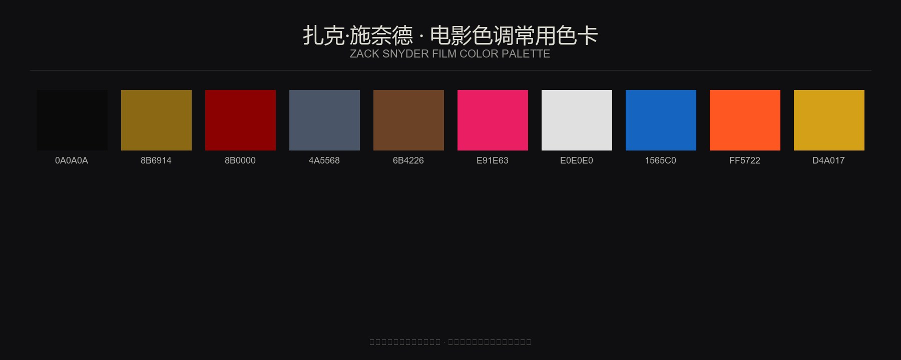
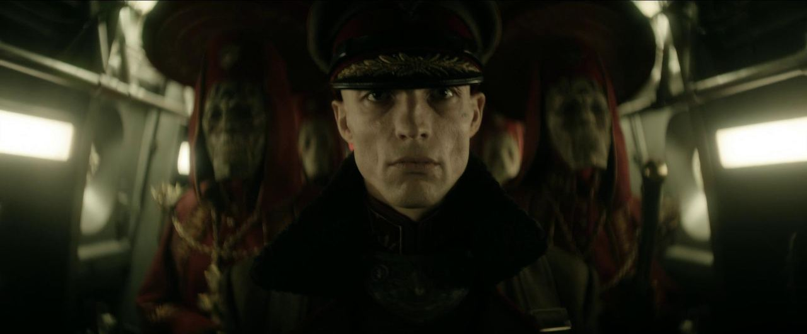
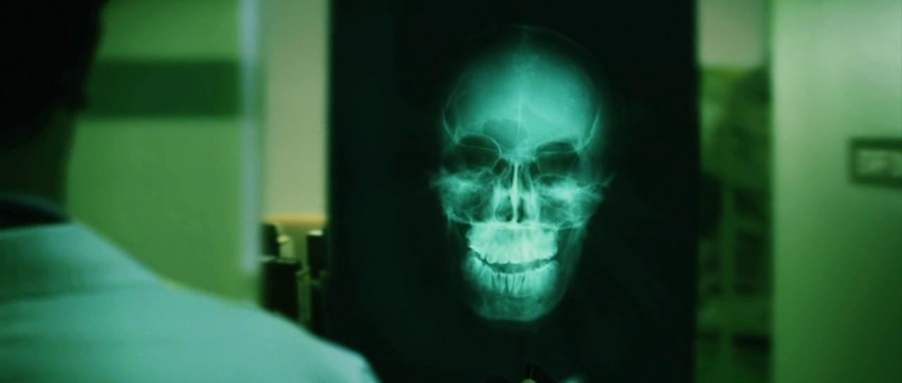
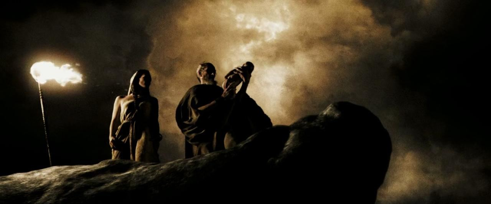
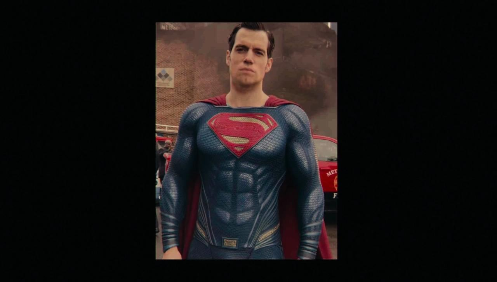

# 导演色卡 #034 — Zack Snyder 扎克·施奈德

> **分类**：02 霓虹黑色与赛博未来
> **编号**：034
> **国籍**：美国
> **活跃年代**：2004-至今
> **创建日期**：2026-07-31

---

## 一、核心风格一句话

> 暗金油画质感与高反差深黑阴影构筑的漫画史诗中，慢镜飞溅的血滴与闪电白的速度力交汇成视觉暴力的暗黑神话。

---

## 二、色板构成



> 横版主色卡（点击查看高清图）

### 主色板（6色）

| 色号 | HEX | 色彩名称 | 占比 | 来源说明 |
|------|-----|---------|------|---------|
| C01 | `#0A0A0A` | 深黑墨影 | 25% | 暗部阴影、黑夜背景、 Snyder暗场 |
| C02 | `#8B6914` | 暗金铜锈 | 22% | 300勇士青铜、斯巴达金、古铜皮肤、历史质感 |
| C03 | `#8B0000` | 血锈红 | 15% | 慢镜鲜血、战争暴力、300红披风 |
| C04 | `#4A5568` | 冷钢灰 | 12% | 守望者夜枭金属、蝙蝠侠战甲、钢铁冷调 |
| C05 | `#6B4226` | 尘褐 sepia | 13% | 尘暴战场、 sepia色调、古代泥土 |
| C06 | `#E91E63` | 霓虹玫红 | 13% | 活死人军团维加斯霓虹、僵尸乐园、现代霓虹 |

### 情绪色板（4色）

| 色号 | HEX | 色彩名称 | 情绪含义 |
|------|-----|---------|---------|
| E01 | `#E0E0E0` | 闪电白 | 速度力、闪电侠、慢镜高光、神圣光芒 |
| E02 | `#1565C0` | 曼哈顿蓝 | 曼哈顿博士、超能力蓝光、神之存在 |
| E03 | `#FF5722` | 烈焰橙 | 爆炸火焰、战争火光、毁灭 |
| E04 | `#D4A017` | 荒漠金 | 史诗沙漠、神话金光、英雄光环 |

### 光影特征

- **主光方向**：极端侧光/逆光为主，硬光切割，暗部几乎纯黑，高光处爆发闪电白
- **高光色偏**：闪电白/暗金（速度力高光/古铜金光/神圣光芒）
- **阴影色偏**：深黑墨影（暗部几乎无细节，纯黑阴影，Snyder标志性暗场）
- **对比比**：极高对比（85-98%），油画质感暗调，高光刺眼，暗部深邃
- **色调整体**：暗调油画，60%暗金褐黑 + 40%血锈红/冷钢灰/霓虹玫红

---

## 三、视觉风格关键词（按权重排序）

### 构图与运镜
慢镜飞溅 · 速度力推进 · 漫画分镜构图 · 低角度英雄 · 油画质感画面 · 对称史诗 · 速度线爆发 · 剪影英雄 · 雨滴慢镜 · 上帝视角俯拍

### 色彩与光影
暗金铜锈 · 深黑墨影 · 血锈红 · 冷钢灰 · 闪电白 · 高反差暗调 · 油画质感 · sepia尘褐 · 霓虹玫红 · 烈焰橙

### 氛围与情绪
暗黑神话 · 漫画史诗 · 英雄悲壮 · 暴力美学 · 男性荷尔蒙 · 神与人 · 慢镜仪式 · 宿命感 · 黑暗骑士 · 僵尸末日

---

## 四、运镜特征

| 特征 | 说明 | 经典例子 |
|------|------|---------|
| 慢镜血滴飞溅 | 暴力瞬间的极慢镜头，血滴/碎片悬浮 | 《300勇士》砍杀慢镜、《守望者》笑匠之死 |
| 速度力推进 | 极速者的闪电特效和速度线推进 | 《扎克·施奈德版正义联盟》闪电侠 |
| 漫画分镜构图 | 直接复刻漫画经典分格画面 | 《守望者》、《300勇士》逐帧还原漫画 |
| 低角度英雄 | 极低角度仰拍英雄/战士的伟岸 | 《300勇士》列奥尼达、《蝙蝠侠》 |
| 油画质感画面 | 棕褐色调+暗金光泽的油画质感 | 《300勇士》全片油画风格 |
| 雨滴慢镜 | 雨滴/水花的极致慢镜拍摄 | 《守望者》雨战、《活死人军团》片头 |
| 剪影逆光 | 人物以纯黑剪影出现在强光前 | 《300勇士》勇士剪影、《蝙蝠侠》 |
| 上帝视角俯拍 | 从极高处俯拍战场/城市全景 | 《300勇士》战场俯拍、《活死人军团》拉斯维加斯 |

---

## 五、经典场景色彩参考

### 电影截图画廊

| 300勇士 | 守望者 | 活死人军团 |
|--------|------|--------|
|  |  |  |
| 暗金铜锈+血锈红+尘褐 · 斯巴达史诗 | 冷钢灰+深黑墨影+曼哈顿蓝 · 暗黑漫画 | 霓虹玫红+烈焰橙+深黑 · 维加斯僵尸 |

| 扎克·施奈德版正义联盟 | 蝙蝠侠大战超人 | 美少女特攻队 |
|--------|------|--------|
|  | *蝙蝠侠大战超人（剧照未收录）* | *美少女特攻队（剧照未收录）* |
| 闪电白+冷钢灰+暗金 · 速度力神话 | 冷钢灰+深黑+闪电白 · 黑暗骑士 | 霓虹玫红+暗金+尘褐 · 幻想暴力 |

**色彩氛围描述**：施奈德的画面世界是一幅幅从漫画书页中走出的暗黑油画——深黑墨影吞噬了所有中间调和灰色地带，暗金铜锈在暗部泛着古老的金属光泽，血锈红在慢镜中以最仪式化的方式泼洒，冷钢灰是蝙蝠侠和夜枭的战甲色，而闪电白在慢镜爆发的瞬间刺眼地切开黑暗。霓虹玫红是他后期加入的新色彩——维加斯的僵尸霓虹和幻想世界的艳丽，为这个暗黑宇宙注入了现代的数码迷幻。每一帧都像被油画刷涂抹过，充满了男性荷尔蒙的悲壮史诗感。

### 电影色彩速查

| 电影 | 场景 | 主导色 | 色彩氛围 |
|------|------|--------|---------|
| 300勇士 | 温泉关列阵 | 暗金铜锈+血锈红+尘褐 | 斯巴达史诗、男性悲壮、油画战争 |
| 300勇士 | "This is Sparta!" | 深黑+暗金+尘褐 | 英雄怒吼、命运抉择、神话时刻 |
| 守望者 | 笑匠之死/雨夜 | 冷钢灰+深黑+雨水 | 黑暗开场、阴谋序幕、反英雄之死 |
| 守望者 | 曼哈顿博士 | 曼哈顿蓝+深黑+闪电白 | 神之存在、蓝色全能、超然冷漠 |
| 活死人军团 | 维加斯末日 | 霓虹玫红+烈焰橙+深黑 | 僵尸霓虹、赌城废墟、B级狂欢 |
| 扎克·施奈德版正义联盟 | 闪电侠速度力 | 闪电白+冷钢灰+暗金 | 速度力、时间倒流、英雄史诗 |
| 蝙蝠侠大战超人 | 蝙蝠侠暗夜 | 冷钢灰+深黑+闪电白 | 黑暗骑士、雨夜打击、义警暴力 |
| 美少女特攻队 | 幻想战斗 | 霓虹玫红+暗金+尘褐 | 幻想暴力、蒸汽朋克+武士、游戏感 |

---

## 六、AI 生成提示词模板

> 完整提示词文件见 `prompts/` 目录

### 图像生成速用公式

```
[subject description], in the style of Zack Snyder,
dark comic book epic film still,
dark gold bronze tones, deep black shadows,
blood red accents, cold steel grey,
high contrast chiaroscuro, oil painting texture,
slow-motion dramatic moment, comic book panel composition,
lightning white highlights, desaturated sepia tones,
cinematic epic, film grain --ar 16:9 --style raw
```

### 视频生成速用公式

```
An epic dark scene in Zack Snyder style,
dark gold bronze palette with deep black shadows,
slow-motion action with blood and debris suspended in air,
high contrast chiaroscuro lighting, oil painting texture,
lightning white speed force effects,
comic book panel composition, low angle hero shots,
desaturated sepia tones with red accents,
epic cinematic, dramatic slow motion,
2.35:1 aspect ratio, stylized comic book movement
```

---

## 七、代表作索引

| 年份 | 片名 | 主要色彩特征 |
|------|------|-------------|
| 2004 | 活死人黎明 | 暗绿灰、血锈红、僵尸恐怖 |
| 2007 | 300勇士 | 暗金铜锈、血锈红、sepia油画 |
| 2009 | 守望者 | 冷钢灰、曼哈顿蓝、黑暗漫画 |
| 2011 | 美少女特攻队 | 霓虹色、暗金、幻想战斗 |
| 2013 | 超人：钢铁之躯 | 冷钢蓝灰、深黑、外星暗金 |
| 2016 | 蝙蝠侠大战超人 | 蝙蝠暗灰黑、超人红蓝、暗金 |
| 2017/2021 | 扎克·施奈德版正义联盟 | 暗金、闪电白、冷钢灰、史诗暗调 |
| 2021 | 活死人军团 | 霓虹玫红、烈焰橙、维加斯末日 |
| 2023 | 月球叛军 | 暗金太空、尘褐、星际暗战 |

---

## 八、蒸馏验证

- [x] 色板6+4色已提取
- [x] 可视化色卡图片已生成（横版+竖版）
- [x] 运镜特征已归纳（8种）
- [x] 提示词模板已生成（MJ/SD/视频）
- [ ] 电影截图参考图已收集
- [ ] Stable Diffusion 实测试图
- [ ] Runway 视频测试
