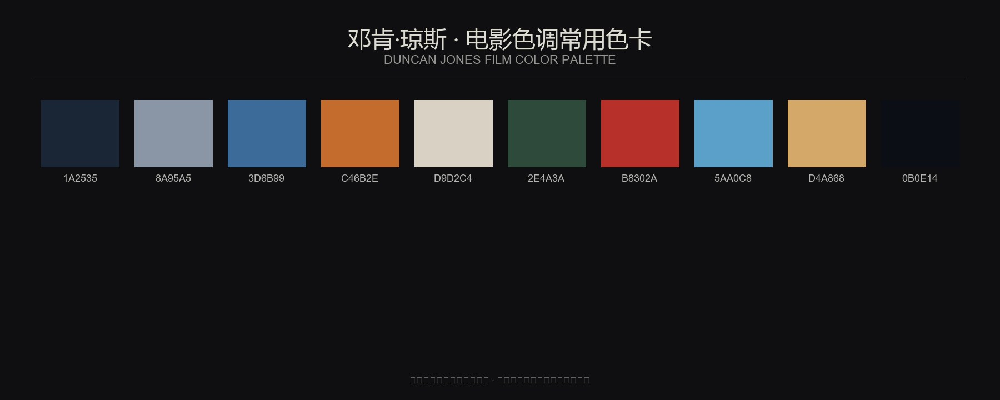
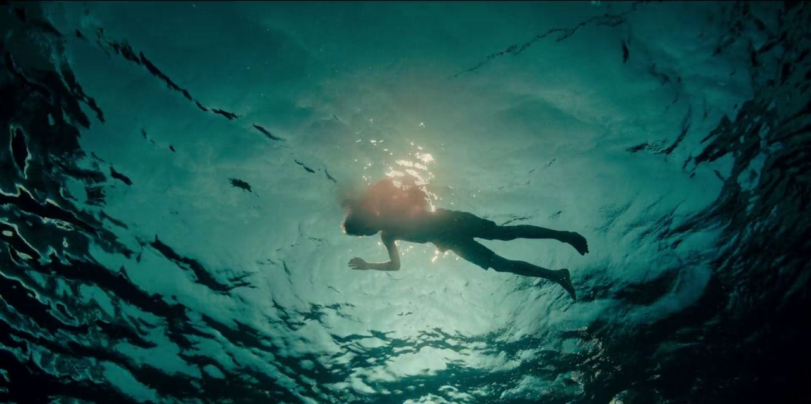
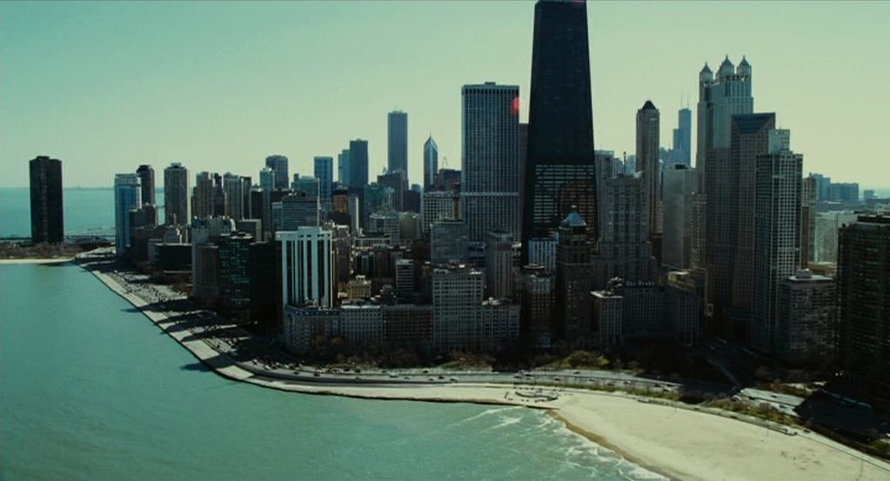
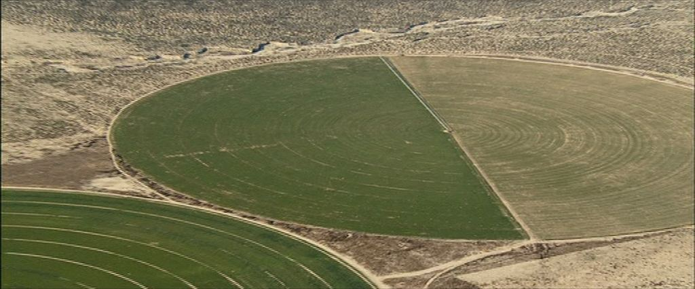

# 导演色卡 #035 — Duncan Jones 邓肯·琼斯

> **分类**：02 霓虹黑色与赛博未来
> **编号**：035
> **国籍**：英国
> **活跃年代**：2009-至今
> **创建日期**：2026-07-31

---

## 一、核心风格一句话

> 低预算科幻冷调中的孤独灰蓝，时间循环的机械冰冷与记忆暖光在密闭空间中交织的存在主义寓言。

---

## 二、色板构成



> 横版主色卡（点击查看高清图）

### 主色板（6色）

| 色号 | HEX | 色彩名称 | 占比 | 来源说明 |
|------|-----|---------|------|---------|
| C01 | `#1A2535` | 月基深灰蓝 | 32% | 《月球》基地内景暗部、《源代码》列车阴影 |
| C02 | `#8A95A5` | 冷金属灰 | 20% | 太空站金属墙面、舱门、机械装置 |
| C03 | `#3D6B99` | 屏幕蓝光 | 18% | GERTY界面、全息投影、代码显示 |
| C04 | `#C46B2E` | 警报暖橙 | 12% | 系统警报灯、《源代码》爆炸暖光、紧急指示灯 |
| C05 | `#D9D2C4` | 无菌白 | 10% | 月球基地白色舱壁、实验服、清洁表面 |
| C06 | `#2E4A3A` | 兽人绿棕 | 8% | 《魔兽》兽人领地泥土绿棕、自然粗粝感 |

### 情绪色板（4色）

| 色号 | HEX | 色彩名称 | 情绪含义 |
|------|-----|---------|---------|
| E01 | `#B8302A` | 警报红 | 危机、系统故障、死亡倒计时、生命威胁 |
| E02 | `#5AA0C8` | 全息蓝 | 虚拟世界、时间循环、数字身份、非现实感 |
| E03 | `#D4A868` | 记忆暖金 | 人性温暖、记忆碎片、家的渴望、存在证明 |
| E04 | `#0B0E14` | 太空虚空黑 | 绝对孤独、宇宙冷漠、死亡、未知深渊 |

### 光影特征

- **主光方向**：冷顶光+屏幕侧光，人工光源为主，极少自然光
- **高光色偏**：冷蓝/屏幕蓝光（显示器、全息投影、仪表灯）
- **阴影色偏**：深灰蓝偏黑（金属阴影、密闭空间角落、太空暗部）
- **对比比**：中高对比（65-80%），冷蓝调中暖橙点缀
- **色调整体**：冷调科幻，75%冷蓝灰 + 25%暖橙金点缀

---

## 三、视觉风格关键词（按权重排序）

### 构图与运镜
密闭空间构图 · 对称框架 · 反射镜像 · 舱门/通道纵深 · 监视器视角 · 缓慢推轨 · 机械重复 · 克隆对称 · 屏幕画框 · 孤独远景

### 色彩与光影
冷灰蓝基调 · 屏幕蓝光 · 无菌白 · 警报暖橙 · 金属质感 · 记忆暖金 · 工业冷光 · 霓虹全息 · 低饱和科幻 · 冷暖对峙

### 氛围与情绪
存在主义孤独 · 密闭压抑 · 身份追问 · 时间循环 · 人机温情 · 反乌托邦 · 记忆执念 · 工业冷感 · 人性微光 · 哲学科幻

---

## 四、运镜特征

| 特征 | 说明 | 经典例子 |
|------|------|---------|
| 密闭空间框中框 | 利用舱门/走廊/屏幕构成多重框架 | 《月球》基地走廊、《源代码》列车车厢 |
| 反射镜像对称 | 玻璃/屏幕/面罩反射，暗示双重身份 | 《月球》Sam与克隆人对视 |
| 监视器POV | 监控摄像头视角，冰冷观察感 | 《月球》GERTY视角、基地监控 |
| 缓慢推轨特写 | 缓慢推向演员面部，揭示情绪 | 《月球》Sam发现真相的特写 |
| 重复循环剪辑 | 相同场景的微妙变化，暗示时间循环 | 《源代码》反复醒来的列车场景 |
| 太空孤独远景 | 极远景中人物渺小，宇宙空旷 | 《月球》表面作业、基地远景 |
| 屏幕画中画 | 全息屏/显示器作为画面元素 | 《源代码》舱内屏幕显示、通讯画面 |
| 手持纪实晃动 | 动作场景中手持增加紧张感 | 《源代码》爆炸、《魔兽》战斗场景 |

---

## 五、经典场景色彩参考

### 电影截图画廊

| 月球 | 源代码 | 魔兽 |
|------|--------|------|
|  |  |  |
| 月基深灰蓝+无菌白+屏幕蓝光 · 孤独存在 | 冷金属灰+警报红+爆炸暖橙 · 时间循环 | 兽人绿棕+冷钢蓝+记忆暖金 · 双世界对峙 |

| 静音 | 魔兽世界 |  |
|------|--------|------|
| *静音（剧照未收录）* | *魔兽世界（剧照未收录）* |  |
| 霓虹蓝+暖橙+雨夜 · 赛博黑色 | 绿棕兽人+冷蓝人类+史诗暗调 · 种族冲突 |  |

**色彩氛围描述**：邓肯·琼斯的画面世界是一座漂浮在星海中的冰冷金属盒子——月基深灰蓝铺满密闭空间的每个角落，屏幕蓝光像孤独的心跳在黑暗中闪烁，警报暖橙是系统崩溃前唯一的温度，而记忆暖金是克隆人在存在追问中抓住的最后一缕人性光辉。每一帧都像被工业冷光洗过，却在深处藏着对身份和归属的执着追问。

### 电影色彩速查

| 电影 | 场景 | 主导色 | 色彩氛围 |
|------|------|--------|---------|
| 月球 | Sam发现克隆人 | 月基深灰蓝+冷金属灰+屏幕蓝光 | 身份崩塌、存在恐惧、孤独真相 |
| 月球 | GERTY对话场景 | 无菌白+屏幕蓝光+记忆暖金 | 人机温情、信任与背叛、温柔悲伤 |
| 源代码 | 列车上反复醒来 | 冷金属灰+全息蓝+警报红 | 时间循环、紧迫感、虚拟世界 |
| 源代码 | 爆炸瞬间 | 警报暖橙+警报红+太空虚空黑 | 死亡、毁灭、时间重启 |
| 魔兽 | 兽人营地 | 兽人绿棕+尘土暖黄+火焰橙 | 原始粗粝、氏族荣耀、家园失落 |
| 魔兽 | 人类王国 | 冷钢蓝+石灰色+旗红 | 文明秩序、骑士荣耀、史诗对决 |
| 静音 | 未来柏林酒吧 | 霓虹蓝+暖橙+雨夜黑 | 赛博黑色、哑巴寻爱、城市孤独 |

---

## 六、AI 生成提示词模板

> 完整提示词文件见 `prompts/` 目录

### 图像生成速用公式

```
[subject description], in the style of Duncan Jones,
low-budget sci-fi cold tone,
sterile lunar base interior, cool blue-gray metallic,
screen glow blue light, warning orange accent lights,
confinement composition, reflective surfaces,
existential loneliness atmosphere,
cinematic texture, grainy film look --ar 16:9 --style raw
```

### 视频生成速用公式

```
A sci-fi scene in Duncan Jones style,
cold blue-gray space station interior,
monitor screens casting blue glow,
warm amber warning lights pulsing,
slow tracking shot through corridors,
reflections in metallic surfaces,
claustrophobic and lonely atmosphere,
cinematic film look, 16:9 aspect ratio
```

---

## 七、代表作索引

| 年份 | 片名 | 主要色彩特征 |
|------|------|-------------|
| 2009 | 月球 Moon | 冷灰蓝月基、屏幕蓝光、孤独无菌白、存在主义 |
| 2011 | 源代码 Source Code | 列车冷蓝、爆炸暖橙、全息科技蓝、时间循环 |
| 2016 | 魔兽 Warcraft | 兽人绿棕vs人类冷蓝、史诗暗调、冰火对峙 |
| 2018 | 静音 Mute | 未来柏林霓虹、赛博黑色、蓝橙对比、失语孤独 |

---

## 八、蒸馏验证

- [x] 色板6+4色已提取
- [x] 可视化色卡图片已生成（横版+竖版）
- [x] 运镜特征已归纳（8种）
- [x] 提示词模板已生成（MJ/SD/视频）
- [ ] 电影截图参考图已收集
- [ ] Stable Diffusion 实测试图
- [ ] Runway 视频测试
