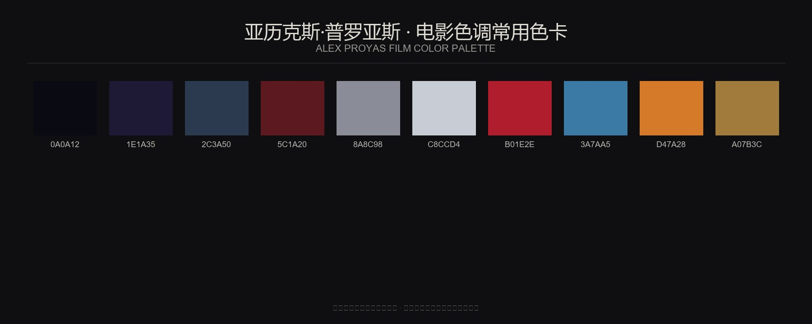
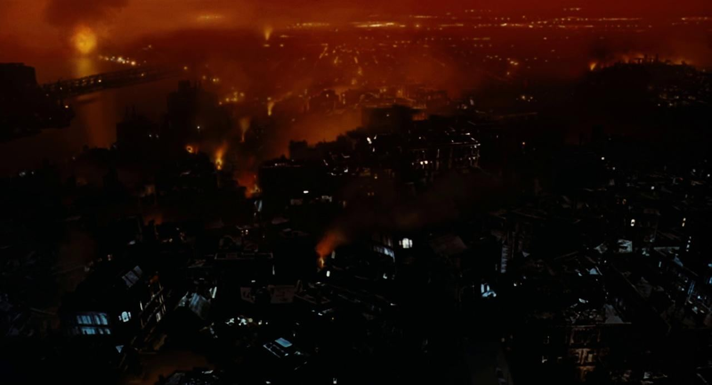
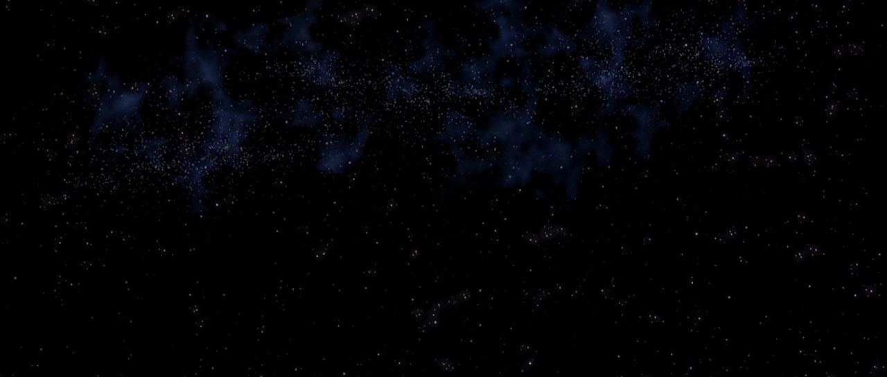

# 导演色卡 #036 — Alex Proyas 亚历克斯·普罗亚斯

> **分类**：02 霓虹黑色与赛博未来
> **编号**：036
> **国籍**：澳大利亚
> **活跃年代**：1989-至今
> **创建日期**：2026-07-31

---

## 一、核心风格一句话

> 哥特暗夜里永恒雨幕下的机械都市，黑紫蓝色调中复仇血红燃烧，漫画式黑色剪影构筑的存在主义黑暗寓言。

---

## 二、色板构成



> 横版主色卡（点击查看高清图）

### 主色板（6色）

| 色号 | HEX | 色彩名称 | 占比 | 来源说明 |
|------|-----|---------|------|---------|
| C01 | `#0A0A12` | 哥特永夜黑 | 35% | 《乌鸦》黑夜、《黑暗城市》永夜天幕、暗部底色 |
| C02 | `#1E1A35` | 暗夜紫蓝 | 22% | 哥特夜空、《乌鸦》紫蓝雨幕、神秘暗角 |
| C03 | `#2C3A50` | 雨夜钢蓝 | 15% | 湿冷街道、钢蓝雨光、城市建筑暗面 |
| C04 | `#5C1A20` | 血色暗红 | 12% | 复仇血腥、暴力伤痕、《乌鸦》红黑图腾 |
| C05 | `#8A8C98` | 漫画银灰 | 9% | 机械金属、《我，机器人》银色外壳、建筑钢构 |
| C06 | `#C8CCD4` | 冷白月光 | 7% | 月光、机器人白光、苍白皮肤、闪电瞬间 |

### 情绪色板（4色）

| 色号 | HEX | 色彩名称 | 情绪含义 |
|------|-----|---------|---------|
| E01 | `#B01E2E` | 乌鸦血红 | 复仇、死亡归来、暴力美学、超自然愤怒 |
| E02 | `#3A7AA5` | 霓虹雨蓝 | 城市孤寂、雨夜反光、超现实调谐、异世界感 |
| E03 | `#D47A28` | 灾变火焰橙 | 毁灭、末日、爆炸、失控之火 |
| E04 | `#A07B3C` | 哥特烛金 | 怀旧神秘、装饰艺术、古董质感、记忆之光 |

### 光影特征

- **主光方向**：低角度硬光+顶部闪电光，雨夜湿面反射，强烈明暗切割
- **高光色偏**：冷白/银蓝（闪电、月光、机器人眼、屏幕光）
- **阴影色偏**：深紫蓝偏黑（哥特暗夜、建筑阴影、永夜角落）
- **对比比**：极高对比（80-95%），黑暗吞噬大部分画面
- **色调整体**：极暗哥特，85%冷黑紫蓝 + 15%血红/暖金点缀

---

## 三、视觉风格关键词（按权重排序）

### 构图与运镜
荷兰角倾斜 · 哥特剪影 · 低角度仰拍 · 雨幕纵深感 · 漫画分格构图 · 德国表现主义建筑 · 镜像水面反射 · 十字架/墓碑构图 · 闪电瞬间定格 · 长阴影投射

### 色彩与光影
哥特暗黑 · 紫蓝雨幕 · 血红点缀 · 银白闪电 · 漫画高对比 · 湿面反光 · 机械冷银 · 烛金暖光 · 永恒黑夜 · 黑色剪影

### 氛围与情绪
哥特复仇 · 存在主义荒诞 · 永夜囚禁 · 死亡归来 · 机械冰冷 · 黑色漫画 · 命运宿命 · 超自然 · 都市哥特 · 反乌托邦孤独

---

## 四、运镜特征

| 特征 | 说明 | 经典例子 |
|------|------|---------|
| 荷兰角倾斜 | 倾斜构图营造不安与超现实 | 《乌鸦》复仇场景、《黑暗城市》调谐 |
| 哥特剪影构图 | 人物在窗前/闪电前的黑色剪影 | 《乌鸦》屋顶吉他剪影、《黑暗城市》陌生人剪影 |
| 雨幕纵深推轨 | 雨水在前景纵深层次，镜头推进 | 《乌鸦》雨夜街道穿行 |
| 低角度仰拍建筑 | 表现主义建筑压迫感，倾斜建筑 | 《黑暗城市》城市变形、建筑升起 |
| 闪电瞬间定格 | 闪电瞬间照亮一切的定格感 | 《乌鸦》闪电揭示、《我，机器人》隧道 |
| 水面/湿面反射 | 雨水路面倒影对称构图 | 《乌鸦》街道水洼反射、《黑暗城市》时钟倒影 |
| 漫画式构图 | 类似漫画分格的画面安排 | 《乌鸦》漫画原作致敬镜头 |
| 上帝视角俯拍 | 从高处俯瞰命运的无力感 | 《黑暗城市》全城调谐俯瞰、《先知》末日俯瞰 |

---

## 五、经典场景色彩参考

### 电影截图画廊

| 乌鸦 | 黑暗城市 | 我，机器人 |
|------|---------|-----------|
|  |  |  |
| 哥特永夜黑+乌鸦血红+冷白闪电 · 复仇归来 | 暗夜紫蓝+哥特烛金+雨夜钢蓝 · 现实调谐 | 漫画银灰+冷白+霓虹雨蓝 · 机械背叛 |

| 先知 | 德古拉元年 |  |
|------|-----------|------|
| *先知（剧照未收录）* | *德古拉元年（剧照未收录）* |  |
| 灾变火焰橙+暗夜紫蓝+冷白 · 末日预言 | 暗夜紫蓝+血暗红+哥特烛金 · 暗黑起源 |  |

**色彩氛围描述**：普罗亚斯的画面世界是一座永远不会迎来黎明的哥特都市——暗夜紫蓝的天空下，雨水在钢蓝街道上流淌成血色倒影，哥特永夜黑像吞噬一切的深渊，而乌鸦血红是从坟墓归来的唯一颜色。闪电劈下的冷白瞬间，照亮了德国表现主义式的倾斜建筑，每一帧都像从黑色漫画中撕下来的画面，美丽、暴力、而永恒孤独。

### 电影色彩速查

| 电影 | 场景 | 主导色 | 色彩氛围 |
|------|------|--------|---------|
| 乌鸦 | 屋顶吉他复仇 | 哥特永夜黑+乌鸦血红+冷白闪电 | 复仇、死亡归来、摇滚哥特 |
| 乌鸦 | 雨夜墓地复活 | 暗夜紫蓝+血暗红+冷白月光 | 超自然、从死域归来、悲伤 |
| 黑暗城市 | 城市调谐 | 暗夜紫蓝+哥特烛金+建筑变形 | 现实操控、存在主义、永夜 |
| 黑暗城市 | 时钟午夜 | 雨夜钢蓝+冷白月光+长阴影 | 时间停止、命运、神秘陌生人 |
| 我，机器人 | 隧道机器人叛变 | 漫画银灰+冷白光+霓虹蓝 | 机械背叛、未来恐惧、动作 |
| 我，机器人 | USR大厦 | 冷白+漫画银灰+玻璃蓝 | 企业冰冷、AI控制、极简未来 |
| 先知 | 末日灾难 | 灾变火焰橙+暗夜紫蓝+尘灰 | 毁灭、预言、无力感 |
| 神战：权力之眼 | 黄金神殿 | 金+沙漠黄+深蓝天空 | 神话史诗、饱和奇幻（非典型） |

---

## 六、AI 生成提示词模板

> 完整提示词文件见 `prompts/` 目录

### 图像生成速用公式

```
[subject description], in the style of Alex Proyas,
gothic noir dark city, eternal night,
dark purple-blue atmosphere, rain-soaked streets,
blood red accent, silver-white lightning,
comic book high contrast silhouette,
German expressionist architecture,
wet surface reflections, gothic revenge mood,
cinematic texture, grainy film look --ar 16:9 --style raw
```

### 视频生成速用公式

```
A gothic noir scene in Alex Proyas style,
eternal night city with purple-blue rain,
dark silhouettes against lightning flashes,
wet streets reflecting blood red neon,
German expressionist buildings looming,
dutch angle composition,
gothic revenge atmosphere,
cinematic film look, high contrast shadows,
16:9 aspect ratio, dramatic lighting
```

---

## 七、代表作索引

| 年份 | 片名 | 主要色彩特征 |
|------|------|-------------|
| 1994 | 乌鸦 The Crow | 哥特黑紫、雨夜血红、闪电白、漫画黑色复仇 |
| 1998 | 黑暗城市 Dark City | 永夜紫蓝、装饰艺术金、雨幕钢蓝、表现主义 |
| 2004 | 我，机器人 I, Robot | 银白机械未来、冷蓝玻璃、USR冷白、霓虹蓝 |
| 2009 | 先知 Knowing | 灾变橙火、暗夜末日、冷蓝预言、灰烬灰 |
| 2014 | 德古拉元年 Dracula Untold | 哥特暗红、暗影紫蓝、烛金、中世纪黑暗 |

---

## 八、蒸馏验证

- [x] 色板6+4色已提取
- [x] 可视化色卡图片已生成（横版+竖版）
- [x] 运镜特征已归纳（8种）
- [x] 提示词模板已生成（MJ/SD/视频）
- [ ] 电影截图参考图已收集
- [ ] Stable Diffusion 实测试图
- [ ] Runway 视频测试
