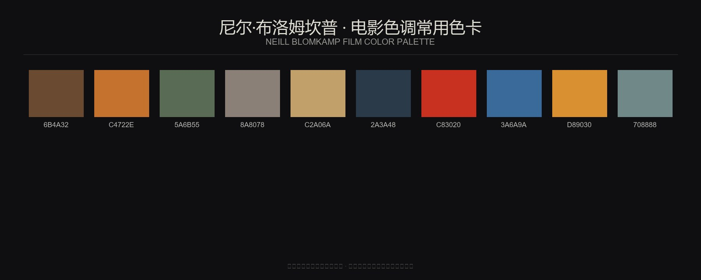
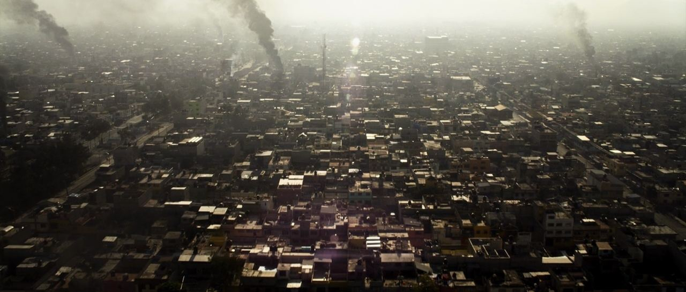
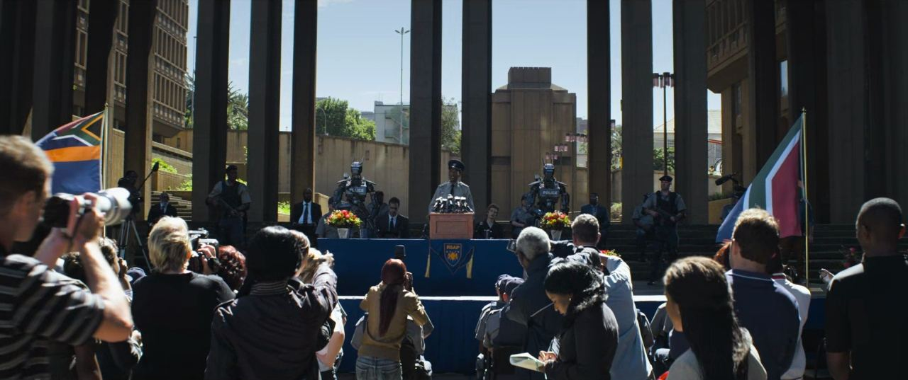

# 导演色卡 #037 — Neill Blomkamp 尼尔·布洛姆坎普

> **分类**：02 霓虹黑色与赛博未来
> **编号**：037
> **国籍**：南非/加拿大
> **活跃年代**：2009-至今
> **创建日期**：2026-07-31

---

## 一、核心风格一句话

> 手持纪实镜头下约翰内斯堡贫民窟的脏橙铁锈与外星流体绿灰，贫富对峙中的尘土科幻与社会寓言。

---

## 二、色板构成



> 横版主色卡（点击查看高清图）

### 主色板（6色）

| 色号 | HEX | 色彩名称 | 占比 | 来源说明 |
|------|-----|---------|------|---------|
| C01 | `#6B4A32` | 铁锈棕 | 28% | 《第九区》铁皮屋、锈蚀金属、贫民区建筑 |
| C02 | `#C4722E` | 脏橙贫民 | 22% | 约翰内斯堡尘土、铁皮屋阳光、贫民窟日落 |
| C03 | `#5A6B55` | 外星油绿灰 | 15% | 外星流体、军事橄榄绿、机械油污、虾人黏液 |
| C04 | `#8A8078` | 混凝土灰 | 13% | 水泥建筑、尘土飞扬、MNU设施、城市废墟 |
| C05 | `#C2A06A` | 沙尘米黄 | 12% | 非洲干土、沙尘、垃圾场、荒凉大地 |
| C06 | `#2A3A48` | 军警蓝灰 | 10% | MNU装甲、夜间行动、企业军警、机械冷钢 |

### 情绪色板（4色）

| 色号 | HEX | 色彩名称 | 情绪含义 |
|------|-----|---------|---------|
| E01 | `#C83020` | 暴力警红 | 暴力、警灯、血腥、枪战、军事压迫 |
| E02 | `#3A6A9A` | 霓虹警蓝 | 警灯蓝、外星科技、未来警用、电子冷光 |
| E03 | `#D89030` | 爆炸火橙 | 爆炸、枪口焰、火焰、武器发射、破坏 |
| E04 | `#708888` | 外星银 | 外星武器、虾人科技、生物技术、异质文明 |

### 光影特征

- **主光方向**：自然硬光（非洲烈日）+手持纪实光，夜间警灯红蓝闪烁
- **高光色偏**：脏橙/暖黄（非洲阳光、火光、爆炸）
- **阴影色偏**：铁锈棕绿偏灰（铁皮阴影、油污暗部、建筑阴影）
- **对比比**：高对比（70-85%），烈日下硬阴影，夜间强明暗
- **色调整体**：脏调纪实科幻，70%暖橙棕铁锈 + 30%冷蓝绿外星/军警

---

## 三、视觉风格关键词（按权重排序）

### 构图与运镜
手持纪实晃动 · 伪纪录片采访 · 监控新闻画面 · 低角度仰拍机甲 · 尘土飞扬纵深 · 贫富对比构图 · 特写血迹/伤口 · 跟拍奔跑 · 新闻字幕叠加 · 军事POV

### 色彩与光影
脏橙铁锈 · 尘土米黄 · 外星流体绿 · 军警蓝灰 · 警灯红蓝 · 爆炸火橙 · 硬光烈日 · 油污质感 · 垃圾美学 · 外星银金属

### 氛围与情绪
社会寓言 · 种族隔离隐喻 · 贫富悬殊 · 纪实科幻 · 暴力真实 · 人性灰度 · 企业邪恶 · 草根反抗 · 外星难民 · 非洲粗粝

---

## 四、运镜特征

| 特征 | 说明 | 经典例子 |
|------|------|---------|
| 手持纪实晃动 | 伪纪录片风格，新闻采访质感 | 《第九区》全片纪实风格、采访镜头 |
| 监控/新闻画面 | 穿插CCTV/新闻直播画面 | 《第九区》新闻播报、MNU监控 |
| 低角度仰拍机甲 | 机甲/外星武器的压迫感 | 《第九区》外骨骼机甲、《极乐空间》守卫机器人 |
| 尘土纵深跟拍 | 尘土飞扬中跟拍人物奔跑 | 《第九区》贫民窟穿行、《查派》约堡街头 |
| 特写创伤变形 | 伤口/变异/机械改造的特写 | 《第九区》Wikus手臂变异、外星流体 |
| 贫富并置构图 | 同一画面中贫/富两个世界 | 《极乐空间》地球贫民窟vs太空站 |
| 警灯红蓝闪烁 | 夜间场景红蓝警灯交替 | 《查派》警察机器人行动、《第九区》夜袭 |
| 军事HUD POV | 机甲/武器的第一视角HUD | 《第九区》外骨骼战斗视角、武器瞄准 |

---

## 五、经典场景色彩参考

### 电影截图画廊

| 第九区 | 极乐空间 | 超能查派 |
|--------|---------|---------|
|  |  |  |
| 脏橙贫民+铁锈棕+外星油绿灰 · 种族隔离 | 沙尘米黄+军警蓝灰+外星银 · 贫富对峙 | 脏橙+霓虹警蓝+暴力警红 · 约堡街头 |

| 第九区机甲 | 极乐空间太空 |  |
|-----------|------------|------|
| *机甲（剧照未收录）* | *太空（剧照未收录）* |  |
| 铁锈棕+爆炸火橙+外星银 · 草根反抗 | 军警蓝灰+太空黑+金属银 · 阶级对立 |  |

**色彩氛围描述**：布洛姆坎普的画面世界是约翰内斯堡铁皮屋顶上的烈日炙烤——脏橙贫民的尘土在铁锈棕的铁皮屋间弥漫，外星油绿灰的流体在垃圾场中流淌，军警蓝灰的装甲在贫民窟边界巡逻。警灯红蓝在夜间贫民窟闪烁，爆炸火橙是暴力冲突的语言，外星银的武器是弱者唯一的反击。每一帧都像战地记者的镜头，粗粝、真实、而刺痛人心。

### 电影色彩速查

| 电影 | 场景 | 主导色 | 色彩氛围 |
|------|------|--------|---------|
| 第九区 | 贫民窟铁皮屋全景 | 脏橙贫民+铁锈棕+沙尘米黄 | 种族隔离、贫困、外星难民 |
| 第九区 | Wikus变异 | 外星油绿灰+混凝土灰+血肉红 | 身体恐怖、异化、人性挣扎 |
| 第九区 | 外骨骼决战 | 铁锈棕+爆炸火橙+外星银 | 反抗、暴力、悲壮 |
| 极乐空间 | 地球贫民窟 | 脏橙+沙尘米黄+军警蓝灰 | 贫困、压迫、阶级固化 |
| 极乐空间 | 极乐空间空间站 | 金属银+白+蓝绿地球 | 特权、人造天堂、冷酷 |
| 超能查派 | 约堡街头黑帮 | 脏橙+霓虹警蓝+金链子亮黄 | 街头文化、成长、警匪 |
| 超能查派 | 查派诞生 | 金属银+警灯红蓝+油污绿 | 人工智能觉醒、纯真与暴力 |

---

## 六、AI 生成提示词模板

> 完整提示词文件见 `prompts/` 目录

### 图像生成速用公式

```
[subject description], in the style of Neill Blomkamp,
documentary sci-fi, gritty Johannesburg slums,
dirty orange rust palette, corrugated iron shacks,
alien fluid green-gray accents, dust and sand beige,
handheld camera aesthetic, found footage feel,
military blue-gray armor, police light red-blue,
explosion fire orange, gritty realism, social sci-fi,
cinematic texture, grainy film look --ar 16:9 --style raw
```

### 视频生成速用公式

```
A gritty sci-fi scene in Neill Blomkamp style,
documentary handheld camera, Johannesburg shantytown,
dirty orange rust-colored corrugated iron shacks,
dust blowing through the air, alien technology present,
hard African sunlight casting sharp shadows,
military vehicles and robots patrolling,
red and blue police lights flashing,
gritty realistic social sci-fi atmosphere,
cinematic film look, 16:9 aspect ratio, hand-held movement
```

---

## 七、代表作索引

| 年份 | 片名 | 主要色彩特征 |
|------|------|-------------|
| 2009 | 第九区 District 9 | 脏橙铁锈、外星绿灰、尘土纪实、南非贫民窟 |
| 2013 | 极乐空间 Elysium | 地球脏橙vs太空银白、军警蓝灰、贫富对峙 |
| 2015 | 超能查派 Chappie | 约堡脏橙、警灯红蓝、金属机器人、街头黑帮 |
| 2021 | 恶灵 Demonic | 暗黑恐怖、生物科技、更暗的绿灰调 |

---

## 八、蒸馏验证

- [x] 色板6+4色已提取
- [x] 可视化色卡图片已生成（横版+竖版）
- [x] 运镜特征已归纳（8种）
- [x] 提示词模板已生成（MJ/SD/视频）
- [ ] 电影截图参考图已收集
- [ ] Stable Diffusion 实测试图
- [ ] Runway 视频测试
