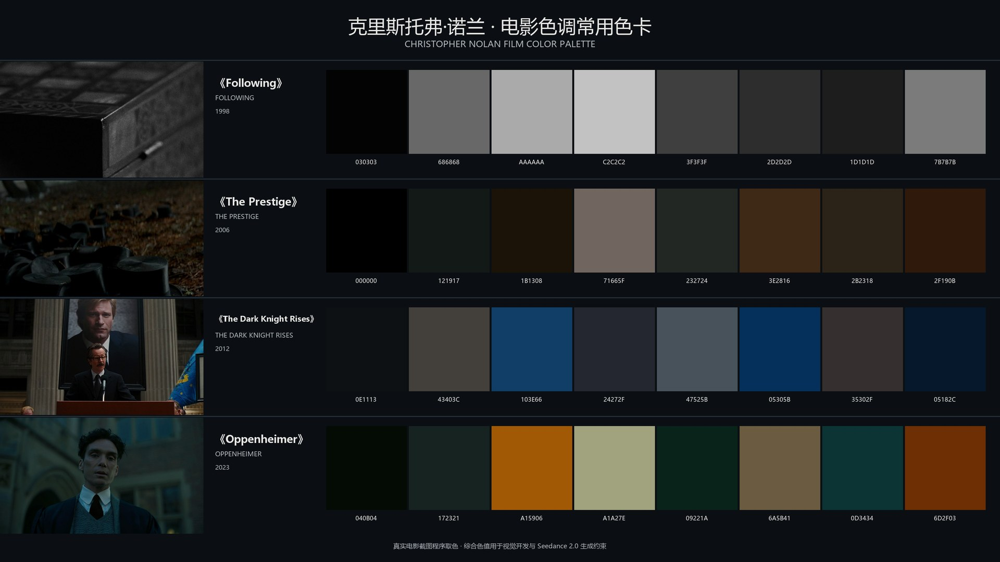
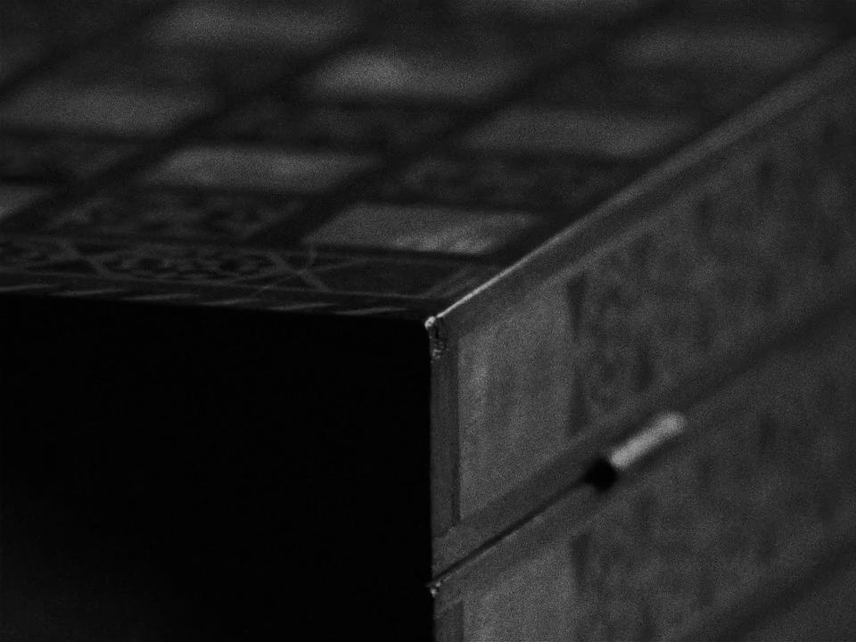
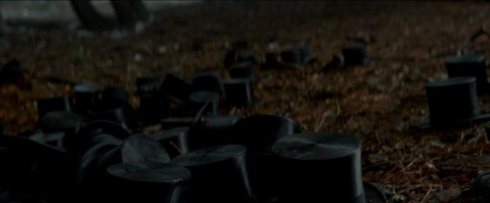
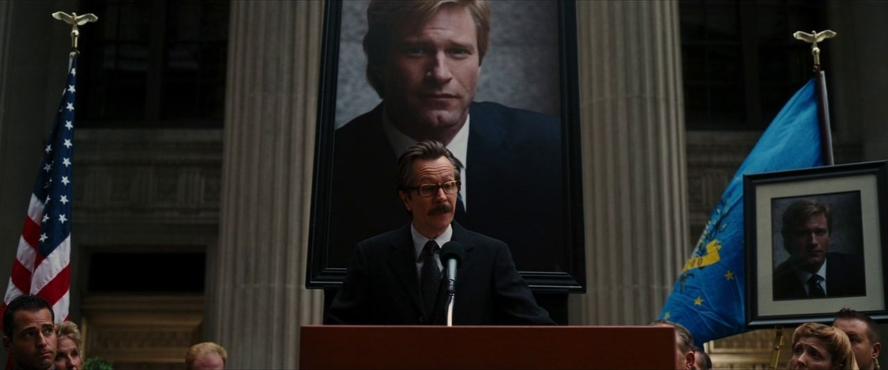
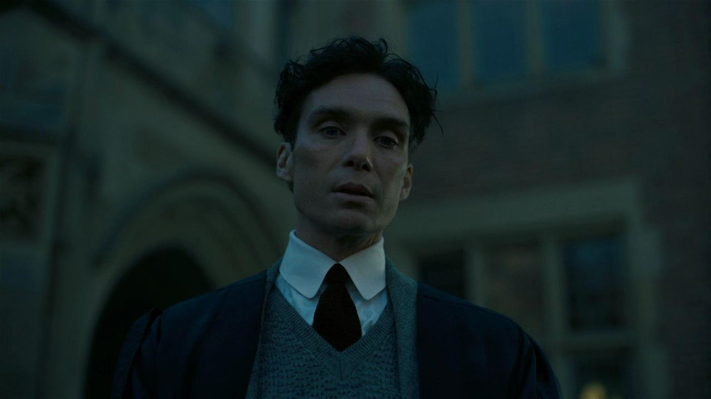

# 导演色卡 #038 — Christopher Nolan 克里斯托弗·诺兰

> **分类**：02 霓虹黑色与赛博未来
> **编号**：038
> **国籍**：英/美
> **活跃年代**：1998-至今
> **创建日期**：2026-07-31

---

## 一、核心风格一句话

> IMAX巨幕下冷钢蓝与建筑灰构筑的暗色史诗，时间折叠的建筑感构图中，黑洞暖橙与记忆金是理性迷宫里唯一的情感坐标。

---

## 二、色板构成



> 横版主色卡（点击查看高清图）

### 主色板（6色）

| 色号 | HEX | 色彩名称 | 占比 | 来源说明 |
|------|-----|---------|------|---------|
| C01 | `#0C1420` | IMAX深空蓝黑 | 30% | 太空黑暗、《星际穿越》宇宙、《蝙蝠侠》夜幕 |
| C02 | `#2A4060` | 冷钢蓝 | 22% | 现实色调、企业/军警/科技、《盗梦空间》现实层 |
| C03 | `#6E7580` | 建筑灰 | 16% | 混凝土、西装、哥谭建筑、《盗梦空间》都市 |
| C04 | `#C9A44C` | 玉米金 | 12% | 《星际穿越》玉米地、记忆暖光、怀旧质感 |
| C05 | `#7A5C3E` | 暖棕木色 | 11% | 梦境层暖调、图书馆木质、复古质感、《盗梦空间》梦境 |
| C06 | `#060A10` | 虚空墨黑 | 9% | 绝对黑暗、黑洞边缘、纯影、深邃暗部 |

### 情绪色板（4色）

| 色号 | HEX | 色彩名称 | 情绪含义 |
|------|-----|---------|---------|
| E01 | `#D4782A` | 黑洞暖橙 | 超验时刻、爆炸、原子之火、五维空间、爱的穿越 |
| E02 | `#0F1418` | 蝙蝠侠黑 | 义警黑暗、哥谭阴影、恐惧、正义的暗影 |
| E03 | `#B8864A` | 梦境琥珀 | 梦境温暖、记忆怀旧、时间质感、金色年代 |
| E04 | `#A0A8B0` | 时间灰白 | 时间逆行、因果倒转、Tenet冷感、理性冰冷 |

### 光影特征

- **主光方向**：IMAX大画幅硬光，自然光为主，建筑感定向光，极少散射
- **高光色偏**：冷钢蓝/金（现实冷蓝 vs 梦境/记忆暖金，诺兰标志性冷暖二元）
- **阴影色偏**：深蓝黑偏墨色（IMAX暗部浓郁，纯黑死黑区域）
- **对比比**：极高对比（75-90%），IMAX画幅特有的大光比
- **色调整体**：暗色史诗，65%冷蓝灰 + 35%暖金棕橙，现实冷vs梦境暖

---

## 三、视觉风格关键词（按权重排序）

### 构图与运镜
IMAX巨幅构图 · 建筑感对称 · 透视纵深走廊 · 折叠城市 · 低角度仰拍 · 大远景人物渺小 · 实用特效实拍 · 旋转走廊 · 时间逆向运动 · 交叉蒙太奇

### 色彩与光影
IMAX冷钢蓝 · 建筑混凝土灰 · 玉米金暖光 · 黑洞暖橙 · 梦境琥珀暖调 · 蝙蝠侠黑 · 时间灰白 · 实拍质感 · 大光比 · 冷暖二元对立

### 氛围与情绪
时间迷宫 · 存在主义 · 记忆执念 · 暗色史诗 · 理性与情感 · 道德困境 · 宏大叙事 · 智识悬疑 · 父爱/执念 · 诺兰式精密

---

## 四、运镜特征

| 特征 | 说明 | 经典例子 |
|------|------|---------|
| IMAX巨幅大远景 | 70mm IMAX大画幅，人物在宏阔空间中渺小 | 《星际穿越》太空、《蝙蝠侠》哥谭全景 |
| 建筑感对称构图 | 几何精确的建筑对称，理性秩序感 | 《盗梦空间》折叠巴黎、《信条》建筑 |
| 旋转/折叠环境 | 实际搭建的旋转装置拍摄失重/折叠 | 《盗梦空间》旋转走廊、折叠城市 |
| 低角度仰拍英雄 | 英雄人物的雕塑感低角度 | 《蝙蝠侠》蝙蝠侠登场、《星际穿越》宇航员 |
| 时间逆向运动 | 正向与逆向动作同时呈现 | 《信条》逆时间战斗、倒放爆炸 |
| 交叉蒙太奇 | 多线叙事平行剪辑，时间层交织 | 《盗梦空间》多层梦境、《敦刻尔克》三线 |
| 实拍特效优先 | 尽量用实体特效而非CGI | 《星际穿越》玉米地、《信条》真实飞机撞楼 |
| 推轨近景对话 | 经典正反打+缓慢推轨的对话场景 | 多部作品中的关键对话场景 |

---

## 五、经典场景色彩参考

### 电影截图画廊

| 星际穿越 | 盗梦空间 | 蝙蝠侠：黑暗骑士 |
|---------|---------|----------------|
|  |  |  |
| 玉米金+IMAX深空蓝黑+黑洞暖橙 · 爱与时间 | 冷钢蓝+梦境琥珀+建筑灰 · 现实与梦境 | 蝙蝠侠黑+建筑灰+小丑病态绿紫 · 混乱正义 |

| 敦刻尔克 | 信条 | 奥本海默 |
|---------|------|---------|
|  | *信条（剧照未收录）* | *奥本海默（剧照未收录）* |
| 冷钢蓝+海灰+喷火蓝 · 陆海天三线 | 时间灰白+逆红+冷钢蓝 · 时间逆流 | 原子火橙+沙漠棕+黑白政治 · 普罗米修斯之火 |

**色彩氛围描述**：诺兰的画面世界是一座用IMAX胶片雕刻的理性迷宫——冷钢蓝的现实世界里建筑灰的几何结构精确得令人敬畏，玉米金的麦田和梦境琥珀是记忆深处仅存的温度，而黑洞暖橙在IMAX深空蓝黑的宇宙尽头燃烧，那是超越五维空间的爱与执念。蝙蝠侠黑是暗夜中的正义悖论，时间灰白是因果倒转的冷峻美学。每一帧都像用数学公式计算过的精确构图，宏大、精密、而在理性最深处藏着最动人的情感。

### 电影色彩速查

| 电影 | 场景 | 主导色 | 色彩氛围 |
|------|------|--------|---------|
| 星际穿越 | 玉米地追逐 | 玉米金+尘土灰+蓝天 | 地球末日、父女温情、家园 |
| 星际穿越 | 黑洞/五维空间 | IMAX深空蓝黑+黑洞暖橙+虚空墨黑 | 超验、爱的穿越、时间维度 |
| 盗梦空间 | 折叠巴黎 | 冷钢蓝+建筑灰+梦境琥珀 | 梦境操控、现实折叠、智识 |
| 盗梦空间 | 旋转走廊 | 建筑灰+暖棕木色+冷钢蓝 | 失重梦境、多层平行、无重力 |
| 黑暗骑士 | 哥谭夜景 | 蝙蝠侠黑+建筑灰+冷钢蓝 | 混乱正义、小丑恐怖、道德灰色 |
| 敦刻尔克 | 喷火式空战 | 冷钢蓝+海空灰+喷火蓝 | 撤退、生存、陆海天三线交织 |
| 信条 | 逆向战斗 | 时间灰白+逆红+冷钢蓝 | 时间逆流、因果倒转、算法末日 |
| 奥本海默 | 三位一体核试 | 原子火橙+沙漠棕+黑白政治 | 普罗米修斯之火、毁灭与创造 |

---

## 六、AI 生成提示词模板

> 完整提示词文件见 `prompts/` 目录

### 图像生成速用公式

```
[subject description], in the style of Christopher Nolan,
IMAX cinematic epic, cold steel blue and architectural gray,
practical effects, geometric symmetry composition,
warm amber dream tones vs cold reality blue,
large format cinematography, high contrast,
deep black shadows, 70mm film texture,
intellectual sci-fi atmosphere,
monumental wide shot, film grain --ar 2.35:1 --style raw
```

### 视频生成速用公式

```
An epic scene in Christopher Nolan IMAX style,
cold steel blue reality with warm amber dream tones,
architectural geometric composition,
practical effects and real stunts,
deep black shadows, high contrast lighting,
70mm IMAX film texture,
cross-cutting between time layers implied,
monumental cinematic scope, intellectual atmosphere,
2.35:1 anamorphic aspect ratio
```

---

## 七、代表作索引

| 年份 | 片名 | 主要色彩特征 |
|------|------|-------------|
| 2000 | 记忆碎片 Memento | 黑白/彩色交替、宝丽来灰白、 motel 暖黄、记忆碎片感 |
| 2002 | 失眠症 Insomnia | 阿拉斯加白昼夜、冷冰雾蓝、心理灰色、永昼压迫 |
| 2005 | 蝙蝠侠：侠影之谜 | 哥谭暗黑、蝙蝠黑、稻草黄、忍者大师棕 |
| 2008 | 黑暗骑士 The Dark Knight | 哥谭灰黑、小丑绿紫、双面人橙火、暗色史诗 |
| 2010 | 盗梦空间 Inception | 冷蓝现实vs暖琥珀梦境、折叠灰城、旋转走廊 |
| 2012 | 黑暗骑士崛起 | 雪地白+黑、监狱深井、哥谭冬灰、贝恩棕 |
| 2014 | 星际穿越 Interstellar | 玉米金、太空蓝黑、黑洞暖橙、尘埃棕灰 |
| 2017 | 敦刻尔克 Dunkirk | 海空冷蓝、沙滩卡其、喷火蓝、陆海天三色交织 |
| 2020 | 信条 Tenet | 冷蓝正向vs暖红逆向、时间灰白、算法灰 |
| 2023 | 奥本海默 Oppenheimer | 黑白政治vs彩色沙漠、原子火橙、圣达菲棕 |

---

## 八、蒸馏验证

- [x] 色板6+4色已提取
- [x] 可视化色卡图片已生成（横版+竖版）
- [x] 运镜特征已归纳（8种）
- [x] 提示词模板已生成（MJ/SD/视频）
- [ ] 电影截图参考图已收集
- [ ] Stable Diffusion 实测试图
- [ ] Runway 视频测试
