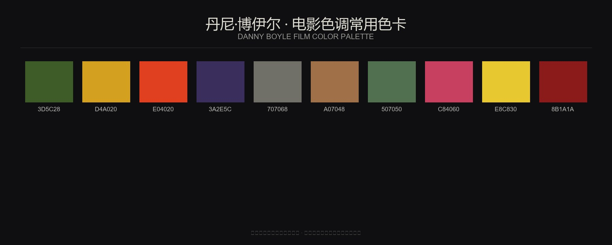
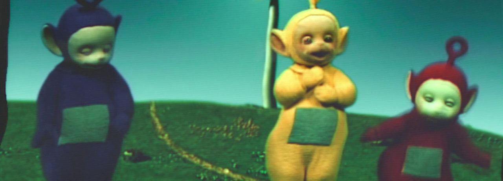
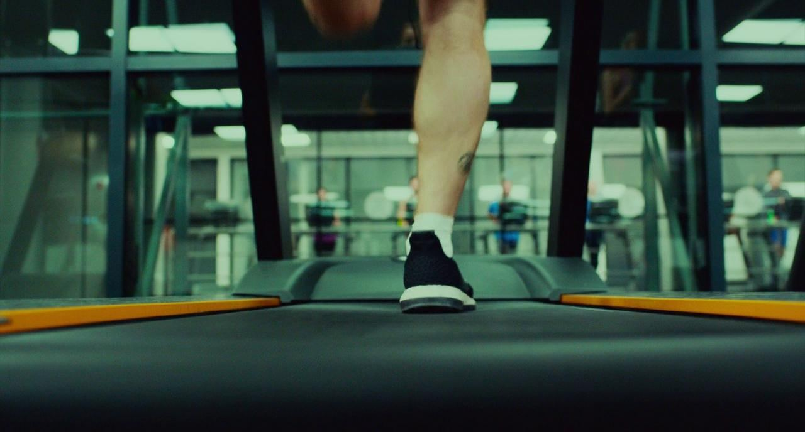
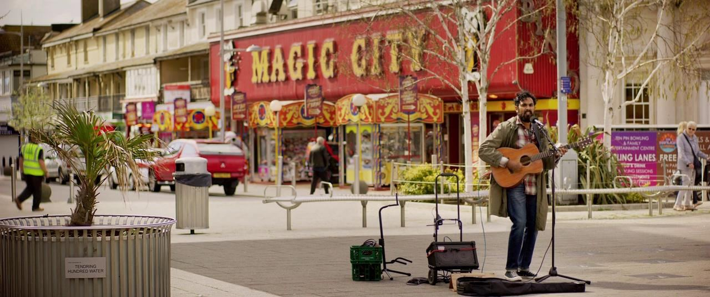

# 导演色卡 #039 — Danny Boyle 丹尼·博伊尔

> **分类**：02 霓虹黑色与赛博未来
> **编号**：039
> **国籍**：英国
> **活跃年代**：1994-至今
> **创建日期**：2026-07-31

---

## 一、核心风格一句话

> 快速剪辑下迷幻脏绿与霓虹都市的癫狂碰撞，孟买暖黄与病毒冷绿的两极跳跃，毒品、爱情与末日的视觉肾上腺素。

---

## 二、色板构成



> 横版主色卡（点击查看高清图）

### 主色板（6色）

| 色号 | HEX | 色彩名称 | 占比 | 来源说明 |
|------|-----|---------|------|---------|
| C01 | `#3D5C28` | 迷幻脏绿 | 22% | 《猜火车》毒品绿、《28天后》感染绿、病态壁纸 |
| C02 | `#D4A020` | 孟买暖黄 | 20% | 《贫民窟》金黄阳光、印度番红花、阳光灿烂 |
| C03 | `#E04020` | 霓虹橙红 | 16% | 《猜火车》标题橙、毒品狂躁、《127小时》峡谷红 |
| C04 | `#3A2E5C` | 毒幻蓝紫 | 14% | 夜店紫蓝、毒品幻境、《猜火车》迷幻夜、《太阳浩劫》冷空 |
| C05 | `#707068` | 废弃灰 | 14% | 《28天后》空城伦敦、末日混凝土、苏格兰灰 |
| C06 | `#A07048` | 皮肤暖棕 | 14% | 人肤色、大地色、混乱中的人性温度 |

### 情绪色板（4色）

| 色号 | HEX | 色彩名称 | 情绪含义 |
|------|-----|---------|---------|
| E01 | `#507050` | 末日冷绿 | 病毒感染、末日荒凉、被遗弃的世界、死寂 |
| E02 | `#C84060` | 孟买红粉 | 生命能量、印度色彩、节日、贫民窟生命力 |
| E03 | `#E8C830` | 狂喜金黄 | 毒品狂喜、太阳崇拜、生命力爆发、希望 |
| E04 | `#8B1A1A` | 病毒血红 | 狂暴病毒、暴力血腥、毒瘾深渊、死亡 |

### 光影特征

- **主光方向**：狂乱手持+快速跳切光，极端冷暖交替，自然光与色光混用
- **高光色偏**：暖黄/霓虹橙（阳光、毒品狂躁、印度暖光）
- **阴影色偏**：脏绿/蓝紫（毒幻、末日、病态暗部）
- **对比比**：高对比但饱和度跳跃（60-90%两极），从极度去饱和到极度饱和
- **色调整体**：迷幻两极，50%暖黄橙红 + 50%冷绿蓝紫，快速剪辑跳跃

---

## 三、视觉风格关键词（按权重排序）

### 构图与运镜
快速跳切 · 手持狂晃 · 鱼眼畸变 · 低角度扭曲 · 主观毒幻视角 · 奔跑跟拍 · 字幕插入 · 分割画面 · 极速推拉 · 超现实插入

### 色彩与光影
迷幻脏绿 · 孟买暖黄 · 霓虹橙红 · 毒幻蓝紫 · 末日冷绿 · 狂喜金黄 · 病毒血红 · 高饱和跳跃 · 极端冷暖 · 色光染色

### 氛围与情绪
狂躁能量 · 毒品迷幻 · 底层生命力 · 末日恐惧 · 黑色幽默 · 爱与救赎 · 英国愤怒 · 印度喧嚣 · 肾上腺素 · 存在荒诞

---

## 四、运镜特征

| 特征 | 说明 | 经典例子 |
|------|------|---------|
| 快速跳切剪辑 | 极短镜头快速切换，肾上腺素感 | 《猜火车》开场选择生活、《贫民窟》问答闪回 |
| 手持狂晃奔跑 | 跟拍人物奔跑的手持晃动 | 《猜火车》街头奔跑、《28天后》空城奔跑 |
| 毒幻主观视角 | 吸毒后的扭曲/畸变/超现实画面 | 《猜火车》钻入马桶、天花板婴儿 |
| 鱼眼/广角畸变 | 极端广角造成的空间扭曲感 | 《猜火车》戒毒房间、《28天后》空城 |
| 字幕/文字插入 | 画面中直接插入文字、选择项 | 《猜火车》"Choose Life"开场 |
| 交叉闪回 | 多条时间线快速交叉剪辑 | 《贫民窟》节目问答闪回、《127小时》回忆 |
| 极端色彩切换 | 一场景内色彩饱和度极端变化 | 《猜火车》从正常到毒幻、《28天后》绿灰到红血 |
| 超现实幻想插入 | 突然插入的超现实/动画/幻想画面 | 《猜火车》婴儿爬行天花板、《贫民窟》泰姬陵幻想 |

---

## 五、经典场景色彩参考

### 电影截图画廊

| 猜火车 | 贫民窟的百万富翁 | 28天后 |
|--------|----------------|--------|
|  |  |  |
| 迷幻脏绿+霓虹橙红+毒幻蓝紫 · 选择生活 | 孟买暖黄+孟买红粉+皮肤暖棕 · 命运喧嚣 | 末日冷绿+废弃灰+病毒血红 · 空城死寂 |

| 太阳浩劫 | 127小时 | 史蒂夫·乔布斯 |
|---------|--------|--------------|
| *太阳浩劫（剧照未收录）* | *127小时（剧照未收录）* | *乔布斯（剧照未收录）* |
| 狂喜金黄+冷蓝太空+虚空黑 · 太阳崇拜 | 霓虹橙红+峡谷红+蓝天 · 绝境求生 | 冷灰蓝+产品白+舞台暖光 · 数字时代 |

**色彩氛围描述**：博伊尔的画面世界是一场视觉的毒品旅行——迷幻脏绿的墙纸在《猜火车》的爱丁堡公寓里蠕动，霓虹橙红的标题像针管里的快感一样刺入视网膜，而镜头一转，孟买暖黄的阳光下贫民窟的孩子们在《贫民窟的百万富翁》的金黄尘土中奔跑，孟买红粉的纱丽在晾衣绳上飘扬。然后一切坠入《28天后》末日冷绿的死寂伦敦，废弃灰的街道上只有病毒血红在黑暗中闪烁。每一帧都打了肾上腺素，快速、狂乱、美丽而危险。

### 电影色彩速查

| 电影 | 场景 | 主导色 | 色彩氛围 |
|------|------|--------|---------|
| 猜火车 | 开场"选择生活"奔跑 | 霓虹橙红+废弃灰+迷幻脏绿 | 狂躁、青春、毒品文化 |
| 猜火车 | 钻入马桶/最糟厕所 | 毒幻蓝紫+脏绿+恶心棕黄 | 超现实、恶心、黑色幽默 |
| 猜火车 | 戒毒婴儿幻觉 | 毒幻蓝紫+病毒血红+脏绿 | 恐怖、毒瘾地狱、心理崩溃 |
| 贫民窟 | 孟买贫民窟童年 | 孟买暖黄+孟买红粉+尘土 | 生命力、贫困、童年 |
| 贫民窟 | 贾马尔跳粪坑 | 棕黄+皮肤暖棕+金黄 | 黑色幽默、决心、底层 |
| 28天后 | 空城伦敦 | 末日冷绿+废弃灰+死寂 | 末日、孤立、病毒恐怖 |
| 28天后 | 丧尸红眼追杀 | 病毒血红+末日冷绿+黑暗 | 恐怖、生存、狂暴 |
| 太阳浩劫 | 太阳接近 | 狂喜金黄+冷蓝太空+虚空黑 | 神性、牺牲、光明 |

---

## 六、AI 生成提示词模板

> 完整提示词文件见 `prompts/` 目录

### 图像生成速用公式

```
[subject description], in the style of Danny Boyle,
hyperkinetic filmmaking, fast editing aesthetic,
psychedelic sickly green and neon orange-red,
warm golden Mumbai light, drug-trip purple-blue,
handheld camera energy, extreme color contrast,
gritty urban energy, surreal inserts,
cinematic adrenaline, grainy film look --ar 16:9 --style raw
```

### 视频生成速用公式

```
A hyperkinetic scene in Danny Boyle style,
fast-paced editing energy, handheld camera movement,
psychedelic green and neon orange color palette,
warm golden light with drug-trip purple-blue flashes,
extreme color saturation jumps,
surreal visual inserts and jump cuts,
gritty urban vitality, cinematic adrenaline rush,
16:9 aspect ratio, dynamic camera movement
```

---

## 七、代表作索引

| 年份 | 片名 | 主要色彩特征 |
|------|------|-------------|
| 1996 | 猜火车 Trainspotting | 迷幻脏绿、霓虹橙红、毒幻蓝紫、英国灰色 |
| 2000 | 海滩 The Beach | 热带蓝绿、 paradise金黄、暗部黑化 |
| 2002 | 28天后 28 Days Later | 末日冷绿、废弃灰、病毒血红、DV质感 |
| 2007 | 太阳浩劫 Sunshine | 太阳金黄、太空冷蓝、存在主义光 |
| 2008 | 贫民窟的百万富翁 | 孟买暖黄、印度红粉、金黄尘土、饱和色彩 |
| 2010 | 127小时 127 Hours | 峡谷红橙、蓝天、闪回多彩、求生意志 |
| 2015 | 史蒂夫·乔布斯 Steve Jobs | 数字冷蓝、舞台暖光、产品白、三段式格式 |
| 2019 | 昨日奇迹 Yesterday | 英国暖调、摇滚红、复古色彩 |

---

## 八、蒸馏验证

- [x] 色板6+4色已提取
- [x] 可视化色卡图片已生成（横版+竖版）
- [x] 运镜特征已归纳（8种）
- [x] 提示词模板已生成（MJ/SD/视频）
- [ ] 电影截图参考图已收集
- [ ] Stable Diffusion 实测试图
- [ ] Runway 视频测试
