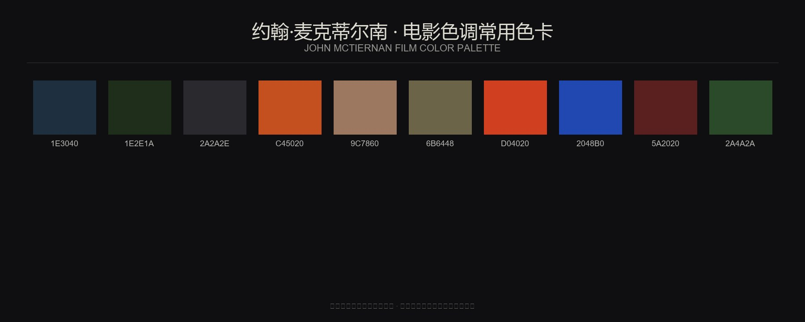
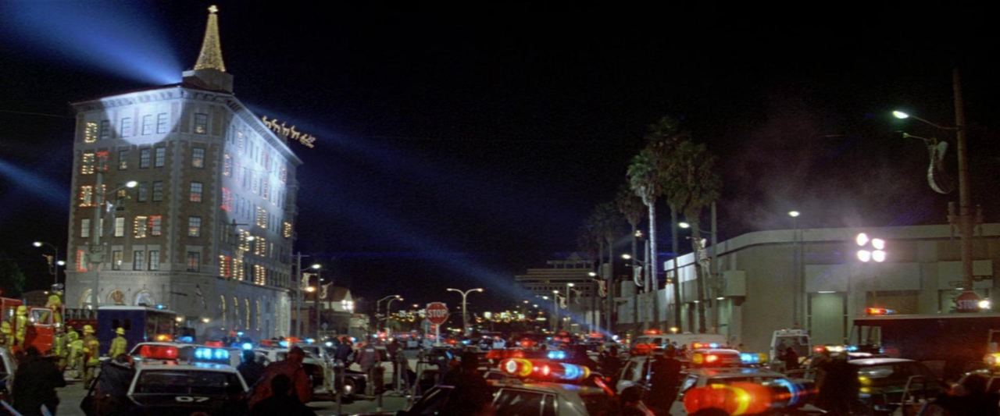
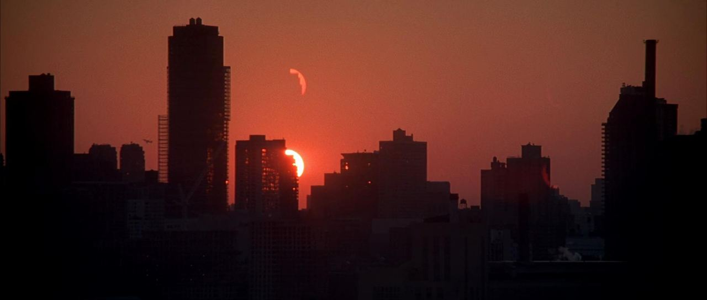
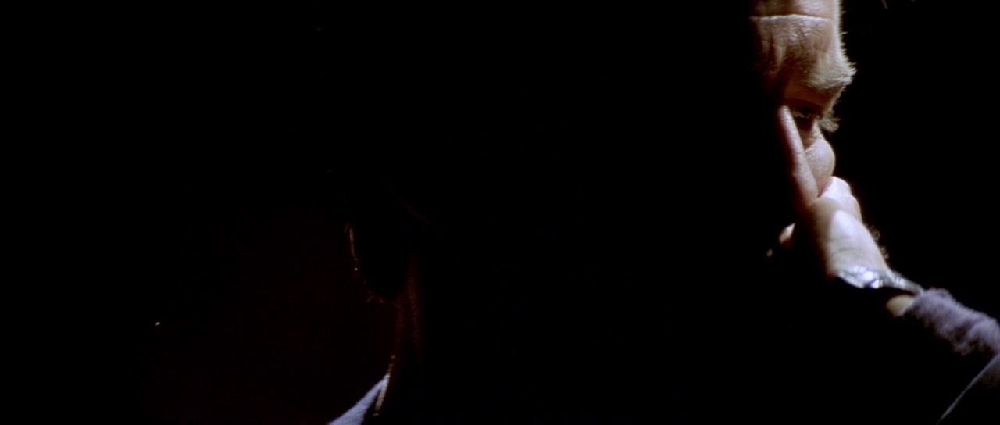
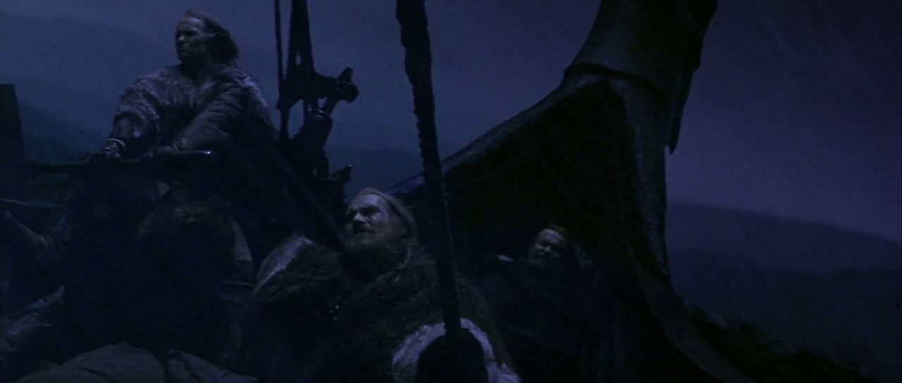

# 导演色卡 #040 — John McTiernan 约翰·麦克蒂尔南

> **分类**：02 霓虹黑色与赛博未来
> **编号**：040
> **国籍**：美国
> **活跃年代**：1986-2003
> **创建日期**：2026-07-31

---

## 一、核心风格一句话

> 暗调动作中烟雾弥漫的硬汉剪影，潜艇钢蓝与丛林暗绿交织的硬核战场，爆炸暖橙撕裂烟雾阴影的80年代动作巅峰。

---

## 二、色板构成



> 横版主色卡（点击查看高清图）

### 主色板（6色）

| 色号 | HEX | 色彩名称 | 占比 | 来源说明 |
|------|-----|---------|------|---------|
| C01 | `#1E3040` | 潜艇钢蓝 | 25% | 《猎杀红色十月》潜艇内、《虎胆龙威》办公楼夜色 |
| C02 | `#1E2E1A` | 丛林暗绿 | 20% | 《铁血战士》丛林、夜战绿叶、热带雨林暗色 |
| C03 | `#2A2A2E` | 烟雾影黑 | 20% | 硝烟、阴影、暗部、金属枪黑、夜色 |
| C04 | `#C45020` | 爆炸暖橙 | 15% | 爆炸火球、枪口焰、火焰、《虎胆龙威》爆炸 |
| C05 | `#9C7860` | 硬汉汗肤 | 12% | 麦克莱恩汗湿皮肤、泥灰、尘土、伤痕 |
| C06 | `#6B6448` | 军事卡其 | 8% | 军装橄榄绿、迷彩、军事装备、丛林作战服 |

### 情绪色板（4色）

| 色号 | HEX | 色彩名称 | 情绪含义 |
|------|-----|---------|---------|
| E01 | `#D04020` | 热成像红 | 铁血战士热视觉、暴力、猎杀、热量签名 |
| E02 | `#2048B0` | 警灯蓝 | 警察、警报、包围、危机逼近、城市夜 |
| E03 | `#5A2020` | 潜艇暗红 | 苏联潜艇警报、危机红灯、冷战紧张 |
| E04 | `#2A4A2A` | 丛林湿绿 | 雨林湿热、伪装隐匿、未知威胁、越南遗风 |

### 光影特征

- **主光方向**：硬侧光+烟雾散射光，明暗分明的硬汉布光，实战质感
- **高光色偏**：暖橙/火光（爆炸、火焰、枪口焰）
- **阴影色偏**：钢蓝/暗绿（夜战冷蓝+丛林绿暗，烟雾弥漫处呈烟灰）
- **对比比**：高对比（70-88%），烟雾柔化边缘但核心明暗分明
- **色调整体**：暗调硬核动作，70%冷钢蓝暗绿烟灰 + 30%暖橙火光点缀

---

## 三、视觉风格关键词（按权重排序）

### 构图与运镜
经典三幕式构景 · 低角度硬汉 · 烟雾弥漫纵深 · 热成像视角 · 手持战场感 · 轨道侧移跟拍 · 爆炸逆光剪影 · 封闭式空间压迫 · 军事地图俯拍 · 第一人称瞄准

### 色彩与光影
暗调钢蓝 · 丛林暗绿 · 烟雾烟灰 · 爆炸暖橙 · 硬汉汗光 · 军事卡其 · 热成像红 · 警灯红蓝 · 枪口焰 · 油汗质感

### 氛围与情绪
硬核硬汉 · 孤立无援 · 猫鼠猎杀 · 军事紧张 · 黑色幽默 · 蓝领英雄 · 80年代动作 · 烟雾迷漫 · 一触即发 · 原始暴力

---

## 四、运镜特征

| 特征 | 说明 | 经典例子 |
|------|------|---------|
| 低角度硬汉布光 | 经典好莱坞硬汉打光，侧光勾勒轮廓 | 《虎胆龙威》麦克莱恩登场、《铁血战士》达奇 |
| 烟雾纵深构图 | 硝烟/雾气/蒸汽制造纵深层次 | 《虎胆龙威》通风管道、《铁血战士》丛林晨雾 |
| 热成像视角POV | 铁血战士视角的热成像视觉 | 《铁血战士》经典热成像猎杀视角 |
| 爆炸逆光剪影 | 爆炸在身后人物成剪影 | 《虎胆龙威》屋顶爆炸、多场动作戏 |
| 封闭空间压迫 | 建筑/潜艇/丛林的封闭感构图 | 《虎胆龙威》Nakatomi大厦、《猎杀红色十月》潜艇舱 |
| 手持战场晃动 | 动作场景中手持增加实战感 | 《铁血战士》丛林交火、《虎胆龙威》枪战场面 |
| 轨道侧移跟拍 | 经典动作片侧面轨道跟拍 | 《虎胆龙威》走廊行走、人物出场 |
| 地图/雷达俯拍 | 军事信息屏幕/雷达的俯拍视角 | 《猎杀红色十月》声纳屏幕、战术指挥 |

---

## 五、经典场景色彩参考

### 电影截图画廊

| 虎胆龙威 | 铁血战士 | 猎杀红色十月 |
|---------|---------|-------------|
|  |  |  |
| 潜艇钢蓝+爆炸暖橙+硬汉汗肤 · 孤胆英雄 | 丛林暗绿+热成像红+军事卡其 · 丛林猎杀 | 潜艇钢蓝+潜艇暗红+烟雾影黑 · 冷战潜航 |

| 虎胆龙威3 | 终极奇兵 |  |
|-----------|---------|------|
|  | *终极奇兵（剧照未收录）* |  |
| 纽约灰+警灯蓝+爆炸暖橙 · 城市复仇 | 动作暖橙+霓虹+戏中戏 · 元动作 |  |

**色彩氛围描述**：麦克蒂尔南的画面世界是80年代硬汉动作片的视觉圣经——潜艇钢蓝的Nakatomi大厦通风管道里烟雾影黑弥漫，爆炸暖橙在尽头撕开一道火线照亮麦克莱恩的硬汉汗肤；《铁血战士》的丛林暗绿中热成像红的异形视角在湿热阴影中搜索猎物；《猎杀红色十月》潜艇舱内钢蓝与暗红警报交织，冷战的紧张感凝结在金属舱壁上。每一帧都充满烟雾、汗水、和一触即发的暴力。

### 电影色彩速查

| 电影 | 场景 | 主导色 | 色彩氛围 |
|------|------|--------|---------|
| 虎胆龙威 | Nakatomi大厦之夜 | 潜艇钢蓝+烟雾影黑+爆炸暖橙 | 孤胆英雄、封闭空间、圣诞夜 |
| 虎胆龙威 | 屋顶爆炸跳跃 | 爆炸暖橙+烟雾影黑+硬汉汗肤 | 绝境逃生、火焰剪影、经典动作 |
| 铁血战士 | 丛林热成像 | 丛林暗绿+热成像红+军事卡其 | 猎杀视角、未知威胁、丛林恐怖 |
| 铁血战士 | 最终泥战 | 丛林湿绿+泥棕+暗黑 | 原始对决、伪装、最终肉搏 |
| 猎杀红色十月 | 潜艇舱内 | 潜艇钢蓝+潜艇暗红+金属灰 | 冷战紧张、潜航、军事对峙 |
| 猎杀红色十月 | 声纳追逐 | 钢蓝+屏幕绿+黑暗 | 猫鼠游戏、深海恐惧、科技军事 |
| 虎胆龙威3 | 纽约街头 | 纽约灰+警灯蓝+爆炸橙 | 城市追逐、复仇、搭档喜剧 |

---

## 六、AI 生成提示词模板

> 完整提示词文件见 `prompts/` 目录

### 图像生成速用公式

```
[subject description], in the style of John McTiernan,
80s action cinema, dark moody lighting,
steel blue and jungle dark green palette,
smoke and shadow atmosphere,
explosion warm orange backlight,
tough guy side lighting, sweat and grime,
thermal imaging elements, military khaki,
cinematic film look, grainy 35mm --ar 16:9 --style raw
```

### 视频生成速用公式

```
An 80s action scene in John McTiernan style,
dark steel blue interiors with smoke and shadows,
explosions casting warm orange backlight,
tough guy hero silhouette against fire,
jungle dark green or submarine steel settings,
hard side lighting on sweaty faces,
classic action camera movement,
smoke-filled atmosphere, tension,
35mm film grain, 16:9 aspect ratio
```

---

## 七、代表作索引

| 年份 | 片名 | 主要色彩特征 |
|------|------|-------------|
| 1987 | 铁血战士 Predator | 丛林暗绿、军事卡其、热成像红、越战遗风 |
| 1988 | 虎胆龙威 Die Hard | 钢蓝办公楼、爆炸暖橙、圣诞夜暗调、烟雾阴影 |
| 1990 | 猎杀红色十月 | 潜艇钢蓝、暗红警报、深海冷灰、冷战紧张 |
| 1992 | 燃烧的天堂 Medicine Man | 雨林绿、科学白、原始自然 |
| 1993 | 幻影英雄 Last Action Hero | 元动作戏、霓虹、多类型色彩 |
| 1995 | 虎胆龙威3 Die Hard with a Vengeance | 纽约灰、警灯红蓝、爆炸暖橙 |
| 1999 | 托马斯·克朗事件 The Thomas Crown Affair | 高端深蓝、艺术画廊暖调、优雅盗窃 |

---

## 八、蒸馏验证

- [x] 色板6+4色已提取
- [x] 可视化色卡图片已生成（横版+竖版）
- [x] 运镜特征已归纳（8种）
- [x] 提示词模板已生成（MJ/SD/视频）
- [ ] 电影截图参考图已收集
- [ ] Stable Diffusion 实测试图
- [ ] Runway 视频测试
