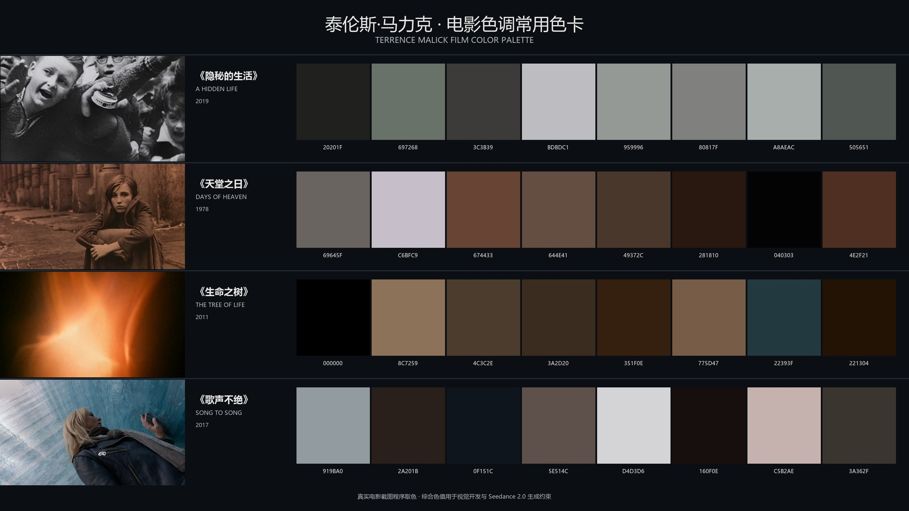
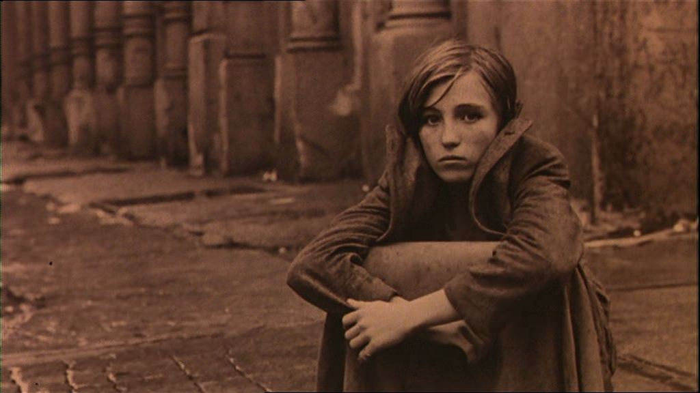
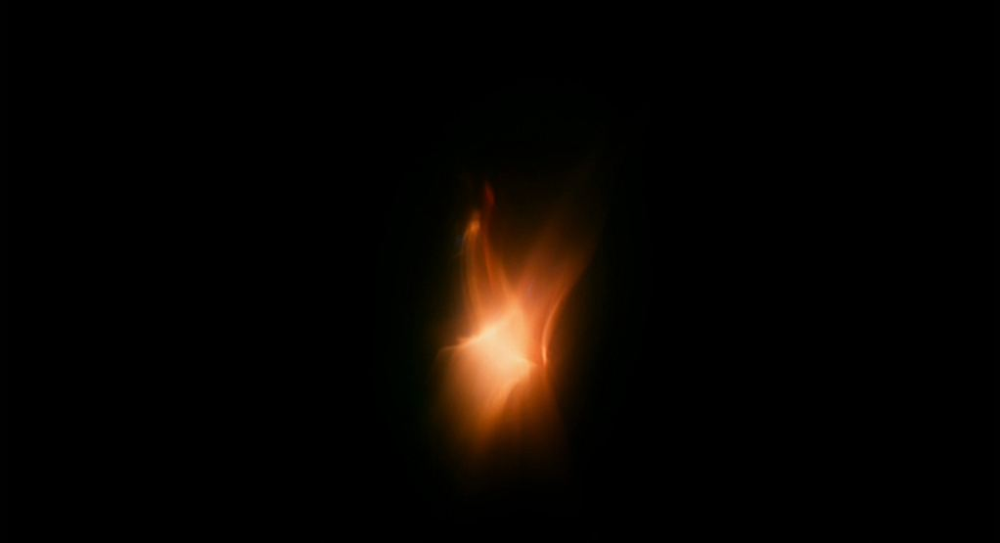

# 导演色卡 #041 — Terrence Malick 泰伦斯·马力克

> **分类**：03 大地暖调与自然光诗意 | **编号**：041 | **国籍**：美国 | **活跃年代**：1973-至今 | **创建日期**：2026-08-01

---

## 一、核心风格一句话
> 黄金时刻的自然光把大地与灵魂一同照亮，广角镜头中神性与诗意在风中缓缓流淌。

---

## 二、色板构成

> 横版主色卡

### 主色板（6色）
| 色号 | HEX | 色彩名称 | 占比 | 来源说明 |
|------|-----|---------|------|---------|
| C01 | `#D4A574` | 麦田金 | 22% | 天堂之日麦田黄金时刻 |
| C02 | `#8B6F47` | 大地褐 | 18% | 细细的红线热带泥土 |
| C03 | `#2F4530` | 深林绿 | 15% | 生命之树森林远景 |
| C04 | `#E8D5B7` | 暖沙米 | 15% | 天堂之日柔光天光 |
| C05 | `#C25A2A` | 夕阳橙 | 12% | 天堂之日日落剪影 |
| C06 | `#F5E6C8` | 圣光金 | 18% | 生命之树高光神性光 |

### 情绪色板（4色）
| 色号 | HEX | 色彩名称 | 情绪含义 |
|------|-----|---------|---------|
| E01 | `#FFC857` | 神圣金 | 神性启示 |
| E02 | `#7BA05B` | 草甸绿 | 自然生命 |
| E03 | `#8C3A1F` | 铁锈红 | 战争苦难 |
| E04 | `#B8D4E3` | 天空蓝 | 浩瀚宇宙 |

### 光影特征
- **主光方向**：golden hour backlight, natural magic hour, soft ambient bounce
- **高光色偏**：warm gold / honey yellow
- **阴影色偏**：warm earth brown / muted green
- **对比比**：low-medium 40-55%，柔光柔和
- **色调整体**：warm natural earth, 70% warm + 30% cool

---

## 三、视觉风格关键词
### 构图与运镜
magic hour golden light · wide-angle landscape · steadicam glide · low angle sun rays · silhouettes against sunset · nature framing · handheld whisper · lens flare divine
### 色彩与光影
golden hour wheat · warm earth tones · soft natural backlight · honey highlight · grass green meadow · warm skin tones · dust in sunlight · cloud shadow drift
### 氛围与情绪
transcendental nature · spiritual wonder · human and cosmos · memory and time · quiet melancholy · pastoral poetry · divine immanence · wind and light

---

## 四、运镜特征
| 特征 | 说明 | 经典例子 |
|------|------|---------|
| 黄金时刻背光 | 日落前后柔光背光勾勒人物 | 《天堂之日》麦田日落 |
| 广角大地 | 广角展现自然与人物渺小 | 《细细的红线》太平洋战场 |
| 跟拍滑行 | 斯坦尼康随人物在自然中滑行 | 《生命之树》童年奔跑 |
| 逆光剪影 | 人物在落日中成剪影 | 《天堂之日》农场工人 |
| 自然画框 | 树、田野、地平线作为画框 | 《细细的红线》丛林穿行 |
| 圣光眩光 | 镜头眩光制造神性时刻 | 《生命之树》树影阳光 |
| 低语旁白 | 哲学沉思画外音伴随画面 | 所有作品标志性旁白 |
| 风与光 | 风动草叶光影流动 | 《天堂之日》麦田风吹 |

---

## 五、经典场景色彩参考
### 电影截图画廊
| 天堂之日 | 细细的红线 | 生命之树 |
|--------|----------|--------|
|  |  |  |
| 麦田金+夕阳橙 · 黄金时刻诗意 | 深林绿+大地褐 · 战争与自然 | 圣光金+暖沙米 · 神性家庭 |

| 新世界 | 通往仙境 | 隐秘的生活 |
|-------|---------|-----------|
|  | *通往仙境（剧照未收录）* | *隐秘的生活（剧照未收录）* |
| 深林绿+暖沙米 · 文明与自然 | 麦田金+草甸绿 · 爱情漫游 | 大地褐+天空蓝 · 信仰坚守 |

马力克的电影是被黄金时刻延长的一日——麦田金是德克萨斯农场的呼吸，夕阳橙把爱情与劳作都染成剪影，圣光金从叶隙间倾泻下来，仿佛上帝在注视着每一个灵魂。风穿过草叶，光穿过手指，人类在广袤大地上显得既渺小又神圣。

### 电影色彩速查
| 电影 | 场景 | 主导色 | 色彩氛围 |
|------|------|--------|---------|
| 天堂之日 | 麦田丰收 | 麦田金+夕阳橙 | 黄金时刻诗意 |
| 天堂之日 | 农舍日落 | 暖沙米+圣光金 | 宁静悲剧 |
| 细细的红线 | 热带丛林 | 深林绿+大地褐 | 战争与自然哲思 |
| 细细的红线 | 岛上山丘 | 草甸绿+天空蓝 | 灵魂追问 |
| 生命之树 | 童年街道 | 圣光金+暖沙米 | 记忆与家庭 |
| 生命之树 | 宇宙诞生 | 天空蓝+神圣金 | 神性浩瀚 |
| 新世界 | 弗吉尼亚森林 | 深林绿+麦田金 | 文明碰撞 |
| 隐秘的生活 | 阿尔卑斯山村 | 大地褐+天空蓝 | 信仰苦难 |

---

## 六、AI 生成提示词模板
### 图像生成速用公式
```
[subject description], in the style of Terrence Malick, golden hour natural light,
wide-angle landscape, warm earth tone palette, wheat field golden hour,
divine backlight lens flare, spiritual transcendental atmosphere,
cinematic film grain, 35mm anamorphic --ar 16:9 --style raw
```
### 视频生成速用公式
```
A Terrence Malick inspired nature scene, golden hour magic hour light,
wide-angle sweeping landscape, wheat fields swaying in wind,
soft warm backlight, silhouettes against sunset, slow gliding steadicam,
spiritual and transcendental mood, natural earth tones, 16:9 cinematic
```

---

## 七、代表作索引
| 年份 | 片名 | 主要色彩特征 |
|------|------|-------------|
| 1973 | 穷山恶水 | 70年代公路暖黄 |
| 1978 | 天堂之日 | 黄金时刻麦田金 |
| 1998 | 细细的红线 | 热带丛林绿褐 |
| 2005 | 新世界 | 森林文明碰撞 |
| 2011 | 生命之树 | 圣光金家庭记忆 |
| 2012 | 通往仙境 | 田野爱情漫游 |
| 2015 | 圣杯骑士 | 洛杉矶空幻金 |
| 2019 | 隐秘的生活 | 阿尔卑斯信仰 |

---

## 八、蒸馏验证
- [x] 色板6+4色已提取
- [x] 运镜特征已归纳（8种）
- [x] 提示词模板已生成（MJ/SD/视频）
- [ ] 电影截图参考图已收集
- [ ] Stable Diffusion 实测试图
- [ ] Runway 视频测试
