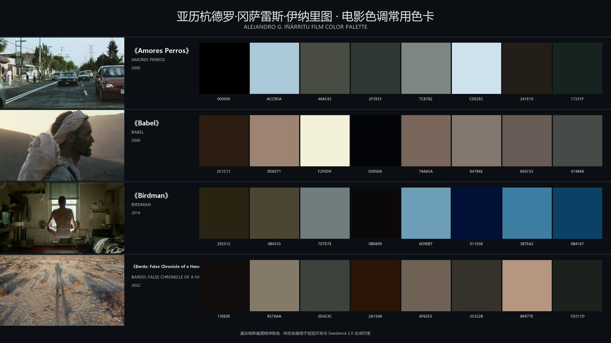
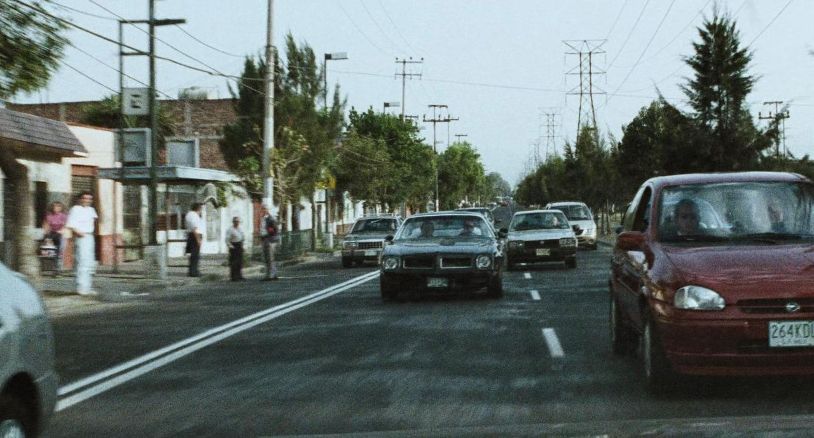
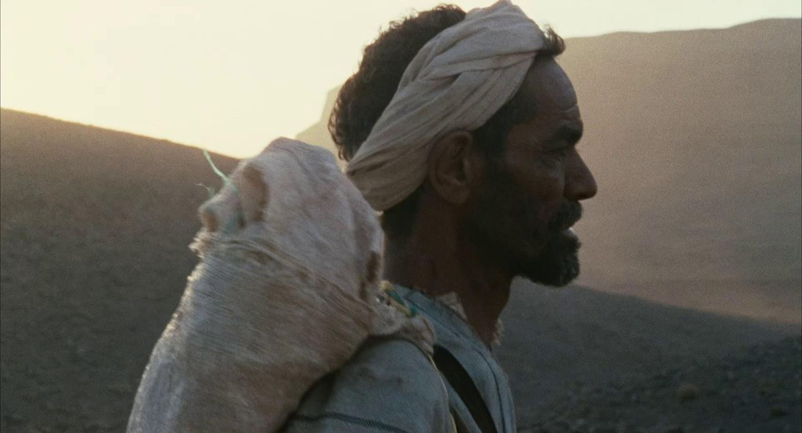
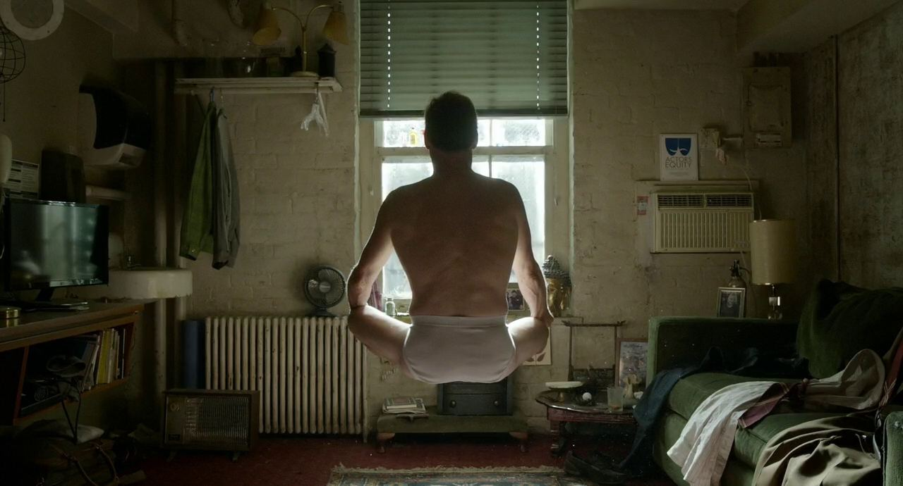
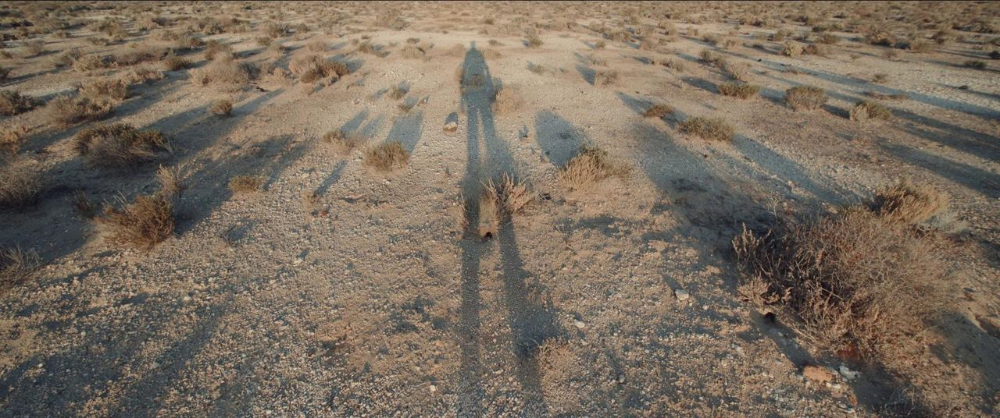

# 导演色卡 #042 — Alejandro G. Iñárritu 伊纳里图

> **分类**：03 大地暖调与自然光诗意 | **编号**：042 | **国籍**：墨西哥 | **活跃年代**：2000-至今 | **创建日期**：2026-08-01

---

## 一、核心风格一句话
> 长镜头追踪下的泥土与血暖交织，自然光中呼吸的肉体在生存的重量下发出真实的喘息。

---

## 二、色板构成

> 横版主色卡

### 主色板（6色）
| 色号 | HEX | 色彩名称 | 占比 | 来源说明 |
|------|-----|---------|------|---------|
| C01 | `#6B4423` | 泥土棕 | 25% | 荒野猎人雪泥与土地 |
| C02 | `#A87C50` | 兽皮黄 | 18% | 荒野猎人皮毛与荒野 |
| C03 | `#8B261A` | 凝血红 | 12% | 荒野猎人血迹与伤痕 |
| C04 | `#D9C4A3` | 暖米肤 | 15% | 鸟人后台暖调肤色 |
| C05 | `#4A5D6B` | 冷雾灰蓝 | 15% | 荒野猎人冰雪寒风 |
| C06 | `#E8A84C` | 夕照金 | 15% | 巴别塔摩洛哥沙漠 |

### 情绪色板（4色）
| 色号 | HEX | 色彩名称 | 情绪含义 |
|------|-----|---------|---------|
| E01 | `#C0392B` | 赤红痛楚 | 生存挣扎 |
| E02 | `#F4D03F` | 金色救赎 | 命运转机 |
| E03 | `#566573` | 灰蓝孤寂 | 存在疏离 |
| E04 | `#6E2C00` | 深棕大地 | 根脉归属 |

### 光影特征
- **主光方向**：natural available light, long take practical lighting, soft window fill
- **高光色偏**：warm amber / dirty gold
- **阴影色偏**：earthy brown / muted cool gray
- **对比比**：medium-high 60-75%，自然光中保留层次
- **色调整体**：warm earth and blood, 65% warm + 35% cool

---

## 三、视觉风格关键词
### 构图与运镜
long take roving camera · handheld intimate · wide-angle immersive · natural framing · continuous shot choreography · low angle grit · mirror/reflection framing · visceral close-up
### 色彩与光影
mud and blood warm tones · natural available light · amber interior glow · cold winter grey-blue · warm skin under stress · dirt and sweat · firelight flicker · dust in air
### 氛围与情绪
existential weight · human survival · interconnected fate · visceral physicality · cultural collision · spiritual longing · bitter triumph · breath and exhaustion

---

## 四、运镜特征
| 特征 | 说明 | 经典例子 |
|------|------|---------|
| 长镜头追踪 | 连续长镜头沉浸式追踪人物 | 《鸟人》后台一镜到底 |
| 手持呼吸感 | 手持微晃贴近人物生理感受 | 《荒野猎人》格拉斯爬行 |
| 广角沉浸 | 广角让环境包围人物 | 《荒野猎人》森林全景 |
| 自然光纪实 | 仅用可用光拍摄的真实质感 | 《荒野猎人》全部自然光 |
| 镜面反射 | 镜子与水面映射心理状态 | 《鸟人》更衣室镜子 |
| 低空跟拍 | 低角度贴近地面的跟随 | 《爱情是狗娘》街头 |
| 群像调度 | 多人物复杂场面调度 | 《巴别塔》多线叙事 |
| 喘息特写 | 极端特写捕捉呼吸与表情 | 《荒野猎人》面部特写 |

---

## 五、经典场景色彩参考
### 电影截图画廊
| 荒野猎人 | 鸟人 | 巴别塔 |
|--------|------|--------|
|  |  |  |
| 泥土棕+凝血红 · 生存荒野 | 暖米肤+夕照金 · 存在荒诞 | 兽皮黄+夕照金 · 命运交织 |

| 爱情是狗娘 | 21克 | 美错 |
|----------|------|------|
|  | *21克（剧照未收录）* | *美错（剧照未收录）* |
| 泥土棕+凝血红 · 城市残酷 | 冷雾灰蓝+暖米肤 · 生死重量 | 泥土棕+夕照金 · 底层温暖 |

伊纳里图的镜头是带着体温的——泥土棕是大地与伤口的底色，凝血红把生存的痛感刻进每一帧，夕照金在绝望的缝隙里洒下一点命运的温度。长镜头不让你喘息，手持感让你与人物一同奔跑，自然光不美化苦难，只让苦难在真实中变得神圣。

### 电影色彩速查
| 电影 | 场景 | 主导色 | 色彩氛围 |
|------|------|--------|---------|
| 荒野猎人 | 森林求生 | 泥土棕+凝血红 | 生存荒野 |
| 荒野猎人 | 雪夜寒风 | 冷雾灰蓝+泥土棕 | 绝境孤独 |
| 鸟人 | 后台长镜头 | 暖米肤+夕照金 | 存在荒诞 |
| 鸟人 | 屋顶城市 | 冷雾灰蓝+夕照金 | 疯狂救赎 |
| 巴别塔 | 摩洛哥沙漠 | 兽皮黄+夕照金 | 命运交织 |
| 巴别塔 | 东京夜 | 冷雾灰蓝+暖米肤 | 文化隔阂 |
| 爱情是狗娘 | 墨西哥城街头 | 泥土棕+凝血红 | 城市残酷 |
| 21克 | 医院与悲伤 | 冷雾灰蓝+暖米肤 | 生死重量 |

---

## 六、AI 生成提示词模板
### 图像生成速用公式
```
[subject description], in the style of Alejandro G. Iñárritu,
long take natural light, mud and blood warm tones,
handheld immersive camera, visceral physicality,
warm earth and cold winter palette, cinematic film grain,
anamorphic lens, existential weight atmosphere --ar 16:9 --style raw
```
### 视频生成速用公式
```
An Alejandro Iñárritu inspired cinematic scene, long take roving camera,
natural available light, mud and blood warm earth tones,
handheld intimate movement, visceral human survival,
wide-angle immersive composition, warm amber interior glow,
existential weight and interconnected fate, 16:9 cinematic
```

---

## 七、代表作索引
| 年份 | 片名 | 主要色彩特征 |
|------|------|-------------|
| 2000 | 爱情是狗娘 | 墨西哥城泥土红 |
| 2003 | 21克 | 生死冷灰暖肤 |
| 2006 | 巴别塔 | 多国多文化大地调 |
| 2010 | 美错 | 巴塞罗那底层暖棕 |
| 2014 | 鸟人 | 后台暖金长镜头 |
| 2015 | 荒野猎人 | 荒野泥土血与雪 |
| 2018 | 国家破产 | 未上映（概念） |
| 2022 | 诗人 | 墨西哥自传式记忆 |

---

## 八、蒸馏验证
- [x] 色板6+4色已提取
- [x] 运镜特征已归纳（8种）
- [x] 提示词模板已生成（MJ/SD/视频）
- [ ] 电影截图参考图已收集
- [ ] Stable Diffusion 实测试图
- [ ] Runway 视频测试
