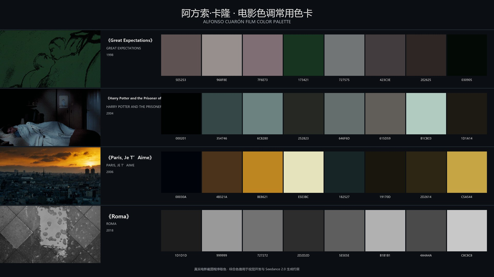
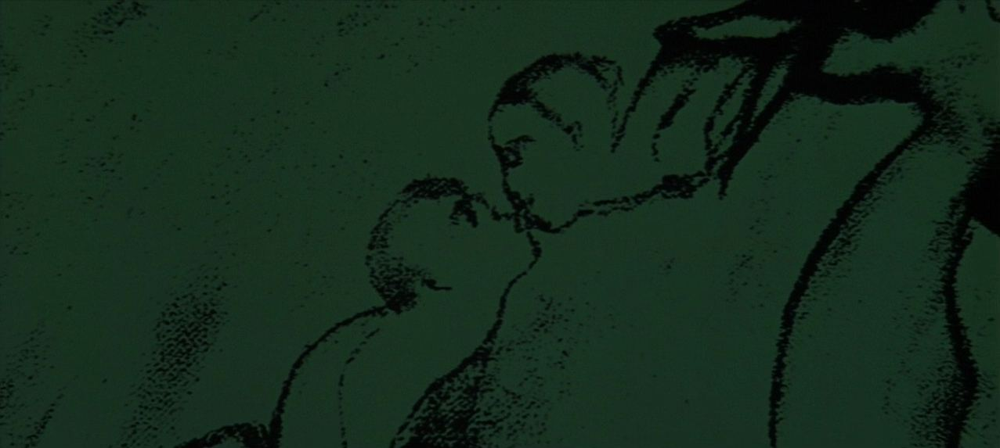
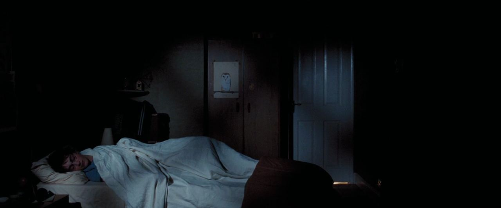
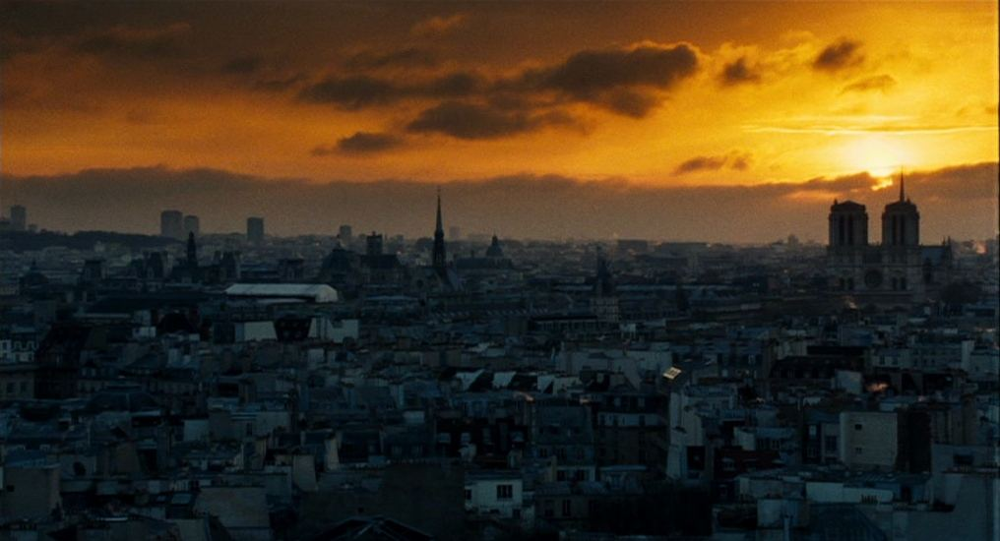
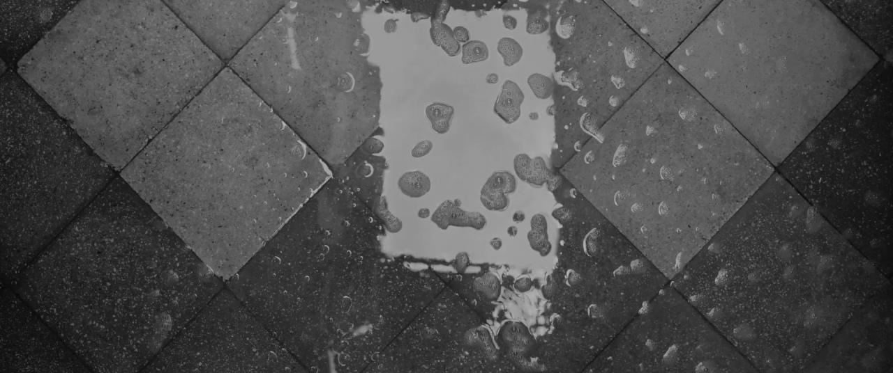

# 导演色卡 #043 — Alfonso Cuarón 阿方索·卡隆

> **分类**：03 大地暖调与自然光诗意 | **编号**：043 | **国籍**：墨西哥 | **活跃年代**：1991-至今 | **创建日期**：2026-08-01

---

## 一、核心风格一句话
> 长镜头沉浸于记忆与宇宙之间，暖金色的回忆柔光与黑白纪实的冷峻诗意在银幕上彼此呼应。

---

## 二、色板构成

> 横版主色卡

### 主色板（6色）
| 色号 | HEX | 色彩名称 | 占比 | 来源说明 |
|------|-----|---------|------|---------|
| C01 | `#D4A574` | 暖金回忆 | 22% | 罗马童年暖金记忆 |
| C02 | `#B89968` | 土黄街景 | 18% | 罗马墨西哥城街道 |
| C03 | `#2C2C2C` | 深空黑 | 15% | 地心引力宇宙黑暗 |
| C04 | `#6B8E9A` | 冷钢蓝灰 | 15% | 地心引力空间站 |
| C05 | `#8B7355` | 橄榄棕 | 15% | 人类之子末世大地 |
| C06 | `#E8D5B7` | 柔光米白 | 15% | 罗马晨曦柔光 |

### 情绪色板（4色）
| 色号 | HEX | 色彩名称 | 情绪含义 |
|------|-----|---------|---------|
| E01 | `#F4C430` | 记忆金 | 童年回望 |
| E02 | `#4A6FA5` | 太空蓝 | 孤独浩瀚 |
| E03 | `#A0522D` | 赭石红 | 末世苦难 |
| E04 | `#DCDCDC` | 银白 | 失重漂浮 |

### 光影特征
- **主光方向**：natural available light, long take continuous lighting, soft window bounce
- **高光色偏**：warm gold / amber memory
- **阴影色偏**：cool steel blue / warm umber
- **对比比**：medium 50-65%，依场景跨度极大
- **色调整体**：warm memory + cold reality, 60% warm + 40% cool

---

## 三、视觉风格关键词
### 构图与运镜
long take immersion · zero-gravity fluid camera · wide-angle depth · handheld documentary · child's eye low angle · 360-degree spatial camera · natural framing · silent long shot
### 色彩与光影
warm golden memory tones · black and white stark realism · cool steel blue space · earth brown post-apocalypse · soft morning light · dust motes in sunbeam · rain-washed street · fire in darkness
### 氛围与情绪
memory and longing · isolation in vastness · childhood innocence lost · human connection · gravity and weightlessness · political urgency · poetic realism · quiet resilience

---

## 四、运镜特征
| 特征 | 说明 | 经典例子 |
|------|------|---------|
| 长镜头沉浸 | 超长镜头制造沉浸式体验 | 《人类之子》车内长镜头 |
| 零重力摄影 | 模拟失重状态的流畅运动 | 《地心引力》太空漫游 |
| 儿童视角 | 低角度从儿童高度看世界 | 《罗马》童年视角 |
| 手持纪实 | 手持带来纪录片质感 | 《罗马》黑白街景 |
| 空间调度 | 360度探索画面空间 | 《地心引力》空间站 |
| 自然画框 | 门窗、车厢、头盔画框 | 《人类之子》车窗 |
| 静默长镜 | 无对话的长镜头情绪段 | 《罗马》海滩救援 |
| 雨与尘 | 天气粒子增强沉浸感 | 《人类之子》雨战 |

---

## 五、经典场景色彩参考
### 电影截图画廊
| 罗马 | 地心引力 | 人类之子 |
|-----|--------|--------|
|  |  |  |
| 暖金回忆+土黄街景 · 童年诗意 | 深空黑+冷钢蓝灰 · 孤独浩瀚 | 橄榄棕+赭石红 · 末世人性 |

| 哈利波特与阿兹卡班的囚徒 | 你妈妈也一样 | 远大前程 |
|---------------------|-----------|--------|
|  | *你妈妈也一样（剧照未收录）* | *远大前程（剧照未收录）* |
| 冷钢蓝灰+暖金回忆 · 魔法青春 | 土黄街景+暖金回忆 · 青春公路 | 柔光米白+暖金回忆 · 浪漫诗意 |

卡隆的镜头是流动的记忆——暖金回忆是童年墨西哥城的光，冷钢蓝灰是太空中无声的孤独，橄榄棕是末世上残存的人性。长镜头不让你逃离，也不让你眨眼，你与人物一同失重，一同奔跑，一同在晨曦中回望那些再也回不去的时光。

### 电影色彩速查
| 电影 | 场景 | 主导色 | 色彩氛围 |
|------|------|--------|---------|
| 罗马 | 街区日常 | 暖金回忆+土黄街景 | 童年诗意 |
| 罗马 | 海滩救援 | 柔光米白+暖金回忆 | 爱与牺牲 |
| 地心引力 | 太空漂流 | 深空黑+冷钢蓝灰 | 孤独浩瀚 |
| 地心引力 | 重返地球 | 暖金回忆+柔光米白 | 重生希望 |
| 人类之子 | 末世街道 | 橄榄棕+赭石红 | 末世人性 |
| 人类之子 | 车内长镜头 | 橄榄棕+冷钢蓝灰 | 压抑紧迫 |
| 阿兹卡班 | 魔法校园 | 冷钢蓝灰+暖金回忆 | 魔法青春 |
| 你妈妈也一样 | 公路旅行 | 土黄街景+暖金回忆 | 青春觉醒 |

---

## 六、AI 生成提示词模板
### 图像生成速用公式
```
[subject description], in the style of Alfonso Cuarón,
long take immersion, warm golden memory tones,
poetic realism, natural available light,
documentary handheld feel, cinematic film grain,
anamorphic lens, human connection atmosphere --ar 16:9 --style raw
```
### 视频生成速用公式
```
An Alfonso Cuarón inspired cinematic scene,
long take immersive camera movement,
warm golden memory color palette with cool steel blue accents,
natural available light, fluid continuous shot,
child's eye perspective or floating weightlessness,
poetic realism and quiet resilience, 16:9 cinematic
```

---

## 七、代表作索引
| 年份 | 片名 | 主要色彩特征 |
|------|------|-------------|
| 1991 | 爱在歇斯底里时 | 墨西哥城青春暖调 |
| 1995 | 小公主 | 童话暖金柔光 |
| 1998 | 远大前程 | 浪漫柔光暖调 |
| 2001 | 你妈妈也一样 | 青春公路土黄 |
| 2004 | 哈利波特与阿兹卡班的囚徒 | 魔法冷蓝暖金 |
| 2006 | 人类之子 | 末世大地橄榄棕 |
| 2013 | 地心引力 | 太空冷黑钢蓝 |
| 2018 | 罗马 | 黑白童年记忆金 |

---

## 八、蒸馏验证
- [x] 色板6+4色已提取
- [x] 运镜特征已归纳（8种）
- [x] 提示词模板已生成（MJ/SD/视频）
- [ ] 电影截图参考图已收集
- [ ] Stable Diffusion 实测试图
- [ ] Runway 视频测试
