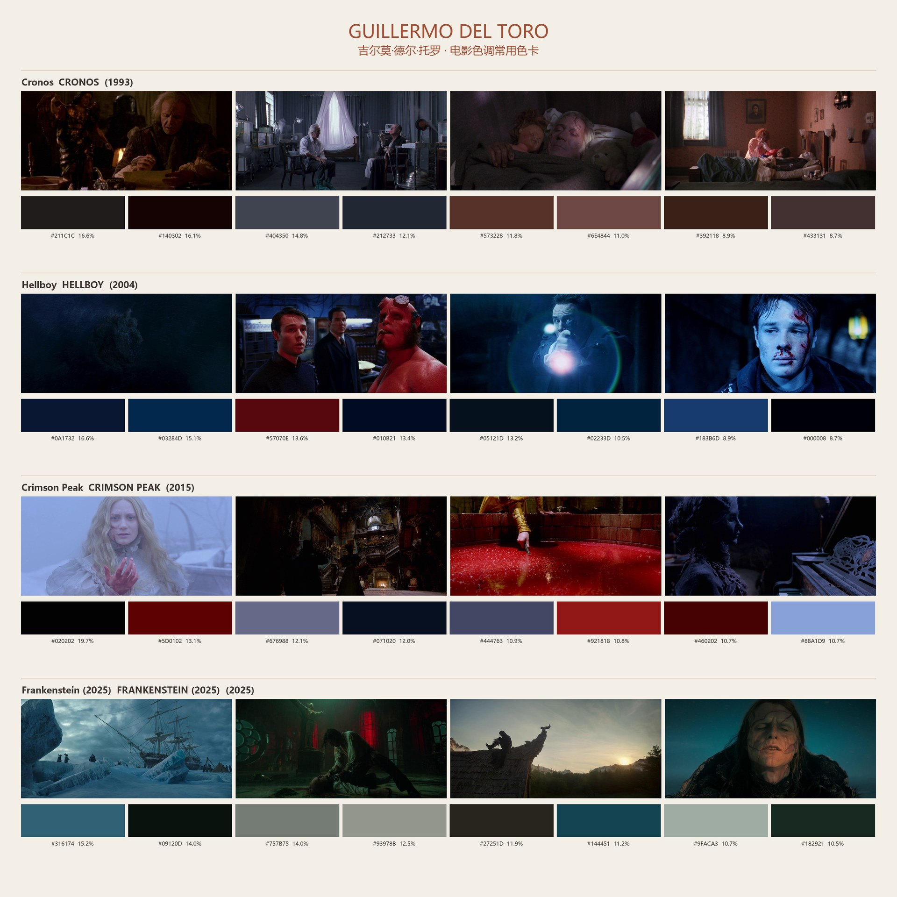
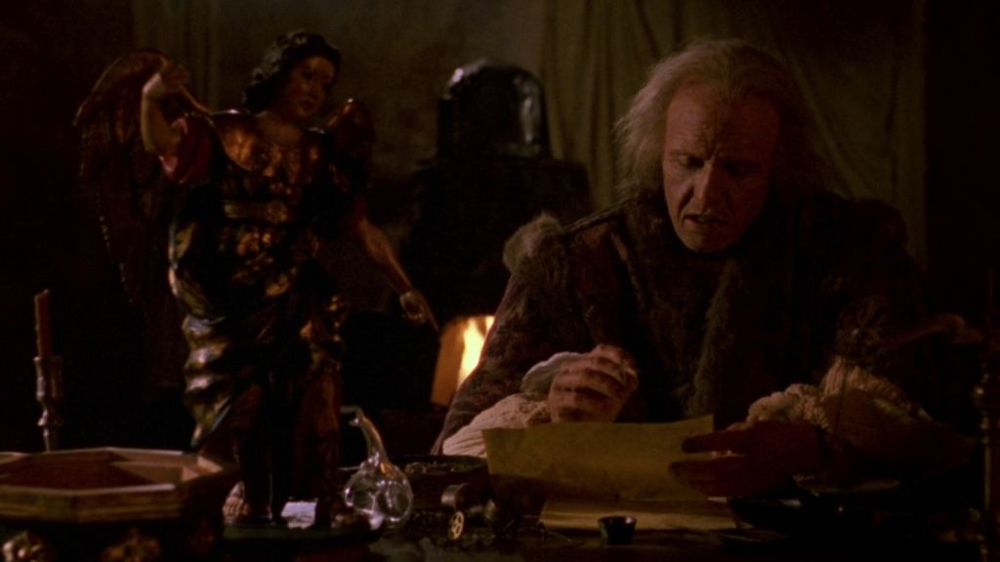
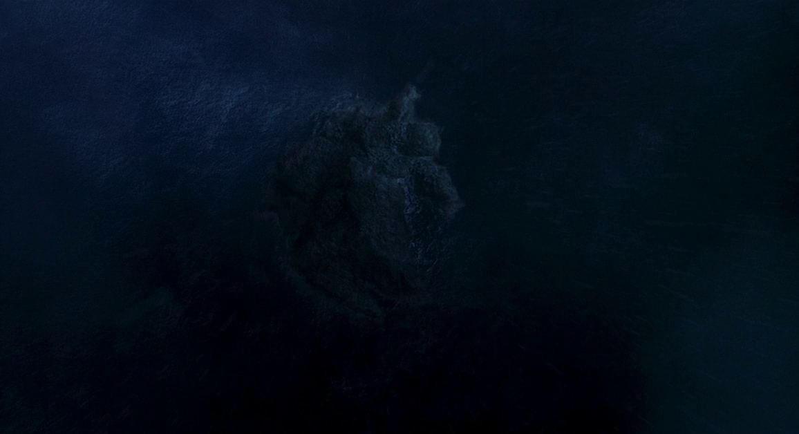
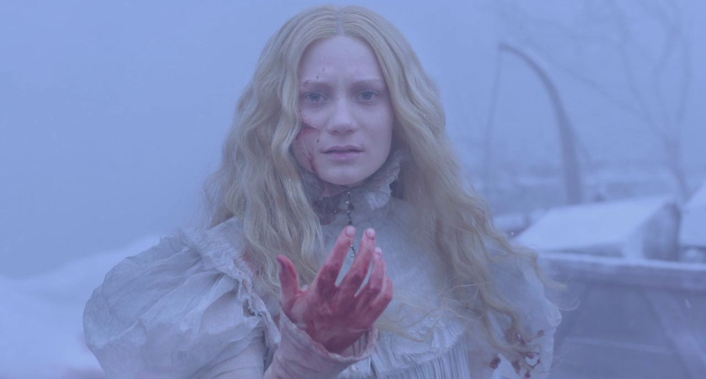
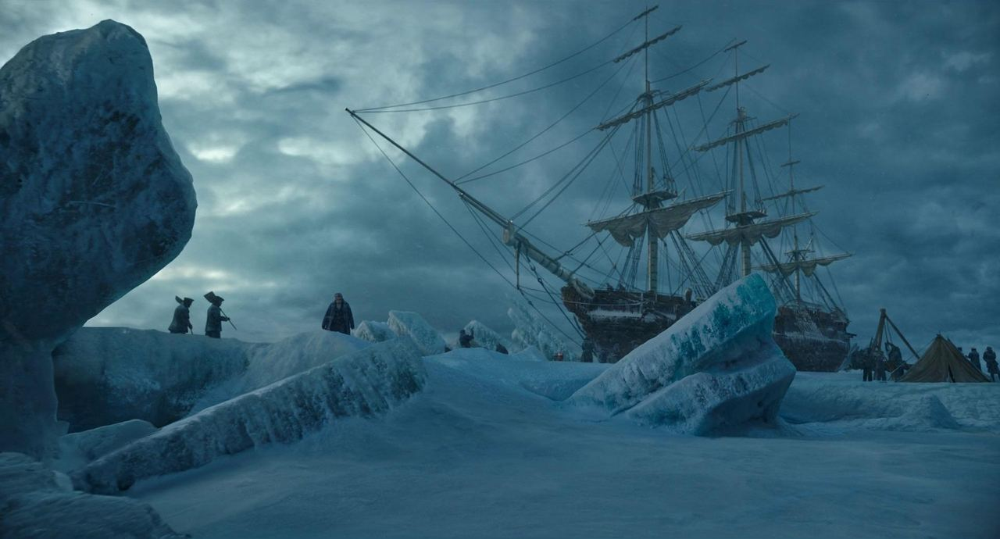

# 导演色卡 #044 — Guillermo del Toro 吉尔莫·德尔·托罗

> **分类**：03 大地暖调与自然光诗意 | **编号**：044 | **国籍**：墨西哥 | **活跃年代**：1993-至今 | **创建日期**：2026-08-01

---

## 一、核心风格一句话
> 琥珀色的童话与暗金色的神话相拥，暖黑哥特中怪物与人类共享着温柔与悲悯的诗意。

---

## 二、色板构成

> 横版主色卡

### 主色板（6色）
| 色号 | HEX | 色彩名称 | 占比 | 来源说明 |
|------|-----|---------|------|---------|
| C01 | `#3B220F` | 深棕琥珀 | 25% | 潘神的迷宫地下世界 |
| C02 | `#B8860B` | 暗金神话 | 20% | 水形物语实验室暖金 |
| C03 | `#1C1C1C` | 暖黑哥特 | 18% | 刀锋战士哥特底调 |
| C04 | `#D4A574` | 大地金棕 | 15% | 潘神的迷宫森林大地 |
| C05 | `#8B4513` | 赭石红木 | 12% | 水形物语复古室内 |
| C06 | `#F0E68C` | 蜜光黄 | 10% | 潘神的迷宫童话高光 |

### 情绪色板（4色）
| 色号 | HEX | 色彩名称 | 情绪含义 |
|------|-----|---------|---------|
| E01 | `#FFD700` | 童话金 | 纯真奇幻 |
| E02 | `#4682B4` | 深海蓝 | 孤寂爱意 |
| E03 | `#8B0000` | 暗红血 | 战争残酷 |
| E04 | `#556B2F` | 苔藓绿 | 神秘自然 |

### 光影特征
- **主光方向**：warm side lighting, amber practicals, soft fairy tale diffusion
- **高光色偏**：honey gold / amber yellow
- **阴影色偏**：warm black / deep brown (never pure cool black)
- **对比比**：high 70-85%，黑暗中保留琥珀层次
- **色调整体**：warm amber gothic, 80% warm + 20% cool

---

## 三、视觉风格关键词
### 构图与运镜
fairy tale symmetry · creature feature framing · gothic architecture · low angle monster reveal · warm candlelit interior · fantasy portal · symmetrical wide shot · creature close-up empathy
### 色彩与光影
amber fairy tale palette · warm black gothic · dark gold mythic tones · honey light diffusion · teal laboratory contrast · moss green forest magic · blood red violence · sepia memory glow
### 氛围与情绪
dark fairy tale wonder · sympathetic monsters · gothic romance · childhood imagination · anti-fascist resistance · love across difference · magical realism · melancholic beauty

---

## 四、运镜特征
| 特征 | 说明 | 经典例子 |
|------|------|---------|
| 童话对称构图 | 对称构图呼应童话寓言感 | 《水形物语》浴室对称 |
| 怪物低角度登场 | 低角度让怪物显得神圣而庄严 | 《潘神的迷宫》法翁 |
| 暖调蜡烛光 | 蜡烛与琥珀色灯具营造氛围 | 《水形物语》公寓 |
| 异世界入口 | 门/通道作为两个世界的接口 | 《潘神的迷宫》树洞 |
| 哥特建筑画框 | 拱廊、柱子、旋转楼梯画框人物 | 《猩红山峰》哥特庄园 |
| 生物特写共情 | 特写怪物眼睛制造共情 | 《水形物语》鱼人 |
| 奇幻慢镜头 | 魔法时刻用慢动作强化 | 《潘神的迷宫》白色人形 |
| 暖黑阴影 | 阴影偏暖棕而非纯黑 | 所有作品光影签名 |

---

## 五、经典场景色彩参考
### 电影截图画廊
| 潘神的迷宫 | 水形物语 | 环太平洋 |
|----------|--------|--------|
|  |  |  |
| 深棕琥珀+蜜光黄 · 童话奇幻 | 暗金神话+深海蓝 · 跨物爱恋 | 暖黑哥特+暗金神话 · 机甲史诗 |

| 猩红山峰 | 地狱男爵 | 魔鬼银爪 |
|--------|--------|--------|
|  | *地狱男爵（剧照未收录）* | *魔鬼银爪（剧照未收录）* |
| 暖黑哥特+暗红血 · 浪漫恐怖 | 暗金神话+赭石红木 · 英雄怪物 | 深棕琥珀+蜜光黄 · 永生寓言 |

德尔·托罗的世界是被琥珀封存的童话——深棕琥珀是地下王国与旧日时光的底色，暗金神话让怪物与英雄同样庄严，暖黑哥特从不吞没细节，反而在阴影里藏着更多温柔。怪物从来不是反派，孤独的人才是；在琥珀色的光里，异类之间的爱意比任何人类的誓言都更真诚。

### 电影色彩速查
| 电影 | 场景 | 主导色 | 色彩氛围 |
|------|------|--------|---------|
| 潘神的迷宫 | 地下王国 | 深棕琥珀+蜜光黄 | 童话奇幻 |
| 潘神的迷宫 | 西班牙内战 | 赭石红木+暗红血 | 战争残酷 |
| 水形物语 | 实验室浴室 | 暗金神话+深海蓝 | 跨物爱恋 |
| 水形物语 | 公寓影院 | 暖黑哥特+暗金神话 | 孤独温情 |
| 环太平洋 | 机甲基地 | 暖黑哥特+暗金神话 | 机甲史诗 |
| 猩红山峰 | 哥特庄园 | 暖黑哥特+暗红血 | 浪漫恐怖 |
| 地狱男爵 | 超自然调查局 | 暗金神话+赭石红木 | 英雄怪物 |
| 魔鬼银爪 | 古董店钟楼 | 深棕琥珀+蜜光黄 | 永生寓言 |

---

## 六、AI 生成提示词模板
### 图像生成速用公式
```
[subject description], in the style of Guillermo del Toro,
amber fairy tale palette, warm black gothic atmosphere,
dark gold mythic tones, sympathetic creature design,
magical realism, candlelit warm lighting,
cinematic film grain, anamorphic lens --ar 16:9 --style raw
```
### 视频生成速用公式
```
A Guillermo del Toro inspired dark fairy tale scene,
amber warm color palette with dark gold and warm black gothic tones,
symmetrical fairy tale composition, sympathetic monster,
candlelit warm lighting, magical portal or gothic architecture,
melancholic beauty and wonder, 16:9 cinematic
```

---

## 七、代表作索引
| 年份 | 片名 | 主要色彩特征 |
|------|------|-------------|
| 1993 | 魔鬼银爪 | 深棕琥珀永生寓言 |
| 1997 | 变种DNA | 暖黑哥特地下虫灾 |
| 2001 | 鬼童院 | 琥珀色西班牙内战鬼故事 |
| 2004 | 地狱男爵 | 暗金神话英雄怪物 |
| 2006 | 潘神的迷宫 | 琥珀童话内战残酷 |
| 2008 | 地狱男爵2黄金军团 | 暗金神话精灵世界 |
| 2013 | 环太平洋 | 暖黑哥特机甲史诗 |
| 2015 | 猩红山峰 | 暖黑哥特浪漫恐怖 |
| 2017 | 水形物语 | 暗金神话跨物爱情 |
| 2021 | 玉面情魔 | 暗黑嘉年华琥珀调 |
| 2022 | 匹诺曹 | 定格动画暗金童话 |

---

## 八、蒸馏验证
- [x] 色板6+4色已提取
- [x] 运镜特征已归纳（8种）
- [x] 提示词模板已生成（MJ/SD/视频）
- [ ] 电影截图参考图已收集
- [ ] Stable Diffusion 实测试图
- [ ] Runway 视频测试
