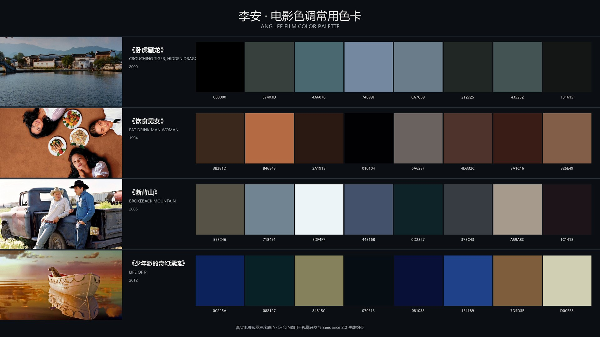
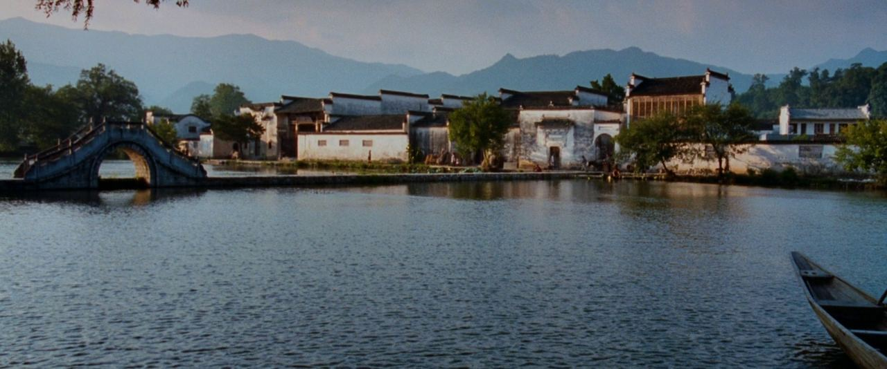
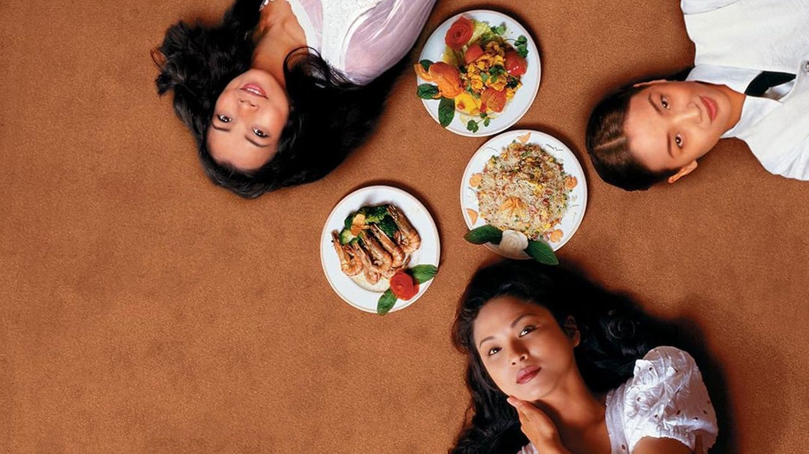
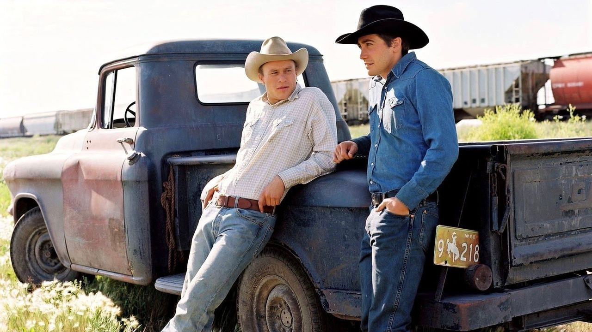

# 导演色卡 #045 — Ang Lee 李安

> **分类**：03 大地暖调与自然光诗意 | **编号**：045 | **国籍**：中国台湾 / 美国 | **活跃年代**：1991-至今 | **创建日期**：2026-08-01

---

## 一、核心风格一句话
> 温润柔光里东西方美学悄然融合，大地的沉默与人心的克制在每一帧里都如诗如画。

---

## 二、色板构成

> 横版主色卡

### 主色板（6色）
| 色号 | HEX | 色彩名称 | 占比 | 来源说明 |
|------|-----|---------|------|---------|
| C01 | `#C2A676` | 温润玉黄 | 20% | 卧虎藏龙竹林柔光 |
| C02 | `#5A6B4A` | 竹林青灰 | 18% | 卧虎藏龙飞檐竹海 |
| C03 | `#8B7355` | 大地赭棕 | 17% | 断背山山野大地 |
| C04 | `#E8D5B7` | 暖沙米白 | 15% | 饮食男女家常暖光 |
| C05 | `#3D4F3F` | 深松绿 | 15% | 少年派森林与海藻 |
| C06 | `#D68C45` | 暖阳橙 | 15% | 断背山黄昏牧场 |

### 情绪色板（4色）
| 色号 | HEX | 色彩名称 | 情绪含义 |
|------|-----|---------|---------|
| E01 | `#98D8C8` | 翡翠青 | 东方诗意 |
| E02 | `#F4A460` | 夕阳橙 | 禁忌爱恋 |
| E03 | `#1E3A5F` | 深海蓝 | 命运孤独 |
| E04 | `#DEB887` | 暖棕茶 | 家庭温情 |

### 光影特征
- **主光方向**：soft diffused natural light, gentle side lighting, warm window fill
- **高光色偏**：warm sand yellow / pale gold
- **阴影色偏**：earth brown / muted green (never harsh)
- **对比比**：low-medium 40-55%，柔和温润
- **色调整体**：warm earth and soft green, 65% warm + 35% cool

---

## 三、视觉风格关键词
### 构图与运镜
soft diffused light · landscape meditation · static balanced frame · gentle tracking · nature as emotional mirror · martial arts poetry · family interior warmth · water surface reflection
### 色彩与光影
warm earth natural palette · soft jade green · bamboo forest light · golden hour meadow · warm family interior · ocean twilight blue · tea brown nostalgia · pastel restraint
### 氛围与情绪
quiet restraint · eastern-western fusion · forbidden longing · family duty vs freedom · poetic nature · gentle melancholy · spiritual journey · compassionate humanity

---

## 四、运镜特征
| 特征 | 说明 | 经典例子 |
|------|------|---------|
| 温润柔光 | 柔光散射，不硬不刺 | 《卧虎藏龙》竹林打斗 |
| 静框构图 | 稳定构图如卷轴画 | 《饮食男女》家庭场景 |
| 自然为镜 | 自然风景映照人物心境 | 《断背山》山野四季 |
| 武侠诗意 | 武打如舞蹈，轻盈飘逸 | 《卧虎藏龙》飞檐走壁 |
| 水面对称 | 水面倒影构图对称 | 《少年派》海洋镜像 |
| 缓慢推进 | 缓缓进入人物内心 | 《色·戒》情感递进 |
| 家庭暖光 | 室内暖黄营造家的感觉 | 父亲三部曲 |
| 四季更迭 | 时间流逝用季节变化 | 《断背山》年复一年 |

---

## 五、经典场景色彩参考
### 电影截图画廊
| 卧虎藏龙 | 断背山 | 少年派的奇幻漂流 |
|--------|-------|---------------|
|  |  |  |
| 温润玉黄+竹林青灰 · 武侠诗意 | 大地赭棕+暖阳橙 · 禁忌爱恋 | 深松绿+深海蓝 · 灵性旅程 |

| 饮食男女 | 喜宴 | 理智与情感 |
|--------|------|----------|
|  | *喜宴（剧照未收录）* | *理智与情感（剧照未收录）* |
| 暖沙米白+暖棕茶 · 家庭温情 | 温润玉黄+暖沙米白 · 文化碰撞 | 大地赭棕+暖沙米白 · 英伦克制 |

李安的电影是一杯温茶——温润玉黄是东方美学的底色，大地赭棕是西方土地的呼吸，竹林青灰在风中轻轻摇曳，暖阳橙把隐秘的爱意烘得微醺。他不呐喊，不煽情，只让光柔下来，让镜头静下来，让东西方的灵魂在同一片月光下彼此照见。

### 电影色彩速查
| 电影 | 场景 | 主导色 | 色彩氛围 |
|------|------|--------|---------|
| 卧虎藏龙 | 竹林打斗 | 温润玉黄+竹林青灰 · 武侠诗意 |
| 卧虎藏龙 | 山庄夜战 | 深松绿+温润玉黄 | 飘逸空灵 |
| 断背山 | 山野牧场 | 大地赭棕+暖阳橙 | 禁忌爱恋 |
| 断背山 | 冬日重逢 | 暖沙米白+大地赭棕 | 隐忍思念 |
| 少年派 | 海上漂流 | 深松绿+深海蓝 | 灵性旅程 |
| 饮食男女 | 家宴厨房 | 暖沙米白+暖棕茶 | 家庭温情 |
| 喜宴 | 纽约华人婚礼 | 温润玉黄+暖沙米白 | 文化碰撞 |
| 理智与情感 | 英国乡村庄园 | 大地赭棕+暖沙米白 | 英伦克制 |

---

## 六、AI 生成提示词模板
### 图像生成速用公式
```
[subject description], in the style of Ang Lee,
soft diffused natural light, warm earth palette,
eastern-western fusion aesthetic, gentle melancholy,
nature as emotional mirror, poetic cinematic composition,
cinematic film grain, 35mm anamorphic --ar 16:9 --style raw
```
### 视频生成速用公式
```
An Ang Lee inspired cinematic scene,
soft diffused warm natural light, warm earth and soft green palette,
eastern-western fusion aesthetic, quiet restraint,
balanced static composition with gentle camera movement,
nature reflecting inner emotion, gentle melancholy,
35mm film grain, 16:9 cinematic
```

---

## 七、代表作索引
| 年份 | 片名 | 主要色彩特征 |
|------|------|-------------|
| 1991 | 推手 | 纽约家庭暖调温情 |
| 1993 | 喜宴 | 中西文化碰撞暖调 |
| 1994 | 饮食男女 | 台北家宴暖棕茶 |
| 1995 | 理智与情感 | 英伦乡村大地棕 |
| 1997 | 冰风暴 | 70年代美国家庭冷调 |
| 2000 | 卧虎藏龙 | 竹林玉黄武侠诗意 |
| 2003 | 绿巨人浩克 | 深松绿科幻心理 |
| 2005 | 断背山 | 山野大地赭棕 |
| 2007 | 色·戒 | 民国上海暖金暗调 |
| 2012 | 少年派的奇幻漂流 | 海洋深绿蓝灵性 |
| 2016 | 比利·林恩的中场战事 | 战地与舞台冷暖 |
| 2019 | 双子杀手 | 现代动作冷暖交织 |

---

## 八、蒸馏验证
- [x] 色板6+4色已提取
- [x] 运镜特征已归纳（8种）
- [x] 提示词模板已生成（MJ/SD/视频）
- [ ] 电影截图参考图已收集
- [ ] Stable Diffusion 实测试图
- [ ] Runway 视频测试
