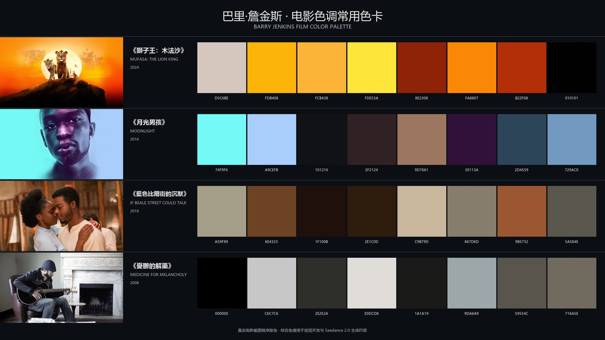
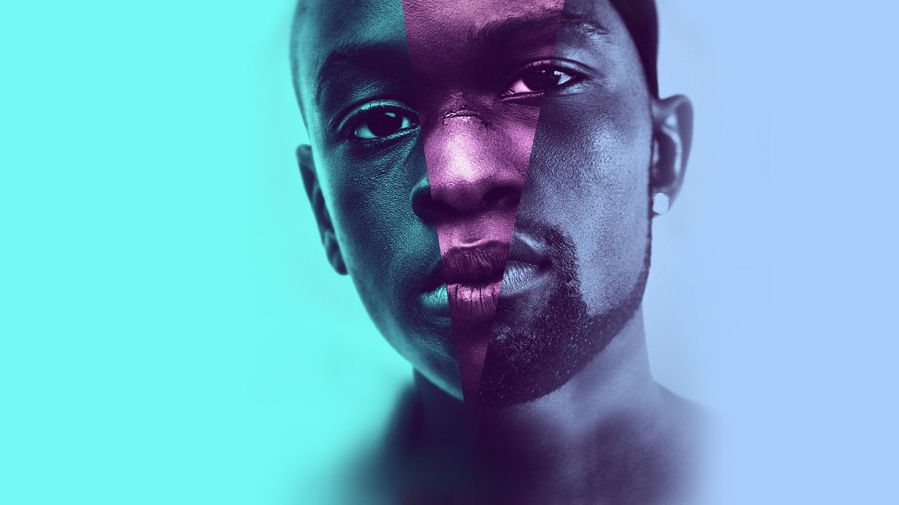
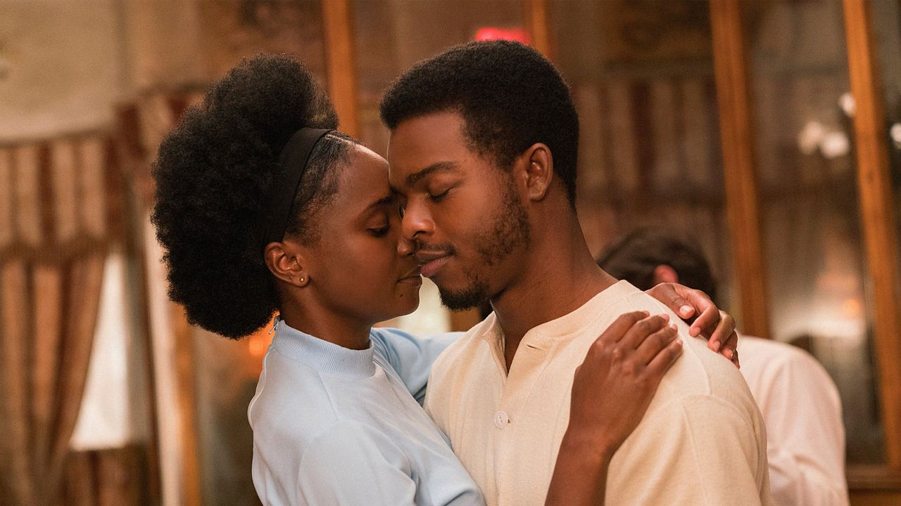
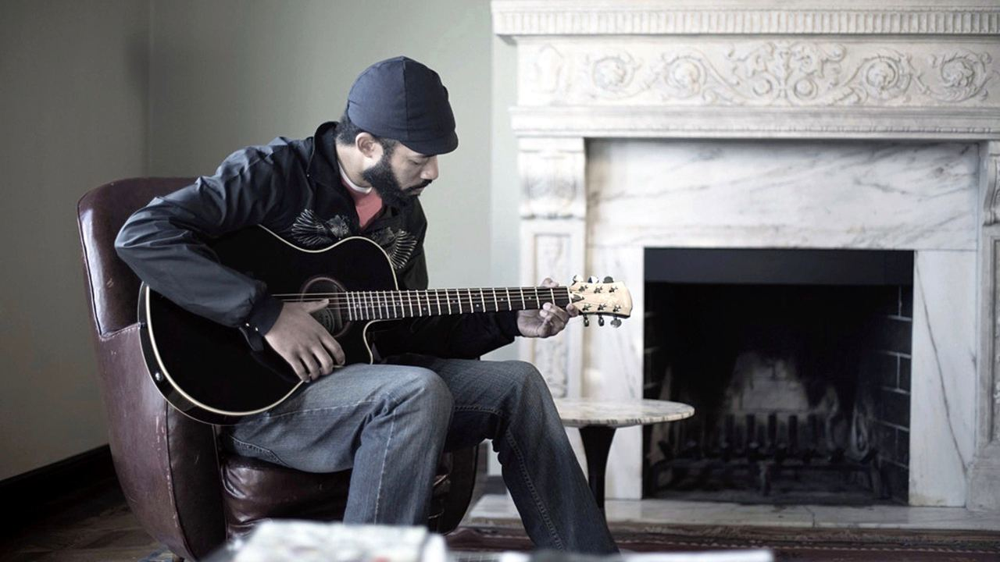

# 导演色卡 #046 — Barry Jenkins 巴里·詹金斯

> **分类**：03 大地暖调与自然光诗意 | **编号**：046 | **国籍**：美国 | **活跃年代**：2008-至今 | **创建日期**：2026-08-01

---

## 一、核心风格一句话
> 饱和温暖的肤色在蓝紫暮光中呼吸，城市诗意里黑人的生命与爱情被光温柔地捧起。

---

## 二、色板构成

> 横版主色卡

### 主色板（6色）
| 色号 | HEX | 色彩名称 | 占比 | 来源说明 |
|------|-----|---------|------|---------|
| C01 | `#C68642` | 暖金褐肤 | 22% | 月光男孩饱和肤色 |
| C02 | `#3A2E5F` | 暮光紫蓝 | 20% | 月光男孩迈阿密夜色 |
| C03 | `#8B5A2B` | 深棕暖肤 | 15% | 假若比尔街能说话 |
| C04 | `#D4A574` | 阳光金棕 | 15% | 月光男孩海滩日光 |
| C05 | `#2E5E4E` | 墨绿青蓝 | 14% | 月光男孩泳池场景 |
| C06 | `#E8C99B` | 暖沙金 | 14% | 比尔街暖黄街灯 |

### 情绪色板（4色）
| 色号 | HEX | 色彩名称 | 情绪含义 |
|------|-----|---------|---------|
| E01 | `#FF8C42` | 橙红热情 | 爱与渴望 |
| E02 | `#7B68EE` | 靛蓝紫梦 | 梦幻少年 |
| E03 | `#F0E68C` | 柔黄希望 | 温柔未来 |
| E04 | `#4A0E0E` | 深酒红 | 苦难深情 |

### 光影特征
- **主光方向**：soft warm key with color fill, practical neon/tungsten, natural window light
- **高光色偏**：warm gold / orange sunset
- **阴影色偏**：deep purple-blue / teal green
- **对比比**：medium-high 60-75%，肤色始终暖调
- **色调整体**：warm skin + cool purple/teal environment, 55% warm + 45% cool

---

## 三、视觉风格关键词
### 构图与运镜
slow push-in intimacy · centered portrait · circular camera movement · soft shallow focus · negative space loneliness · streetlamp silhouette · tender close-up · mirror/glass reflection
### 色彩与光影
saturated warm brown skin · twilight purple-blue · teal pool water · golden hour beach · warm tungsten streetlight · deep blue night · orange sunset haze · yellow memory glow
### 氛围与情绪
tender black masculinity · queer love and longing · urban poetry · childhood memory · racial injustice · gentle intimacy · dreamlike memory · resilience and hope

---

## 四、运镜特征
| 特征 | 说明 | 经典例子 |
|------|------|---------|
| 缓慢推近 | 温柔推近进入人物内心 | 《月光男孩》奇伦凝视 |
| 居中肖像 | 人物居中直视镜头 | 《月光男孩》三段肖像 |
| 环绕运动 | 摄影机环绕双人舞蹈 | 《假若比尔街能说话》跳舞 |
| 浅景深柔焦 | 柔和散景突出主体 | 《月光男孩》海滩约会 |
| 街灯剪影 | 路灯下人物剪影 | 《月光男孩》街角相遇 |
| 镜面倒影 | 水面/镜面对称构图 | 《月光男孩》泳池水面 |
| 色彩分章 | 不同章节不同色调 | 《月光男孩》三段式 |
| 窗户画框 | 窗框门框隔离与渴望 | 《假若比尔街能说话》监狱探视 |

---

## 五、经典场景色彩参考
### 电影截图画廊
| 月光男孩 | 假若比尔街能说话 | 月光下的布鲁斯男孩 |
|--------|---------------|---------------|
|  |  |  |
| 暖金褐肤+暮光紫蓝 · 成长诗意 | 深棕暖肤+暖沙金 · 爱情正义 | 暖金褐肤+墨绿青蓝 · 少年孤独 |

| 药剂师 | 亲爱的白人们 | 青春焦虑 |
|------|-----------|--------|
|  | *亲爱的白人们（剧照未收录）* | *青春焦虑（剧照未收录）* |
| 墨绿青蓝+暖金褐肤 · 城市漫步 | 深棕暖肤+暮光紫蓝 · 校园身份 | 阳光金棕+暖沙金 · 青春迷茫 |

詹金斯的镜头是给黑色皮肤的一封情书——暖金褐肤在暮光紫蓝里被温柔地照亮，深棕暖肤在街灯的暖光中诉说着爱情与尊严。迈阿密的海滩泛着墨绿青蓝，哈莱姆的街道流淌着暖沙金，在这个世界里，黑人的脆弱、温柔与渴望终于被堂堂正正地看见。

### 电影色彩速查
| 电影 | 场景 | 主导色 | 色彩氛围 |
|------|------|--------|---------|
| 月光男孩 | 海滩初夜 | 暖金褐肤+暮光紫蓝 | 成长诗意 |
| 月光男孩 | 校园泳池 | 暖金褐肤+墨绿青蓝 | 少年孤独 |
| 假若比尔街能说话 | 哈莱姆街道 | 深棕暖肤+暖沙金 | 爱情正义 |
| 假若比尔街能说话 | 监狱探视 | 深棕暖肤+暮光紫蓝 | 分离思念 |
| 月光下的布鲁斯男孩 | 街角夜晚 | 暖金褐肤+暮光紫蓝 | 暗夜温柔 |
| 药剂师 | 旧金山漫步 | 墨绿青蓝+暖金褐肤 | 城市邂逅 |
| 亲爱的白人们 | 大学校园 | 深棕暖肤+暮光紫蓝 | 身份认同 |
| 地下铁道 | 南方逃亡 | 深棕暖肤+阳光金棕 | 自由苦难 |

---

## 六、AI 生成提示词模板
### 图像生成速用公式
```
[subject description], in the style of Barry Jenkins,
saturated warm brown skin, twilight purple-blue palette,
tender intimacy, urban poetry,
soft shallow focus, slow push-in composition,
cinematic film grain, anamorphic lens --ar 16:9 --style raw
```
### 视频生成速用公式
```
A Barry Jenkins inspired cinematic scene,
saturated warm brown skin tones against twilight purple-blue night,
tender intimacy and gentle camera movement,
soft shallow depth of field, centered portrait composition,
urban poetry and queer love atmosphere,
warm golden hour and cool night contrast,
35mm film grain, 16:9 cinematic
```

---

## 七、代表作索引
| 年份 | 片名 | 主要色彩特征 |
|------|------|-------------|
| 2008 | 药剂师 | 旧金山城市青蓝暖肤 |
| 2016 | 月光男孩 | 迈阿密暮光紫蓝成长 |
| 2018 | 假若比尔街能说话 | 哈莱姆暖金爱情正义 |
| 2021 | 地下铁道 | 南方逃亡暖棕冷蓝 |
| 2024 | 米莉·戴维斯 | 未上映（概念暖调） |
| / | 亲爱的白人们（制片） | 校园身份紫蓝调 |
| / | 青春焦虑（制片） | 青春阳光金棕 |
| / | 蓝调女王（制片） | 爵士年代暖调 |

---

## 八、蒸馏验证
- [x] 色板6+4色已提取
- [x] 运镜特征已归纳（8种）
- [x] 提示词模板已生成（MJ/SD/视频）
- [ ] 电影截图参考图已收集
- [ ] Stable Diffusion 实测试图
- [ ] Runway 视频测试
