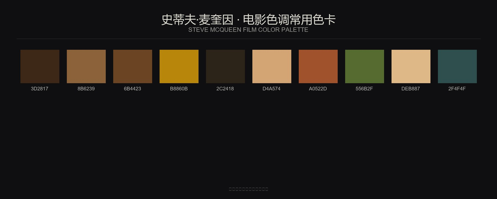
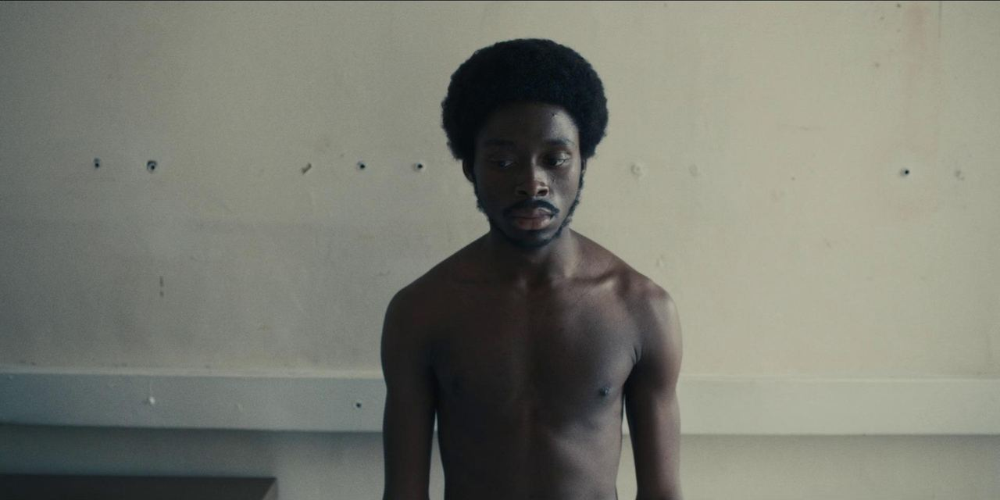
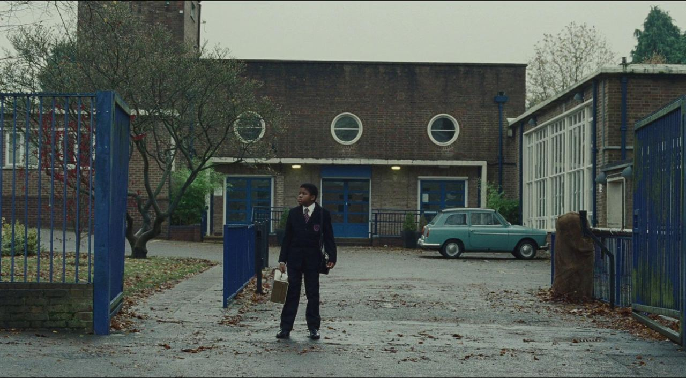
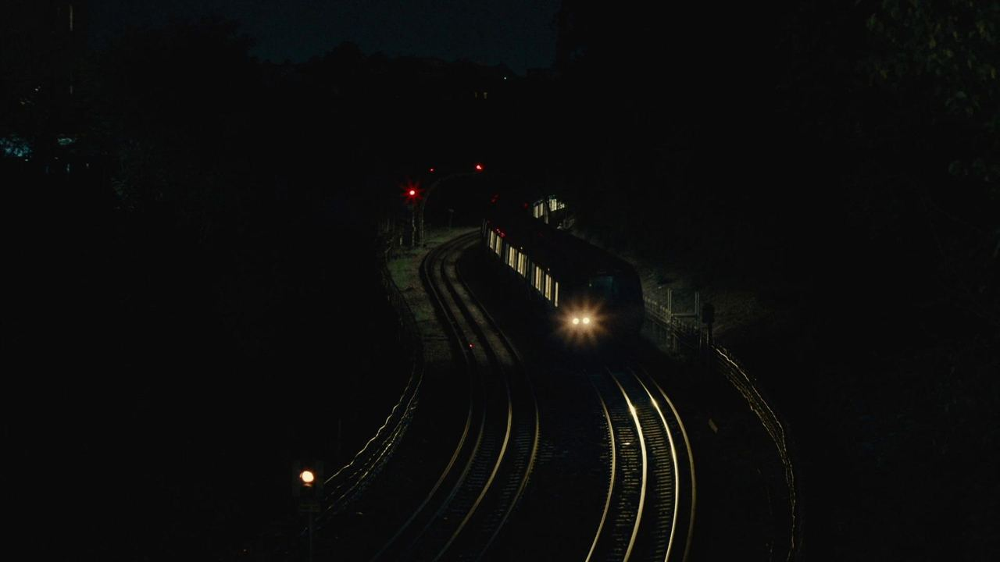

# 导演色卡 #047 — Steve McQueen 史蒂夫·麦奎因

> **分类**：03 大地暖调与自然光诗意 | **编号**：047 | **国籍**：英国 | **活跃年代**：2008-至今 | **创建日期**：2026-08-01

---

## 一、核心风格一句话
> 油画般的暖暗肤色在历史的重量中静默，克制的镜头里苦难与尊严在同一束光中并存。

---

## 二、色板构成

> 横版主色卡

### 主色板（6色）
| 色号 | HEX | 色彩名称 | 占比 | 来源说明 |
|------|-----|---------|------|---------|
| C01 | `#3D2817` | 深棕油画 | 25% | 为奴十二年南方种植园 |
| C02 | `#8B6239` | 赭石暖肤 | 20% | 为奴十二年日光下的皮肤 |
| C03 | `#6B4423` | 泥土红棕 | 15% | 羞耻都市克制色调 |
| C04 | `#B8860B` | 暗金历史 | 15% | 为奴十二年黄昏田野 |
| C05 | `#2C2418` | 暖棕墨黑 | 15% | 寡妇联盟夜色底色 |
| C06 | `#D4A574` | 暖土金 | 10% | 历史题材的记忆柔光 |

### 情绪色板（4色）
| 色号 | HEX | 色彩名称 | 情绪含义 |
|------|-----|---------|---------|
| E01 | `#A0522D` | 赭红愤怒 | 反抗与力量 |
| E02 | `#556B2F` | 橄榄军绿 | 压迫秩序 |
| E03 | `#DEB887` | 暖金温柔 | 人性微光 |
| E04 | `#2F4F4F` | 冷钢灰 | 都市疏离 |

### 光影特征
- **主光方向**：painterly side lighting, natural available light, warm window bounce
- **高光色偏**：ochre gold / honey amber
- **阴影色偏**：warm brown-black / deep umber (never cool)
- **对比比**：medium-high 65-75%，油画般层次
- **色调整体**：warm earth historical, 85% warm + 15% cool

---

## 三、视觉风格关键词
### 构图与运镜
painterly composition · long static take · close-up endurance · natural framing · shallow depth of field isolation · handheld urgency · historical tableaux · intimate suffering
### 色彩与光影
warm brown skin tones · ochre historical palette · painterly chiaroscuro · deep umber shadows · honey gold highlights · earth red soil · muted desaturated color · natural daylight realism
### 氛围与情绪
historical weight · quiet resistance · human dignity · intimate trauma · systemic injustice · visceral physicality · restrained passion · moral urgency

---

## 四、运镜特征
| 特征 | 说明 | 经典例子 |
|------|------|---------|
| 油画构图 | 如古典油画般的光影布局 | 《为奴十二年》田野劳作 |
| 长镜头静观 | 长时间固定镜头考验观众 | 《饥饿》绝食抗议 |
| 特写忍耐 | 长时间特写承受痛苦 | 《羞耻》面部特写 |
| 自然画框 | 门框窗棂隔绝人物 | 《为奴十二年》囚笼 |
| 浅焦孤立 | 浅景深把人物从环境剥离 | 《羞耻》都市孤独 |
| 手持紧迫 | 手持增强混乱与紧迫 | 《寡妇联盟》抢劫 |
| 历史群像 | 群像构图如历史画卷 | 《小斧子》集体场景 |
| 静默张力 | 无对话场景中的情绪积累 | 《为奴十二年》绞刑架 |

---

## 五、经典场景色彩参考
### 电影截图画廊
| 为奴十二年 | 羞耻 | 寡妇联盟 |
|---------|------|--------|
|  |  |  |
| 深棕油画+赭石暖肤 · 历史苦难 | 泥土红棕+冷钢灰 · 都市沉沦 | 暖棕墨黑+暗金历史 · 女性力量 |

| 饥饿 | 小斧子 | 红树林 |
|------|------|------|
|  | *小斧子（剧照未收录）* | *红树林（剧照未收录）* |
| 深棕油画+橄榄军绿 · 政治抗争 | 赭石暖肤+暖土金 · 集体记忆 | 深棕油画+赭石暖肤 · 种族正义 |

麦奎因的镜头是历史的画框——深棕油画是南方种植园的暮色，赭石暖肤是被奴役者不灭的尊严，暗金历史在时间的尘埃里微微发光。他不回避苦难，也不渲染痛苦；在克制的长镜头里，你必须与人物一同忍耐，一同呼吸，一同在沉默中积蓄反抗的力量。

### 电影色彩速查
| 电影 | 场景 | 主导色 | 色彩氛围 |
|------|------|--------|---------|
| 为奴十二年 | 棉花田劳作 | 深棕油画+赭石暖肤 | 历史苦难 |
| 为奴十二年 | 木屋暗夜 | 暖棕墨黑+赭石暖肤 | 恐惧绝望 |
| 羞耻 | 纽约都市 | 泥土红棕+冷钢灰 | 都市沉沦 |
| 羞耻 | 酒店房间 | 泥土红棕+暖土金 | 亲密空虚 |
| 寡妇联盟 | 抢劫行动 | 暖棕墨黑+暗金历史 | 女性力量 |
| 饥饿 | 监狱绝食 | 深棕油画+橄榄军绿 | 政治抗争 |
| 小斧子 | 伦敦社区 | 赭石暖肤+暖土金 | 集体记忆 |
| 红树林 | 法庭审判 | 深棕油画+赭石暖肤 | 种族正义 |

---

## 六、AI 生成提示词模板
### 图像生成速用公式
```
[subject description], in the style of Steve McQueen,
painterly warm brown palette, historical weight,
natural available light, ochre and umber tones,
long take stillness, human dignity and suffering,
cinematic film grain, anamorphic lens --ar 16:9 --style raw
```
### 视频生成速用公式
```
A Steve McQueen inspired cinematic scene,
painterly warm brown and ochre historical color palette,
long static take with quiet tension,
natural available light, chiaroscuro lighting,
historical weight and human dignity,
restrained but visceral emotion,
35mm film grain, 16:9 cinematic
```

---

## 七、代表作索引
| 年份 | 片名 | 主要色彩特征 |
|------|------|-------------|
| 2008 | 饥饿 | 监狱深棕政治抗争 |
| 2011 | 羞耻 | 纽约泥土红棕沉沦 |
| 2013 | 为奴十二年 | 南方深棕历史油画 |
| 2018 | 寡妇联盟 | 犯罪暖黑女性力量 |
| 2020 | 小斧子（剧） | 伦敦社区暖调记忆 |
| / | 红树林（小斧子） | 法庭深棕种族正义 |
| / | 情人的摇滚（小斧子） | 派对暖金青春 |
| / | 教育（小斧子） | 校园暖调成长 |

---

## 八、蒸馏验证
- [x] 色板6+4色已提取
- [x] 运镜特征已归纳（8种）
- [x] 提示词模板已生成（MJ/SD/视频）
- [ ] 电影截图参考图已收集
- [ ] Stable Diffusion 实测试图
- [ ] Runway 视频测试
