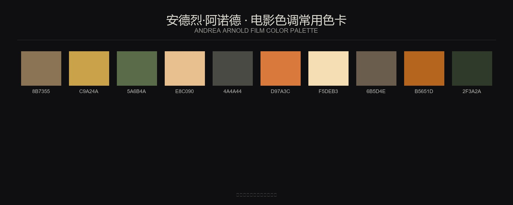
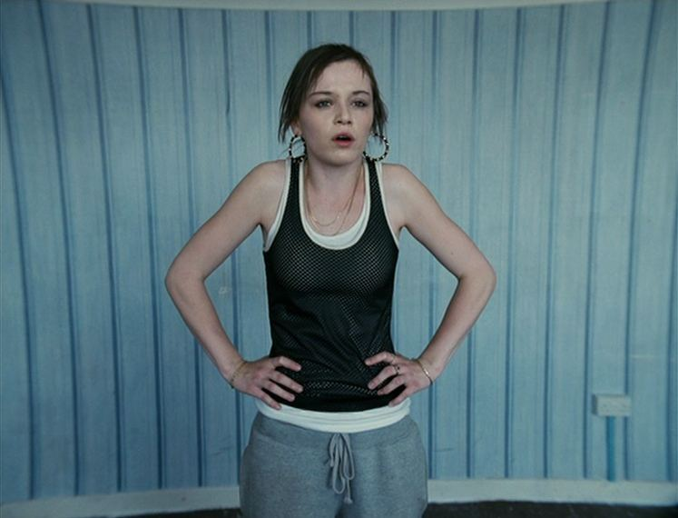
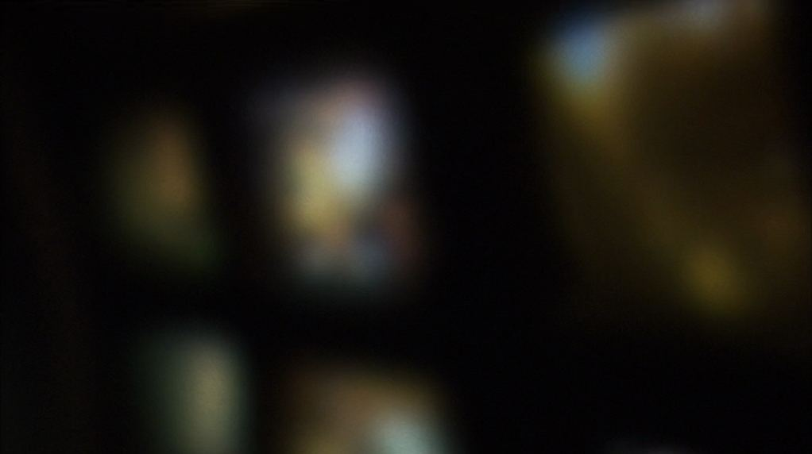
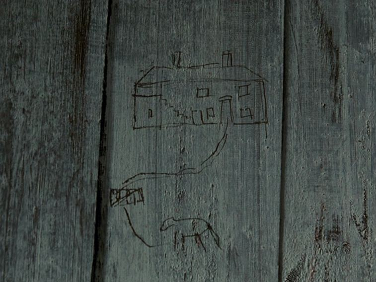

# 导演色卡 #048 — Andrea Arnold 安德烈·阿诺德

> **分类**：03 大地暖调与自然光诗意 | **编号**：048 | **国籍**：英国 | **活跃年代**：2006-至今 | **创建日期**：2026-08-01

---

## 一、核心风格一句话
> 手持自然光与金色黄昏包裹的底层青春，粗粝纪实里渗出亲密诗意。

---

## 二、色板构成

> 横版主色卡

### 主色板（6色）
| 色号 | HEX | 色彩名称 | 占比 | 来源说明 |
|------|-----|---------|------|---------|
| C01 | `#8B7355` | 荒原褐 | 22% | 《呼啸山庄》荒原土地 |
| C02 | `#C9A24A` | 黄昏金 | 18% | 《鱼缸》黄昏时刻 |
| C03 | `#5A6B4A` | 野草绿 | 15% | 《呼啸山庄》荒野草地 |
| C04 | `#E8C090` | 肌肤麦 | 15% | 《美国甜心》女主肤色 |
| C05 | `#4A4A44` | 烟煤灰 | 15% | 《鱼缸》廉租屋阴影 |
| C06 | `#D97A3C` | 落日橙 | 15% | 《美国甜心》公路落日 |

### 情绪色板（4色）
| 色号 | HEX | 色彩名称 | 情绪含义 |
|------|-----|---------|---------|
| E01 | `#F5DEB3` | 暖麦金 | 青春希望 |
| E02 | `#6B5D4E` | 旧木褐 | 困顿压抑 |
| E03 | `#B5651D` | 琥珀火 | 欲望躁动 |
| E04 | `#2F3A2A` | 苔原绿 | 孤独疏离 |

### 光影特征
- **主光方向**：natural daylight, golden hour side light, handheld documentary style
- **高光色偏**：golden amber / warm yellow
- **阴影色偏**：earthy brown-gray, no fill light
- **对比比**：medium 50-65%, soft natural rolloff
- **色调整体**：warm earthy natural, 70% warm + 30% cool

---

## 三、视觉风格关键词
### 构图与运镜
handheld cinéma vérité · golden hour natural light · tight close-up intimacy · aspect ratio 4:3 · shallow depth of field · dirty frame · natural location · unscripted movement
### 色彩与光影
golden hour amber · natural earth tones · moorland heather green · council estate grey · skin tone warmth · overcast soft daylight · firelight orange · wet pavement sheen
### 氛围与情绪
working-class intimacy · raw youth vulnerability · social realism poetry · feral tenderness · british social landscape · transient freedom · quiet desperation · tactile warmth

---

## 四、运镜特征
| 特征 | 说明 | 经典例子 |
|------|------|---------|
| 手持纪实 | 摄影机贴身跟随，呼吸感强烈 | 《鱼缸》米娅奔跑 |
| 4:3画幅 | 窄幅画面压迫人物空间 | 《美国甜心》公路旅途 |
| 极端特写 | 面孔与身体部位大特写 | 《鱼缸》面部表情 |
| 自然光 | 黄金时刻与阴天柔光 | 《呼啸山庄》荒原 |
| 脏构图 | 人物被门框/物体遮挡 | 《美国甜心》车内戏 |
| 浅景深 | 焦点柔化突出情绪 | 《鱼缸》少女特写 |
| 动物隐喻 | 马/鸟/鱼意象贯穿 | 《鱼缸》白马、《呼啸山庄》鸟 |
| 非职业演员 | 真实人物的即兴表演 | 《美国甜心》街头演员 |

---

## 五、经典场景色彩参考
### 电影截图画廊
| 鱼缸 | 美国甜心 | 呼啸山庄 |
|------|--------|---------|
|  |  |  |
| 烟煤灰+黄昏金 · 底层青春 | 落日橙+肌肤麦 · 公路自由 | 荒原褐+野草绿 · 荒野情欲 |

| 红色之路 | 黄蜂 | 牛 |
|----------|------|----|
| *红色之路（剧照未收录）* | *黄蜂（剧照未收录）* | *牛（剧照未收录）* |
| 烟煤灰+苔原绿 · 窥视孤独 | 黄昏金+旧木褐 · 母性挣扎 | 肌肤麦+烟煤灰 · 生命凝视 |

安德烈·阿诺德的摄影机从不评判，只是贴着皮肤呼吸——荒原褐的旷野是她人物永远的背景板，黄昏金在皮肤上镀一层薄薄的希望，野草绿在风里晃动着未被驯化的野性。手持镜头的晃动感像青春期的心跳，4:3画幅把人物紧紧框在命运的窄门里，阳光却总能从缝隙里漏进来。

### 电影色彩速查
| 电影 | 场景 | 主导色 | 色彩氛围 |
|------|------|--------|---------|
| 鱼缸 | 廉租屋黄昏 | 烟煤灰+黄昏金 | 底层青春躁动 |
| 美国甜心 | 公路面包车 | 落日橙+肌肤麦 | 自由与漂泊 |
| 呼啸山庄 | 荒野石屋 | 荒原褐+野草绿 | 原始情欲 |
| 红色之路 | 格拉斯哥监控室 | 烟煤灰+苔原绿 | 窥视与孤独 |
| 黄蜂 | 单亲母亲黄昏 | 黄昏金+旧木褐 | 母性挣扎 |
| 牛 | 奶牛场生命 | 肌肤麦+烟煤灰 | 存在凝视 |
| 犬之力 | 不适用（非阿诺德） | — | — |

---

## 六、AI 生成提示词模板
### 图像生成速用公式
```
[subject description], in the style of Andrea Arnold, british social realism, handheld natural light, golden hour amber glow, earthy color palette, intimate close-up, 4:3 aspect ratio, cinéma vérité documentary feel, working class setting, cinematic film grain --ar 4:3 --style raw
```
### 视频生成速用公式
```
An intimate natural light scene in Andrea Arnold style, handheld cinéma vérité camera, golden hour amber glow, british council estate setting, tight close-up intimacy, raw working class youth, shallow depth of field, unscripted natural movement, earthy color palette
```

---

## 七、代表作索引
| 年份 | 片名 | 主要色彩特征 |
|------|------|-------------|
| 2003 | 黄蜂 | 黄昏金·单亲母亲挣扎 |
| 2006 | 红色之路 | 烟煤灰·窥视与孤独 |
| 2009 | 鱼缸 | 黄昏金+烟煤灰·底层青春 |
| 2011 | 呼啸山庄 | 荒原褐+野草绿·荒野情欲 |
| 2016 | 美国甜心 | 落日橙+肌肤麦·公路漂泊 |
| 2021 | 牛 | 肌肤麦+烟煤灰·生命凝视 |

---

## 八、蒸馏验证
- [x] 色板6+4色已提取
- [x] 运镜特征已归纳（8种）
- [x] 提示词模板已生成（MJ/SD/视频）
- [ ] 电影截图参考图已收集
- [ ] Stable Diffusion 实测试图
- [ ] Runway 视频测试
