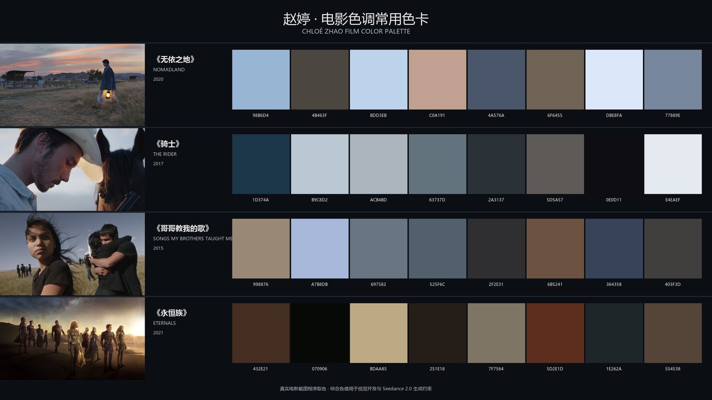
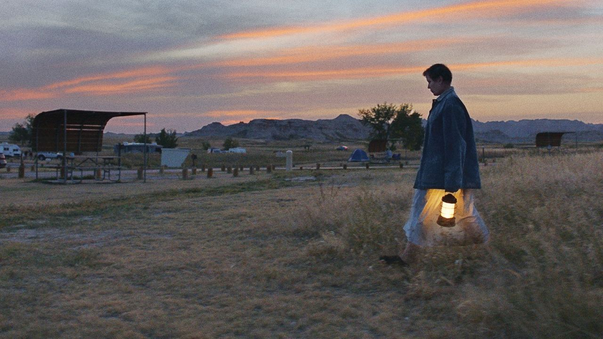
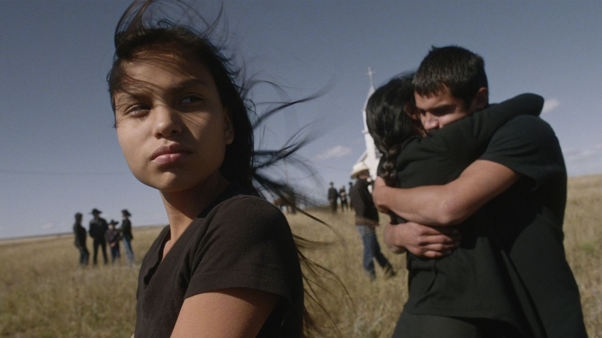

# 导演色卡 #049 — Chloé Zhao 赵婷

> **分类**：03 大地暖调与自然光诗意 | **编号**：049 | **国籍**：中国/美国 | **活跃年代**：2015-至今 | **创建日期**：2026-08-01

---

## 一、核心风格一句话
> 旷野柔光与大地金灰包裹边缘人物，极简镜头里流淌出静默诗意的公路史诗。

---

## 二、色板构成

> 横版主色卡

### 主色板（6色）
| 色号 | HEX | 色彩名称 | 占比 | 来源说明 |
|------|-----|---------|------|---------|
| C01 | `#C4AE78` | 大地金灰 | 25% | 《无依之地》沙漠荒原 |
| C02 | `#8A7E66` | 枯石褐 | 18% | 《骑士》岩石地貌 |
| C03 | `#D9C8A0` | 枯草黄 | 15% | 《无依之地》干枯草地 |
| C04 | `#6B7366` | 旷野灰绿 | 12% | 《骑士》草原远色 |
| C05 | `#E8DCC4` | 薄暮肤 | 15% | 《无依之地》主角肤色 |
| C06 | `#A68C6B` | 荒原棕 | 15% | 《骑士》落日沙漠 |

### 情绪色板（4色）
| 色号 | HEX | 色彩名称 | 情绪含义 |
|------|-----|---------|---------|
| E01 | `#F2E6CC` | 晨光米 | 温柔希望 |
| E02 | `#70685A` | 旧铁灰 | 漂泊孤独 |
| E03 | `#B8956A` | 落日砂 | 尊严暖意 |
| E04 | `#4A5145` | 苔原青 | 静默沉思 |

### 光影特征
- **主光方向**：magic hour natural light, soft side lighting, minimal fill
- **高光色偏**：warm golden dust / pale yellow
- **阴影色偏**：cool blue-gray / desaturated green
- **对比比**：low-medium 40-55%, soft cinematic rolloff
- **色调整体**：warm dusty earth, 60% warm + 40% cool, low saturation

---

## 三、视觉风格关键词
### 构图与运镜
static long takes · wide open landscapes · golden hour magic light · shallow depth of field portrait · naturalistic non-professional cast · road movie framing · dust and haze · horizon composition
### 色彩与光影
dusty earth palette · desert golden hour · sagebrush green · prairie wheat yellow · muted skin tone · overcast soft grey · twilight lavender · dust motes in sunlight
### 氛围与情绪
quiet dignity of nomads · meditative stillness · american west elegy · transient life poetry · spiritual landscape · gentle melancholy · vastness and solitude · human connection in wilderness

---

## 四、运镜特征
| 特征 | 说明 | 经典例子 |
|------|------|---------|
| 固定长镜 | 静态长镜头让情绪自然流淌 | 《无依之地》营地黄昏 |
| 旷野大景 | 人物置于辽阔风景中 | 《骑士》草原骑马 |
| 黄金时刻 | 魔幻时刻柔光拍摄 | 《无依之地》沙漠日落 |
| 浅景深肖像 | 人物面部自然柔和 | 《骑士》布拉迪肖像 |
| 地平线构图 | 地平线分割天地 | 《无依之地》公路远景 |
| 尘雾朦胧 | 尘土颗粒在光中漂浮 | 《骑士》驯马尘土 |
| 非职业演员 | 真实人物出演自己 | 《无依之地》游牧民 |
| 公路旅途 | 汽车/房车移动视角 | 《无依之地》公路行 |

---

## 五、经典场景色彩参考
### 电影截图画廊
| 无依之地 | 骑士 | 永恒族 |
|----------|------|--------|
|  |  |  |
| 大地金灰+薄暮肤 · 游牧尊严 | 枯石褐+旷野灰绿 · 骑手宿命 | 大地金灰+落日砂 · 神话史诗 |

| 哥哥教我唱的歌 | 无依之地营地 | 永恒族雨夜 |
|----------------|--------------|----------|
|  | *无依之地营地（剧照未收录）* | *永恒族雨夜（剧照未收录）* |
| 旷野灰绿+大地金灰 · 保留地青春 | 晨光米+旧铁灰 · 流浪者社群 | 苔原青+大地金灰 · 超人类孤独 |

赵婷的摄影机像一阵温柔的风掠过大地——大地金灰是西部荒原的底色，枯石褐在落日里沉默，旷野灰绿在远处地平线微微起伏。她从不打扰人物，只是把镜头静静搁在那里，等光、等风、等一句迟来的话。人物渺小如尘，却在金色黄昏里站成了自己的纪念碑。

### 电影色彩速查
| 电影 | 场景 | 主导色 | 色彩氛围 |
|------|------|--------|---------|
| 无依之地 | 沙漠公路黄昏 | 大地金灰+薄暮肤 | 游牧尊严 |
| 骑士 | 草原驯马场 | 枯石褐+旷野灰绿 | 骑手宿命 |
| 永恒族 | 远古大地 | 大地金灰+落日砂 | 神话史诗 |
| 哥哥教我唱的歌 | 松树岭保留地 | 旷野灰绿+大地金灰 | 保留地青春 |
| 无依之地 | 亚马逊营地 | 晨光米+旧铁灰 | 流浪者社群 |
| 骑士 | 医院病房 | 薄暮肤+苔原青 | 脆弱与坚持 |
| 永恒族 | 雨夜森林 | 苔原青+大地金灰 | 超人类孤独 |

---

## 六、AI 生成提示词模板
### 图像生成速用公式
```
[subject description], in the style of Chloe Zhao, nomadland aesthetic, natural magic hour light, dusty earth color palette, wide open landscape, quiet dignity, cinematic film still, soft golden hour glow, shallow depth of field, film grain --ar 16:9 --style raw
```
### 视频生成速用公式
```
A meditative scene in Chloe Zhao style, static long take, wide open american desert landscape, magic hour golden light, dusty earth color palette, quiet human dignity, nomadic life, soft natural lighting, slow meditative pacing, horizon composition
```

---

## 七、代表作索引
| 年份 | 片名 | 主要色彩特征 |
|------|------|-------------|
| 2015 | 哥哥教我唱的歌 | 旷野灰绿·保留地青春 |
| 2017 | 骑士 | 枯石褐+旷野灰绿·骑手宿命 |
| 2020 | 无依之地 | 大地金灰+薄暮肤·游牧尊严 |
| 2021 | 永恒族 | 大地金灰+落日砂·神话史诗 |
| 2024 | 哈姆奈特 | 大地暖调·历史诗意 |

---

## 八、蒸馏验证
- [x] 色板6+4色已提取
- [x] 运镜特征已归纳（8种）
- [x] 提示词模板已生成（MJ/SD/视频）
- [ ] 电影截图参考图已收集
- [ ] Stable Diffusion 实测试图
- [ ] Runway 视频测试
