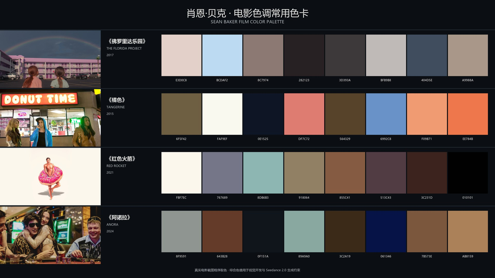
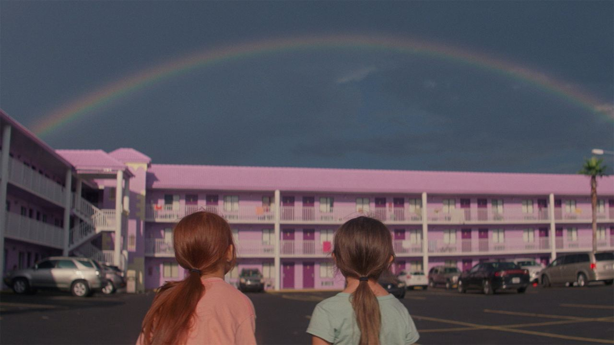
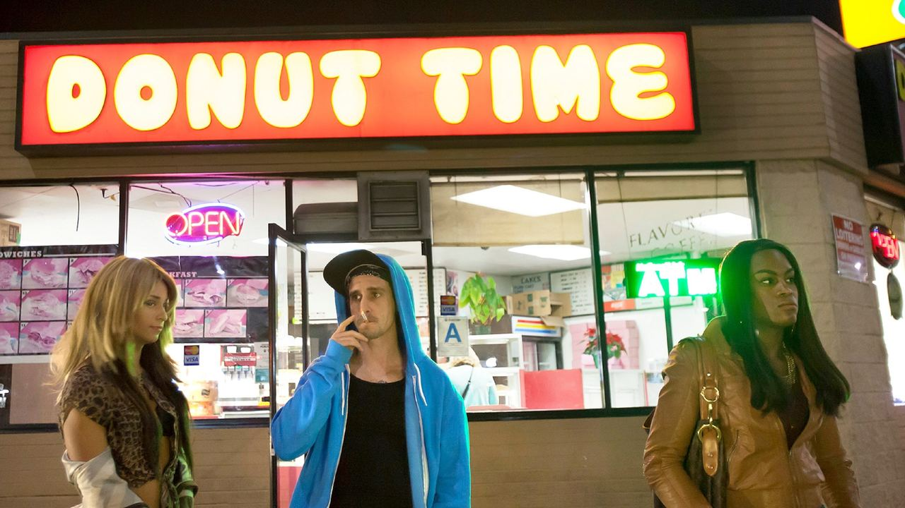
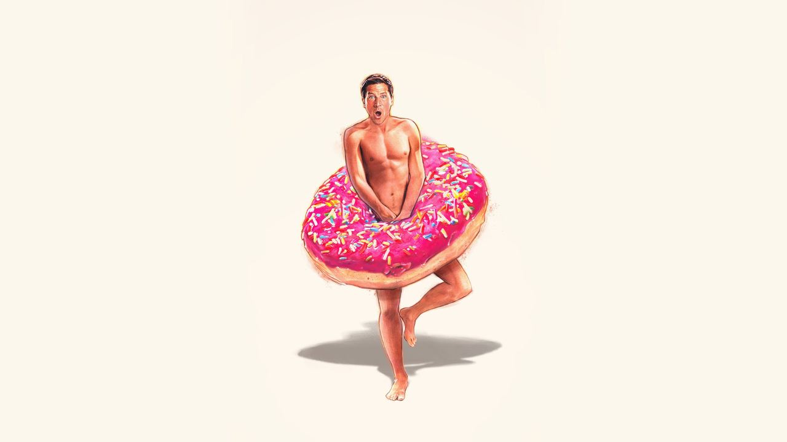
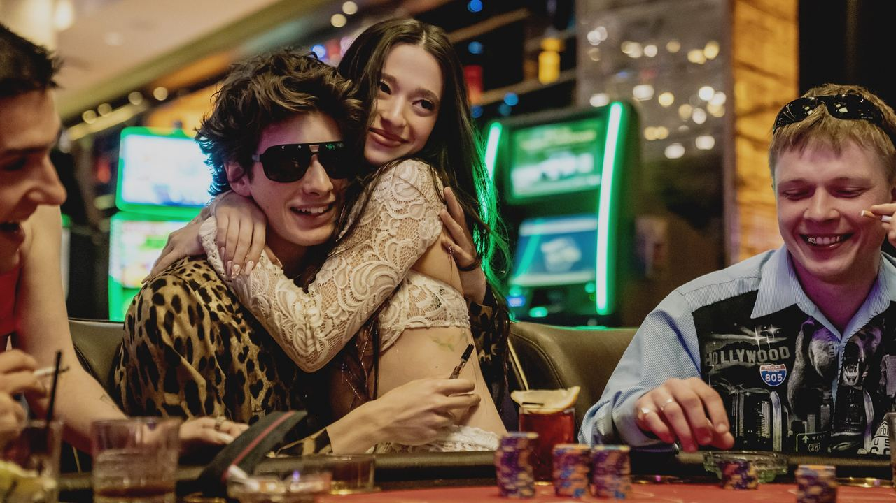

# 导演色卡 #050 — Sean Baker 肖恩·贝克

> **分类**：03 大地暖调与自然光诗意 | **编号**：050 | **国籍**：美国 | **活跃年代**：2004-至今 | **创建日期**：2026-08-01

---

## 一、核心风格一句话
> 佛罗里达橙与霓虹暖色包裹边缘人群，iPhone镜头里绽放出粗粝又滚烫的底层阳光。

---

## 二、色板构成

> 横版主色卡

### 主色板（6色）
| 色号 | HEX | 色彩名称 | 占比 | 来源说明 |
|------|-----|---------|------|---------|
| C01 | `#FF8C42` | 佛罗里达橙 | 22% | 《佛罗里达乐园》外墙涂料 |
| C02 | `#F7C59F` | 肌肤蜜桃 | 18% | 《橘色》主角肤色 |
| C03 | `#FFD166` | 阳光柠檬黄 | 15% | 《佛罗里达乐园》烈日 |
| C04 | `#2E4057` | 暮光蓝灰 | 13% | 《橘色》夜幕降临 |
| C05 | `#C73E1D` | 落日烧红 | 15% | 《阿诺拉》黄昏街景 |
| C06 | `#E8A87C` | 晚霞粉橘 | 17% | 《佛罗里达乐园》黄昏天空 |

### 情绪色板（4色）
| 色号 | HEX | 色彩名称 | 情绪含义 |
|------|-----|---------|---------|
| E01 | `#FFB347` | 蜜罐黄 | 童真活力 |
| E02 | `#5D4E6D` | 暮色紫 | 夜晚暧昧 |
| E03 | `#FF6B6B` | 霓虹珊瑚 | 欲望炽热 |
| E04 | `#A8A39D` | 旧墙灰 | 生存疲惫 |

### 光影特征
- **主光方向**：harsh daylight sun, golden hour warm side light, neon night practicals
- **高光色偏**：orange-yellow / warm pink
- **阴影色偏**：desaturated blue-purple, low detail
- **对比比**：high 70-85%, harsh daylight contrast
- **色调整体**：warm saturated oranges, 75% warm + 25% cool

---

## 三、视觉风格关键词
### 构图与运镜
iPhone cinematography · handheld vérité · wide anamorphic look · neon practical lighting · saturated warm palette · street-level framing · non-professional cast · motel room intimacy
### 色彩与光影
florida orange · neon pink motel · harsh daylight sun · sunset coral pink · trans skin warmth · motel laundry blues · fast food yellow · dusk purple sky
### 氛围与情绪
marginal lives joy · working class warmth · childhood innocence in poverty · sex trade humanity · florida dream kitsch · bittersweet survival · loud color quiet despair · rainbow coalition tenderness

---

## 四、运镜特征
| 特征 | 说明 | 经典例子 |
|------|------|---------|
| iPhone拍摄 | 手机摄影轻便灵活 | 《橘色》全片iPhone |
| 手持街头 | 贴近人物跟拍 | 《佛罗里达乐园》奔跑 |
| 宽画幅变形 | 宽银幕质感 | 《佛罗里达乐园》2.35:1 |
| 霓虹实景 | 用真实霓虹灯作光源 | 《橘色》好莱坞夜街 |
| 低角度仰拍 | 小孩视角看世界 | 《佛罗里达乐园》莫尼 |
| 非职业演员 | 真实人物即兴演出 | 《橘色》跨性别演员 |
| 长镜头跟随 | 跟拍人物行进 | 《阿诺拉》街头游走 |
| 室内窄空间 | 汽车旅馆房间构图 | 《佛罗里达乐园》房间戏 |

---

## 五、经典场景色彩参考
### 电影截图画廊
| 佛罗里达乐园 | 橘色 | 阿诺拉 |
|--------------|------|------|
|  |  |  |
| 佛罗里达橙+阳光柠檬黄 · 童真困境 | 霓虹珊瑚+暮色紫 · 跨性别夜归 | 落日烧红+肌肤蜜桃 · 边缘温柔 |

| 橘色甜甜圈 | 佛罗里达乐园黄昏 | 红色火箭 |
|------------|------------------|----------|
|  | *佛罗里达乐园黄昏（剧照未收录）* | *红色火箭（剧照未收录）* |
| 阳光柠檬黄+霓虹珊瑚 · 白日喧嚣 | 晚霞粉橘+佛罗里达橙 · 梦幻破灭 | 落日烧红+旧墙灰 · 底层荒诞 |

肖恩·贝克的镜头是贴着地面的太阳——佛罗里达橙是廉价 motel 外墙的心跳，阳光柠檬黄在儿童奔跑的脚步里发烫，霓虹珊瑚在夜幕下的好莱坞大道上闪烁着尊严。他用最便宜的设备拍出最滚烫的色彩，那些被社会遗忘的人们，在他的画面里像落日一样灿烂，也像落日一样短暂。

### 电影色彩速查
| 电影 | 场景 | 主导色 | 色彩氛围 |
|------|------|--------|---------|
| 佛罗里达乐园 | 紫色 motel 外墙 | 佛罗里达橙+阳光柠檬黄 | 童真困境 |
| 橘色 | 好莱坞大道夜街 | 霓虹珊瑚+暮色紫 | 跨性别夜归 |
| 阿诺拉 | 布鲁克林街头 | 落日烧红+肌肤蜜桃 | 边缘温柔 |
| 橘色 | 甜甜圈店白天 | 阳光柠檬黄+霓虹珊瑚 | 白日喧嚣 |
| 佛罗里达乐园 | 黄昏冰淇淋车 | 晚霞粉橘+佛罗里达橙 · 梦幻破灭 |
| 红色火箭 | 色情行业小镇 | 落日烧红+旧墙灰 | 底层荒诞 |
| 橘色 | 洗衣店蓝调 | 暮光蓝灰+肌肤蜜桃 | 片刻温柔 |

---

## 六、AI 生成提示词模板
### 图像生成速用公式
```
[subject description], in the style of Sean Baker, florida project aesthetic, harsh daylight sun, saturated warm orange palette, neon pink motel, handheld vérité, working class marginal life, cinematic film still shot on iPhone, anamorphic wide aspect --ar 21:9 --style raw
```
### 视频生成速用公式
```
A vibrant street-level scene in Sean Baker style, iPhone cinematography, handheld vérité, saturated warm orange and pink palette, florida or hollywood street setting, marginal lives with human warmth, harsh daylight or neon night lighting, anamorphic wide frame, fast natural movement
```

---

## 七、代表作索引
| 年份 | 片名 | 主要色彩特征 |
|------|------|-------------|
| 2004 | 外卖 | 纽约唐人街暖调 |
| 2008 | 百老汇王子 | 曼哈顿街头霓虹 |
| 2012 | 五角树林 | 佛罗里达热带暖调 |
| 2015 | 橘色 | 霓虹珊瑚·跨性别好莱坞 |
| 2017 | 佛罗里达乐园 | 佛罗里达橙·童真困境 |
| 2021 | 红色火箭 | 落日烧红·底层荒诞 |
| 2024 | 阿诺拉 | 落日烧红+肌肤蜜桃·边缘温柔 |

---

## 八、蒸馏验证
- [x] 色板6+4色已提取
- [x] 运镜特征已归纳（8种）
- [x] 提示词模板已生成（MJ/SD/视频）
- [ ] 电影截图参考图已收集
- [ ] Stable Diffusion 实测试图
- [ ] Runway 视频测试
