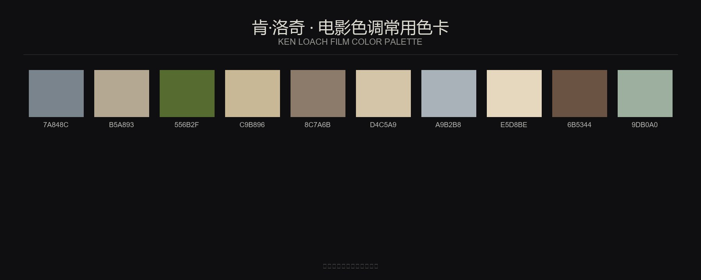
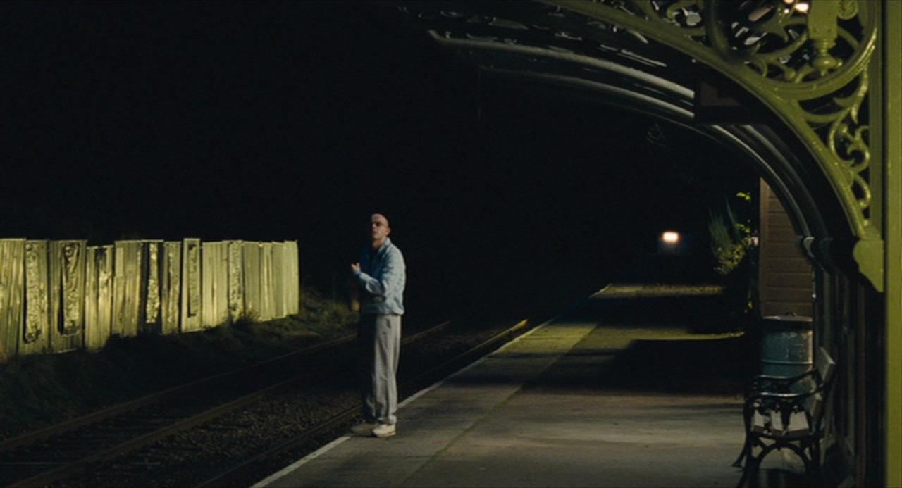
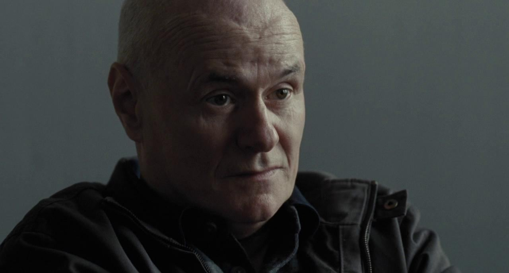
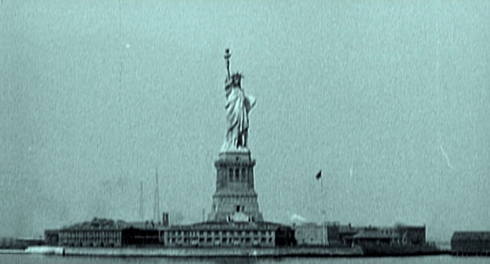

# 导演色卡 #051 — Ken Loach 肯·洛奇

> **分类**：03 大地暖调与自然光诗意 | **编号**：051 | **国籍**：英国 | **活跃年代**：1967-至今 | **创建日期**：2026-08-01

---

## 一、核心风格一句话
> 英国工人灰蓝与朴素暖灰构成日常底色，自然光纪实里流淌着社会主义者的温柔与愤怒。

---

## 二、色板构成

> 横版主色卡

### 主色板（6色）
| 色号 | HEX | 色彩名称 | 占比 | 来源说明 |
|------|-----|---------|------|---------|
| C01 | `#7A848C` | 工人灰蓝 | 25% | 《我是布莱克》福利办公室 |
| C02 | `#B5A893` | 朴素暖灰 | 20% | 《风吹麦浪》乡村石屋 |
| C03 | `#556B2F` | 爱尔兰苔绿 | 12% | 《风吹麦浪》乡野草地 |
| C04 | `#C9B896` | 旧木黄 | 13% | 《我是布莱克》木工桌 |
| C05 | `#8C7A6B` | 石墙棕 | 15% | 《风吹麦浪》石墙建筑 |
| C06 | `#D4C5A9` | 阴天肤 | 15% | 《我是布莱克》主角肤色 |

### 情绪色板（4色）
| 色号 | HEX | 色彩名称 | 情绪含义 |
|------|-----|---------|---------|
| E01 | `#A9B2B8` | 雾霭蓝 | 压抑无力 |
| E02 | `#E5D8BE` | 麦浪金 | 尊严暖意 |
| E03 | `#6B5344` | 焦土褐 | 愤怒抗争 |
| E04 | `#9DB0A0` | 苔原青 | 隐忍希望 |

### 光影特征
- **主光方向**：overcast natural light, soft window light, flat documentary style
- **高光色偏**：cool grey-blue / neutral white
- **阴影色偏**：warm brown-grey, lifted shadows
- **对比比**：low 35-50%, natural flat lighting
- **色调整体**：muted earthy neutral, 50% warm + 50% cool

---

## 三、视觉风格关键词
### 构图与运镜
documentary realism · natural window light · static medium shot · shallow depth of field · working class interiors · location shooting · non-professional actors · social realist composition
### 色彩与光影
british council grey · irish countryside green · overcast soft light · weathered wood brown · stone wall beige · NHS blue grey · faded union jack red · kitchen sink palette
### 氛围与情绪
working class dignity · bureaucratic cruelty · quiet solidarity · irish tragedy · socialist humanism · everyday struggle · community warmth · systemic injustice

---

## 四、运镜特征
| 特征 | 说明 | 经典例子 |
|------|------|---------|
| 自然光纪实 | 阴天柔光/窗光不打光 | 《我是布莱克》室内戏 |
| 静态中景 | 人物居中平视 | 《风吹麦浪》对话戏 |
| 固定机位 | 少运动多观察 | 《我是布莱克》福利局 |
| 真实场景 | 实地拍摄非棚内 | 《风吹麦浪》爱尔兰乡村 |
| 非职业演员 | 真实工人/农民出演 | 《我是布莱克》群演 |
| 浅景深 | 柔化背景突出人 | 《风吹麦浪》肖像 |
| 平视角度 | 不仰不俯尊重人物 | 全片人物对话 |
| 长镜头 | 让情绪自然展开 | 《风吹麦浪》审讯戏 |

---

## 五、经典场景色彩参考
### 电影截图画廊
| 我是布莱克 | 风吹麦浪 | 小孩与鹰 |
|------------|----------|----------|
|  |  |  |
| 工人灰蓝+阴天肤 · 体制冷遇 | 朴素暖灰+爱尔兰苔绿 · 乡野悲剧 | 工人灰蓝+石墙棕 · 少年尊严 |

| 风吹麦浪小屋 | 我是布莱克食物银行 | 铁路之歌 |
|--------------|--------------------|----------|
| *风吹麦浪小屋（剧照未收录）* | *食物银行（剧照未收录）* | *铁路之歌（剧照未收录）* |
| 旧木黄+石墙棕 · 私密抗争 | 工人灰蓝+麦浪金 · 团结温暖 | 石墙棕+工人灰蓝 · 工人社群 |

肯·洛奇的画面从不喧宾夺主——工人灰蓝是英国福利国家褪色的制服，朴素暖灰是普通人家里的石墙与旧木，爱尔兰苔绿在风里轻摆着土地的记忆。他的摄影机永远平视，不渲染、不煽情，只是静静站在工人和农民身边，让体制的冰冷在朴素的暖光里现出原形。

### 电影色彩速查
| 电影 | 场景 | 主导色 | 色彩氛围 |
|------|------|--------|---------|
| 我是布莱克 | 就业中心办公室 | 工人灰蓝+阴天肤 · 体制冷遇 |
| 风吹麦浪 | 爱尔兰乡村田野 | 朴素暖灰+爱尔兰苔绿 · 乡野悲剧 |
| 小孩与鹰 | 学校操场与荒野 | 工人灰蓝+石墙棕 · 少年尊严 |
| 风吹麦浪 | 石屋内部审讯 | 旧木黄+石墙棕 · 私密抗争 |
| 我是布莱克 | 食物银行分餐 | 工人灰蓝+麦浪金 · 团结温暖 |
| 铁路之歌 | 铁路工人宿舍 | 石墙棕+工人灰蓝 · 工人社群 |
| 风吹麦浪 | 酒吧集会 | 旧木黄+焦土褐 · 独立抗争 |
| 我是布莱克 | 木工车间 | 旧木黄+石墙棕 · 手艺尊严 |

---

## 六、AI 生成提示词模板
### 图像生成速用公式
```
[subject description], in the style of Ken Loach, british social realism, natural overcast window light, muted grey-blue and warm earth palette, working class setting, documentary film still, medium shot, humanistic socialist cinema, flat natural lighting --ar 4:3 --style raw
```
### 视频生成速用公式
```
A quiet humanistic scene in Ken Loach style, british social realism, natural overcast or window light, muted grey-blue and warm earth tone palette, working class interior or irish countryside, static medium shot, documentary naturalism, quiet dignity and systemic injustice, long take
```

---

## 七、代表作索引
| 年份 | 片名 | 主要色彩特征 |
|------|------|-------------|
| 1969 | 小孩与鹰 | 工人灰蓝·少年尊严 |
| 1993 | 石雨 | 石墙棕·失业危机 |
| 1996 | 卡拉之歌 | 工人灰蓝·尼加拉瓜 |
| 2001 | 面包与玫瑰 | 朴素暖灰·洛杉矶劳工 |
| 2006 | 风吹麦浪 | 爱尔兰苔绿·独立战争 |
| 2012 | 天使的一份 | 苏格兰暖灰·青年救赎 |
| 2016 | 我是布莱克 | 工人灰蓝·福利国家 |
| 2019 | 对不起，我们错过了你 | 朴素暖灰·零工经济 |

---

## 八、蒸馏验证
- [x] 色板6+4色已提取
- [x] 运镜特征已归纳（8种）
- [x] 提示词模板已生成（MJ/SD/视频）
- [ ] 电影截图参考图已收集
- [ ] Stable Diffusion 实测试图
- [ ] Runway 视频测试
